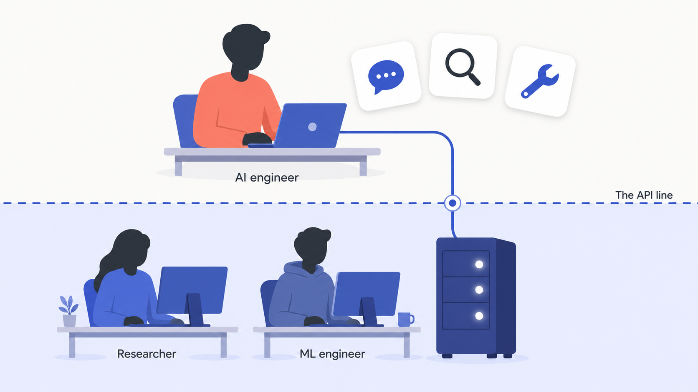

# What an AI engineer is (and isn't)

On June 30, 2023, Shawn Wang (who writes as swyx) published an essay called "The Rise of the AI Engineer" and gave a name to a job that already existed but had no label. His argument was simple. Maybe 5,000 people in the world train frontier models. Around 50 million can write software. The models had just gotten good enough that the second group could build real products on top of the first group's work, without retraining anything. Someone had to fill that gap.

Andrej Karpathy, a founding member of OpenAI, drew the boundary in one sentence: "One can be quite successful in this role without ever training anything."[^1]

You don't need to train a model to be good at building with one.

## The API line

The stack splits into two territories, and the dividing line is the model API.

**Below the line, teams train models.** They gather pretraining data, run GPU clusters, tune loss curves, and publish weights. That's the world of ML engineers, research engineers, and research scientists.

**Above the line, teams use models.** They call an API (or self-host an open-weight model), assemble the context the model sees, wire it to tools, evaluate the output, and ship the result inside a product. That's where you'll work.

swyx called this boundary the API line, and he's careful that it's permeable: an AI engineer sometimes fine-tunes a small model, and a research engineer sometimes builds on top of an API.[^1]

Chip Huyen, whose book *AI Engineering* (O'Reilly, December 2024) is the most complete treatment of the field, draws the same split another way. She calls the right side the "model-as-a-service" approach, a shift that "transformed AI from an esoteric discipline into a powerful development tool that anyone can use."[^2] Her book gives the boundary a whole chapter: "AI Engineering Versus ML Engineering."

The line leaks, but it's still the center of gravity. An AI engineer can be excellent without ever changing a weight. What they own instead: model behavior, the context window, evaluation, and production operation.

*Everything below the line changes model weights; everything above consumes them through an API.*

How much of the work really sits above the line? An analysis of more than 1,000 AI engineer job descriptions from January 2026 found the role overwhelmingly production-focused. Only about 4% list fine-tuning as a primary responsibility, and roughly 81% of postings don't mention fine-tuning at all.[^3] That's one dated study, not a law of nature, but it points the same way the people who named the role did.

## Three roles, one sentence each

| Role | What they own | Iteration speed |
|---|---|---|
| **AI engineer** | Products on top of foundation models: prompts, context, retrieval, agents, evals, serving, cost. | Hours for a prompt, days for retrieval. |
| **ML engineer** | Models and model pipelines they or their team train: training loops, feature stores, retraining. | Weeks to months per retrain. |
| **Researcher** | New architectures, training methods, and capabilities, published as papers and weights. | Months to years per advance. |

Read the table left to right and you see a supply chain. Researchers invent the models. ML engineers operationalize the ones their team trains. AI engineers build products on whatever comes out the other end, through an API.

The boundaries are real where it counts: interview loops, titles, and pay bands all differ. And the cleanest test is one question. Will you change model weights as your main work? If yes, you're an ML engineer. If no, you're an AI engineer.

## Is the role even real?

A fair skeptic pushes back here. Some argue "AI engineer" is title inflation, a new sticker on a full-stack or ML job. One enterprise hiring critique reports that around 75% of candidates fail structured AI engineering assessments, and that companies collapse three different kinds of work into one job description.[^4] The complaint isn't silly. A low barrier to calling an API attracts people who've only ever called an API.

The market answers anyway. LinkedIn ranked "AI engineer" the #1 fastest-growing job title in the US on its Jobs on the Rise 2026 list, reported in January 2026.[^5] Median total compensation for the role was about $245,000 in the US as of Q3 2025, per levels.fyi, one dated data point and not a guarantee.[^6] Companies now run dedicated interview loops for it. Messy title, real job.

## What changes when your dependency is a model

Most of your engineering instincts transfer. [The software baseline](./01-the-software-baseline.md) lists the skills this book assumes you already have.

One instinct doesn't transfer. Your most important dependency is now probabilistic: the same input can return different outputs, and your test suite can't assert exact strings. [Thinking in probabilistic systems](./02-thinking-in-probabilistic-systems.md) follows from that one fact.

There's a matching shift in how you build. This book teaches a ladder that runs from a plain prompt up to fine-tuning, and each rung costs more than the last. Most features never climb past the third rung. [The escalation ladder](./03-the-escalation-ladder.md) is the decision tool you'll reach for weekly.

## What this handbook teaches (and skips)

**It teaches** working with model APIs, prompting, eval-first development, context engineering, retrieval, agents, observability, security, cost engineering, and shipping AI features users can trust. Everything aims at production: real budgets, real failure modes, real users. Fine-tuning is in scope as a last resort; Part 10 covers when it's the right call and, more often, when it isn't.

**It skips** training models from scratch, pretraining infrastructure, and architecture research. Model internals like tokenization and sampling appear only where they show up as a cost, latency, or quality knob you actually turn. Huyen draws the same boundary. swyx put it bluntly: "When it comes to shipping AI products, you want engineers, not researchers."[^1]

The split is also a bet on what lasts. Pretraining knowledge rotates out in months as the frontier moves; the skills for evaluating and operating model-based systems compound.

If you want to *build* models, this is the wrong book, and Huyen's earlier *Designing Machine Learning Systems* is the right one. If you want to **build with** models, professionally, keep reading.

## References

[^1]: swyx (Shawn Wang), "The Rise of the AI Engineer," Latent Space, June 30, 2023. https://www.latent.space/p/ai-engineer
[^2]: Chip Huyen, "AI Engineering: Building Applications with Foundation Models," O'Reilly Media, December 2024. ISBN 9781098166298. https://www.oreilly.com/library/view/ai-engineering/9781098166298/
[^3]: Alexey Grigorev and Valeriia Kuka, "What 1,000+ Job Descriptions Reveal About the AI Engineer Role in 2026," Alexey on Data, March 4, 2026. https://alexeyondata.substack.com/p/what-1000-job-descriptions-reveal
[^4]: Kennith Jackson, "Why hiring 'AI engineers' won't work," CIO.com, April 23, 2026. https://www.cio.com/article/4162080/why-hiring-ai-engineers-wont-work.html
[^5]: LinkedIn News, "LinkedIn Jobs on the Rise 2026: The 25 fastest-growing roles in the U.S.," LinkedIn Pulse, January 7, 2026. https://www.linkedin.com/pulse/linkedin-jobs-rise-2026-25-fastest-growing-roles-us-linkedin-news-dlb1c
[^6]: Alina Kolesnikova, "AI Engineer Compensation Trends Q3 2025," levels.fyi, July 17, 2025. https://www.levels.fyi/blog/ai-engineer-compensation-trends-q3-2025.html
