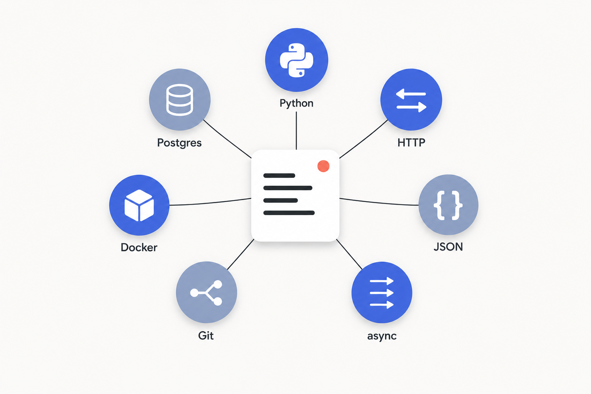

# The software baseline

By the end of Part 0 you'll write one small script: call a model API, retry when it fails, log what the call cost. Sounds trivial.

That script touches seven skills at once: Python for the body, HTTP for the call, JSON to parse the reply, asyncio if you batch calls, Git to commit it, Docker to ship it, and Postgres to store the cost. This book assumes you already have all seven. This chapter is the bar, not the lesson.

[What an AI engineer is (and isn't)](./00-what-an-ai-engineer-is.md) drew the role boundary: you work above the model API line. So the baseline is a working software engineer's toolkit, nothing more. No machine-learning math, no distributed-systems theory, no algorithms depth. Those are the wrong prerequisites for this book, and the sibling handbooks own them where you do want them.


*One ordinary script, seven ordinary skills; if any spoke is missing, the script doesn't ship.*

Treat the seven as an audit, not a syllabus. For each row below, ask one question: could you do that right now, today, without looking it up? If yes, move on. If a row makes you hesitate, open its link, spend a couple of hours, and come back. Don't try to learn all seven at once.

## The seven skills

| Skill | Why it matters here | You should be able to... | Refresh |
|---|---|---|---|
| **Python** | Every SDK in this book (openai, anthropic, httpx, pydantic) is Python. You can't run a single snippet without it. | Write a function that loops over a list, calls something on each item, catches an exception, and returns a dict. `pip install` and import a package. | [Python tutorial](https://docs.python.org/3/tutorial/)[^1] |
| **HTTP / REST** | Every provider exposes a REST API over HTTPS; the SDK is a thin wrapper. Retries, fallbacks, and streaming all hinge on it. | Explain a POST (method, URL, headers, body), say what 200/400/429/500 mean, and use a Bearer token. | [Overview of HTTP](https://developer.mozilla.org/en-US/docs/Web/HTTP/Overview)[^2] |
| **JSON** | It's the wire format of every request and response, every tool-call schema, every eval log and trace. | Read nested keys, parse with `json.loads()`, serialize a dict with `json.dumps()`. | [Working with JSON](https://developer.mozilla.org/en-US/docs/Learn_web_development/Core/Scripting/JSON)[^3] |
| **Async (asyncio)** | Model calls are slow network I/O. Agents fan out tool calls and evals fan out prompts; you await them together, not one at a time. | Define an `async def`, `await` it, and run many coroutines with `asyncio.gather()`. | [asyncio docs](https://docs.python.org/3/library/asyncio.html)[^4] |
| **Git** | Prompt changes are code changes. Part 3 versions prompt templates as commits and reviews them in pull requests. | Clone, branch, commit with a real message, push, open a PR, and resolve a simple merge conflict. | [Pro Git](https://git-scm.com/book/en/v2)[^5] |
| **Docker** | Production AI ships as a containerized service with a real URL, not a notebook. Inference servers, eval runners, and agent backends all ship as containers. | Write a Dockerfile for a Python service, `docker run` it, and bring up a service plus Postgres with Docker Compose. | [Docker get started](https://docs.docker.com/get-started/)[^6] |
| **SQL / Postgres** | Postgres is the default store for three jobs: pgvector for retrieval, eval logs, and chat history. | Write SELECT, INSERT, UPDATE, DELETE, know what a primary key and an index are, and connect to a local Postgres. | [PostgreSQL tutorial](https://www.postgresql.org/docs/current/tutorial.html)[^7] |

A note on versions while you check your setup. The book uses Python 3.10+ syntax, so confirm `python --version` reads 3.12 or newer before you start; 3.8 will throw syntax errors. The linked Python and asyncio docs track 3.14.6 as of June 2026, and the Postgres tutorial tracks 18.4.

> [!WARNING]
> **JSON and JSON Schema are not the same thing, and Part 2 uses both.** JSON is the data format in the row above. JSON Schema is a separate spec that describes the *shape* a valid JSON object must have, and it's how tool calls and structured outputs are defined. If "write a JSON Schema for your tool" sounds confusing, that gap is why. The format is the one-hour read linked above; the schema spec is introduced in context when you reach it.

## The one idiom worth recognizing now

The async self-check says you can gather coroutines. Here's the exact shape, the one you'll hit in Part 2 for parallel model calls and Part 7 for parallel tool calls.

```python
# illustrative: the fan-out idiom, not a runnable demo
import asyncio

async def call_model(prompt: str) -> str:
    await asyncio.sleep(0)            # stands in for a real async SDK call
    return f"response to: {prompt}"

async def main() -> None:
    prompts = ["summarize A", "summarize B", "summarize C"]
    results = await asyncio.gather(*[call_model(p) for p in prompts])
    print(results)

asyncio.run(main())
```

Read `gather(*[f(item) for item in items])` as one move: fire every call at once, wait for all of them, collect the results in order. If that line reads cleanly, you're ready. If it looks foreign, spend an hour on the asyncio link before Part 2.

The payoff isn't cosmetic. Evaluating 50 prompts in a sequential `for` loop at three seconds each costs you 150 seconds. The same 50 calls through `gather` finish in roughly the time of the slowest single call, often under ten seconds. That's a 15x difference on the first eval script you write, which is why async sits on this list and not in an appendix.

## What stays off the list

This is the floor, not the ceiling. Three topics show up at scale later, and each lives in a sibling handbook:

- **HTTP at scale** (load balancing, connection pooling, HTTP/2 multiplexing) is covered in the HLD handbook. You need the request/response model; you don't need the scaling theory yet.
- **Databases at scale** (replication, partitioning, sharding) is also HLD territory. The bar here is only "can you use Postgres at all."
- **Algorithms and data structures** aren't on the list at all. If you want that depth, the DSA handbook is where it lives. AI engineering doesn't gate on it.

Container orchestration sits in the same bucket: local Docker and Docker Compose are the bar, and Kubernetes or ECS gets one sentence and a cross-link when you reach deployment.

Everything after this chapter assumes the seven are in place and stops explaining them.

## References

[^1]: Python Software Foundation, "The Python Tutorial," Python 3.14.6 documentation, https://docs.python.org/3/tutorial/
[^2]: MDN Web Docs contributors, "Overview of HTTP," Mozilla Developer Network, https://developer.mozilla.org/en-US/docs/Web/HTTP/Overview
[^3]: MDN Web Docs contributors, "Working with JSON," Mozilla Developer Network, https://developer.mozilla.org/en-US/docs/Learn_web_development/Core/Scripting/JSON
[^4]: Python Software Foundation, "asyncio - Asynchronous I/O," Python 3.14.6 standard library docs, https://docs.python.org/3/library/asyncio.html
[^5]: Scott Chacon and Ben Straub, "Pro Git," 2nd edition, Apress, licensed CC BY-NC-SA 3.0, https://git-scm.com/book/en/v2
[^6]: Docker Inc., "Get started," Docker official documentation, https://docs.docker.com/get-started/
[^7]: PostgreSQL Global Development Group, "Part I. Tutorial," PostgreSQL 18.4 documentation, https://www.postgresql.org/docs/current/tutorial.html
