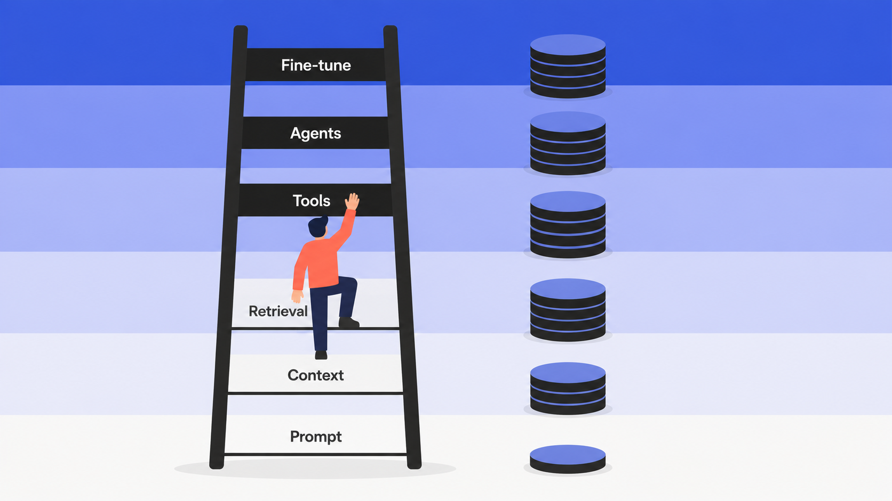
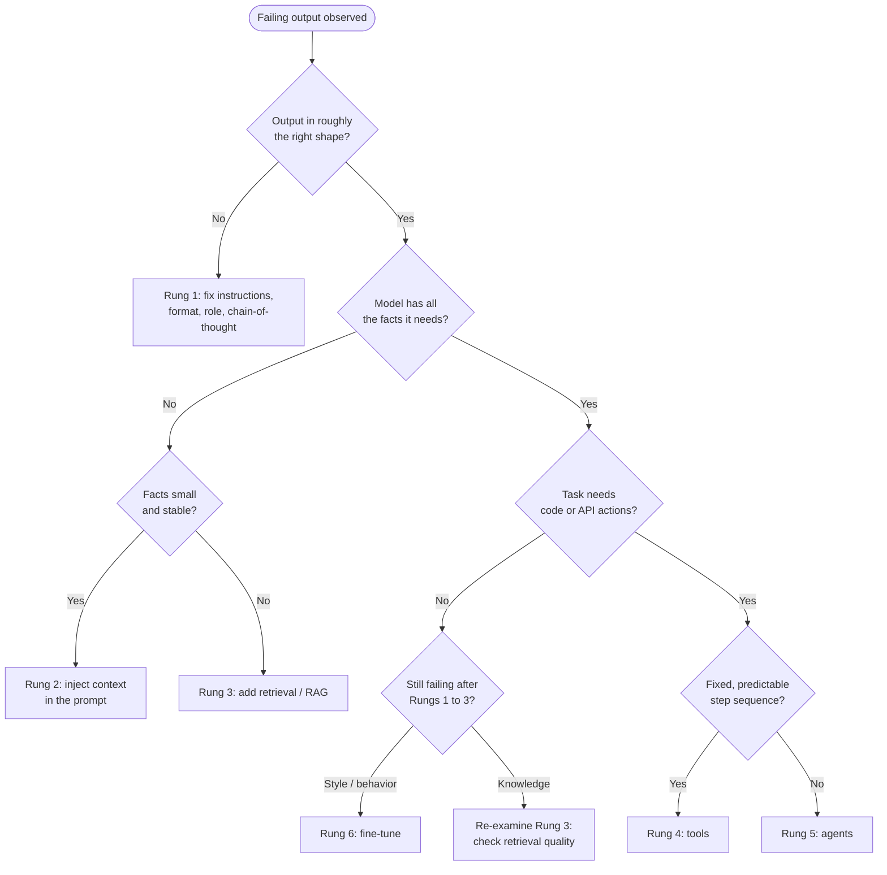

# The escalation ladder

Your support bot just gave a customer the wrong refund policy. You have six ways to fix it. You could rewrite the prompt. You could paste the policy doc into the system message. You could build a retrieval pipeline over your whole knowledge base. You could give the model a tool that queries the live policy API. You could turn it into an agent that plans and checks its own work. Or you could fine-tune a custom model on thousands of labeled examples.

Those six options aren't equal. The first is free and takes an afternoon. The last costs real money, weeks of work, and a permanent maintenance bill. Yet teams reach for the expensive one first, because fine-tuning and multi-agent systems sound like the serious, sophisticated answer.

They're almost never the right first move. One rule keeps you from over-building, and the whole book is organized around it.

## The rule

> Start with the simplest thing that works. Optimize it with evaluation. Add complexity only when simpler solutions demonstrably fall short.

That's Anthropic's framing from *Building Effective Agents*, and it's the spine of everything that follows.[^1] The six fixes form a ladder. Each rung up buys more capability and costs more in latency, dollars, complexity, and failure surface. Your job is to climb the cheapest rung that solves the problem, and to stop there.

The six rungs, lowest to highest:

| Rung | Technique | What it fixes | Signal you must climb higher |
|---|---|---|---|
| 1 | **Prompt engineering** | The model doesn't know what you want: vague task, wrong format, bad reasoning strategy | Failure persists after clear instructions, an output schema, 3 to 5 examples, and negative examples |
| 2 | **Context engineering** | The model lacks the specific facts for this request, but the facts are small and stable | The reference material is too large for the window, or it changes faster than you can redeploy |
| 3 | **Retrieval (RAG)** | Knowledge is large or dynamic and must be fetched and injected per query | Retrieval quality is good, but the task needs live actions or code, not reading alone |
| 4 | **Tools** | The task needs actions text can't do: live lookups, exact math, writing to systems | One call isn't enough; the next call depends on the last and the sequence can't be fixed |
| 5 | **Agents** | The task is open-ended; steps depend on what intermediate results reveal | The base model's weights, not its tools or context, are the ceiling on quality |
| 6 | **Fine-tuning** | A style or behavior the model can't hold consistently despite exhaustive prompting | (top of the ladder) |

Each rung is taught in full later: prompting in Part 3, context engineering in Part 5, retrieval in Part 6, tools and agents in Part 7, fine-tuning in Part 10.

The cost gradient is steep. Rung 1 adds no API cost at all, just your time. Rung 2 adds tokens. Rung 3 adds an embedding pipeline, a vector database, and a retrieval round-trip on every request. Rung 5 multiplies your LLM calls by the number of steps the agent takes, and Anthropic is blunt about the trade: "the autonomous nature of agents means higher costs, and the potential for compounding errors."[^1] Rung 6 is the most expensive of all, because a fine-tuned model isn't a one-time spend. Every base-model update means re-training, and your training data becomes a versioned artifact you own forever.

*Capability and cost both climb with every rung; most production features never pass the third.*

## The weekly heuristic

The ladder earns its keep when an output fails in production and you have to decide what to do by Friday. Diagnose the failure type first; the failure type tells you the rung.

*Run this tree every time an output fails; start at the top and stop at the first rung that can fix the problem.*

A wrong format or a bad reasoning strategy is a prompt problem. A confident but factually wrong answer is usually a knowledge problem, which means context or retrieval. A request for something that lives outside the model, like today's exchange rate or a write to your database, is a tools problem. A genuinely multi-step task whose path you can't draw in advance is an agent problem. And a style the model keeps drifting from no matter how you prompt it is the one case that points at fine-tuning.

### The oracle test

The trickiest fork is telling a knowledge failure from a behavior failure, because both look identical: a confident, wrong answer. A one-minute diagnostic settles it.

Paste the correct answer, or the document that contains it, straight into the context, and ask again.

- **The model now gets it right.** Your problem was missing knowledge. Fix it with context (Rung 2) or retrieval (Rung 3). Don't fine-tune.
- **The model still fails.** The problem is behavior, not knowledge, and you have a real candidate for fine-tuning.

This single check stops the most expensive mistake on the ladder: fine-tuning a model to teach it facts it could've simply been handed.

## Why "more rungs" isn't "better"

OpenAI ran a clean experiment on an Icelandic text-correction task and scored each rung with BLEU, a standard translation-quality metric.[^2] Zero-shot GPT-4 scored 62. Adding three few-shot examples, a pure Rung 1 move, lifted it to 70. Fine-tuning GPT-4 on 1,000 examples reached 87, the peak. So far the ladder behaves as you'd expect: each escalation helped.

Then they stacked one more rung. They added retrieval on top of the fine-tuned model, and the score dropped to 83.[^2] The extra rung made the system worse, because the task's bottleneck was behavior, and the retrieved examples just added noise. Climbing past the rung that fixed your problem doesn't buy insurance; it buys cost, latency, and new ways to fail.

Premature escalation happens for three reasons. Teams misdiagnose a Rung 1 instruction gap as a Rung 6 training-data gap. They build the most capable system they can imagine instead of the simplest one that meets the bar. And, honestly, agents and fine-tuning look better on a resume than a well-written prompt.[^4] Anthropic names the cost plainly: extra layers "obscure the underlying prompts and responses, making them harder to debug."[^1]

### When skipping rungs is correct

The ladder is a default, not dogma. Some failures are decided at design time, and starting higher is the right call:

- **Hard format requirements.** A booking system that writes to a database can't ship free-text. Structured outputs or function calling (Rung 4) is the minimum viable architecture, not an escalation.
- **A known, large knowledge gap.** If you're building a bot over a 10,000-page internal wiki, you know on day one the corpus will never fit a system prompt. Start at retrieval (Rung 3); trying Rung 2 first would fail immediately and obviously.
- **Genuinely multi-step tasks.** A coding agent resolving a GitHub issue can't work as a single call. Anthropic's own SWE-bench coding agent is exactly this case.[^1]

The honest version of the disagreement comes from Hamel Husain: the deepest reason to prompt-engineer first isn't that prompting always wins. It's that prompting forces you to build the eval harness, and you can't judge any higher rung without one.[^3] Once the harness exists, fine-tuning becomes a measurable choice instead of a guess.

So the rule survives the exceptions. Skip a rung only when a hard requirement provably rules out everything below it. Otherwise, start at the bottom.

> [!WARNING]
> **Escalating without an eval harness is flying blind.** If you can't state the failure rate before and after a change, you can't tell whether retrieval or fine-tuning helped, hurt, or did nothing. Build a labeled test set of 20 to 50 examples at Rung 1 and carry it to every rung after. Part 4 (Evals) is the prerequisite that makes the whole ladder work; read it before you escalate anything in production.

Let evaluation, not vibes, tell you when a rung is spent.

## References

[^1]: Anthropic, "Building Effective Agents", December 19, 2024. https://www.anthropic.com/engineering/building-effective-agents
[^2]: OpenAI, "Optimizing LLM Accuracy", platform.openai.com (as of June 2026). https://platform.openai.com/docs/guides/optimizing-llm-accuracy
[^3]: Hamel Husain, "Is Fine-Tuning Still Valuable?", March 27, 2024. https://hamel.dev/blog/posts/fine_tuning_valuable.html
[^4]: "Resume-driven development" is a community-documented social dynamic in practitioner discourse, not a single published study; named here because it is a real and common cause of premature escalation.
