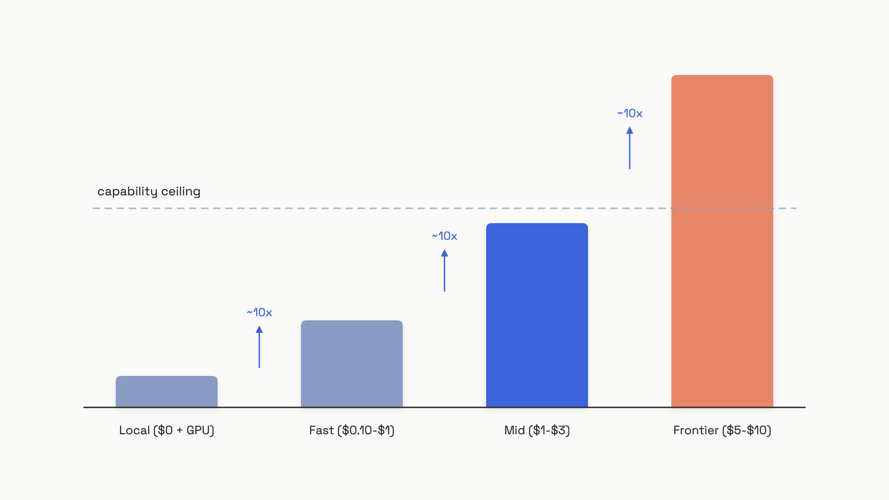

# The model landscape

"Best model" and "right model for my task" are not the same sentence. The first picks the top of a benchmark. The second weighs a cost difference that runs about 100x from the cheapest hosted model to the most expensive one, against a capability gap that, on some benchmarks, has shrunk to under 3 points.[^1] Get those two confused and you'll pay frontier prices for work a model a tenth the cost would have done fine.

So the first skill isn't picking a model. It's placing any model you hear about into a tier, and knowing what that tier is for. There are four.

## The four tiers

Run the same request through three Claude models and watch the bill change by 10x while the wording barely shifts:

```python
# Prices as of June 2026. Sources: anthropic.com/pricing
PRICE_PER_MTOK = {
    "claude-fable-5":    {"in": 10.00, "out": 50.00},  # frontier
    "claude-sonnet-4-6": {"in":  3.00, "out": 15.00},  # mid
    "claude-haiku-4-5":  {"in":  1.00, "out":  5.00},  # fast
}

def cost(model: str, in_tok: int, out_tok: int) -> float:
    p = PRICE_PER_MTOK[model]
    return (in_tok * p["in"] + out_tok * p["out"]) / 1_000_000

# A 2,000-token prompt, 500-token answer:
# claude-haiku-4-5    -> $0.0045
# claude-sonnet-4-6   -> $0.0135
# claude-fable-5      -> $0.0450
```

Three models from one provider, same request, 10x spread. Stretch that across the whole market and the ladder has four rungs.

**Frontier** is the top of each lab's lineup: the highest scores, the highest price, hosted only. As of June 2026 that's Claude Fable 5 ($10 input / $50 output per million tokens), OpenAI's GPT-5.5 ($5 / $30), and Google's Gemini 3.1 Pro ($2 input / $12 output, in preview).[^1][^2][^3] You reach for these when a quality failure is expensive, legal review, hard code generation, high-stakes customer work, or when the task genuinely needs deep multi-step reasoning.

**Mid** trades a sliver of capability for a much smaller bill. Claude Sonnet 4.6 ($3 / $15), GPT-5.4 ($2.50 / $15), and Gemini 2.5 Pro ($1.25 / $10) live here.[^1][^2][^3] These are the workhorse tier, and your default for any new feature. Don't read "mid" as "mediocre": today's Sonnet 4.6 beats the frontier models of 18 months ago, and on MMMU-Pro the four leading frontier models sit within 3 points of each other as of April 2026.[^4]

**Fast** trades real capability for speed and cost. These are smaller models, not frontier models turned down. Claude Haiku 4.5 ($1 / $5), GPT-5.4 mini ($0.75 / $4.50), and Gemini 2.5 Flash ($0.30 / $2.50) sit here, with Gemini 2.5 Flash-Lite at the floor: $0.10 input per million tokens.[^1][^2][^3] Anthropic calls Haiku 4.5 its "fastest model with near-frontier intelligence."[^1] Use this tier for classification, intent detection, short summaries, simple extraction, and routing inside an agent. The catch comes later.

**Local** means open-weight: the lab publishes the actual weights as downloadable files, and you run them on your own GPUs. Llama 4 Scout and Maverick, Gemma 4, Qwen 3, DeepSeek V4. No per-token bill. Instead you own the hardware, the serving stack, and the on-call pager.


*Each tier costs roughly 10x the one below, while the capability gap between them stays small. That asymmetry is the whole argument for starting cheap.*

The cost ladder climbs roughly 10x per rung. The capability ladder barely climbs at all. That gap is why you start at mid-tier and only escalate when a measurement, not a hunch, shows the gap matters for your specific task. A later chapter, [The cost-quality-latency triangle](./05-the-cost-quality-latency-triangle.md), turns this asymmetry into the recurring mental model you'll use for every model decision; this chapter just plants the tiers.

## Open-weight vs hosted: an operational choice, not a moral one

The split between the first three tiers and the fourth is about who runs the GPU.

- **Hosted** models live behind an API. You send tokens, you get tokens, you pay per token, and the provider owns every server, upgrade, and outage. Zero infrastructure work.
- **Open-weight** models are files you download and serve yourself, usually with [vLLM](https://docs.vllm.ai/) for production or Ollama for local development. No per-token charge, full control of where your data sits.

The temptation is to call open-weight "free." It isn't. The per-token cost is zero, but GPUs, networking, serving infrastructure, model-update cadence, and on-call time are all real, and a GPU running at 40% utilization quietly doubles your effective cost per token. The crossover against a budget API like Gemini 2.5 Flash-Lite at $0.10 per million input tokens doesn't arrive until you're pushing billions of tokens a month.[^5] Open-weight models also trail frontier on most benchmarks by roughly 3 to 6 months as of mid-2026.[^5]

> [!WARNING]
> **"Open-weight" does not mean "cheap by default."** If you do go open-weight, rent before you buy: run the model through a hosted inference provider before committing to your own GPUs. The price for *identical* weights varies wildly by host. One 2026 survey put Llama 3.3 70B between $0.12 and $1.05 per million input tokens across providers, about a 9x spread, as of June 2026.[^6] Treat that figure as directional, not gospel; it rests on a single source. Still, the lesson holds: benchmark at least three providers, because for open-weight models the host, not the model, drives most of the cost.

So the real decision is operational, not ethical. Pick hosted unless one of three things is true:

1. **Data can't leave your walls.** Healthcare, finance, and government data under HIPAA, GDPR, or internal governance often can't go to a third-party API at all.
2. **Volume is enormous.** Past roughly 5 billion tokens a month on a well-utilized cluster, the hosting arithmetic can flip in open-weight's favor.
3. **You must fine-tune on data that can't leave.** Proprietary training data that can't go to a provider forces local.

Absent one of those, hosted wins on every axis a small team cares about.

## Chat, reasoning, multimodal: three model types, not three tiers

Tier is about cost and capability. Type is a separate axis, and conflating the two is a common beginner mistake. All three types run on the same transformer; what differs is the training objective and how the model behaves at inference.

| Type | What it does | Use it for | Avoid it for |
|---|---|---|---|
| **Chat** | Generates the answer directly | Most tasks; the default | Nothing; it's the baseline |
| **Reasoning** | Thinks step by step before answering | Math, code, multi-step logic | Real-time, simple, latency-sensitive work |
| **Multimodal** | Accepts images, audio, or video too | Tasks where the input isn't text | Text-only work (it adds cost) |

A **chat model** is the default: you send a prompt, it writes a reply. A **reasoning model** generates a hidden chain of thought before its final answer, which measurably lifts accuracy on hard problems. OpenAI's o3 solved 25% of the Frontier Math benchmark where no prior model cleared 2%.[^7] Claude Sonnet 4.6 even decides for itself when to think, rather than making you set a budget. But that thinking isn't free, in tokens or in time. A later chapter, [Reasoning models](./04-reasoning-models.md), covers the test-time-compute mechanism, the hidden token cost, and the precise rule for when thinking earns its keep.

The cost of getting reasoning wrong is concrete. One support team switched reasoning on for every request and watched p99 latency jump from 2.4 seconds to 41 seconds; they rolled it back within hours.[^8] Reasoning is for STEM problems with verifiable answers, multi-step code review, and anything where a competent human would pause before answering. It's wrong for customer support, classification, and real-time voice.

**Multimodal** models accept non-text input. As of June 2026, image input is standard across every frontier and mid-tier model; native audio and video are available on Gemini 3.x and on GPT-5.5 through its Realtime API.[^2][^3] Images cost tokens too. A 512x512 image runs about 210 tokens in GPT models, so process only the modalities the task actually needs.[^2] For audio, transcribe to text first and feed text to the model, unless you genuinely need real-time voice.

## Putting it together

You now have the whole map. Place any model by asking two questions: which tier (frontier, mid, fast, local) and which type (chat, reasoning, multimodal). Claude Haiku 4.5 is a fast hosted chat model. Llama 4 Scout is a local multimodal chat model. Gemini 2.5 Pro is a mid-tier hosted model that can reason on demand.

Three defaults flow from the map, and each holds until a measurement overturns it:

- **Start mid-tier.** Escalate to frontier only when an eval on your own task shows a quality gap worth the price. Run both models against a 100-example set; if the delta is under 5%, stay mid.
- **Start hosted.** Go open-weight only for data residency, extreme volume, or fine-tuning that can't leave your walls.
- **Start with chat.** Turn on reasoning only for hard, verifiable, non-real-time tasks; reach for multimodal only when the input isn't text.

One last hazard worth pinning now, because it bites in production: every price and model name above carries an "as of June 2026" tag for a reason. This list will be stale within a year, so verify current pricing in the provider docs before you bake a model choice into your architecture. And pin specific model IDs in production code (`claude-haiku-4-5`, not a drifting alias), so a provider's silent update can't change your behavior overnight.[^1] These numbers are also your starting point for the benchmark you'll build at the end of this part: cost versus quality across two or three models on one real task.

## References

[^1]: Anthropic, "Models overview" and API pricing, platform.claude.com and claude.com/pricing, fetched June 12, 2026. https://platform.claude.com/docs/en/about-claude/models/overview
[^2]: OpenAI, "API Pricing", fetched June 12, 2026. https://openai.com/api/pricing/
[^3]: Google, "Gemini Developer API pricing", last updated June 9, 2026. https://ai.google.dev/gemini-api/docs/pricing
[^4]: digitalapplied.com, "Multimodal AI Benchmarks 2026", April 2026. https://www.digitalapplied.com/blog/multimodal-ai-benchmarks-2026-vision-audio-code
[^5]: digitalapplied.com, "Self-Hosting Open-Weight LLMs", May 2026. https://www.digitalapplied.com/blog/self-hosting-open-weight-llms-2026-deployment-decision-guide
[^6]: saturncloud.io, "Inference Provider Comparison Report", May 2026 (single source; figure is directional). https://saturncloud.io/reports/inference-provider-comparison-report/
[^7]: tianpan.co, "Reasoning Models: When to Use Them and When Not To", October 2025. https://tianpan.co/blog/2025-10-10-reasoning-models-in-production
[^8]: kindatechnical.com, "When to Use Extended Thinking and When Not To", 2025-2026. https://www.kindatechnical.com/claude-ai/when-to-use-extended-thinking-and-when-not-to.html
