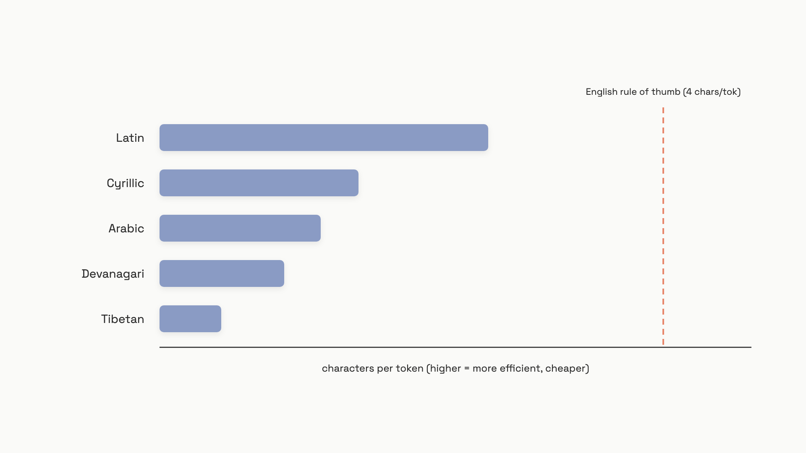
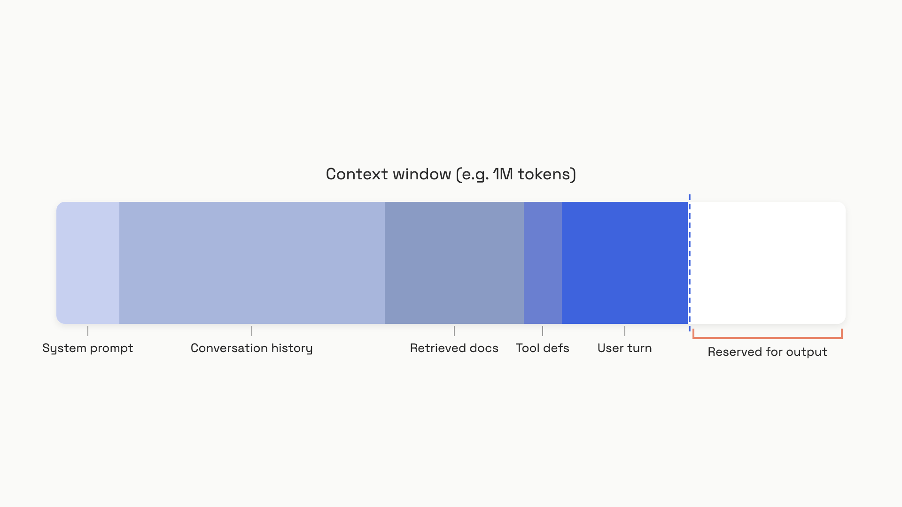

# Tokens and context windows

Run this before you read another paragraph:

```python
# needs: pip install tiktoken
import tiktoken

def count_tokens(text: str, model: str = "gpt-4o") -> int:
    enc = tiktoken.encoding_for_model(model)
    return len(enc.encode(text))

english = "Hello, how are you today?"
japanese = "こんにちは、今日はお元気ですか？"

print(count_tokens(english))   # 7 tokens, 25 characters
print(count_tokens(japanese))  # far more tokens, far fewer characters
```

Two greetings that mean the same thing. The model doesn't see the letters. It sees a list of integers, and the Japanese line resolves to more integers than the English one. You pay per integer. So the same sentence, in a different script, costs you more money and eats more of your fixed budget, before you have changed a single word of your prompt.

That's the whole reason to care about tokens. Price, context limits, rate limits, and latency all count tokens, not words or characters. An engineer who eyeballs character length to guess cost will be wrong, sometimes by 4x, and won't find out until the API returns an error or the invoice arrives.

## A token is a chunk of text, not a word

Before any model reads your prompt, a tokenizer splits the string into pieces and maps each piece to an integer ID from a fixed vocabulary. The model works on those integers and emits new integers; a second pass turns them back into text.

The dominant method is **Byte Pair Encoding** (BPE), used by OpenAI, Anthropic, and most providers as of June 2026.[^1] You don't need the training-time details. You need three facts:

- **Common words are one token.** "hello", "return", and "function" each map to a single integer because they were frequent in the training corpus.
- **Rare words split into pieces.** OpenAI's own example: `"tiktoken is great!"` becomes six tokens, `['t', 'ik', 'token', ' is', ' great', '!']`.[^2] The word "tiktoken" was rare, so it fractures.
- **The split is deterministic and model-specific.** The same text under the same encoding always yields the same IDs. But a different model can use a different vocabulary, so the count changes.

Two quirks bite people. A leading space joins the next word, so `" is"` is one token, not two. And capitalization matters: `" red"` mid-sentence and `"Red"` at a sentence start are different tokens with different IDs.[^3]

For plain English prose, OpenAI publishes a rule of thumb: roughly 4 characters per token, or about 0.75 words per token.[^3] Useful for a rough guess. Useless the moment you leave English prose, hit code, or paste a URL. Treat it as a sanity check, never a guard.

## Non-Latin scripts cost more, and the gap is large

BPE vocabularies are built from corpora dominated by English. Common English chunks become single tokens. Scripts that were rarer in training get chopped into small subword pieces or individual bytes, so the same meaning takes more tokens.

A 2025 study measured this across 200+ languages with tiktoken's `cl100k_base` encoding, using characters per token (higher means more efficient).[^4]


*The same encoding packs over five times more characters into a token for Latin script than for Tibetan; non-Latin users spend their token budget faster.*

The practical effect is direct. The worst script in that study, Myanmar, packs about 7x more tokens into a sentence than Latin script.[^4] A separate 2023 analysis across 22 languages put it plainly: speakers of many non-English languages are "overcharged while obtaining poorer results."[^5]

So a 1,000-token English paragraph can run 2,000 to 4,000 tokens in Hindi. If your product serves Japanese, Arabic, or Hindi users on the same character budget you sized for English, those users will hit truncation and context errors that English users never see.

The rule: **count real tokens for your target script.** The English 4-chars heuristic underestimates for everything else. Apply a script multiplier of roughly 1.5x to 7x to any English-derived estimate, and confirm it against actual user queries before you commit to a context design. A flat 2x isn't safe; it still undershoots Myanmar, Tibetan, and Dravidian scripts.

## Count tokens in Python before you send

There's one method per provider, and they aren't interchangeable.

**OpenAI: tiktoken, local and free.** It runs on your machine, needs no API call, and returns exact counts. Use `encoding_for_model(model)`, not a hard-coded encoding name, because the encoding differs across model families. GPT-4o and newer use `o200k_base` (200k vocabulary); GPT-4 and GPT-3.5 use `cl100k_base` (100k vocabulary).[^2] The `count_tokens` function at the top of this chapter is the whole pattern.

**Anthropic: the count_tokens endpoint.** tiktoken doesn't model Anthropic's tokenizer, so it'll give wrong numbers for Claude. Use the dedicated API, which is free and rate-limited separately from your main calls (as of June 2026).[^6]

```python
# needs: pip install anthropic
import anthropic

def count_tokens_anthropic(messages, model="claude-sonnet-4-6"):
    client = anthropic.Anthropic()
    resp = client.messages.count_tokens(model=model, messages=messages)
    return resp.input_tokens

messages = [{"role": "user", "content": "Summarize the attached document."}]
# remaining = 200_000 - count_tokens_anthropic(messages)  # Haiku 4.5 = 200k context
```

**Gemini: the countTokens method.** Google's SDK exposes `model.count_tokens()`, which accepts the same `contents` structure you would send to generate text.[^7]

Two costs hide from a naive count. Chat messages carry overhead: OpenAI adds 3 tokens per message plus 3 to prime the reply.[^2] And **tool definitions count as input.** A 20-tool agent can add several thousand tokens of JSON schema on every single call. Count the messages and the tools, or your guard will pass right before the API rejects the request.

After you ship, log `usage.prompt_tokens` from each response and compare it against your pre-send estimate. If the two diverge by more than 10%, your estimator is broken, usually because it is using the wrong tokenizer or ignoring tools.

## The context window is a budget you spend

The context window is the maximum number of tokens, **input plus output**, the model handles in one call. It is a hard limit. Cross it and you get `context_length_exceeded`, not a warning.

Treat it as a fixed wallet split across everything you send and everything you want back.


*Every part of the prompt competes for the same fixed window; conversation history and tool definitions spend it just as the user's question does.*

Windows have grown. As of June 2026, GPT-5.5 and Claude Sonnet 4.6 both offer 1,000,000-token input windows, and Gemini 2.5 Flash offers 1,048,576.[^8][^9][^7] But each model also caps its own output separately, often far lower than the full window: Sonnet 4.6 maxes out at 64k output tokens even with a 1M input window.[^9]

Three habits keep you inside the budget.

- **Reserve output space.** Subtract a fixed output reserve from the window before you fill the input. Reserve at least 4,096 tokens by default; reserve 16k to 32k for code generation or long-form writing.[^3] Skip this and you risk a context-full error mid-generation.
- **Watch agent loops.** Multi-turn agents resend the full history every turn, including tool results. A 10-turn task with 50k-token tool outputs hits 500k input tokens by turn 10, most of it stale. Compression strategies are load-bearing for agent cost, and Part 5 covers how to spend the budget well.
- **Re-count when you switch models.** Anthropic's Claude Fable 5 tokenizer produces about 30% more tokens than pre-Opus-4.7 Claude models for the same text.[^6] Migrating GPT-4 to GPT-4o also shifts counts, especially for non-English strings. After any model change, re-count your representative prompts with the new tokenizer.

Here is the guard as one function. It counts input, reserves output, and refuses to send a request that won't fit.

```python
# needs: pip install tiktoken
import tiktoken

CONTEXT_LIMITS = {"gpt-5.5": 1_000_000, "gpt-5.4-mini": 400_000}
MAX_OUTPUT_RESERVE = 4_096

def check_fits(messages: list[dict], model: str = "gpt-5.4-mini") -> int:
    try:
        enc = tiktoken.encoding_for_model(model)
    except KeyError:
        enc = tiktoken.get_encoding("o200k_base")
    total = 0
    for m in messages:
        total += 3  # per-message overhead
        for v in m.values():
            total += len(enc.encode(str(v)))
    total += 3  # reply priming
    budget = CONTEXT_LIMITS.get(model, 128_000) - MAX_OUTPUT_RESERVE
    if total > budget:
        raise ValueError(f"Prompt ({total} tokens) exceeds budget ({budget})")
    return total
```

One more trap worth a callout, because it costs quality rather than money.

> [!WARNING]
> **A bigger window doesn't mean the model reads all of it equally.** Models show a "lost in the middle" effect: accuracy is highest for information at the very start or end of a long context and dips for anything buried in the middle, even on models built for long context.[^10] Filling a 1M-token window doesn't guarantee the model attends to all 1M tokens. Put the most relevant content, retrieved chunks and key instructions, near the start or the end. For retrieval, place the chunks next to the user's question, not in the middle.

Tokens are the unit. Once you can count them, you can do the arithmetic that everything else in this part rests on: multiply your token counts by the per-token input and output prices, and you have the cost of a call. [The cost-quality-latency triangle](./05-the-cost-quality-latency-triangle.md) turns that arithmetic into a product decision; it spends the unit this chapter taught you to measure.

## References

[^1]: Sennrich, Rico; Haddow, Barry; Birch, Alexandra. "Neural Machine Translation of Rare Words with Subword Units." ACL 2016. arXiv:1508.07909. https://arxiv.org/abs/1508.07909
[^2]: Sanders, Ted (OpenAI). "How to count tokens with Tiktoken." OpenAI Cookbook, last updated Aug 2024. https://cookbook.openai.com/examples/how_to_count_tokens_with_tiktoken
[^3]: OpenAI. "What are tokens and how to count them?" OpenAI Help Center. Accessed June 2026. https://help.openai.com/en/articles/4936856-what-are-tokens-and-how-to-count-them
[^4]: Teklehaymanot, Hailay Kidu; Nejdl, Wolfgang. "Tokenization Disparities as Infrastructure Bias." arXiv:2510.12389, October 2025. https://arxiv.org/abs/2510.12389v1
[^5]: Ahia, Orevaoghene; et al. "Do All Languages Cost the Same? Tokenization in the Era of Commercial Language Models." EMNLP 2023. arXiv:2305.13707. https://arxiv.org/abs/2305.13707
[^6]: Anthropic. "Token counting." Anthropic API Documentation. Accessed June 2026. https://docs.anthropic.com/en/docs/build-with-claude/token-counting
[^7]: Google. "Gemini 2.5 Flash model card." Google AI for Developers. Last updated 2026-04-28. https://ai.google.dev/gemini-api/docs/models/gemini-2.5-flash
[^8]: OpenAI. "Models." OpenAI API Documentation. Accessed June 2026. https://platform.openai.com/docs/models
[^9]: Anthropic. "Models overview." Anthropic API Documentation. Accessed June 2026. https://docs.anthropic.com/en/about-claude/models/overview
[^10]: Liu, Nelson F.; et al. "Lost in the Middle: How Language Models Use Long Contexts." TACL 2024. arXiv:2307.03172. https://arxiv.org/abs/2307.03172
