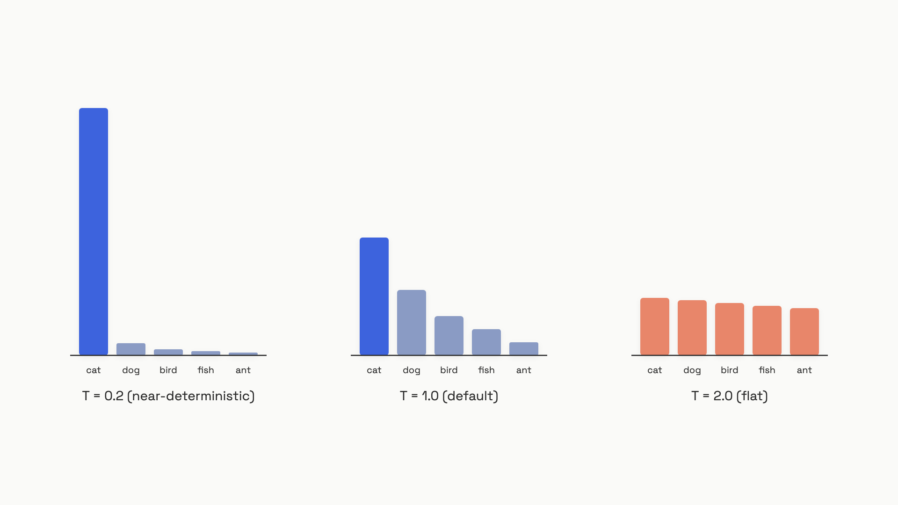

# Sampling and temperature

A model doesn't pick its next word. It produces a score for every word in its vocabulary, turns those scores into probabilities, and draws one. Temperature and top-p are the two knobs that reshape that distribution before the draw. Treat them as creativity dials and you'll ship a classifier that hallucinates and a chat bot that sounds like a vending machine.

[Thinking in probabilistic systems](../part-0-start-here/02-thinking-in-probabilistic-systems.md) made the case that an LLM call is a draw from a distribution, not a function call. This is the chapter where you learn to shape that distribution on purpose, one task at a time.

## Temperature reshapes the curve

Start with the raw scores, called logits. Here are three tokens with logits `[3.0, 1.0, 0.5]`. Temperature divides every logit by a single number before the softmax turns them into probabilities:

```python
import math

def softmax_with_temperature(logits: list[float], temperature: float) -> list[float]:
    if temperature <= 0:
        raise ValueError("temperature must be > 0")
    scaled = [l / temperature for l in logits]
    max_l = max(scaled)
    exps = [math.exp(x - max_l) for x in scaled]
    total = sum(exps)
    return [e / total for e in exps]

logits = [3.0, 1.0, 0.5]
for temp in [0.2, 1.0, 2.0]:
    print(f"T={temp}: {[round(p, 3) for p in softmax_with_temperature(logits, temp)]}")
# T=0.2: [1.0, 0.0, 0.0]        <- one token wins everything
# T=1.0: [0.821, 0.111, 0.067]  <- the model's native shape
# T=2.0: [0.604, 0.222, 0.173]  <- flattened; the long shots get a vote
```

Dividing by a small number stretches the gaps between logits, so the top token swallows nearly all the probability. Dividing by a large number squeezes the gaps, so weaker tokens climb back into contention. That is the whole mechanism: temperature below 1 sharpens the peak, temperature above 1 flattens it.


*The same logits, three temperatures. Low temperature concentrates the bet on one token; high temperature spreads it across many.*

Temperature 0 is the limit of this: as temperature approaches zero, the top token's probability approaches 1. Most APIs clamp it to plain `argmax`, picking the single highest-scoring token every step. That is the setting people reach for when they want one answer, not a sample of answers.

The provider ranges differ, and the differences bite in production:

| Provider | Temperature range | Default | As of |
|---|---|---|---|
| OpenAI (Chat Completions, Responses) | 0 to 2 | 1 | June 2026[^1] |
| Anthropic Claude Haiku 4.5, Sonnet 4.5, Sonnet 4.6 | 0 to 1 | 1 | June 2026[^2] |
| Anthropic Claude Opus 4.7+ (4.8, Fable 5, Mythos 5) | parameter rejected (HTTP 400) | n/a | June 2026[^2] |
| Google Gemini (GenerationConfig) | 0 to 2 | varies by model | June 2026[^3] |

That last Anthropic row isn't a typo, and it changes how you write multi-model code. More on it below.

## Top-p trims the tail

Temperature reshapes every bar. Top-p, also called nucleus sampling, takes a second cut: it throws away the long tail of unlikely tokens entirely, then renormalizes what is left.

The rule is "keep the smallest set of tokens whose probabilities add up to `p`, drop the rest":

```python
def top_p_filter(token_probs, top_p):
    if not (0.0 < top_p <= 1.0):
        raise ValueError("top_p must be in (0, 1]")
    cumulative, nucleus = 0.0, []
    for token, prob in sorted(token_probs, key=lambda x: -x[1]):
        nucleus.append((token, prob))
        cumulative += prob
        if cumulative >= top_p:
            break
    total = sum(p for _, p in nucleus)
    return [(t, p / total) for t, p in nucleus]

tokens = [("cat", 0.40), ("dog", 0.30), ("bird", 0.15), ("fish", 0.10), ("ant", 0.05)]
print(top_p_filter(tokens, top_p=0.8))
# [('cat', 0.471), ('dog', 0.353), ('bird', 0.176)]
# cat + dog + bird reach 0.85, which clears 0.80, so the walk stops there.
# fish and ant are cut before sampling ever happens.
```

The clever part is that the cut is adaptive. When the model is sure the next word is "the", the nucleus might hold a single token even at `top_p=0.95`. When fifty continuations are all plausible, the nucleus widens to hold them. Top-p tracks the model's actual confidence at each step, instead of always sampling from a fixed-size pool.

Top-p lives in the same 0-to-1 range across OpenAI, Anthropic Sonnet and Haiku, and Gemini, with a default of 1 meaning "cut nothing."[^1][^2][^3] Gemini adds `topK`, an integer cap on how many tokens can ever enter the pool; OpenAI doesn't expose top-k at all.[^3]

> [!IMPORTANT]
> **Tune temperature or top-p, not both at once.** OpenAI and Anthropic both say so in their docs, and the reason is mechanical: temperature reshapes the curve, then top-p cuts a tail off the reshaped curve. The tail you cut at temperature 0.3 is a completely different tail than the one at temperature 1.0, so the two knobs interact in ways nobody can reason about by eye.[^1][^2] Pick one axis. Leave the other at its default.

## Pick the setting from the task, not from a vibe

These are variance controls, not quality controls. Low temperature doesn't make a wrong answer right; it just makes the model more confident about whatever it already believes. So you choose the setting from the cost of a varied output, not from how "creative" the task feels.

Start at temperature 0 for anything you can grade. Raise it only when output variety has real product value. The defaults below come from provider guidance and practitioner consensus:[^4][^5]

| Task | Temperature | Why |
|---|---|---|
| Extraction, classification, JSON output | 0 | You want the single highest-confidence answer; pair with structured-output schemas to kill the rest of the variance. |
| Code generation | 0 to 0.2 | Less surprising code is usually correct code. OpenAI itself recommends low temperature for deterministic tasks.[^4] |
| Retrieval-grounded answers (RAG) | 0 to 0.3 | Keep the model close to the retrieved facts; higher values invite confident-sounding inventions. |
| Conversational chat, helpdesk | 0.7 to 1.0 | Enough variety to dodge the robotic feel, still coherent. |
| Creative writing, brainstorming | 1.0 to 1.5 | Variety is the point; coherence can slip a little. |

Two cautions sit under that table.

First, the dissent. Some engineers argue temperature 0 gives chat a flat "robot voice" that hurts how users feel about the product, even when accuracy improves. There is no strong public A/B data either way as of June 2026. The defensible move is to start low, measure, and raise temperature only if a real metric, not a hunch, says the flatness costs you.[^5]

Second, the only top-p rule worth memorizing. If you do push temperature above 1.0, pair it with `top_p` around 0.9 to 0.95 to cut the unreliable tail. Without that cut, high temperature lets near-zero-probability tokens get selected, and once a weird token lands it biases the next ones toward more weirdness, which is how you get degenerate repetition loops. Hold this one loosely: it rests on a single primary source, the Holtzman et al. 2020 nucleus-sampling paper, plus practitioner corroboration. It is a working heuristic, not a law.[^6]

## Temperature 0 isn't a determinism switch

Here's the trap that sends evals flaky. Setting temperature 0 removes the *sampling* randomness, but it doesn't make outputs repeatable across calls. The same prompt at temperature 0 can return different text on two runs, with no bug and no code change.

Three mechanisms drive the drift, all live as of mid-2026:

- **Floating-point non-associativity.** GPUs sum partial results in parallel, and the order of that sum shifts with batch size, GPU count, and hardware generation. `(a + b) + c` isn't bit-for-bit equal to `a + (b + c)`, so a logit moves by a hair. When two top tokens sit nearly tied, that hair flips which one wins, and every token after diverges.[^7]
- **Dynamic batching.** Cloud providers pack your request into a batch with whatever other requests arrive at that instant. Different batch composition means a different summation order, which means a different rounding, which can mean a different token.[^8]
- **Mixture-of-experts routing.** Models that route tokens to expert sub-networks can route differently under load-balancing pressure, changing the logits for the same token in the same context.[^8]

The numbers aren't subtle. Yuan et al. (2025) measured a reasoning model (DeepSeek-R1-Distill-Qwen-7B) under bfloat16 greedy decoding and found up to **9% swing in benchmark accuracy** and **up to 9,000 tokens of difference in response length**, purely from changing GPU count and batch size, with sampling fully off.[^7]

OpenAI is candid about this. Its API offers a `seed` parameter and returns a `system_fingerprint`, but the docs only promise a "best effort" at determinism, and the fingerprint changes whenever the backend configuration shifts underneath you. Set the same seed and temperature 0, and you can still get different outputs when that fingerprint moves.[^9]

This is precisely why your evals must judge meaning, not match strings. An eval that diffs output against a golden string will pass locally, fail in CI, then pass on a re-run, with nothing changed. The [assertions and unit tests](../part-4-eval-fundamentals/03-assertions-and-unit-tests.md) chapter builds evals that tolerate this surface variation; the rule to carry forward now is to assert a property ("parses as JSON with a `city` key") rather than an exact string.

## The parameter landscape is shifting

The freshest surprise in this topic: Anthropic's most capable models no longer accept these parameters at all. As of June 2026, sending `temperature`, `top_p`, or `top_k` to Claude Opus 4.7, Opus 4.8, Fable 5, or Mythos 5 returns an HTTP 400 error. The SDK type definitions still list the fields for backward compatibility, so your code type-checks fine and then fails server-side in production.[^2]

Anthropic's migration guide is blunt about the fix and the philosophy behind it: "The safest migration path is to omit these parameters entirely from request payloads. Prompting is the recommended way to guide model behavior on Claude Opus 4.7."[^2] The reasoning is that the newest models are trained to take behavioral guidance through the prompt rather than through inference-time distribution shaping. The Part 3 chapters on prompt engineering are where you learn to steer tone, formality, and variety with words instead of a temperature knob.

For multi-model code, the safe pattern is a per-model lookup, not a parameter you pass to "any model":

```python
def get_sampling_params(task_type: str, provider: str) -> dict:
    # provider "anthropic_claude4x" means Opus 4.7+, which rejects sampling params.
    defaults = {
        "deterministic": {
            "openai":             {"temperature": 0.0, "seed": 42},
            "anthropic_claude4x": {},                  # omit; steer via the prompt
            "gemini":             {"temperature": 0.0, "seed": 42},
        },
        "conversational": {
            "openai":             {"temperature": 0.7},
            "anthropic_claude4x": {},
            "gemini":             {"temperature": 0.7, "topP": 0.9},
        },
        "creative": {
            "openai":             {"temperature": 1.0},
            "anthropic_claude4x": {},
            "gemini":             {"temperature": 1.4, "topP": 0.95},
        },
    }
    return defaults.get(task_type, {}).get(provider, {})
```

> [!WARNING]
> **A passthrough gateway that sends `temperature` to "whatever model the alias points at" is a silent 400 waiting to happen.** Model aliases drift to newer versions, and the day yours maps to Opus 4.7+, every request that sets a sampling parameter starts failing in production while your integration tests, which hit an older model, stay green. Check the model ID against a known "supports sampling params" list before you build the payload, and strip the parameters when it does not.[^2]

## Set it once, then leave it

Walk the decision in order, and you'll set these knobs deliberately instead of copying someone's magic number:

1. **Name the task.** Gradeable (extraction, code, RAG) or open-ended (chat, creative)?
2. **Set temperature from the task, not the mood.** 0 for gradeable, 0.7 to 1.0 for chat, 1.0 to 1.5 for creative. Touch top-p only if you go above 1.0, and then leave temperature alone.
3. **Check the model tier first.** On Claude Opus 4.7+ you send nothing; you steer with the prompt. Everywhere else, set the one knob you chose.
4. **Never assume temperature 0 repeats.** Design the eval to judge meaning. If you truly need byte-exact reproducibility for a regression test, lock the seed and refuse to compare unless the `system_fingerprint` is unchanged.

These are the same settings you'll wire into the model playground at the end of this part, so the controls you expose there are temperature, top-p, and a model picker that knows which models accept which.

## References

[^1]: OpenAI, "Create chat completion, API Reference" (fields: temperature, top_p, frequency_penalty, presence_penalty), OpenAI Developer Platform, accessed June 2026. https://platform.openai.com/docs/api-reference/chat/create
[^2]: Anthropic, "Migrating to Claude 4," Anthropic Claude Docs, accessed June 2026, and "Using the Messages API," https://docs.claude.com/en/api/messages-examples. https://docs.anthropic.com/en/docs/about-claude/models/migrating-to-claude-4
[^3]: Google, "GenerationConfig, Gemini API Reference," Google AI for Developers, accessed June 2026. https://ai.google.dev/api/generate-content#v1beta.GenerationConfig
[^4]: OpenAI, "Text generation" and prompt engineering guidance, OpenAI Developer Platform, accessed June 2026. https://platform.openai.com/docs/guides/text-generation
[^5]: Practitioner consensus synthesis on temperature-by-task and the chat "robot voice" debate, drawn from multiple secondary sources, labeled as consensus. https://tianpan.co/blog/2026-05-05-hyperparameter-illusion-temperature-top-p-last-to-tune
[^6]: Holtzman, A., Buys, J., Du, L., Forbes, M., Choi, Y., "The Curious Case of Neural Text Degeneration," ICLR 2020 (introduces nucleus sampling). https://arxiv.org/abs/1904.09751
[^7]: Yuan, J., Li, H., Ding, X., et al., "Understanding and Mitigating Numerical Sources of Nondeterminism in LLM Inference," arXiv:2506.09501, submitted June 2025, revised October 2025. https://arxiv.org/abs/2506.09501
[^8]: Kindatechnical.com, "Why Temperature Zero Is Not Deterministic," accessed June 2026 (secondary, practitioner). https://kindatechnical.com/testing-non-deterministic-systems/why-temperature-zero-is-not-deterministic.html
[^9]: OpenAI, "Chat Completions API Reference, seed and system_fingerprint," OpenAI Developer Platform, accessed June 2026. https://platform.openai.com/docs/api-reference/chat/create
