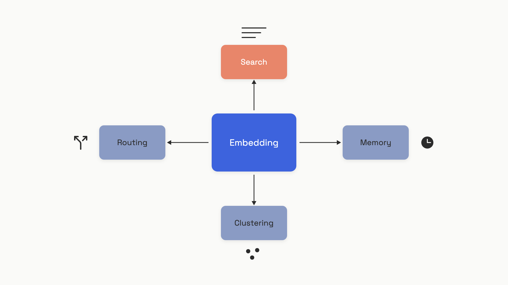

# Embeddings

Send the string `"capital of France"` to OpenAI's `/v1/embeddings` endpoint and you get back a list of 1,536 floating-point numbers. Send `"Paris"` and you get back a different list of 1,536 numbers. Compute the cosine of the angle between them and you get something close to 0.7. Do the same for `"Paris"` and `"how to fix a leaky tap"` and you get something close to 0.1.

That gap, between 0.7 and 0.1, is what embeddings are for. Two strings that mean similar things produce vectors that point in similar directions. Two unrelated strings point off into different parts of the space. Once you have that, four product features fall out almost for free: search that understands paraphrase, memory that retrieves by meaning, routing without a trained classifier, and clustering without labels.

This chapter is the mental model and the metric. The deep dives, picking a vector store, chunking documents, hybrid search, reranking, agent memory, all live in later parts. Here you learn what an embedding *is*, which similarity number to compute, and the map of what embeddings power so the later chapters land in a frame you already have.

## A vector is just a coordinate in a meaning space

Think of embedding the way a cartographer thinks of latitude and longitude. Two points with similar coordinates are physically near each other. The catch is that the embedding space has hundreds or thousands of axes instead of two, and you can't draw it. But the rule is the same: closeness on the map equals closeness in meaning.


*Similar meanings land near each other. The query lands in whichever neighborhood matches.*

The numbers themselves carry no human-readable meaning. Dimension 47 is not "Frenchness." A single coordinate, in isolation, says nothing. The information lives entirely in the *relationships* between vectors, in how close any two of them sit. That is the only contract: similar meaning, close vectors. Everything embeddings do is built on that one fact.

How does the network learn this? Through contrastive training. During training, the model sees pairs of texts that mean the same thing (a question and its answer, two paraphrases) and is rewarded for pulling their vectors together. It sees pairs of unrelated texts and is rewarded for pushing them apart. Repeat across billions of pairs and you end up with a function that lays out the entire English language, and often a hundred other languages, into a geometry where distance encodes semantics.[^1]

A few practical things follow from how the model is trained:

- **The model takes text in and returns a fixed-size vector out.** No generation, no sampling, no temperature. The same input gives you the same vector every time (per model snapshot).
- **Output sizes are model-specific.** OpenAI's `text-embedding-3-small` returns 1,536 floats. `text-embedding-3-large` returns 3,072. Cohere's `embed-v4` returns 1,536. Google's `gemini-embedding-001` returns up to 3,072.[^1][^2][^3]
- **There's a token limit on input.** OpenAI's models accept up to 8,192 tokens; Cohere `embed-v4` accepts 128,000; Google's `gemini-embedding-001` accepts 2,048.[^1][^2][^3] Anything longer is truncated silently or has to be chunked, which is one of the failure modes [chunking](../part-6-retrieval-augmented-generation/01-document-processing-and-chunking.md) exists to handle.
- **Vectors from different models are not comparable.** Each model carves up the space differently. Cosine similarity between an OpenAI vector and a Cohere vector is meaningless. Pick one model per index and stick with it.

The last point matters more than it sounds. When you upgrade an embedding model, you have to re-embed your entire corpus before you go live. Mixing vectors from two model versions in one index is the fastest way to ship a search system that quietly returns nonsense.[^4]

## Cosine, dot product, and the trick that makes them the same

You have two vectors. You want one number that says how similar they are. There are two practical choices, and on the embeddings you'll actually use, they collapse into the same operation.

**Cosine similarity** measures the angle between two vectors. It runs from -1 (pointing in opposite directions) to 1 (pointing the same way). It ignores how long either vector is. Two vectors at the same angle score the same, whether one is short and one is long.

**Dot product** is the raw multiplication-and-sum: `a[0]*b[0] + a[1]*b[1] + ...`. It cares about both the angle *and* the lengths. A long vector at a decent angle can outscore a short vector at a perfect angle.

The trick: if both vectors are normalized to unit length, meaning `||a|| = ||b|| = 1`, the dot product *equals* the cosine similarity. The lengths drop out, the formula collapses, and you get the same number with one fewer operation.

```python
import numpy as np

def cosine_similarity(a, b):
    return float(np.dot(a, b) / (np.linalg.norm(a) * np.linalg.norm(b)))

a = np.array([0.2, 0.8, -0.1, 0.5])
b = np.array([0.3, 0.7,  0.0, 0.4])

# Normalize both vectors to unit length.
a_unit = a / np.linalg.norm(a)
b_unit = b / np.linalg.norm(b)

print(f"cosine on raw vectors:        {cosine_similarity(a, b):.4f}")
print(f"dot on unit vectors:          {np.dot(a_unit, b_unit):.4f}  <- same number")
print(f"dot on raw vectors:           {np.dot(a, b):.4f}  <- magnitude leaks in")
# cosine on raw vectors:        0.9832
# dot on unit vectors:          0.9832  <- same number
# dot on raw vectors:           0.8200  <- magnitude leaks in
```

Why does this matter for your code? Because every major commercial embedding API returns unit-normalized vectors by default. OpenAI states it directly: "OpenAI embeddings are normalized to length 1, which means that cosine similarity can be computed slightly faster using just a dot product."[^1] Cohere and Google return normalized vectors too. So in practice, the choice between cosine similarity and dot product disappears: you call `np.dot`, and you've computed both.

The decision rule, then, is short:

- **Default: dot product on unit-normalized vectors.** It's faster, it's what every vector database is optimized for, and on commercial embeddings it's identical to cosine. Postgres `pgvector`, Pinecone, Qdrant, and Weaviate all expose it as the recommended metric for normalized inputs.
- **Don't second-guess it for normal text retrieval.** If you're embedding text with a commercial API or a sentence-transformers model and asking which metric to use, the answer is this one.
- **The one exception is recommender systems.** Some recommendation models, especially the maximum-inner-product-search style, are trained with a dot product objective on *unnormalized* vectors, where the magnitude is meant to encode item popularity. There, normalizing throws away signal and cosine ranks long-tail items wrong. Steck, Ekanadham and Kallus (Netflix, 2024) showed that for certain regularized matrix-factorization embeddings, cosine similarity can produce "arbitrary and therefore meaningless" rankings.[^5] The rule from that paper, and from Pinecone's similarity guide, is the same: match the metric to whatever the model was trained to optimize.[^5][^6]

For text embeddings, that means cosine. For text embeddings *as you'll actually call them*, that means `np.dot` on what the API hands back.

Euclidean distance is a third option some libraries offer, but for unit-normalized vectors it ranks documents in the same order as cosine, just with different absolute numbers. Pick one, stick with it, move on.

Scaling this from two vectors to a corpus is one numpy line. Stack every document's embedding into a matrix of shape `(n_docs, dim)`, normalize the rows, and one matrix-vector multiply gives you the similarity score against every document at once:

```python
def top_k_similar(query, corpus, k=3):
    """corpus: (n_docs, dim) array. Returns (doc_index, score) pairs."""
    q = query / np.linalg.norm(query)
    corpus_unit = corpus / np.linalg.norm(corpus, axis=1, keepdims=True)
    scores = corpus_unit @ q                        # one dot product per row
    top = np.argsort(scores)[::-1][:k]
    return list(zip(top.tolist(), scores[top].tolist()))
```

That's the entire engine of semantic search at small scale. Below a few hundred thousand documents, on a laptop, this is fast enough to ship. Past that, you swap in a vector database that uses an approximate-nearest-neighbor index (HNSW is the modern default), but the math at the core is still this dot product. The vector store is doing the same comparison, just cleverly skipping most of the rows. That algorithmic layer, and when you actually need a dedicated vector DB versus `pgvector` on the database you already have, lives in [embeddings and vector search](../part-6-retrieval-augmented-generation/02-embeddings-and-vector-search.md).

## What embeddings power

Once you have "similar text, close vectors" as a primitive, four product features fall out of it. Each gets a full chapter elsewhere; here's the map so you know which one you're reaching for when a problem shows up.


*One vector representation, four engineering patterns. Search is the most common entry point.*

**Search.** Embed every document in your corpus once, offline. Store the vectors in a database. At request time, embed the user's query and ask the database for the nearest documents by cosine similarity. The thing that makes this different from `WHERE body LIKE '%foo%'` is that "what time does the store close" matches a document titled "store hours" without sharing a single word. This is the engine room of RAG, and how you pick the embedding model, how you chunk documents, and when hybrid search beats pure embeddings is in [why retrieval matters](../part-6-retrieval-augmented-generation/00-when-you-actually-need-rag.md) and the chapters that follow it.

**Memory.** A chat agent that remembers things across sessions doesn't usually stuff its entire history into the next prompt; the context window would explode and the cost would too. Instead it embeds each message or extracted fact, stores the vectors, and at every turn retrieves the few past entries most relevant to the current query. The mechanism is search; the *use* is letting the agent recall "you mentioned last week that you're allergic to peanuts" without re-reading the transcript. This is treated in depth in [memory and state](../part-5-context-engineering/03-memory-and-state.md) and again in [agent memory](../part-7-agent-engineering/06-agent-memory-and-task-state.md).

**Routing.** You have a request and three or four possible system prompts (one for billing questions, one for technical support, one for general chat). Embed a short description of each route once. At request time, embed the user's message and pick the route with the closest vector. That's a zero-shot classifier with no training data, no labels, no fine-tuning. It works surprisingly well as a first pass, and falls down on requests that genuinely span two routes; for those, the escalation is a small classifier or an LLM-as-router call. The full discussion is in [model routing](../part-7-agent-engineering/01-the-five-workflow-patterns.md).

**Clustering and deduplication.** Run k-means on the embeddings of 50,000 support tickets and you get groups of "tickets about billing," "tickets about login," "tickets that are actually praise mailed to the wrong address." OpenAI's own embeddings guide demonstrates this on Amazon reviews and recovers the obvious clusters (positive reviews, negative reviews, dog food) without any labels.[^1] Deduplication is the tightest version of the same idea: two documents whose vectors have cosine similarity above 0.95 are almost certainly near-duplicates, including paraphrases that exact-match would miss.

The pattern across all four is the same primitive doing different jobs. You don't pick a different model for search versus routing; you pick a good general-purpose embedding model and use it everywhere it fits.

## Picking a model, and the trap people fall into

The shopping list looks roughly like this in mid-2026:

| Model | Dimensions | Context | Price (per 1M input tokens) | As of |
|---|---|---|---|---|
| OpenAI `text-embedding-3-small` | 1,536 | 8,192 tok | $0.02 | June 2026[^1] |
| OpenAI `text-embedding-3-large` | 3,072 | 8,192 tok | $0.13 | June 2026[^1] |
| Cohere `embed-v4` | 1,536 | 128,000 tok | $0.12 | June 2026[^2] |
| Google `gemini-embedding-001` | up to 3,072 | 2,048 tok | check Vertex AI pricing | June 2026[^3] |
| BAAI `bge-m3` (open-weight) | 1,024 | 8,192 tok | self-host | June 2026[^7] |

The trap is the leaderboard. The Massive Text Embedding Benchmark (MTEB) is the standard scoreboard, and it's tempting to read it like a single performance number. OpenAI reports `text-embedding-3-small` at 62.3% and `text-embedding-3-large` at 64.6%.[^8] Cohere reports `embed-v4` at 65.2%, though that figure comes from a single secondary source dated April 2025 (Vercel's AI Gateway listing) rather than Cohere's own published benchmark, so treat it as directional, not authoritative.[^2]

What MTEB scores do *not* tell you is how a model will perform on *your* data. The benchmark averages across 56 tasks. A model that ranks first overall can rank tenth on legal text, on code, on a non-English language you care about, or on the specific kind of paraphrase your users actually write. A 2024 study found that domain-specific embedding models reliably beat general-purpose ones on domain tasks; the size of the gap varies, but the direction holds across the domains they tested.[^9]

The discipline here, and it's the same discipline [evals](../part-4-eval-fundamentals/00-why-you-cant-ship-without-evals.md) preaches everywhere else, is to build a small evaluation set from real user queries with known good documents, then measure recall on *that*, not on MTEB. Two hundred query/document pairs is enough to tell two models apart. Pick the cheaper one if they're close; pick the better one if the gap is real on your data.

A second knob worth knowing about is **dimension shortening**. Modern embedding models (`text-embedding-3-*`, `gemini-embedding-001`, `embed-v4`) are trained with a technique called Matryoshka Representation Learning, where the first 256 or 512 dimensions of the full vector are themselves a usable, lower-quality embedding.[^10] You ask the API for 512 dimensions and get a 512-dim vector back, which is roughly 6x cheaper to store than the 3,072-dim default. OpenAI's published benchmark shows `text-embedding-3-large` shortened to 256 dims still outperforming the older `text-embedding-ada-002` at full 1,536 dims.[^8] At a million documents the storage saving is real (12 GB down to 2 GB at float32). At ten thousand it's not worth thinking about.

> [!WARNING]
> **Pin your embedding model to a specific snapshot, and tag every stored vector with the model version that produced it.** Hosted embedding endpoints share the same URL across model upgrades. The day a vendor swaps weights underneath you, queries embedded with the new model start being compared against a corpus embedded with the old one, and retrieval quality drifts in ways no test will catch. A 2026 practitioner essay walks through the worst version of this failure: a vendor-side embedding rotation silently invalidating a quarter's worth of A/B test conclusions, because the experiment platform had no field for the one variable that moved.[^4] Treat embedding-model upgrades like database schema migrations: blue-green a new index, atomically swap, and refuse to mix vectors from different versions in the same store.

Embeddings carry more weight per line of code than any other primitive in this book. One API call, a few thousand floats, and you've turned "find me documents that mean roughly this" from a hard problem into one matrix multiply. The chapters from Part 5 onward keep cashing this in, sometimes for retrieval, sometimes for memory, sometimes for routing decisions inside an agent. The mechanism doesn't change. What changes is the question you're asking the geometry, and how cleverly you index it so you can ask at scale.

## References

[^1]: OpenAI, "Vector embeddings" (Embeddings guide), retrieved June 2026. https://platform.openai.com/docs/guides/embeddings
[^2]: Vercel AI Gateway, "Embed v4.0 by Cohere, Specs, Pricing & API," retrieved June 2026 (Cohere `embed-v4` MTEB 65.2% figure dated April 2025; single secondary source). https://vercel.com/ai-gateway/models/embed-v4.0/about
[^3]: Google Cloud, "Text embeddings API" (Vertex AI generative AI), page dated June 10, 2026. https://cloud.google.com/vertex-ai/generative-ai/docs/model-reference/text
[^4]: Tian Pan, "The Embedding Model Rotation That Shadowed Your A/B Test for a Quarter," tianpan.co, June 2, 2026. https://tianpan.co/blog/2026-06-02-the-embedding-model-rotation-that-shadowed-your-ab-test
[^5]: Steck, H., Ekanadham, C., & Kallus, N. (Netflix), "Is Cosine-Similarity of Embeddings Really About Similarity?", arXiv:2403.05440, March 8, 2024. https://arxiv.org/abs/2403.05440
[^6]: Pinecone, "Vector Similarity Explained," Pinecone Learning, January 2024. https://www.pinecone.io/learn/vector-similarity/
[^7]: BAAI / FlagEmbedding, "BGE-M3," HuggingFace model card, January 30, 2024; paper arXiv:2402.03216. https://huggingface.co/BAAI/bge-m3
[^8]: OpenAI, "New embedding models and API updates," OpenAI blog, January 25, 2024. https://openai.com/index/new-embedding-models-and-api-updates/
[^9]: "Do We Need Domain-Specific Embedding Models? An Empirical Investigation," arXiv:2409.18511, September 2024. https://arxiv.org/abs/2409.18511
[^10]: Kusupati, A. et al., "Matryoshka Representation Learning," arXiv:2205.13147, NeurIPS 2022. https://arxiv.org/abs/2205.13147
