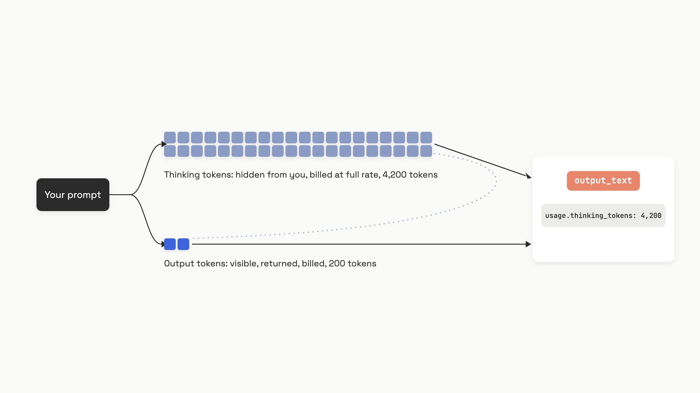

# Reasoning models

A call to Claude Opus 4.8 at high effort can return 200 words of visible text and bill you for 5,000 tokens you never see. At $25 per million output tokens as of June 2026, that one call costs about $0.13. The same 200 words from a standard model cost about $0.008. Same answer on the screen, 16x the bill.[^1]

That gap is the whole reason this chapter exists. A reasoning model thinks before it answers, the thinking happens in tokens, and you pay for every one of them at full output rate even though they're hidden by default. Get this wrong and your monthly bill jumps 3x to 5x with no change in traffic. Get it right and you have a tool that solves multi-step problems a standard model fumbles.

## What "thinking" actually is

Strip away the marketing and the mechanism is plain. Before writing its visible reply, a reasoning model generates a long internal token sequence, its chain of thought. Those tokens go into the model's own context and steer what it writes next. Then they're thrown away.[^1]

Researchers call this **test-time compute**: instead of one pass over your input, the model spends extra compute at inference time to plan, check alternatives, and recover from a wrong turn before committing to an answer. A standard model gets one shot. A reasoning model gets a scratchpad.

The tokens on that scratchpad are the catch. They cost the same per token as visible output, and most providers don't show them to you. Three things are true of those thinking tokens at every major provider as of June 2026:

- **They're billed.** At the same per-token rate as the visible answer.
- **They're hidden.** You get a summary at best, never the raw chain of thought.
- **They're discarded between turns.** The model can't read its own reasoning from a previous message, so every turn reasons from scratch.[^1]

The response object tells you the true count. On OpenAI's Responses API the field is `output_tokens_details.reasoning_tokens`; on Anthropic it's `output_tokens_details.thinking_tokens`; on Google's Gemini API it's `usage_metadata.thoughts_token_count`, reported separately from the visible `candidates_token_count`.[^1][^2][^3] Check it. Your invoice depends on it.


*One call produces two billed streams. You read the small one and pay for both.*

## The knobs, one per provider

You don't toggle thinking on and off so much as dial how hard the model works. Each provider exposes a different control surface, and the names don't match, so here's the lookup for all three.

**OpenAI** uses `reasoning.effort` on the Responses API. It accepts `none`, `minimal`, `low`, `medium`, `high`, and `xhigh`. GPT-5.5 defaults to `medium`.[^1]

```python
from openai import OpenAI

client = OpenAI()  # reads OPENAI_API_KEY from env

response = client.responses.create(
    model="gpt-5.5",
    reasoning={"effort": "low"},  # none | minimal | low | medium | high | xhigh
    input=[{"role": "user", "content": "Write a bash script to transpose a matrix."}],
)

print(response.output_text)
# The number that drives your bill, not the visible token count:
print("Reasoning tokens used:", response.usage.output_tokens_details.reasoning_tokens)
```

**Anthropic** now recommends adaptive thinking: the model decides per request how much to think, and you shape that with `effort`. The older manual `budget_tokens` still works on Sonnet 4.6 and earlier but is deprecated on Opus 4.6+ and Sonnet 4.6+.[^2]

```python
import anthropic

client = anthropic.Anthropic()  # reads ANTHROPIC_API_KEY from env

response = client.messages.create(
    model="claude-opus-4-8",
    max_tokens=16000,
    thinking={"type": "adaptive"},
    output_config={"effort": "high"},  # low | medium | high | max | xhigh
    messages=[{"role": "user", "content": "Solve this optimization problem step by step."}],
)

# Billed even though you only see a summary of the reasoning:
print("Billed thinking tokens:", response.usage.output_tokens_details.thinking_tokens)
```

**Google Gemini** splits by generation. The 2.5 series takes `thinkingBudget`, an integer token cap (0 to 24,576 on Flash, 128 to 32,768 on Pro). The 3 series takes `thinkingLevel`, an enum of `minimal`, `low`, `medium`, `high`. Gemini 3.5 Flash defaults to `medium`; 3.1 Pro defaults to `high` and can't go below `low`.[^3]

```python
from google import genai
from google.genai import types

client = genai.Client()  # reads GOOGLE_API_KEY from env

response = client.models.generate_content(
    model="gemini-3.5-flash",
    contents="Explain Occam's Razor with an everyday example.",
    config=types.GenerateContentConfig(
        thinking_config=types.ThinkingConfig(thinking_level="low"),
    ),
)

print("Thinking tokens:", response.usage_metadata.thoughts_token_count)
print("Output tokens:", response.usage_metadata.candidates_token_count)
```

Two quirks bite people. First, some models won't let you turn thinking off at all: Gemini 2.5 Pro rejects `thinkingBudget=0`, and Anthropic's Fable 5 keeps adaptive thinking always on.[^2][^3] Second, the latency knob and the cost knob are the same knob. Higher effort means more thinking tokens, which means both a bigger bill and a slower response. There's no setting that buys you more reasoning for free.

## The budget trap that bills you for nothing

Reasoning tokens count against the same output budget as your visible answer. Set `max_output_tokens` (OpenAI) or `max_tokens` (Anthropic) too low and the model can burn the whole budget thinking, then return with `status: "incomplete"` and zero visible text. You still pay for the input and every reasoning token it consumed.[^1]

OpenAI's own docs spell out the failure: the model can hit the limit "before any visible output tokens are produced, meaning you could incur costs for input and reasoning tokens without receiving a visible response."[^1] Their fix is blunt: reserve at least 25,000 tokens of headroom for reasoning.[^1] Anthropic warns separately that thinking budgets above 32k tokens should run through their batch endpoint, because a real-time request that thinks that long will hit an HTTP timeout.[^2]

So two rules before you ship a reasoning call:

- **Give it room.** Set the token limit high enough to cover thinking plus the answer, not just the answer.
- **Check the status.** Read the `status` field (OpenAI) or `stop_reason` (Anthropic) on every response. `incomplete` or `max_tokens` means you paid and got nothing useful.

## When reasoning earns its cost, and when it doesn't

Default to a standard model. A reasoning model is an escalation you justify with a measurement, not a setting you leave on. OpenAI frames its own guidance the same way: start with the standard path, and reach for high effort only "when quality and intelligence matters more than latency."[^1]

Reach for a reasoning model when the task breaks into multiple steps whose intermediate results feed later ones:

- **Multi-step math and algorithmic code.** Problems where one wrong early step poisons everything after it.
- **Agentic workflows.** Tool orchestration and decision trees under uncertainty, the primary production use case.[^1]
- **High-cost-of-error tasks.** Security reviews, code shipping without tests, anything where the first wrong answer is expensive to catch later.

Leave it off, or pin effort to the floor, when:

- **Latency is tight.** Sub-second SLAs like voice, typeahead, or streaming chat. OpenAI recommends `effort: "none"` for the voice fast path.[^1]
- **The task is single-step.** Classification, JSON-to-CSV conversion, short extraction, a lookup a standard model nails in one pass.
- **Throughput matters more than depth.** Parallelizable bulk work belongs on a cheap standard model through a batch endpoint.

The most expensive mistake is running high effort on a task that doesn't need it. A sentiment-classification call on Claude Opus 4.8 at `high` effort can still burn 1,000 to 3,000 thinking tokens to answer "positive."[^2] The model reasons because it was trained to reason, not because the task demanded it. Watch your observability: if a task type consistently spends over 500 thinking tokens to produce a single word, drop its effort or route it to a cheaper model.

| | Strict latency (under 1s) | Flexible latency (5s+) |
|---|---|---|
| **Simple task** | Standard model | Standard model (reasoning wastes money) |
| **Complex task** | Low effort only, or distill | Reasoning model, tune effort with evals |

When you do escalate, climb the effort knob from the bottom. Anthropic's guidance is to "start at minimum thinking budget and incrementally increase," and they note that accuracy gains past 32k thinking tokens are marginal for most tasks.[^2] Don't pay for `high` until an eval on your own task shows it beats `medium`. The full framing for trading cost against quality and latency lives in [The cost-quality-latency triangle](./05-the-cost-quality-latency-triangle.md); the effort knob is just one of its levers.

## One warning before you reach for your old prompts

Everything you'll learn about coaxing better answers from a standard model can backfire here. Reasoning models are trained to generate their own chain of thought, so prescribing the steps for them, with explicit "think step by step" instructions or few-shot worked examples, can interrupt a better path the model would have found on its own. One study measured drops of up to 36.3 percentage points in accuracy on o1-preview when chain-of-thought prompting was applied to tasks where deliberation hurt.[^4] Anthropic's own guidance: "A prompt like 'think thoroughly' often produces better reasoning than a hand-written step-by-step plan."[^5]

Don't paste your standard-model few-shot prompts into a reasoning model and assume they help. The chapter on chain-of-thought, ReAct, and self-consistency covers this inversion in full and tells you which technique fits which model class. For now, give a reasoning model the goal, the output format, and the constraints, then get out of its way.

## References

[^1]: OpenAI, "Reasoning models," OpenAI Developer Docs, https://platform.openai.com/docs/guides/reasoning (fetched June 2026).
[^2]: Anthropic, "Building with extended thinking," Anthropic Developer Docs, https://docs.anthropic.com/en/docs/about-claude/models/extended-thinking-models (fetched June 2026).
[^3]: Google, "Gemini thinking," Google AI for Developers, https://ai.google.dev/gemini-api/docs/thinking (last updated June 4, 2026).
[^4]: Ryan Liu et al., "Mind Your Step (by Step): Chain-of-Thought can Reduce Performance on Tasks where Thinking Makes Humans Worse," arXiv:2410.21333, submitted Oct 27 2024, revised Jun 13 2025, https://arxiv.org/abs/2410.21333.
[^5]: Anthropic, "Prompting best practices," Anthropic Developer Docs, https://docs.anthropic.com/en/docs/build-with-claude/prompt-engineering/claude-prompting-best-practices (fetched June 2026).
