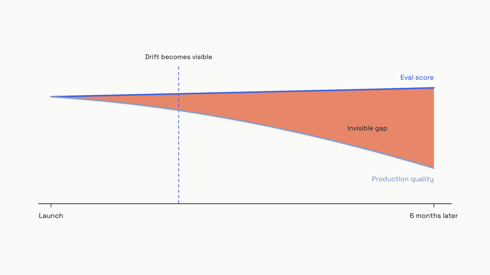

# Just enough ML

You shipped a feature. The eval score read 87%. Three months later, users are unhappy and churning, and the eval score still reads 87%. Nothing in your dashboard is lying to you on purpose. The number is real. It just stopped meaning what you think it means.

That gap, between a green metric and an unhappy user, is the whole reason this chapter exists. You'll never train a model. But the moment you build an eval set, swap a model version, or argue about whether to fine-tune, you're doing machine-learning reasoning whether you call it that or not. Three ideas carry almost all of that reasoning: the data split, overfitting, and distribution shift. Get them and you can read your own numbers honestly.

## The data split, in eval terms

Here is the discipline, stripped of theory. You have a pile of examples. You divide it into three locked boxes.

- **Train (around 70%):** examples you iterate against freely. Tweak the prompt, try a retrieval config, look at every failure, repeat.
- **Validation (around 15%):** examples you use to pick between finalists. Two prompt variants, two model versions, two retrieval setups. The validation set breaks ties.
- **Test (around 15%):** examples you open exactly once, when you are about to ship or report a number. Then you close the box again.

The exact ratios barely matter. The discipline matters. Once you look at the test set and change something because of what you saw, the test set has quietly become a validation set, and its number is now optimistic.

Why three boxes instead of two? Because every dataset you make decisions against gets corrupted by those decisions. If you tune your prompt to beat the same 100 examples you also report as your final score, the score is inflated. You didn't measure quality. You measured how well you fit those 100 examples. The third box exists so one number stays honest, untouched by any choice you made.

For an engineer who never runs a training loop, the practical version is one sentence. **Take the examples you planned to use as your final measurement, drop 15% of them into a file you won't open until ship day, and don't peek.**

> [!WARNING]
> **A small test set lies with a straight face.** A 50-example pass/fail test has a standard error near 7 percentage points. So a "75% pass rate" is really somewhere in a 68 to 82% band. Teams read the 75 as truth, ship on it, and act surprised when production disagrees. The fix is not a cleaner number; it is more examples, pulled from real failures.

## Overfitting, and its evil twin

Overfitting is what happens when a system learns patterns specific to the examples it saw, patterns that don't hold on anything new. It shows up here in two distinct shapes, and conflating them will burn you. Keep them separate.

### Shape one: the model overfits

A fine-tuned model can score beautifully on its fine-tuning examples and fall apart on queries phrased even slightly differently. Push it too hard and you hit catastrophic forgetting, where learning the new task overwrites earlier abilities. This was measured across models from 1 billion to 7 billion parameters, and the severity got worse, not better, as models grew.[^1]

### Shape two: your eval set gets memorized

This one bites the AI engineer far more often, and it has nothing to do with training. Iterate against the same 200 examples for three months and your team will memorize their failure modes. Your prompt tweaks start fitting the quirks of those 200 examples instead of fixing real behavior. The eval score climbs while production quality flatlines. You are overfitting to the eval set, by hand, one tweak at a time.

Three signals tell you it's happening:

- Eval scores rise while user metrics (retries, escalations, satisfaction) stay flat or fall.
- A new model swap *drops* your eval score, but users clearly prefer the new model.
- Your team can recite which examples the system will fail from memory.

There is a third shape worth naming because it makes headlines: benchmark contamination. When a public benchmark leaks into a model's training data, its score measures memorization, not capability. In February 2026, OpenAI retired SWE-bench Verified after an audit found that every frontier model it tested, including GPT-5.2 and Claude Opus 4.5, could reproduce gold-patch fixes verbatim from a short hint. The same audit found 59.4% of the problems it checked had flawed tests that rejected correct answers.[^2] The lesson generalizes: keep your own eval set private and never hand it to a model provider.

## Distribution shift: why the 87% goes stale

Distribution shift is the mismatch between the data a system was built on and the data it meets in the wild. It is the single biggest reason eval scores and fine-tunes both rot over time. Production prompts drift along three axes:

- **Time:** users get more fluent with your product and phrase things differently month over month.
- **User group:** the cohort you launched with doesn't look like the cohort you acquire later.
- **Geography:** language and cultural patterns vary by region.

The hard numbers come from the LENS study out of Dartmouth (April 2026), which fine-tuned 81 models on 4.68 million real user prompts and then evaluated them on traffic shifted along each axis. A model fine-tuned on one population loses to an oracle trained on the *actual* evaluation population this often:[^3]

| Shift axis | Loss rate vs. oracle | As of |
|---|---|---|
| Time (later prompts) | 44% | April 2026 |
| User group | 87% | April 2026 |
| Geography | 88% | April 2026 |

Read the geography row again. A model tuned on one region loses to a current-population model in roughly 9 of every 10 head-to-head comparisons. And the time-axis gap widens steadily month over month; there's no cliff, just slow drift you won't notice until users do.[^3]

This explains both failures at once.

**Why fine-tunes go stale.** A fine-tuned model bakes in the behavior of its training set. When the user population moves, those baked-in behaviors no longer match. A model fine-tuned on January's users is a liability in July if the crowd changed. Treat every fine-tune as carrying a staleness clock, and watch production quality, not the eval score, for when it runs down.

**Why eval sets go stale.** Your eval set is a frozen photograph of one moment's traffic.[^4] As users drift, the photo stops representing them. An improving score on a stale eval set isn't improvement. It's your system getting better at fitting a distribution your users already left.

The fix isn't "refresh more often" on a calendar. It's to instrument drift. Compare the topic distribution of recent production queries against your eval set's distribution; when they diverge past a threshold you set empirically, audit and grow the set. A practical detector measures the divergence directly:

```python
from collections import Counter
import math

def js_divergence(p: dict[str, float], q: dict[str, float]) -> float:
    """0 = identical distributions, higher = more drift."""
    keys = set(p) | set(q)
    m = {k: 0.5 * (p.get(k, 0.0) + q.get(k, 0.0)) for k in keys}

    def kl(a, b):
        return sum(a[k] * math.log(a[k] / b[k])
                   for k in a if a.get(k, 0) > 0 and b.get(k, 0) > 0)

    return 0.5 * kl(p, m) + 0.5 * kl(q, m)

def topic_distribution(labels: list[str]) -> dict[str, float]:
    c = Counter(labels)
    total = sum(c.values())
    return {k: v / total for k, v in c.items()}

# Compare eval-set topics to the last N hours of production traffic.
# When js_divergence(eval_dist, prod_dist) climbs past ~0.1, refresh the eval set.
```

The 0.1 threshold is a starting point from practitioners, not a law; tune it to your traffic.[^3]


*The eval set is frozen at launch; production drifts away from it. The gap is invisible on your dashboard until it is large.*

## Fine-tune or RAG: the one fork you can decide now

Both customization methods exist to fix a mismatch, but they fix different ones, and that split makes the decision easy at the conceptual level.

- **RAG** (retrieval-augmented generation) injects knowledge at query time. You fetch relevant documents and drop them into the model's context. The model weights never change, so the corpus travels separately and updates instantly when you update the store.
- **Fine-tuning** injects knowledge at training time, into the weights. The new behavior travels with the model, but the corpus does not, and changing it means retraining.

The frame that decides most cases: **RAG solves a knowledge problem; fine-tuning solves a behavior problem.** If the model lacks facts, RAG. If the model knows enough but answers in the wrong style, format, or persona, fine-tuning. This isn't a slogan; Ovadia and colleagues (EMNLP 2024) found RAG consistently beat unsupervised fine-tuning for injecting factual knowledge, both for facts the model had seen in pretraining and for entirely new ones.[^5]

Three forcing functions push you toward RAG even when fine-tuning tempts you:

- **The corpus changes often.** Daily or weekly updates make retraining a treadmill. RAG just updates the store.
- **Answers must cite sources.** A retrieval step gives you the document to cite; weights cannot quote themselves.
- **You lack labeled behavior examples.** Fine-tuning a behavior shift wants 500 to 1,000 good examples, minimum.

So the default is RAG, and fine-tuning is the escalation. That isn't an accident of taste; it falls straight out of [the escalation ladder](../part-0-start-here/03-the-escalation-ladder.md): prompt, then context, then retrieval, then tools, then agent, then fine-tune. Climb the cheapest rung that fixes the failure. Fine-tuning sits last because it costs real money, carries that staleness clock, and risks catastrophic forgetting. The honest counterpoint is that on hard, multi-domain tasks the two combine well, and some teams run both. Confirm RAG alone falls short before you pay for fine-tuning.

That is the entire conceptual scope here. The deep version (corpus-size math, update-frequency thresholds, long-context-versus-RAG) lives in Part 6, "When you actually need RAG." The full customization menu (LoRA, distillation, cost and execution depth) lives in Part 10.3, "The customization menu." This chapter only hands you the fork.

## Where this lands next

Everything above is the vocabulary for one deliverable you build soon: [your first eval set](../part-4-eval-fundamentals/02-your-first-eval-set.md). The reason that set must pull from real production traffic instead of your imagination is overfitting. The reason it must be held out and versioned is the data split. The reason it needs a refresh signal is distribution shift. When that chapter tells you to collect 50 real examples, hold them out, and grow the set from production failures, you'll already know why each rule is there.

At architecture scale, the monitoring infrastructure that detects drift, the data pipelines and model registries, is the whiteboard view; [HLD Part 9.5, Eval and Observability](../../hld/part-9-ai-ml-system-design/05-llm-evaluation-observability.md), covers that side.

When you next read a green eval score, ask one question before you trust it: does this set still look like the traffic my users send today? If you cannot answer yes, the number is a photograph of a crowd that already left.

## References

[^1]: Shengjie Hou et al., "An Empirical Study of Catastrophic Forgetting in Large Language Models During Continual Fine-tuning," arXiv:2308.08747v5, EMNLP 2024. https://arxiv.org/html/2308.08747v5
[^2]: OpenAI, "Why SWE-bench Verified no longer measures frontier coding capabilities," February 23, 2026. https://openai.com/index/why-we-no-longer-evaluate-swe-bench-verified/
[^3]: Parker Seegmiller and Sarah Masud Preum, "Measuring Distribution Shift in User Prompts and Its Effects on LLM Performance" (LENS), Dartmouth College, arXiv:2604.17650v1, April 19, 2026. https://arxiv.org/html/2604.17650v1
[^4]: tianpan.co, "Your Eval Set Is a Frozen Photograph of Traffic Your Users Already Left," May 2026 (citing the LENS framework). https://tianpan.co/blog/2026-05-17-eval-set-staleness-frozen-photograph
[^5]: Oded Ovadia, Menachem Brief, Moshik Mishaeli, Oren Elisha, "Fine-Tuning or Retrieval? Comparing Knowledge Injection in LLMs," EMNLP 2024, arXiv:2312.05934. https://arxiv.org/html/2312.05934v3
