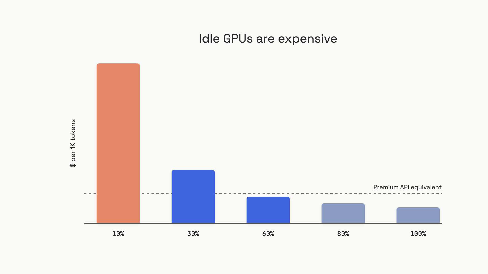

# Hosted vs self-hosted

A FinTech team built an AI chatbot on GPT-4o in early 2026. Month one, $15K. Month three, $60K. Projected annual: $700K. They panicked, rented eight H100s, and self-hosted everything. Six months later, they were spending $85K a month, fighting CUDA crashes, and one incident took the product down for nine hours.[^1]

The fix wasn't to host or to migrate. It was to do both. They routed 600,000 daily bulk classification calls to a self-hosted 13B model and kept 5,000 daily complex queries on the frontier API. Total spend dropped to $8K. The mistake the first time wasn't self-hosting; it was self-hosting *everything*.

This chapter is the decision the FinTech team got wrong twice before they got right. It's also the most consequential infrastructure choice you'll make as an AI engineer, and the one most teams botch in both directions.

## The two-line TCO trap

The trap is comparing GPU rent to API token spend and concluding self-hosting wins. The math looks like this:

```text
8x H100 on-demand:    $25,200/month
Equivalent API spend: $30,000/month
Savings:              $4,800/month, right?
```

That two-line model is wrong because it omits the largest line item on the bill: the people who run the cluster. Correct TCO has four lines.[^2]

| Line | Share of self-hosted TCO | What it actually costs |
|---|---|---|
| GPU rent | 60-70% | $25K/month for 8xH100 on-demand neocloud (Apr 2026) |
| Inference engineer | 25-30% | $20-30K/month loaded, US senior |
| Serving-stack ops | 5-10% | 8-12 engineer-hours/week tuning vLLM, capacity, observability |
| Build-out opportunity | variable | 2 months not shipping product |

The engineer line is the one that breaks the naive math. A team paying $8K/month on a closed API can't justify a $25K/month engineer to take it in-house; the engineer alone costs three times the savings. Below roughly $50K/month in API spend, the four-line model says: don't migrate, route.[^1]

The decision rule that falls out of this:

- **Under ~$10K/month API spend.** Stay on the API. Self-hosting costs 12-30x more once engineer cost is included. Don't even run the math.
- **$10K to $50K/month.** Route bulk repetitive tasks to self-hosted or managed open-weight; keep complex tasks on the frontier API. Hybrid routing typically cuts spend 40-70% at this tier.
- **Above $50K/month.** Self-hosted bulk traffic is mandatory for margin. Engineer cost is dwarfed by what you're saving.

This is the volume axis. There are two more.

## Utilization is the silent multiplier

A GPU bills the same hourly rate at 10% load as at 100% load. That single fact decides more self-hosting outcomes than any benchmark.


*Effective cost per thousand tokens scales inversely with utilization. At 10% sustained load, an H100 costs more per output token than a premium API.*

The math is straightforward. An H100 serving Llama 3.1 70B peaks around 1,400 tokens per second.[^3] At $2.90 per hour on a neocloud and 100% utilization, that's about $0.0006 per 1K tokens. Drop utilization to 10%, and the cost per 1K rises to $0.006. Compare to DeepSeek V4 Flash at $0.14 per million input tokens, and your idle H100 is suddenly more expensive than a managed API.

Production LLM workloads are bursty. Most teams achieve 40-65% average utilization once you account for traffic variability and SLA-driven headroom.[^4] Sizing for p99 tail latency under bursty load lands you at 35-45% average utilization, because you need 30-40% more headroom than p50 sizing implies.[^2] The "we'll run our cluster at 80%" plan rarely survives contact with real traffic.

Managed API providers don't have this problem. They amortize one physical GPU across thousands of tenants and run hot. That structural advantage is why budget open-weight APIs (Together AI, Fireworks, DeepSeek) keep undercutting single-tenant self-hosted deployments at most realistic volumes.

The decision rule: before you commit GPU capacity, measure three months of actual token volume in production. If your forecast utilization sits below 60%, hosted is cheaper. Don't reserve a 1-year cluster on a six-week forecast.

## Compliance decides before cost does

Some workloads have the choice made for them. If you process US Protected Health Information (PHI) without a signed Business Associate Agreement, you're committing a HIPAA violation before any cost analysis runs. If you transmit EU personal data to US infrastructure without a 2021-version Data Processing Agreement and Standard Contractual Clauses, that's a GDPR violation. Neither requires a breach to trigger liability.

Standard consumer APIs from OpenAI, Anthropic, and Google don't ship BAAs by default. Enterprise tiers do, sometimes: AWS Bedrock with BAA, Azure OpenAI with BAA, Google Vertex AI with BAA. Verify the agreement in writing before connecting any pipeline. "SOC 2 certified" is not "will sign a BAA."

For EU personal data with a strict residency requirement, the model availability list shrinks to whatever the cloud providers run in their EU regions, and the latest models lag US availability by weeks to months. The EU AI Act adds another layer: Article 10 data governance for high-risk systems becomes enforceable August 2, 2026, with penalties up to EUR 15 million or 3% of global turnover.

The sequencing matters. Run the compliance check first.

```python
def compliance_gate(
    has_phi: bool,
    baa_available: bool,
    has_eu_personal_data: bool,
    dpa_and_scc_available: bool,
    strict_eu_residency: bool,
) -> dict:
    """Returns whether compliance forces self-hosting or VPC deployment.
    Run this BEFORE any TCO calculation.
    """
    blockers = []
    if has_phi and not baa_available:
        blockers.append("HIPAA: PHI with no BAA. Use enterprise tier or self-host in VPC.")
    if has_eu_personal_data and not dpa_and_scc_available:
        blockers.append("GDPR: EU personal data with no DPA+SCC. Cross-border violation.")
    if strict_eu_residency:
        blockers.append("EU residency: inference must run in EU region or self-host in EU.")
    return {"forced_private": bool(blockers), "blockers": blockers}
```

If the gate fires, you don't need a break-even analysis. You need a VPC deployment or an enterprise-tier provider that will sign the right paperwork. The cost math runs only when the compliance answer is "no constraint."

## Start hosted, migrate the hot path

For everyone else, the 2026 default is unromantic: build the first version entirely on hosted APIs. Instrument every call. After two or three months in production, look at the distribution.

You'll find what every mature team finds: about 80% of your tokens come from 20% of your query types.[^1] Those high-volume, low-variance queries (classification, extraction, summarization, RAG ranking) are the self-hosting candidates. The 20% of queries that are complex, sensitive, or low-volume should stay on frontier APIs. That's not a compromise; it's the right architecture.

The router is where the hybrid stack lives. It classifies each request by task type, data sensitivity, expected difficulty, and failure cost, then picks a model.[^5] The escalation triggers are specific, not vibey: route test generation locally, but escalate to frontier if tests fail twice or coverage misses target. Route bulk extraction locally, but escalate if the schema validation fails. Track cost-per-accepted-outcome, not cost-per-token; the local model is only cheaper if its retries don't eat the savings.

Here's when to actually pull the trigger on the migration:

- **Monthly API spend is above $10K** and the majority of it is bulk repetitive tasks
- **You have an inference engineer in seat** who has run a vLLM or SGLang cluster in production before (not "we'll hire one"; that's three to six months of ramp)
- **Three months of measured volume** show sustained load that would land above 60% GPU utilization on your target cluster size
- **Compliance allows it** (run the gate first)

Don't pull the trigger if:

- Usage is still growing fast or the product is pivoting (the model upgrade treadmill cost is too high while you're iterating)
- All your usage is low-volume complex tasks (no bulk to route to cheaper models)
- The team has no inference infrastructure experience and no budget to hire

## The one dissent worth taking seriously

Frontier hosted models are not just weights. They include safety post-training, tool-use tuning, context management, multimodal handling, and continuous updates that come bundled with the API. An 8xH200 deployment of Qwen3-235B is "Sonnet-ish" on most tasks but still not a GPT-5.5 replacement on the hardest reasoning.[^5] If your product depends on frontier capability across all queries, self-hosting can cost more in total because the local model needs more retries and human review, and cost-per-successful-outcome rises above the apparent per-token savings.

The counter-rule: set quality bars through your own product evals, not through proxy benchmarks. If your local model passes the eval set for the task category you're routing to it, that's the bar. If it doesn't, escalate. Don't try to make a 13B model do work that a frontier model does, just because the per-token math looks attractive.

## The substrate question

Where does this all run? The honest answer is "containers, orchestrated by Kubernetes, on a GPU node pool" and that sentence is the entire deployment-substrate scope of this book. Pod scheduling, autoscaling, GPU node management, ingress, service mesh: those belong to general infrastructure engineering, not AI engineering. At architecture scale, [Deployment substrate for AI workloads](../../hld/part-9-ai-ml-system-design/00-llm-serving-architecture.md) covers the whiteboard view.

What you do need to know about AI infrastructure specifically (vector stores in production, semantic caching, agent job queues, embedding pipelines) lives in [AI infrastructure patterns](07-ai-infrastructure-patterns.md). The serving stack itself (vLLM, KV cache, continuous batching) is the next chapter.

The thing the FinTech team learned the expensive way: this isn't a binary. It's a router. Build the first version on hosted APIs, instrument it, find the hot path, and migrate that. Run the compliance gate before you run the cost math. And size for tail latency, not for the utilization number you wish you had.

## References

[^1]: Tian Pan, "The Build-vs-Buy LLM Infrastructure Decision Most Teams Get Wrong", TianPan.co, April 15, 2026, https://tianpan.co/blog/2026-04-15-build-vs-buy-llm-infrastructure
[^2]: Digital Applied, "Self-Hosting Frontier AI Models: 2026 TCO Analysis", April 24, 2026, https://www.digitalapplied.com/blog/self-host-frontier-models-tco-analysis-2026
[^3]: Digital Applied, "Self-Hosting Open-Weight LLMs: When It Actually Wins", May 27, 2026, https://www.digitalapplied.com/blog/self-hosting-open-weight-llms-2026-deployment-decision-guide
[^4]: Spheron, "LLM Inference On-Premise vs GPU Cloud: 2026 Cost and Break-Even Analysis", April 13, 2026, https://www.spheron.network/blog/llm-inference-on-premise-vs-cloud/
[^5]: TensorOps, "Is It Time to Self-Host LLMs? An Enterprise Guide", May 31, 2026, https://tensorops.ai/blog/is-it-time-to-self-host-llms

