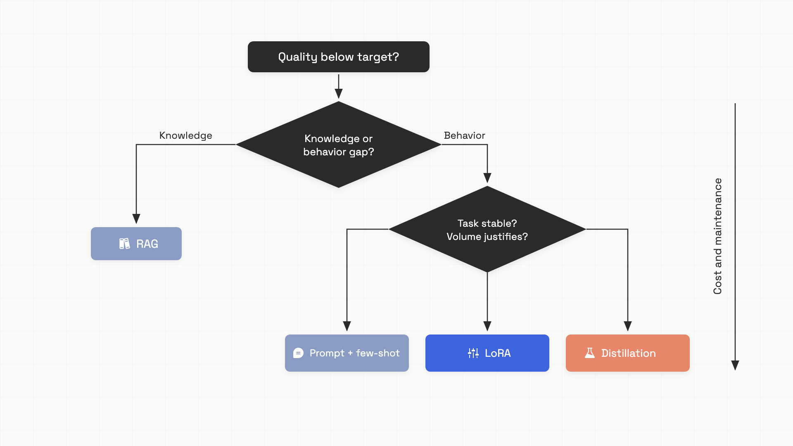

# The customization menu

A team building a customer support classifier sees their prompted GPT-5 model plateau at 87% accuracy. They want 92%. The eng lead says "let's fine-tune" and burns six weeks and $18,000 building a LoRA pipeline on internal traffic. The fine-tuned model scores 94 on their eval. They ship. New users complain. The eval-vs-production gap is twenty points.

What went wrong has a name: contamination. The fine-tuning data and the eval set came from the same query pool. The model didn't get smarter; it memorized the test.

This chapter is about three tools (supervised fine-tuning, LoRA, distillation) taught as decisions, not as techniques. The execution depth (training loops, hyperparameters, optimizer choice) belongs in your provider's docs and to people whose job is full-time ML engineering. What you need as an AI engineer is the decision framework: when each is the right call, what it costs, and the failure modes that bite hardest.

## The escalation order

[The escalation ladder](../part-0-start-here/03-the-escalation-ladder.md) established the order back in Part 0: prompt, context, retrieval, tools, agent, fine-tune. Fine-tuning is the last rung because it's the most expensive in compute, time, data, and ongoing maintenance, and because prompt engineering reaches roughly 80% of fine-tune quality on most tasks.[^1] The 80% number is empirical, not a guarantee. For phishing detection, fine-tuning beats prompting by 10 F1 points. For some clinical classifications, prompting and fine-tuning land within noise of each other. You can't predict which side your task lands on without measuring both.

Before you reach for any customization tool, the first decision is: what kind of gap is this?

- **Knowledge gap.** "The model doesn't know our last quarter's product updates." That's a retrieval problem. Add [RAG](../part-6-retrieval-augmented-generation/00-when-you-actually-need-rag.md), don't fine-tune. Ovadia et al. (EMNLP 2024) showed RAG consistently beats unsupervised fine-tuning for injecting factual knowledge, and a fine-tuned model goes stale the moment your data does.[^2]
- **Behavior gap.** "The model produces the wrong output format" or "ignores the persona" or "won't follow our schema reliably." That's where fine-tuning earns its keep. RAG can't fix output structure.
- **Both.** Fine-tune for behavior, layer RAG for knowledge. The two compose.

If the gap is knowledge: stop reading and go fix retrieval. The rest of this chapter is for behavior gaps and for the small set of cases where API economics genuinely fail.

## Three tools, three decisions


*The customization menu as a decision tree. The cheapest answer at the top, the most expensive at the bottom; you only descend when the rung above genuinely failed.*

**Supervised fine-tuning (SFT)** continues gradient-based optimization on all model parameters using a dataset of prompt-response pairs. Every weight in every layer gets updated. The result is the deepest possible behavioral adaptation, but the cost is proportional: full SFT on a 7B model needs 100-120 GB of VRAM; 70B requires multi-node H100 clusters even in mixed precision.[^1] LIMA (Zhou et al., NeurIPS 2023) showed that 1,000 carefully curated examples can match models trained on 100,000+ examples; the takeaway is that data quality dominates quantity, not that fine-tuning is cheap.[^3]

**LoRA** (Low-Rank Adaptation, Hu et al. 2021) freezes the pretrained weights and instead trains small rank-decomposition matrices that get merged back into the weights at serving time.[^4] For GPT-3 175B at rank 4, LoRA reduced trainable parameters by 10,000x and GPU memory by 3x compared to full SFT. There's no inference latency added, because the adapter is folded into the base weights before serving.

The Biderman et al. paper at TMLR (August 2024) is the definitive comparison: LoRA learns less and forgets less than full SFT.[^5] On deep domain adaptation (like learning a new codebase's style from 20B tokens), LoRA underperforms because the rank required to capture the update is 10-100x what people typically configure. On behavioral adaptation from a few thousand high-quality examples, LoRA matches or approaches full SFT and preserves the base model's capabilities outside the target task much better. A March 2026 controlled experiment measured 0.6% catastrophic forgetting under LoRA versus 19.9% under full SFT (paired t-test, p=0.002).[^6]

**Distillation**, for LLMs, is operationally simple: prompt a large teacher to generate a dataset for your task, then fine-tune a smaller student on that dataset. Hsieh et al. ("Distilling Step-by-Step", ACL 2023) showed a 770M T5 model distilled with chain-of-thought rationales beating a 540B PaLM model prompted few-shot, using 80% of the data.[^7] The student isn't smarter than the teacher; it's a compressed shortcut for one narrow task. That's both the power and the limit.

Three rules that fall out:

- **Choose LoRA over full SFT** unless you're doing genuine deep domain adaptation on billions of tokens. For most behavioral adaptation, LoRA is faster, cheaper, and forgets less.
- **Don't distill from a weak teacher.** If the teacher tops out at 70% accuracy on your task, the student tops out below 70%. Fix the teacher's prompting first.
- **Distillation is for deployment constraints, not API savings.** Apple Intelligence runs a distilled model on a phone NPU because nothing else is physically possible. Most teams don't have that constraint, and frontier API prices dropped roughly 80% over 2024-2026, which collapsed the per-token savings argument.[^8]

## The break-even calculation that decides

Before any fine-tuning project, do the math. Break-even months equals training cost divided by monthly inference savings. The full training cost includes data preparation (20-40% of total project cost), MLOps engineering ($170K-$215K loaded for someone who's done this before), and ongoing retraining cycles when the base model updates.[^1]

```python
def break_even_months(
    training_cost_usd: float,
    monthly_volume_m_tokens: float,
    saving_per_m_tokens: float,
) -> float:
    """Break-even = total training cost / monthly inference savings."""
    monthly_savings = monthly_volume_m_tokens * saving_per_m_tokens
    return training_cost_usd / monthly_savings if monthly_savings > 0 else float("inf")

# Example: $20K training, 10M tokens/month, $1/M savings -> 24 months
print(f"{break_even_months(20_000, 10, 1.0):.0f} months")
```

The decision rules: if break-even exceeds 6 months, don't fine-tune. If it exceeds 12 months, distillation is also probably wrong; stay on the API.[^1] Behind those numbers is the unromantic fact that frontier model prices keep dropping, base models keep getting better, and a fine-tuned model trained today is depreciating from the day it ships.

## The contamination trap

Now the part that bites hardest.

Contamination is when evaluation examples (or close paraphrases) end up in the training set. The model memorizes the eval; reported scores look great; production quality is unchanged. Every subsequent eval becomes a memorization test, and the team ships with confidence they haven't earned.

It's invisible. It's common. And it's structurally hard to fix once it's happened.

The public benchmark world has been documenting this for two years. SWE-bench Verified showed a 10.6% leakage rate; OpenAI publicly stopped reporting on it in late 2025 after their internal audit found every major frontier model could reproduce verbatim gold patches for some tasks.[^9] The Inference-Time Decontamination paper (arXiv:2601.19334, 2026) found roughly 22.9% accuracy reduction on GSM8K and 19.0% on MMLU when properly controlling for contamination. A frontier model that scored 93.9% on SWE-bench Verified scored 45.9% on the contamination-controlled SWE-bench Pro. That's a 48-point gap.

For your own fine-tuning project, contamination doesn't usually happen through malice. It happens through legitimate pipelines. The eval set you built in month 1 came from user queries. The fine-tuning set you're assembling in month 3 also comes from user queries. If the split wasn't enforced at collection time, there's no reliable way to detect the overlap retroactively.

```python
import hashlib

def ngram_hashes(text: str, n: int = 13) -> set[str]:
    tokens = text.split()
    return {
        hashlib.md5(" ".join(tokens[i:i+n]).encode()).hexdigest()
        for i in range(max(0, len(tokens) - n + 1))
    }

def contamination_rate(eval_examples: list[str], training_corpus: list[str], n: int = 13) -> float:
    """Fraction of eval examples with at least one 13-gram match in the training corpus.
    Above ~5% warrants a full audit. (GPT-3 used this method.)
    """
    corpus_hashes: set[str] = set()
    for doc in training_corpus:
        corpus_hashes.update(ngram_hashes(doc, n))
    contaminated = sum(1 for ex in eval_examples if ngram_hashes(ex, n) & corpus_hashes)
    return contaminated / len(eval_examples) if eval_examples else 0.0
```

That's a starting probe, not a guarantee. The 13-gram hash technique is what GPT-3's training pipeline used.[^9] If you see overlap above 5%, run a full audit. Better: prevent contamination structurally.

The prevention rules are organizational, not technical:

- **Designate the test split before any fine-tuning data collection begins.** Store it separately, access-controlled. Never use those examples as training data or as seed prompts for synthetic data generation.
- **Maintain a held-out twin.** A private split of equal distribution and difficulty. A clean model scores within statistical noise of the public eval; a contaminated model scores systematically higher on the public split.
- **For synthetic data: prompt the teacher with held-out production traffic that wasn't used to build the eval set.** Otherwise the synthetic distribution mismatches reality and the student degrades on real users.

LiveCodeBench and LiveBench solved the public benchmark version of this by tagging every problem with a publication date and only evaluating with problems released after a model's training cutoff. SWE-bench Pro uses private GPL-licensed repositories. The pattern is the same: structural barriers replace organizational trust.[^9]

## Buy vs build

If you do decide to fine-tune, the buy-vs-build question is mostly settled by where you're already running. As of June 2026:

- **Google Vertex AI** charges $5/M training tokens for Gemini 2.5 Flash supervised fine-tuning, $25/M for Gemini 2.5 Pro. Tuned-model inference is the same price as base-model inference for Gemini 2.5 and earlier; that changes for newer models.[^10]
- **OpenAI** is winding down its self-serve fine-tuning platform. The platform is no longer accessible to new users. Reinforcement fine-tuning of o4-mini costs $100/hour of training time, with inference at $4/M input tokens.[^11]
- **Self-hosted LoRA** via HuggingFace PEFT eliminates per-token training fees but requires GPU infrastructure, experiment tracking, and serving. Budget $170K-$215K/year for the engineer who runs it competently.[^1]

The pattern: at low-to-moderate volume, managed fine-tuning APIs win on operational cost even when their per-token rates look high. At high volume with stable tasks, self-hosted LoRA on top of a self-hosted base model is the destination, but only after you've proved the volume is real and the task definition is stable.

## Where this leaves you

Most teams shouldn't fine-tune. Prompt engineering exhausts faster than they expect, RAG handles the knowledge gap, and the break-even math doesn't pencil. The teams that should fine-tune (Harvey AI, with 10+ billion tokens of US case law that doesn't exist in any pretraining corpus; Apple, deploying on a phone NPU) have a forcing function: a knowledge corpus genuinely outside pretraining, or a deployment constraint that rules out cloud inference.[^1]

If you're considering it, run the gates in order. Is the gap behavior or knowledge? If knowledge, fix retrieval. If behavior, has prompting been exhausted? If yes, does the break-even land under 6 months? If yes, can you guarantee the fine-tuning data is split clean from your eval set? If you can't say yes to all four, you're not ready to fine-tune yet.

## References

[^1]: Tian Pan, "Fine-Tuning Is Usually the Wrong Move: A Decision Framework for LLM Customization", TianPan.co, April 2026, https://tianpan.co/blog/2025-11-06-fine-tuning-vs-prompt-engineering-decision-framework
[^2]: Oded Ovadia et al., "Fine-Tuning or Retrieval? Comparing Knowledge Injection in LLMs", EMNLP 2024, arXiv:2312.05934, https://arxiv.org/abs/2312.05934
[^3]: Chunting Zhou et al., "LIMA: Less Is More for Alignment", NeurIPS 2023, arXiv:2305.11206, https://arxiv.org/abs/2305.11206
[^4]: Edward Hu et al., "LoRA: Low-Rank Adaptation of Large Language Models", arXiv:2106.09685, October 2021, https://arxiv.org/abs/2106.09685
[^5]: Dan Biderman et al., "LoRA Learns Less and Forgets Less", Transactions on Machine Learning Research, August 2024, arXiv:2405.09673, https://arxiv.org/abs/2405.09673
[^6]: arXiv:2603.27707, "Catastrophic Forgetting in Sequential Fine-tuning", March 2026
[^7]: Cheng-Yu Hsieh et al., "Distilling Step-by-Step!", ACL Findings 2023, arXiv:2305.02301, https://arxiv.org/abs/2305.02301
[^8]: Tian Pan, "Knowledge Distillation Economics: When Compressing a Frontier Model Actually Pays Off", TianPan.co, April 2026, https://tianpan.co/blog/2026-04-09-knowledge-distillation-economics-production-ai
[^9]: Tian Pan, "The Benchmark Leak: How Your Eval Set Quietly Joins the Training Corpus", TianPan.co, April 2026, https://tianpan.co/blog/2026-04-23-benchmark-leak-eval-contamination
[^10]: Google, "Vertex AI Generative AI pricing", June 2026, https://cloud.google.com/vertex-ai/generative-ai/pricing
[^11]: OpenAI, "Developer pricing", June 2026, https://developers.openai.com/api/docs/pricing
