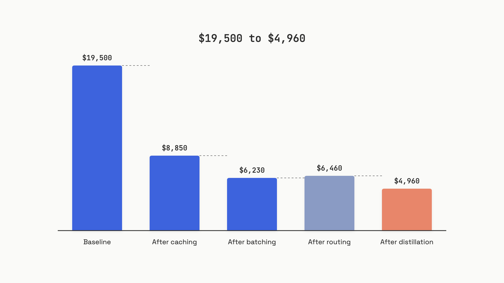

# Cost engineering

A SaaS product running 1 million monthly support-ticket summaries on Claude Sonnet 4.6 pays $19,500 a month. Caching and batching alone, configuration changes with no training and no quality cliff, bring that to roughly $6,200. Training a distilled student for the narrowest slice of the workload pushes it to about $5,000 and, more importantly, turns the biggest remaining line item into flat GPU rent that stops scaling with volume.

This chapter is the math. Each lever attacks a different part of the bill, and they multiply. Get one right and you save 50%. Get all five right and the bill drops by three-quarters, with the stubborn remainder flat instead of linear.

## The bill has one line item

Every API charge is the same arithmetic: tokens processed times price per token. The five levers don't change that line; they change the effective price per token by routing the work through cheaper paths.

| Lever | What it changes | Typical savings |
|---|---|---|
| Prompt caching | Cached tokens billed at 10% of base | 30-70% on cacheable input |
| Batching | Async tokens billed at 50% off | 50% on batch-eligible work |
| Model routing | Easy queries go to cheaper tiers | 30-85% on routed traffic |
| Quantization | Self-hosted weights at lower precision | 2-7x cheaper GPU serving |
| Distillation | Narrow tasks served by a 7B student | 25-130x on stable narrow tasks |

The ordering matters: easiest payoff first, hardest investment last. If you've never optimized an LLM bill, the first two levers are usually 60-70% of the total savings, and you can ship them in a week.

## Lever 1: prompt caching

Every LLM call is stateless. The provider re-runs prefill (full KV computation) over every token you send. Prompt caching stores the KV tensors for a stable prefix, then serves them on subsequent requests at roughly 10% of the base input rate. The discount is consistent across providers; the implementations differ.

For Claude Sonnet 4.6 as of June 2026: base input $3.00/MTok, cache-read $0.30/MTok, cache-write at 5-minute TTL $3.75/MTok (1.25x base), 1-hour TTL $6.00/MTok (2.0x base).[^1] Anthropic requires you to mark cacheable content blocks with `cache_control`. OpenAI's caching is fully automatic on prefixes longer than 1,024 tokens, with a 90% discount on cached input.[^2] Google Gemini requires explicit `cachedContent` resources with a per-MTok-per-hour storage charge.[^3]

The break-even is fast. For Anthropic's 5-minute TTL: `(3.75 - 3.00) / (3.00 - 0.30) = 0.28`, which means a single cache hit after the write recoups the surcharge. Below that one hit, you've lost money. Above it, you save almost everything.

The pitfall is the one that bites every team:

> [!WARNING]
> **Watch `cache_creation_input_tokens` vs `cache_read_input_tokens` in the API response.** If creation is non-zero on every request and reads stay near zero, your cache is never hitting. Almost always: a timestamp, user ID, or per-request value snuck inside the cached block, breaking the prefix hash. Move all dynamic content to *after* the cache breakpoint.

For deeper coverage of the per-provider mechanics, see [Prompt caching](../part-2-working-with-model-apis/07-prompt-caching.md). The decision rule for this chapter: if your stable prefix is at least 1,024 tokens and gets reused across requests within the TTL window, cache it.

## Lever 2: batching

All three major providers offer an async batch API: 50% off both input and output, 24-hour turnaround, identical model, identical quality.[^4] Anthropic's Message Batches API takes up to 100,000 requests or 256 MB per batch; results sit in the queue for 29 days. Most batches finish within an hour despite the 24-hour SLA.

The single decision: can the user wait? If yes, batch it. Nightly summarization, evals pipelines, document processing, daily digest jobs, internal analytics, RAG ingestion. All natural fits. Real-time chat, agent tool calls, and anything user-facing aren't.

Batching stacks cleanly with caching. The cached portion of an input gets the 10% rate; the batch discount applies on top. A cached token in a batch request is billed at 0.10 x 0.50 = 5% of the standard rate.[^4] Use the 1-hour cache TTL with batch workloads; the 5-minute default expires before async processing typically completes.

## Lever 3: model routing

Not every request needs a frontier model. A ticket asking "what are your business hours" doesn't need GPT-5.5. A complex multi-step debugging request does. Model routing classifies each query and dispatches it to the cheapest tier that meets your quality bar, with the frontier as fallback.

The UC Berkeley RouteLLM paper (Ong et al., 2024) showed an 85% cost reduction on MT Bench while retaining 95% of GPT-4 quality, using a matrix factorization router trained on Chatbot Arena preference data.[^5] The 2026 closed-loop routing paper (arXiv:2604.23577) extended this to multi-class routing across production workloads, hitting 40-85% cost reduction while keeping 96-100% quality on structured tasks.[^6]

The price spread between tiers as of June 2026 sets the maximum leverage:

- **Claude Haiku 4.5 vs Sonnet 4.6:** $1.00/$5.00 vs $3.00/$15.00 per MTok input/output, a 3x gap
- **GPT-5.4-mini vs GPT-5.5:** $0.75/$4.50 vs $5.00/$30.00, a 6.7x gap
- **Gemini 3.1 Flash-Lite vs 3.5 Flash:** $0.25/$1.50 vs $1.50/$9.00, a 6x gap

Three implementation styles, in order of complexity:

1. **Rule-based routing.** Classify by request type, token length, or business-logic flag. Zero ML overhead. Easiest to audit. The right default if your query types are well-defined.
2. **Classifier-based routing.** Train a small model (logistic regression or a fine-tuned BERT-class encoder) to predict whether the cheap tier will meet quality. Requires a labeled eval set.
3. **Cascading.** Send to the cheap model first, judge the output, escalate on failure. No pre-routing training needed but adds latency on escalations.

The pitfall is the quality cliff. Queries near the routing threshold have the highest variance in quality, and degradation often shows up as confident wrong answers the user acts on. Run a shadow eval: for 1-5% of routed requests, also call the frontier model and compare with an LLM judge. Move thresholds based on quality data, not cost targets. See [LLM-as-judge](../part-8-evaluation-and-observability/01-llm-as-judge.md) for the judge mechanics.

The other interaction worth knowing: routing breaks caching unless you cache per-tier. A prefix cached for Sonnet can't be reused on Haiku, even if the bytes match. Set up the same `cache_control` breakpoints on every request and accept the per-tier write cost.

## Lever 4: quantization (self-hosted only)

Quantization reduces the precision of model weights from 16-bit BF16 down to 8-bit (FP8 or INT8) or 4-bit (W4A16 INT4). This shrinks GPU memory, fits larger models on smaller hardware, and serves more concurrent requests on the same cluster.

The most thorough study is Kurtic et al. (Red Hat AI, arXiv 2411.02355), which evaluated three formats in vLLM 0.6.4 across Llama 3.1 8B/70B/405B on A6000/A100/H100:[^7]

- **W8A8-FP (FP8).** Lossless in practice. Requires Hopper or Ada Lovelace hardware. Best for high-throughput async deployments. 1.84-3.17x cost reduction vs BF16.
- **W8A8-INT (INT8).** 1-3% accuracy degradation on average. Needs SmoothQuant for 70B+ models.
- **W4A16-INT (INT4 weights, FP16 activations).** Best for synchronous latency-sensitive deployment. 2-3x cost reduction for 8B/70B; 5-7x for 405B (4x A100s instead of 16x).

The headline rule: W4A16-INT for synchronous serving, W8A8-FP for async batching, FP8 on H100s when you can afford it.

This lever applies only when you're serving open-weight models on your own GPUs. Hosted APIs manage quantization internally; you don't have a knob. For the worked example below, this lever contributes zero to a Claude API workload, but it's the primary cost-reduction mechanism if you've already migrated bulk traffic to a self-hosted student model.

## Lever 5: distillation

Distillation trains a smaller student model to replicate a larger teacher's outputs on a narrow task. The mechanism and decision framing live in [The customization menu](02-the-customization-menu.md); this chapter uses distillation as a cost lever and focuses only on ROI.

The Amazon PGKD paper (arXiv 2411.05045) demonstrated 130x faster inference and 25x lower cost than the frontier teacher for narrow text classification.[^8] Those numbers are real but task-specific: classification, not general generation. For more general workloads, the gain is smaller and depends heavily on whether you've fixed the teacher's prompting first.

The 2024-2026 economics shifted hard. Frontier API prices dropped roughly 80%, narrowing the per-token savings argument. Today's strongest cases for distillation:

- **Sub-100ms latency** that no hosted API can hit
- **Privacy-constrained deployment** (data can't leave a private network)
- **Tens of millions of requests** on a stable narrow task where a $3,000/month 7B student beats $20,000/month frontier API calls

Break-even formula: training cost divided by monthly inference savings. Training a 7B student from a frontier teacher costs $5,000-$30,000 in compute alone before labor. If your monthly savings are $500, break-even is 10-60 months. Don't do it.[^9]

## The worked example

Now stack everything on the $19,500/month workload. Setup:

- 1 million requests per month
- 4,500 tokens per request input (4,000 stable system prompt + 500 ticket-specific)
- 400 tokens per request output (JSON summary)
- Base model: Claude Sonnet 4.6 ($3.00 input / $15.00 output per MTok)

```text
Baseline:
  input:  1,000,000 x 4,500 tokens x $3.00/MTok  = $13,500
  output: 1,000,000 x 400   tokens x $15.00/MTok = $6,000
  total                                          = $19,500/month
```


*Five levers stacked across the same workload. Each step is the cumulative bill after applying one more lever. The largest single drop is prompt caching; the second is batching; distillation trims the rest and flattens it against future volume.*

**After lever 1 (caching):** the 4,000-token system prompt is identical across every request. Mark it cacheable. 4,000 of 4,500 input tokens (89%) hit the cache after the first write. Assuming one cache-write event per 100 requests as the 5-minute TTL refreshes:

```text
cache reads:  4,000 x $0.30/MTok x 1,000,000 = $1,200
uncached:     500   x $3.00/MTok x 1,000,000 = $1,500
cache writes: 4,000 x $3.75/MTok x 10,000    = $150
output:                                        $6,000
total                                          $8,850 (55% off baseline)
```

**After lever 2 (batching):** 60% of these summaries are nightly digest jobs that can wait 24 hours. Submit those via the Message Batches API at 50% off, both input and output. Real-time portion stays full-rate.

```text
total after caching + batching: ~$6,230 (68% off baseline)
```

**After lever 3 (routing):** review query distribution and find that 55% are simple extraction Haiku 4.5 handles at the same eval scores. Route those to Haiku ($1.00/$5.00 per MTok). The remaining 45% stay on Sonnet 4.6.

In this scenario routing barely moves the bill, ending at about $6,460. The routed requests lose the caching benefit because the Haiku cache is a separate namespace from the Sonnet cache. Routing only helps significantly when you also configure caching on the cheaper tier or when the routed volume is overwhelming.

**After lever 5 (distillation):** 30% of the workload is narrow ticket classification (billing/technical/account routing). Train a 7B student on synthetic teacher outputs. Training: $15,000 one-time. Serving: at this volume the distilled slice averages about 0.1 requests per second, which a single L4 GPU handles with headroom, roughly $600/month on-demand. Quoted as a per-token rate that's about $0.40 per MTok equivalent, but the per-token framing buries the real property: the GPU is a flat cost that doesn't move when token volume does.

```text
that 30% on Sonnet (with cache + batch) would cost:   ~$1,870
distilled portion (300K req): one L4 GPU, flat:         ~$600
remaining 700K req on Sonnet (with cache + batch):    ~$4,360
total: ~$4,960/month (75% off baseline)
```

Amortizing the $15,000 training cost over 12 months adds $1,250/month, putting year one at about $6,210, barely below the caching-and-batching bill. That's the honest read: at this volume, distillation is a bet on growth, not a windfall. The API levers scale with the bill; the GPU line doesn't. At triple the volume, the distilled slice still costs ~$600 while its Sonnet equivalent would cost ~$5,600 a month, and the bet has paid off. Run the break-even before you train, not after.

## What the levers don't tell you

Three things the math doesn't show but always matter.

The largest single mistake isn't picking the wrong lever; it's shipping a lever and never measuring it. Every team that thinks it's caching but isn't has the same symptom: cache_creation_input_tokens stays high while cache_read_input_tokens stays near zero. Wire those metrics into your dashboard before you ship. See [Monitoring and dashboards](../part-8-evaluation-and-observability/07-monitoring-and-dashboards.md) for the panel design.

The second is that prices rot fast. Every number in this chapter is dated mid-2026 and will be wrong by the time you read it. The math doesn't change; the inputs do. Re-run the worked example against current rates before you cite the 75% number to anyone.

The third: cost reductions that hurt quality aren't reductions. Routing thresholds set by cost targets and not validated by judges create silent regressions. Distilled students that aren't retrained drift. Quantized weights that pass MMLU can fail on the long-tail reasoning cases your users actually send. Treat every lever as a deployment, not a config change. The next chapter, [Latency engineering](04-latency-engineering.md), faces the same pattern from the time axis.

## References

[^1]: Anthropic, "Prompt caching", official documentation, June 2026, https://docs.anthropic.com/en/docs/build-with-claude/prompt-caching
[^2]: OpenAI, "API pricing", June 2026, https://openai.com/api/pricing/
[^3]: Google, "Gemini API pricing", June 2026, https://ai.google.dev/gemini-api/docs/pricing
[^4]: Anthropic, "Message Batches API", official documentation, June 2026, https://docs.anthropic.com/en/docs/build-with-claude/batch-processing
[^5]: Isaac Ong et al., "RouteLLM: Learning to Route LLMs from Preference Data", UC Berkeley Sky Computing Lab, July 2024, https://sky.cs.berkeley.edu/project/routellm/
[^6]: arXiv:2604.23577, "Closed-Loop LLM Routing with Conformal Cascading and Distillation Co-Optimization", April 2026, https://arxiv.org/abs/2604.23577
[^7]: Eldar Kurtic et al., "Give Me BF16 or Give Me Death? Accuracy-Performance Trade-offs in LLM Quantization", arXiv:2411.02355, November 2024, https://arxiv.org/abs/2411.02355
[^8]: Amazon Science, "Performance-Guided Knowledge Distillation for Efficient Text Classification", arXiv:2411.05045, November 2024, https://arxiv.org/abs/2411.05045
[^9]: Tian Pan, "Knowledge Distillation Economics", TianPan.co, April 2026, https://tianpan.co/blog/2026-04-09-knowledge-distillation-economics-production-ai
