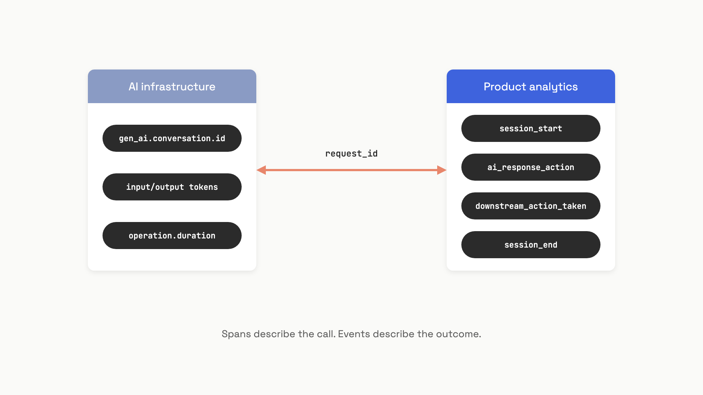

# AI product metrics

A team ships an AI feature and instruments it the way they instrument every other feature: latency histograms, token counts, error rates, all wired to OpenTelemetry. Three months in, the dashboards are green and retention is dropping. The OTel spans tell them everything about the API call. They tell them nothing about whether the user's problem got solved.

That's the gap this chapter is about. Model accuracy measures whether an LLM produces a technically correct output in isolation. Product metrics measure whether a user accomplished something they came to do. The two diverge in both direction and magnitude: a system that scores 90% on benchmarks can sit at 40% task success rate if users can't phrase their goals as benchmark questions, if the system can't take the actions needed to finish a multi-step task, or if each step is slow enough that users give up.

Five metrics carry the weight here, and they live on a different layer than your spans: Task Success Rate, Deflection Rate (with the three definitions everyone uses interchangeably), Escalation Rate, Time-to-Completion, and Feature Retention. Each one needs instrumentation the LLM call doesn't give you for free.

## Two layers, one join key

OpenTelemetry's GenAI semantic conventions (v1.41.1, status: Development as of June 2026) standardize span attributes for the LLM call: `gen_ai.client.operation.duration`, `gen_ai.response.time_to_first_chunk`, `gen_ai.usage.input_tokens`, `gen_ai.usage.output_tokens`, `gen_ai.conversation.id`.[^1] These describe an API call. They don't describe what the user did with it.

The product analytics layer, where session events live (Amplitude, Mixpanel, your own pipeline), is where you record what actually happened. Did the user accept the suggestion? Did they regenerate? Did they complete the downstream action? Did they come back tomorrow? The two layers join via a shared `request_id` or via `gen_ai.conversation.id` propagated through both systems. Joining them is the prerequisite for every metric in this chapter.


*OTel spans live on the left and tell you about the call; product events live on the right and tell you about the outcome. The join key is the only thing that makes either useful.*

The teams that get this wrong build extraordinary infrastructure dashboards and call them product dashboards. They aren't. Use OTel for latency SLOs, cost tracking, and error rates. Use product analytics for whether anything got done.

## Task Success Rate, with a real predicate

NVIDIA's agentic evaluation guidance frames TSR as "intent plus constraints": "Update this record through this API within two tool calls. Measure success only when the agent fully resolves the intent within those constraints."[^2] Without an explicit binary success predicate, TSR can't be computed. Teams that don't have one quietly substitute proxies: thumbs-up rate, no-escalation rate, response quality scores from an LLM judge. Each proxy passes while the real metric fails.

The success predicate has to be a downstream action the user took, not a thing the AI said. Workable defaults by feature type:

- **Customer support:** user did not re-contact within 48 hours.
- **Code assistant:** suggestion committed without modification.
- **Document drafting:** document published or shared.
- **Search/RAG:** user clicked a result *and* didn't issue a follow-up rephrase within 5 minutes.

The other discipline TSR demands is segmentation. A single unsegmented number averages very different task types with very different baseline difficulty, and that mean hides which categories are failing. Track TSR per scenario (normal, degraded tools, ambiguous instructions) so brittleness has somewhere to surface.

## Deflection vs. containment vs. resolution

Three terms get used interchangeably and they're not the same number:[^3]

- **Raw deflection rate:** contacts closed without a human, including users who gave up. Inflated by abandonment.
- **Containment rate:** contacts where the user reached the end of the AI interaction without escalating. Strict subset of deflection. Still doesn't confirm the problem got solved.
- **True resolution rate:** containment plus an outcome the user accepted (downstream action, post-interaction CSAT, no re-contact within 48 hours).

Voiceflow's enterprise data (March 2026) puts the realistic ranges at: 70-90% containment for Tier 1 well-defined tasks like account management within the first months; 50-70% at six months for mixed Tier 1 and Tier 2 scopes; 40-60% for full support scopes including complex edge cases.[^3] Vendor benchmarks of "80-90% deflection" almost always use raw deflection on a narrow workload. They aren't lying; they're using the loosest definition.

The failure mode is deflection theatre. A team under pressure to hit a deflection target makes escalation harder to find, reduces the AI's willingness to say "I don't know," and adds friction to human handoff. Raw deflection climbs. CSAT drops. Re-contact rate climbs. The dashboard stays green because the metric was wrong from the start.

The discipline that catches this: never report deflection alone. Always pair with re-contact rate within 24-48 hours. If re-contact for AI-handled contacts exceeds 15%, raw deflection is inflated and you're quietly failing users who were counted as wins. The economics make the temptation real. Microsoft Copilot Studio (January 2026) reports a human support contact at $5-$10 and an AI session at roughly $0.50.[^4] A 10x cost ratio is enough to corrupt almost any metric you put in front of it.

## Escalation rate as an AI-quality signal

Most organizations read escalation rate as a workforce-planning metric. The AI team should read it as a quality signal, and most of them aren't.[^5] When the AI team ships a capability regression and escalation climbs six points over four weeks, ops sees a headcount question and hires two more agents. The eval suite stays green because the test set doesn't sample whatever new query patterns are causing the regression. The root cause never gets investigated.

Splitting escalations into four categories makes the signal legible:

- **Policy escalations:** AI could handle it but routing rules require a human (refunds above threshold, identity verification). Should be flat across releases; trend means a routing bug.
- **Capability escalations:** AI tried, ran tools, and chose to hand off because confidence was low. *This is the AI team's signal.*
- **Refusal escalations:** AI declined on safety grounds. Requires content review because over-refusal is invisible in queue counts.
- **Abandon escalations:** user gave up mid-conversation and hit you on a different channel. Requires cross-channel session joins to detect.

The threshold-alert pattern fires too late. The pattern that catches drift early is the SRE multi-window burn-rate alert: short window (6 hours) and long window (7 days) both above some multiplier of the planning baseline. A drift from 18% to 24% over six weeks should fire at week three, not show up as a staffing memo at week eight.

```python
from dataclasses import dataclass
from datetime import datetime, timedelta

@dataclass
class EscalationDataPoint:
    timestamp: datetime
    escalated: bool
    cohort: str

def burn_rate_alert(points, short_h=6.0, long_h=168.0,
                    baseline=0.22, multiplier=1.3, now=None):
    now = now or datetime.utcnow()
    short_pts = [p for p in points if p.timestamp >= now - timedelta(hours=short_h)]
    long_pts = [p for p in points if p.timestamp >= now - timedelta(hours=long_h)]
    rate = lambda pts: sum(1 for p in pts if p.escalated) / len(pts) if pts else 0.0
    threshold = baseline * multiplier
    return {
        "firing": rate(short_pts) > threshold and rate(long_pts) > threshold,
        "short_rate": round(rate(short_pts), 3),
        "long_rate": round(rate(long_pts), 3),
        "threshold": round(threshold, 3),
    }
```

A blended hybrid cost model often plans around 22% AI-to-human escalation, with healthy production platforms landing between 15% and 30% depending on task complexity.[^5] The sustainable automation rate for a well-tuned help-desk agent on mixed-complexity queues is closer to 65-75%, putting the escalation floor at 25-35%.[^6] These are starting points, not targets.

## Time-to-completion: anchor on the user, not the API

Two distinct metrics get conflated under "latency." Turn latency is time from user message to first visible AI token, which is the OTel `gen_ai.response.time_to_first_chunk` and an infrastructure concern. Task completion time is the full elapsed wall-clock from task initiation to a completion or abandonment signal: AI response time plus user review time plus iteration time plus downstream action time. That's the product metric.

The instrumentation pitfall: anchoring task completion on the LLM call timestamp instead of when the user actually started the task. A support interaction that "took 45 seconds" by the LLM-anchored measurement may have taken 2 minutes and 15 seconds from the user's perspective, because they spent 90 seconds formulating the request before sending it. The check is to compare LLM-anchored TTC with UI-anchored TTC for a sample of sessions; a 30%+ divergence means the easier metric isn't a valid proxy.

Two reference points anchor the SLO conversation. 90% of customers say a quick response is critical and 60% define "immediate" as within 10 minutes.[^7] AI-mediated support consistently hits resolution times under 5 minutes against 15-45 minutes for human queues. If your median TTC for AI-handled tasks is more than 2x the median TTC for human-handled tasks in the same category, users will abandon to human channels regardless of how well the AI resolves the cases that complete.

## Feature retention, not product retention

The product retention dashboard says the feature is healthy. It isn't. Users are returning to the product for non-AI features and never touching the AI assistant after day three. That's the feature retention failure, and it's invisible if you only measure at the product level.

Andreessen Horowitz's analysis of hundreds of AI companies (September 2025) identified a distinctive shape: an initial steep drop in months 0-3 as non-core users exit, then flattening for users who found repeatable value.[^8] They call the early dropoff "tourist churn" and recommend M12/M3 (month-12 retention divided by month-3 retention) as the forward-looking health signal, because it normalizes out the curiosity-driven decline.

The other AI-specific pathology is the novelty cliff: abnormally high D1/D7 engagement followed by steep dropoff once users realize the feature only works for a narrow slice of their actual work. The fix is to instrument "successful task events" per session, not just "session with AI interaction," and track the activation funnel: what fraction of users had at least one successful task in sessions 1, 2, 3?

Amplitude's 2025 benchmark across 2,600+ companies found that over 98% of new users churn within two weeks when they never hit a value milestone.[^9] The implication: feature retention is downstream of activation. If your D7 feature retention sits below 20% on a B2B product, the bottleneck isn't the model, it's that users aren't completing a successful task in their first sessions. Address the activation funnel before optimizing the prompt.

```python
from dataclasses import dataclass
from typing import List, Optional
from enum import Enum
import statistics

class UserAction(str, Enum):
    ACCEPTED = "accepted"
    REJECTED = "rejected"
    REGENERATED = "regenerated"
    ESCALATED = "escalated"
    ABANDONED = "abandoned"

@dataclass
class SessionRecord:
    session_id: str
    user_action: UserAction
    downstream_action_taken: bool
    task_duration_s: Optional[float]

def compute_metrics(sessions: List[SessionRecord]) -> dict:
    n = len(sessions)
    if n == 0:
        return {}
    n_success = sum(1 for s in sessions if s.downstream_action_taken)
    n_escalated = sum(1 for s in sessions if s.user_action == UserAction.ESCALATED)
    n_resolved = sum(1 for s in sessions
                     if s.downstream_action_taken and s.user_action != UserAction.ESCALATED)
    durations = [s.task_duration_s for s in sessions if s.task_duration_s is not None]
    return {
        "total": n,
        "task_success_rate": round(n_success / n, 3),
        "raw_deflection": round((n - n_escalated) / n, 3),
        "true_resolution": round(n_resolved / n, 3),
        "escalation_rate": round(n_escalated / n, 3),
        "median_ttc_s": round(statistics.median(durations), 1) if durations else None,
    }
```

These five metrics, instrumented correctly, are what tell you whether your AI feature is working. The OTel spans tell you whether the API is up. Both layers matter; treating either one as the whole picture is how green dashboards coexist with declining retention.

## References

[^1]: OpenTelemetry, "GenAI Semantic Conventions: Spans", v1.41.1 (Development), June 2026. https://opentelemetry.io/docs/specs/semconv/gen-ai/gen-ai-spans/

[^2]: NVIDIA, "Mastering Agentic Techniques: AI Agent Evaluation", May 2026. https://developer.nvidia.com/blog/mastering-agentic-techniques-ai-agent-evaluation/

[^3]: Voiceflow, "What Ticket Deflection Rate Actually Means", March 2026. https://www.voiceflow.com/blog/what-ticket-deflection-rate-actually-means

[^4]: Microsoft, "Microsoft Copilot Studio: Deflection Overview", January 2026. https://learn.microsoft.com/en-us/microsoft-copilot-studio/guidance/deflection-overview

[^5]: Tian Pan, "Escalation Rate Is the Eval Signal Your Offline Tests Missed", May 2026. https://tianpan.co/blog/2026-05-11-escalation-rate-leading-indicator-offline-eval-missed

[^6]: Micheal Lanham, "The 10% Rule: Scale AI Agents to Production", May 31, 2026. https://micheallanham.substack.com/p/the-10-rule-scale-ai-agents-to-production

[^7]: Wayne Diamond / Desku, "Time to Resolution: Definition, Measurement and Reduction", January 2024 (updated June 2026). https://desku.io/helpdesk-glossary/what-is-a-resolved-ticket/

[^8]: Andreessen Horowitz, "Retention Is All You Need", September 2025. https://a16z.com/ai-retention-benchmarks/

[^9]: Digital Applied, "The 2026 SaaS Onboarding Metrics Framework" (citing Amplitude 2025 benchmark, 2,600+ companies), May 2026. https://www.digitalapplied.com/blog/customer-onboarding-time-to-value-2026-saas-metrics-framework
