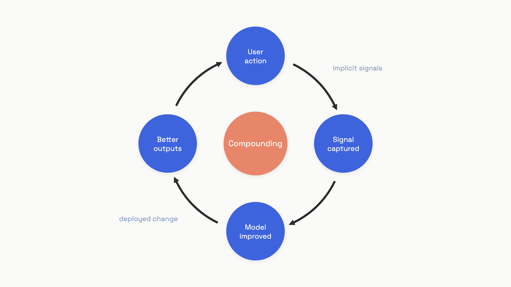

# Feedback and growth loops

Bloomberg trained a finance-tuned LLM on their substantial proprietary corpus, called it Bloomberg GPT, and beat GPT-3 on finance benchmarks at launch. Within a year GPT-3.5 and GPT-4 had eclipsed it.[^1] The lesson isn't that fine-tuning doesn't work. It's that a one-time data advantage decays as foundation models improve. The durable edge comes from a different shape: a product designed so user actions continuously generate signal that improves the AI in near real time, creating advantages that widen with scale.[^1]

That's a flywheel. Most AI teams don't have one. They have a log file.

The distinction matters because the gap between accumulating data and compounding improvement is structural, not technical. Tian Pan (May 2026) names three preconditions that must all hold simultaneously for the loop to actually compound: the feedback signal has to be valid, the loop has to physically close from user action to deployed change, and feedback latency has to be short enough to outpace foundation-model improvement cycles.[^2] Break any one and compounding stalls.

This chapter is the AI-product strategy view of that loop. The technical mechanics of error analysis, annotation pipelines, and judge alignment live in [Feedback and the data flywheel](../part-8-evaluation-and-observability/08-feedback-and-the-data-flywheel.md). What we cover here is why owning the loop is competitive advantage, what makes a real flywheel different from a survey, and what to instrument so the thing actually spins.

## The three preconditions

**Signal validity.** The feedback signal has to be causally linked to the target objective. A click on a code suggestion doesn't establish that the code was correct. A thumbs-down that could mean "wrong answer" or "offensive" or "I don't like this topic today" injects contradictory signal that degrades behavior on average even as it accumulates at scale. The test is direct: if the model learns from this signal, does it actually improve behavior for the target objective? If you can't answer yes with evidence, the signal is noise wearing a mask.

**Loop closure.** Data has to physically flow from user action through collection, labeling, and improvement to a deployed change. This sounds obvious until you audit the org and discover that ops logs LLM interactions to Datadog, the ML team fine-tunes from a different data warehouse, and nobody wired them together. A 2025 Gartner survey of 248 data management leaders found that 63% of organizations either lack or are unsure they have the right data management practices for AI.[^3] The gap is structural: ops owns logs, ML owns training data, and production signals evaporate in the gap between them.[^4]

**Adequate feedback latency.** If the cycle from user action to deployed improvement takes longer than 30 days with no intermediate validation, the team can't iterate faster than foundation models, and can't outrun competitors who do.[^2] Tesla processes fleet disengagements overnight. Most applied AI teams work with month-old logs. The team running weekly improvement cycles compounds 52 times per year. Monthly compounds 12. The gap widens geometrically.


*The loop, not the data, is the moat. Each revolution makes the next revolution easier.*

## Implicit signals are the volume layer

Explicit feedback (thumbs, stars, ratings) averages 0.5% to 5% of all interactions in production LLM deployments.[^5] At 1,000 daily active users and a 1% explicit feedback rate, you collect 10-30 rated examples per day. Detecting a 5% quality change with statistical confidence takes roughly 1,000 samples, which means a 30-100 day wait before any signal accumulates.

Implicit behavioral signals cover the entire user population without UI friction. For a code generation tool: accept vs. reject on inline suggestions, edit distance after acceptance (accepts with >50 character edits are weak negatives), immediate re-request with a modified prompt (strong failure signal), accepted code that gets reverted within minutes (retrospective failure signal). For chat and search: follow-up queries that rephrase the original (the first response missed), copy-paste behavior (high-value content gets copied), session abandonment after a response, return queries on the same topic hours later.

The regenerate button is the loudest implicit thumbs-down available: low-friction, semantically unambiguous, the user explicitly chose not to edit and not to keep.[^6] Coding assistants and image generation tools like Midjourney design interfaces around this insight: accept = strong positive, modify = positive, ignore or regenerate = negative, no extra UI click required.

The other reason to lean on implicit signals is that explicit ones lie at low volumes. The Morandi and Viswanathan paper (May 2026) demonstrates that naive averaging over thumbs-up/thumbs-down feedback can land 40-50 percentage points away from true system quality because users who provide feedback are disproportionately in the tails of the satisfaction distribution. One documented production deployment showed naive quality at 34% against recovered true quality of 83%, a 49-point gap.[^5]

```python
from dataclasses import dataclass

@dataclass
class InteractionBatch:
    total_interactions: int
    rated_interactions: int
    positive_ratings: int

    @property
    def feedback_rate(self) -> float:
        if self.total_interactions == 0:
            return 0.0
        return self.rated_interactions / self.total_interactions

    @property
    def naive_quality(self) -> float:
        if self.rated_interactions == 0:
            return 0.0
        return self.positive_ratings / self.rated_interactions

def selection_bias_warning(batch: InteractionBatch) -> dict:
    if batch.feedback_rate >= 0.05:
        return {"warning": False, "naive_quality": round(batch.naive_quality, 3)}
    return {
        "warning": True,
        "feedback_rate": round(batch.feedback_rate, 4),
        "naive_quality": round(batch.naive_quality, 3),
        "action": "Selection bias risk: corroborate with implicit behavioral signals.",
    }
```

The default architecture: implicit signals as the primary volume source, explicit binary ratings (pass/fail, never Likert scales) as ground-truth calibration for the subset of users who engage. Never use explicit ratings alone to measure absolute quality without bias correction.

## Closing the loop without doubling headcount

Once behavioral signals are captured, the bottleneck moves to labeling. Manual labeling at production scale isn't economic. Weak supervision (Snorkel, Ratner et al., VLDB 2017/2020) is the practical answer: instead of labeling individual examples, write labeling functions that classify based on patterns, and combine multiple noisy functions through a denoising step.[^7]

A labeling function for a coding assistant might say: if the user accepted the suggestion and didn't revert it within 10 minutes, label positive. Another: if the user explicitly rewrote more than 50% of the suggested code, label negative. Snorkel's empirical results: subject-matter experts build models 2.8x faster, with 45.5% average improvement in predictive performance over 7 hours of hand labeling, and within 3.60% of the predictive performance of large hand-curated training sets.[^7] The counterintuitive insight: 100,000 imperfect labels typically outperform 100 perfect ones. Quantity and coverage dominate label-level precision because the model averages over noise when trained on enough data.

Labeled data feeds two improvement paths. Fine-tuning produces durable gains but requires retraining infrastructure, evaluation gates, and deployment pipelines, with cycle times of weeks. Dynamic few-shot retrieval is faster: maintain a database of production traces with metric scores and human-provided fixes; at inference time, retrieve the most similar fixed traces and include them as few-shot demonstrations in the prompt.[^6] Hours to days, not weeks. Prompt engineering becomes a retrieval problem. The ceiling is lower (you can't fix fundamental model limitations this way), but the cadence is fast enough that most teams should default to it and escalate to fine-tuning only when the few-shot ceiling is hit.

The most powerful variant of the loop is reinforcement learning with verifiable rewards: the system generates output, automatically verifies correctness (the code compiles, the test passes, the SQL executes), and improves without waiting for human feedback. It only applies to domains where ground truth is mechanically checkable, but where it does apply, the loop spins as fast as you can run inference. Duolingo's Birdbrain student-model database updates 3,000 times per second with billions of entries.[^8] The signal (correct or incorrect on each exercise) is mechanically verifiable, no labeling required.

## What this looks like at scale

GitHub Copilot's signals loop (October 2025) is the published reference for end-to-end loop closure at scale. The latest code-completions model was trained on over 400,000 real-world samples from public repositories and further tuned via RL using synthetic training data. Result: 30%+ improvement in retained code, 35% improvement in speed, 20 million users.[^9] Microsoft's framing of the architectural shift: "as foundational models become increasingly commoditized, the long-term defensibility of AI products will not come from the model alone, but from how effectively those models learn from usage."[^9]

Microsoft's Dragon Copilot for clinical transcription took a similar path but with stricter eval gates because errors have patient-safety implications. Each model generation must pass automated metric benchmarks before deployment. The latest models outperform base foundation models by approximately 50% on clinical transcription accuracy, driven by continuous fine-tuning on physician corrections to AI-generated notes.[^9] Healthcare is the case where structured explicit feedback (the corrections) is worth the friction.

```python
from dataclasses import dataclass
from datetime import datetime
from typing import Optional

@dataclass
class LoopEvent:
    loop_id: str
    signal_captured_at: datetime
    deployed_at: Optional[datetime] = None

    def total_loop_hours(self) -> Optional[float]:
        if self.deployed_at is None:
            return None
        return (self.deployed_at - self.signal_captured_at).total_seconds() / 3600

def loop_health(events: list[LoopEvent]) -> dict:
    closed = [e.total_loop_hours() for e in events if e.total_loop_hours() is not None]
    if not closed:
        return {"n": 0, "median_loop_hours": None}
    closed.sort()
    return {
        "n": len(closed),
        "median_loop_hours": round(closed[len(closed) // 2], 1),
        "loops_under_168h": sum(1 for h in closed if h < 168),
    }
```

The single health metric to instrument: median signal-to-deployment latency in hours. Target under 168 hours (7 days) for rapid-iteration AI products. Loops longer than 720 hours (30 days) can't detect 5% quality changes before foundation-model improvements obsolete the iteration.

## The failure modes that stall the loop

**The thumbs-up trap.** Adding a feedback widget, watching the thumbs-up rate, and declaring the model is improving when it stays above 80%. The selection bias example from Morandi and Viswanathan: 34% naive vs. 83% true.[^5] Always corroborate explicit ratings with implicit baselines (retry rate, copy rate, abandon rate) and never use naive thumbs-up fraction as an absolute quality metric.

**The degenerate loop.** The model trains on its own outputs, amplifying existing biases over successive iterations. Pinterest's recommendation system compounded popularity bias because users clicked items the algorithm ranked first, teaching the model to reproduce its own predictions.[^2] In generative AI, a user who accepts an AI-drafted email hasn't confirmed the email was good; they may have been in a hurry. The model learns to produce emails that get accepted by distracted users. The defense is exploration (periodically surface lower-confidence predictions and capture explicit feedback) and delayed outcome signals (was the email sent? did the recipient reply?) instead of immediate-acceptance signals.

**The organizational gap.** Production signals are collected but never improve the model because nobody owns the path from user event to deployed change. This is structural, not technical. The fix is assigning explicit ownership: one person or team owns the end-to-end path, and the event schema, labeling pipeline, eval gate, and deployment pipeline share a common key system so traces can be cross-referenced.[^4]

**Model collapse from synthetic data.** The Shumailov et al. paper (Nature, July 2024) demonstrated that "use of model-generated content in training causes irreversible defects in the resulting models, where tails of the original content distribution disappear."[^10] LLM-generated labels are particularly risky in feedback loops because they're generated by the same model being improved, and the loop becomes self-referential. Maintain a minimum ratio of human-labeled data in each fine-tuning run; treat LLM-generated labels as weak supervision to be combined with human labels, not as ground truth on their own.

**The first-3-months plateau.** The team builds the infrastructure, ships, watches the loop for three months, sees no improvement, and abandons the project. This is calibration, not failure. At 1,000 DAU and 1% explicit feedback rate, statistical detection of a 5% change requires 30-100 days of accumulation. Calculate expected time-to-significance before launch; if explicit volume is insufficient, supplement with implicit signals and weak supervision from day one. Use the first 30 days to validate the labeling pipeline, not to detect quality changes.

## The compounding advantage and its limits

The teams that own the loop accumulate three things competitors can't replicate without paying the same usage cost. Domain-specific calibration: the failure modes that only appear in production (unusual phrasings, edge-case inputs, domain-specific terminology) accumulate in your eval set. Eval set maturity: evaluation criteria are discovered by looking at data, not specified in advance, and a mature eval set represents months of actual production failures that can't be replicated from a clean room. Iteration rate: weekly cycles compound 52 times per year against monthly's 12, and the gap widens geometrically.

The honest caveat is that the moat has limits. Bloomberg GPT had real proprietary data and strong launch performance, and foundation-model improvements still erased the advantage in a year. The flywheel creates compounding within a model generation; it doesn't confer immunity to foundation-model disruption.[^1] The defense is to keep the loop running through model upgrades: when a new base model lands, retrain on your continuously updated production dataset rather than treating fine-tuning as a one-time event.

The competitive consequence still holds. Static data isn't the moat. The dynamic loop is. A team running weekly improvement cycles will accumulate a different kind of advantage than a team that fine-tunes once a quarter, and the advantage shows up in iteration rate, not dataset size.

## References

[^1]: Kartik Hosanagar, "The Real AI Moat: Data Flywheels", SXSW 2026 keynote / Wharton faculty essay, March 2026.

[^2]: Tian Pan, "The Data Flywheel: Why Most AI Teams Don't Have One", May 2026. https://tianpan.co/blog/2026-05-data-flywheel-three-preconditions

[^3]: Gartner, "Survey: 63% of Data Management Leaders Lack or Are Unsure of AI-Ready Data Practices", February 2026 press release citing Q3 2024 survey of 248 leaders.

[^4]: Tian Pan, "The Feedback Loop Failure That Kills Most AI Products", April 2026. https://tianpan.co/blog/2026-04-feedback-loop-failure-ownership-gap

[^5]: Morandi and Viswanathan, "Selection Bias in Production LLM Feedback", arXiv:2605.12177, May 2026. https://arxiv.org/abs/2605.12177

[^6]: Shankar et al., "Applied LLMs: Practitioner's Guide to LLM Production", applied-llms.org, June 2024. https://applied-llms.org

[^7]: Ratner et al., "Snorkel: Rapid Training Data Creation with Weak Supervision", VLDB 2017/2020, arXiv:1711.10160. https://arxiv.org/abs/1711.10160

[^8]: Duolingo Engineering, "How Birdbrain Personalizes Lessons at Scale", December 2024. https://blog.duolingo.com/birdbrain-personalization

[^9]: Asha Sharma and Rolf Harms, Microsoft Azure, "Building the Signals Loop: How GitHub Copilot and Dragon Copilot Learn from Usage", October 2025. https://azure.microsoft.com/en-us/blog/signals-loop-copilot

[^10]: Shumailov et al., "The Curse of Recursion: Training on Generated Data Makes Models Forget", Nature, July 2024 (originally arXiv:2305.17493). https://www.nature.com/articles/s41586-024-07566-y
