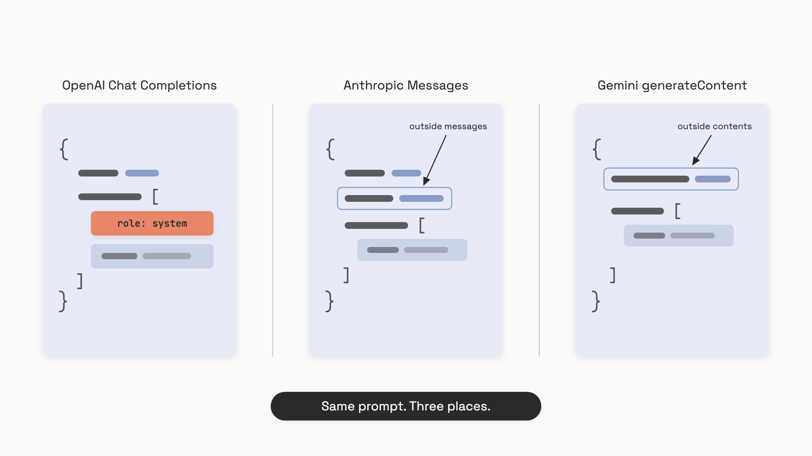

# Calling models

A "chat completion" is one HTTP request. You send a list of messages; you get a message back. That's the whole abstraction every major provider has converged on, and the gap between knowing it conceptually and getting it right on the wire is where most engineers waste their first day.

Here's the smallest call that works, three times, against the three providers you'll actually use:

```python
# OpenAI
from openai import OpenAI
client = OpenAI()
r = client.chat.completions.create(
    model="gpt-5.4",
    messages=[
        {"role": "system", "content": "You are a concise assistant."},
        {"role": "user", "content": "What is the capital of France?"},
    ],
    max_tokens=50,
    temperature=0.0,
)
print(r.choices[0].message.content)
```

```python
# Anthropic
import anthropic
client = anthropic.Anthropic()
m = client.messages.create(
    model="claude-sonnet-4-6",
    max_tokens=50,
    system="You are a concise assistant.",
    messages=[{"role": "user", "content": "What is the capital of France?"}],
    temperature=0.0,
)
print(m.content[0].text)
```

```python
# Gemini
from google import genai
from google.genai import types
client = genai.Client()
r = client.models.generate_content(
    model="gemini-3.5-flash",
    contents="What is the capital of France?",
    config=types.GenerateContentConfig(
        system_instruction="You are a concise assistant.",
        max_output_tokens=50,
        temperature=0.0,
    ),
)
print(r.text)
```

Three calls, same answer. Squint, though, and the differences aren't cosmetic. The system prompt lives in three different places. `max_tokens` is required for one provider and optional for the others. The text comes back at three different paths in the response object. Anthropic doesn't even use the word "assistant" the same way the others do.

That's the chapter. Roles, the system prompt, the request lifecycle, and the small handful of structural differences that trip people up when they wire the same call to a second provider.

## Messages are a list of typed turns

A conversation, on the wire, is just an ordered list. Each item has a **role** (who's speaking) and a **content** (what they said). The model reads the whole list every call, generates the next assistant turn, and stops. It doesn't remember anything from last time. If you want a multi-turn conversation, you push the assistant's reply back onto the list and send the whole list again on the next request.

That's worth saying twice, because it shapes everything else: **the API is stateless, and the conversation history is your responsibility, not the provider's.** Every turn, the full history re-enters the context window and is re-tokenized from scratch. Input token cost grows linearly with conversation length. (OpenAI's newer Responses API has an optional `previous_response_id` for server-side chaining, but the prior tokens are still billed as input.[^1])

Three roles do the work in 95% of production code:

- **`system`** (or `developer` on OpenAI's reasoning models): the developer's instructions. The persona, the rules, the output contract. Highest trust. Set once at the start of the conversation and reuse it every turn.
- **`user`**: anything that came from outside, mostly the end user's text. Lower trust. This is where prompt injection lives, because anything in `user` content was authored by someone who isn't you.
- **`assistant`**: what the model said last time. You echo prior assistant turns back into `messages` so the model can see its own prior answers and stay coherent.

Two more roles exist for tool calling (`tool` on OpenAI, plus a `tool_use` content block on Anthropic), but those belong to [function and tool calling](./03-function-and-tool-calling.md).

## The system prompt sits in three different places

This is the cross-provider trap that catches everyone porting code. The same idea, the developer's authoritative instructions, lives in a different field on each provider:


*Same instruction, three locations: a `system` role inside `messages` for OpenAI, a top-level `system` field for Anthropic, a top-level `systemInstruction` field for Gemini.*

The split matters because it changes how you write portable code. If you treat the system prompt as just another message and dump the same `messages` list across all three providers, Anthropic returns a 400 ("system not allowed in messages"), Gemini rejects the role name, and you spend an hour debugging.

The defensive pattern is simple: keep the system prompt as its own variable in your code, and inject it into the right field per provider. Never store the conversation as a single list with the system prompt baked in.

One OpenAI-specific wrinkle. On o1 and the newer reasoning models, the canonical role is `developer`, not `system`. The two still work interchangeably for now, but the model spec is explicit: developer messages are how high-trust instructions reach reasoning models, and using `developer` gets you better instruction-following on agentic tasks.[^2] Default to `developer` for o-series and gpt-5.x reasoning models; `system` everywhere else.

Anthropic also calls model output `assistant` in `messages`. Gemini calls it `model` in `contents[].role`. That's the second-most common porting bug after the system prompt one. When you echo prior assistant turns back into the conversation for Gemini, the role string is `"model"`, not `"assistant"`.

## What happens between `create()` and the response

The lifecycle is shorter than people think. The SDK serializes your arguments to JSON, posts them to the provider's HTTPS endpoint, and waits. On the provider's side, the input string gets tokenized, the model decodes one token at a time until it hits a stop condition (a stop sequence, the end-of-turn token, or your `max_tokens` cap), and the result comes back as JSON. You get a response object with the generated text, a token usage breakdown, and a `finish_reason` telling you why generation stopped.

That last field is the one beginners ignore and shouldn't. It tells you whether the model finished its thought or got cut off:

- `stop` (OpenAI, Gemini's `STOP`) or `end_turn` (Anthropic): the model finished naturally. This is what you want.
- `length` (OpenAI, Gemini's `MAX_TOKENS`) or `max_tokens` (Anthropic): the model hit your output cap mid-sentence. Your reply is truncated. Raise `max_tokens` or expect garbled JSON.
- `tool_calls` / `tool_use`: the model wants to call a tool. Handled in [function and tool calling](./03-function-and-tool-calling.md).
- `content_filter` (OpenAI), `SAFETY` / `RECITATION` / `PROHIBITED_CONTENT` (Gemini), `stop_sequence` (Anthropic): the provider intervened or you hit a stop sequence. Worth a log line in production.

The text itself lives at three different paths in the response object, which is annoying and unavoidable:

```python
# OpenAI Chat Completions
text = response.choices[0].message.content

# Anthropic Messages
text = response.content[0].text

# Gemini
text = response.text  # SDK convenience; raw is candidates[0].content.parts[0].text
```

Anthropic's `content` is always a list of typed blocks even for plain text replies, because the same field carries tool-use and image blocks in richer responses. Don't assume `content` is a string.

Token usage comes back on every response, and you should log it on every call. Cost monitoring isn't a separate observability problem; it's right there in the response:

```python
# OpenAI: response.usage.prompt_tokens, response.usage.completion_tokens
# Anthropic: response.usage.input_tokens, response.usage.output_tokens
# Gemini: response.usage_metadata.prompt_token_count, .candidates_token_count
```

Multiply those by your per-token prices (gpt-5.4 runs $2.50 per million input and $15.00 per million output tokens as of June 2026[^3]; claude-sonnet-4-6 is $3.00 / $15.00[^4]; gemini-3.5-flash is $1.50 / $9.00[^5]) and you have the cost of every call, live, without a billing dashboard.

## The parameters that bite when you switch providers

Most generation parameters mean the same thing on every provider, with three exceptions worth knowing before you ship.

**`max_tokens` is required on Anthropic.** No default. A request without it returns a 400 with `max_tokens: field required`. OpenAI and Gemini both let you omit it and generate up to the model's natural stop or the context window's edge.[^6] If your code is built around omitting `max_tokens`, every Anthropic call will fail until you add it.

**Temperature ranges differ.** OpenAI accepts `0.0` to `2.0`. Gemini accepts `0.0` to `2.0`. Anthropic caps at `1.0`.[^6] Pass `temperature=1.5` to Anthropic and you get a 422. If you have a single config dial driving multiple providers, clamp it to `[0.0, 1.0]` for portability.

**`top_k` is Anthropic and Gemini only.** OpenAI doesn't expose it. If you've tuned `top_k` for one provider, that knob doesn't exist on the other.

For [sampling and temperature](../part-1-how-models-behave/02-sampling-and-temperature.md) at the conceptual level (what these parameters actually do to the token distribution), Part 1 covers it. For calling code, the rule is: default `temperature=0.0` for anything where you want the same input to produce the same output (classification, structured extraction, tool calls), and `0.7` to `1.0` for creative generation. Don't reach for `top_p` or `top_k` until temperature alone isn't getting you what you want.

## A note on OpenAI's two APIs

OpenAI ships two endpoints that do the same job. **Chat Completions** (`/v1/chat/completions`) is the one every tutorial since 2023 has used. **Responses** (`/v1/responses`) is newer, and as of June 2026 OpenAI recommends it for all new projects.[^1] Same idea, slightly different shape: `messages` becomes `input`, the system message becomes a top-level `instructions` field, the response returns `output[]` instead of `choices[]`, and you get optional server-side state via `previous_response_id` and `store: true`.

For learning, Chat Completions is fine, and the snippets in this chapter use it because they read identically across the open-source ecosystem (LiteLLM, the OpenAI Python SDK's `base_url` override, every framework). For new production code on OpenAI, default to Responses unless your framework hasn't caught up. The Assistants API, a third older option, is being sunset in August 2026.[^1]

A common misread: passing `previous_response_id` does not stop the prior tokens from being billed. They're still billed as input on every call.[^1] The Responses API is a state-management convenience, not a cost optimization. For cost, use [prompt caching](./07-prompt-caching.md), which is an actual discount on cached input tokens.

## The cross-provider abstraction that earns its keep

You'll eventually want to swap providers without rewriting calling code. Two patterns work:

**LiteLLM.** A wrapper that exposes an OpenAI-compatible `completion()` against 100+ providers, including Anthropic and Gemini. You change the `model` string (`"anthropic/claude-sonnet-4-6"`, `"gemini/gemini-3.5-flash"`) and LiteLLM handles the field mapping, including the system-prompt placement. This is the default for cross-provider production code in 2026.

**Gemini's OpenAI-compatibility endpoint.** Google ships an OpenAI-shaped endpoint at `https://generativelanguage.googleapis.com/v1beta/openai/`.[^7] Point the OpenAI SDK at it with `base_url=` and `api_key=` your Gemini key, and OpenAI-format requests work against Gemini models. Useful when you can't add a dependency.

Neither of these eliminates the underlying differences; they paper over them. When something breaks (a tool schema rejected, a parameter ignored, a streaming chunk shaped differently), you're back to provider-native debugging. At the architecture level, [Model router and gateway](../../hld/part-8-case-studies/37-model-router-gateway.md) covers the whiteboard view of putting a single API in front of many providers.

The pattern that will keep your code clean longer than any wrapper: write a thin `call_model(messages, model, **kwargs)` function in your codebase, branch on provider inside it, and let the rest of your application code never see a vendor-specific field. The day you switch providers is the day you change one file.

## References

[^1]: OpenAI, "Migrate to the Responses API," OpenAI Developer Docs, https://platform.openai.com/docs/guides/migrate-to-responses (accessed June 2026).
[^2]: OpenAI, "API Reference: Chat Completions," https://platform.openai.com/api/reference/resources/chat (accessed June 2026).
[^3]: OpenAI, "Pricing," https://platform.openai.com/docs/pricing (accessed June 2026).
[^4]: Anthropic, "API Pricing," https://claude.com/pricing (accessed June 2026).
[^5]: Google, "Gemini Developer API pricing," https://ai.google.dev/gemini-api/docs/pricing (last updated 2026-06-09).
[^6]: Anthropic, "Messages API reference," https://docs.anthropic.com/en/api/messages; Google, "generateContent method reference," https://ai.google.dev/api/generate-content (both accessed June 2026).
[^7]: Google, "OpenAI compatibility," https://ai.google.dev/gemini-api/docs/openai (accessed June 2026).
