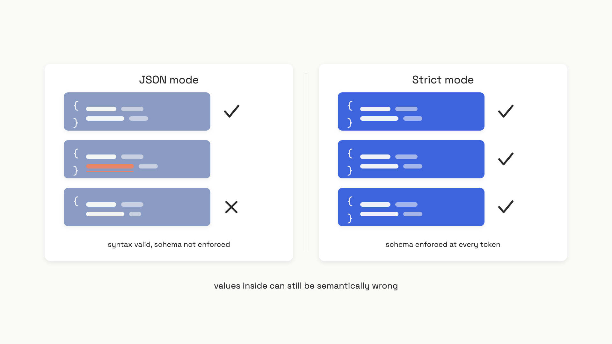
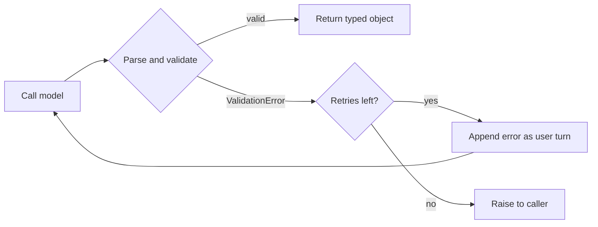

# Structured outputs

You wire an LLM into a pipeline. It extracts the customer's email and plan tier, your code writes both to the database. It works in dev. It works in staging. Then on the 1,000th production call, the model returns this:

```text
Sure! Here's the JSON you asked for:

    {"name": "John Smith", "email": "john@example.com", "plan": "Enterprise"}
```

Your `json.loads()` raises. The retry succeeds. Three calls later the model returns clean JSON, but it renamed `plan` to `plan_tier`. Now `result["plan"]` raises a `KeyError`. A week later the model returns `{"plan": "enterprise"}` instead of `"Enterprise"` and your enum-based router silently sends the customer down the wrong codepath.

Across studies of "naive JSON prompting", schemas of moderate complexity fail to parse cleanly 5 to 20% of the time, with failures clustering around four patterns: chatty preambles, markdown fences, omitted keys, and hallucinated values.[^1] At 1,000 calls per day with a 10% failure rate, that's a hundred broken records every day, and the silent ones, the wrong-key kind, are worse than the loud ones.

The fix is not better prompting. The fix is to stop treating the model's output as text and start treating it as a typed return value. That contract has a name: **structured outputs**.

## Two mechanisms, only one is the fix

Providers ship two different things under similar-sounding names. Don't confuse them; the gap between them is the difference between "usually works" and "cannot fail".

**JSON mode** (OpenAI's `response_format: {"type": "json_object"}`, shipped November 2023) modifies the sampler to avoid tokens that would produce malformed JSON. The output parses. That's all it promises. The model is still free to invent keys, omit required fields, or return any shape it likes, as long as the brackets balance.[^1]

**Strict structured outputs** (OpenAI's `strict: true`, Anthropic's `output_config.format`, Gemini's `responseFormat`) go further. At every token step, the inference engine maintains a state machine over your schema, computes which tokens are valid in the current grammar state, and masks the rest by setting their logits to negative infinity before sampling. The model isn't asked nicely to produce schema-conformant output; it's made physically incapable of producing anything else. Willard and Louf formalized the algorithm in 2023; it's the basis for OpenAI's August 2024 launch and Anthropic's mid-2026 GA.[^2][^3][^4]


*JSON mode guarantees the brackets balance. Strict mode guarantees the schema. Neither guarantees that the values inside are correct.*

The mechanism has a real cost: the first request with a new schema triggers grammar compilation on the provider side, adding latency. Subsequent requests hit a cache (24 hours on Anthropic, indefinite on OpenAI as long as the schema bytes are identical).[^3][^4] Per-token grammar checking adds under 50 microseconds, negligible against the 10 to 50 milliseconds the model spends generating each token.[^5]

The decision rule, which OpenAI states in its own docs: **default to strict structured outputs whenever the target model supports them.** That's gpt-4o-2024-08-06 and later, Claude Sonnet 4.6 and later, and Gemini 2.5 and later, as of mid-2026.[^3][^4][^6] Fall back to JSON mode only when the model predates strict-mode support and you can't change models.

## Pydantic is the schema, the validator, and the type

Hand-writing JSON Schema is tedious and the resulting dict isn't the type your code wants to handle. Pydantic v2 closes both gaps. You declare a `BaseModel`, the SDK derives the schema from it, calls the model with `strict: true`, and hands you back a typed Python object:

```python
from pydantic import BaseModel, Field
from openai import OpenAI

client = OpenAI()

class LeadExtraction(BaseModel):
    name: str
    email: str
    plan_interest: str = Field(description="One of: Starter, Pro, Enterprise")
    demo_requested: bool

completion = client.chat.completions.parse(
    model="gpt-4o-2024-08-06",
    messages=[
        {"role": "system", "content": "Extract lead information from the message."},
        {"role": "user", "content": "John Smith (john@example.com) wants an Enterprise plan demo."},
    ],
    response_format=LeadExtraction,
)
lead = completion.choices[0].message.parsed
# lead.email is a str. lead.demo_requested is a bool. The IDE knows it.
```

Three details in that snippet earn their place. `client.chat.completions.parse` (not `.create`) is the helper that auto-sets `strict: true`, derives the schema from the Pydantic class, and parses the response into the model on the way back. `Field(description=...)` is how you guide the *meaning* of a field, not just its type; vague names like `plan_interest` force the model to guess what you wanted, an explicit description nails it down. And every field is required by default, which matches what strict mode demands anyway. Anthropic's SDK exposes the same shape via `client.messages.parse(output_format=LeadExtraction)`, and Google's GenAI SDK accepts `schema=LeadExtraction.model_json_schema()` directly.[^4][^6]

One field-ordering rule is worth knowing because it changes output quality, not just shape. Models generate left to right, so a `reasoning: str` field placed *before* the answer fields lets the model think on paper before committing. Tam et al. (EMNLP 2024) showed experimentally that answer-first schemas degrade reasoning quality.[^7] If you ask for a classification and a justification, put the justification first.

## Strict mode is a transport guarantee, not a correctness one

Here is the part most readers underestimate. Strict mode guarantees the *shape* of the output. It does not guarantee the *values* are right.

A `score: float = Field(ge=0.0, le=1.0)` field will always come back as a float in that range. Whether the float correctly represents the sentiment of the input is a separate question that depends entirely on the model's reasoning. A model can confidently return `score: 0.9` for a scathing one-star review because it misread "didn't fail" as praise. Schema compliance metrics will read 100% and tell you nothing about that.[^1]

This is where Pydantic earns its second job: validators that encode business rules grammar can't express.

```python
from pydantic import BaseModel, model_validator
from datetime import date

class Booking(BaseModel):
    start_date: date
    end_date: date
    guest_count: int

    @model_validator(mode="after")
    def end_after_start(self) -> "Booking":
        if self.end_date <= self.start_date:
            raise ValueError("end_date must be after start_date")
        return self
```

Strict mode guarantees you'll get two valid `date` values. The validator catches the case where the model picked two valid dates in the wrong order. When it raises, you have a choice: fail the call, or feed the error back to the model and retry.

The retry-on-invalid loop is exactly that: catch the `ValidationError`, append the model's bad output and the error message as new turns, and re-call. The model gets its failed attempt plus a precise description of what was wrong, which usually converges in one extra call.



*The retry loop. The error message itself is the signal that lets the model self-correct; retrying without feeding it back almost always reproduces the same mistake.*

The [Instructor library](https://python.useinstructor.com/) wraps this pattern across providers; `instructor.from_provider("openai/gpt-4o", max_retries=2)` patches the client to do all of this transparently and surfaces token usage across attempts on exhaustion.[^8]

A retry budget of 2 is the right default. Each retry is a full API call, so a 10% semantic failure rate with 2 retries adds about 10% to your cost and latency. Two anti-patterns to avoid: unlimited retries (some schemas are semantically unsatisfiable; you'll loop forever), and retry-on-syntax-error when strict mode is on (those errors can't happen, so the retry path is dead code that will rot).

## The provider quirks that bite

Three providers, three subtly different schema dialects. The differences matter when you write portable code.

| | OpenAI strict | Anthropic `output_config.format` | Gemini `responseFormat` |
|---|---|---|---|
| Optional fields | Must be `anyOf: [T, null]`; all keys in `required` | Native optional support, but each one expands grammar state | Native optional support |
| `additionalProperties: false` | Required on every object | Not required | Not required |
| Unsupported keyword | Hard 400 error | Hard 400 error | Silently dropped |
| Schema complexity ceiling | 5,000 properties, 10 levels deep | 24 optional fields, 16 union types per request | No published cap |
| Refusal path | `message.refusal` populated, `parsed` is `None` | Standard refusal text, no schema applied | Standard refusal text |

A few of those rows are landmines. Gemini silently dropping unsupported keywords means you can ship a schema with `allOf` that the model never actually saw, get back JSON that "validates", and never know your constraints weren't enforced.[^6] OpenAI's refusal path is the one most often missed in production code: when the safety system fires, `message.parsed` is `None` and any `lead.email` access raises an `AttributeError`. Always check `message.refusal` first.[^3]

> [!WARNING]
> **Anthropic's grammar cache invalidates when `output_config.format` changes, even within the same conversation thread.** A/B testing two schema versions on individual requests defeats prompt caching for that thread, and the cost can spike unexpectedly. Batch your schema variations rather than alternating per request, and treat any schema change as a cold-start event.[^4]

For Anthropic specifically, before `output_config.format` reached GA in mid-2026, the dominant pattern was the "tool trick": define a single tool whose `input_schema` matches the desired output, force a `tool_use` call, and read the tool input as your structured response. The trick still works on every Claude model, including the older ones, and a lot of production code still uses it. For Sonnet 4.6 and later, prefer `output_config.format` for response shape and `strict: true` on tool definitions for tool-input shape; the next chapter on [function and tool calling](./03-function-and-tool-calling.md) walks through that side.

## What this gives you, and what comes next

Strict structured outputs plus Pydantic plus a small retry loop is the production primitive for any LLM call whose output feeds downstream code. Schema violations stop being a thing that happens 5 to 20% of the time and start being a thing that doesn't happen at all. Semantic violations, the wrong-but-well-shaped values, become the only failure mode left, which is exactly the failure mode evals exist to catch.

That handoff is the topic of [why evals](../part-4-eval-fundamentals/00-why-you-cant-ship-without-evals.md) and [assertions and unit tests for LLM output](../part-4-eval-fundamentals/03-assertions-and-unit-tests.md). The Pydantic models you write here become the simplest, fastest layer of that eval stack: a schema-conformance check is a unit test you get for free.

## References

[^1]: LDS Team, "Structured Outputs: Making LLMs Return Reliable JSON", Let's Data Science, February 2026, https://www.letsdatascience.com/blog/structured-outputs-making-llms-return-reliable-json
[^2]: Brandon T. Willard and Remi Louf, "Efficient Guided Generation for Large Language Models", arXiv:2307.09702, July 2023, https://arxiv.org/abs/2307.09702
[^3]: OpenAI, "Structured model outputs", OpenAI Platform Docs, accessed June 2026, https://platform.openai.com/docs/guides/structured-outputs
[^4]: Anthropic, "Structured outputs", Anthropic Docs, accessed June 2026, https://docs.anthropic.com/en/docs/build-with-claude/structured-outputs
[^5]: Yixin Dong et al., "XGrammar: Flexible and Efficient Structured Generation Engine for Large Language Models", arXiv:2411.15100, MLSys 2025, https://arxiv.org/abs/2411.15100
[^6]: Google, "Structured outputs", Google AI for Developers, accessed June 2026, https://ai.google.dev/gemini-api/docs/structured-output
[^7]: Tam et al., "Let Me Speak Freely? A Study of Language Models in JSON and Other Output Structures", arXiv:2408.02442, EMNLP 2024, https://arxiv.org/abs/2408.02442
[^8]: Jason Liu et al., "Retry Mechanisms", Instructor Docs, accessed June 2026, https://python.useinstructor.com/learning/validation/retry_mechanisms/
