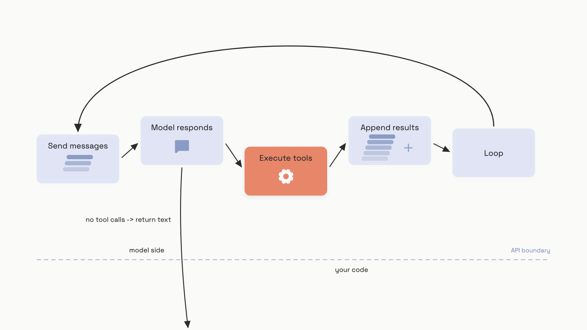

# Function and tool calling

A model never executes anything. When you wire it up to a `get_weather` function, the model doesn't fetch the weather; it returns a JSON object that says "please call `get_weather` with `location='Paris'`," and your code does the rest. You run the function, hand the result back, and the model picks up where it left off. That round trip is the entire mechanism, and it's the foundation under every agent in Part 7.

The thing that confuses every reader on day one is that the API gets called *twice* for one user question. Once to ask the model what to do; once more to give the model the answer and let it write the reply. Hold that loop in your head and the rest of this chapter is detail.

```python
# The shape, in pseudocode. Real code follows below.
while True:
    response = model.call(messages, tools=tools)
    if not response.tool_calls:
        return response.text          # the model is done
    for call in response.tool_calls:
        result = run_locally(call.name, call.arguments)
        messages.append(result)       # feed it back to the model
```

## The schema is what the model reads

Every provider takes tool definitions as JSON Schema (or a subset of it) with three fields that matter: a `name`, a `description`, and a `parameters` object describing the inputs. The description is the field that determines whether the model picks the right tool; treat it as the most important prose in your codebase. The parameters object tells the model what arguments are valid; an `enum` on a constrained field cuts hallucinated values dramatically.

Here's the same `get_weather` tool defined for OpenAI and Anthropic, side by side:

```python
# OpenAI Chat Completions: wrapped in {"type": "function", "function": {...}}
openai_tool = {
    "type": "function",
    "function": {
        "name": "get_weather",
        "description": "Retrieves current weather for a given location.",
        "parameters": {
            "type": "object",
            "properties": {
                "location": {"type": "string", "description": "City and country, e.g. Paris, France"},
                "units":    {"type": ["string", "null"], "enum": ["celsius", "fahrenheit"]},
            },
            "required": ["location", "units"],
            "additionalProperties": False,
        },
        "strict": True,
    },
}

# Anthropic: flat object, with input_schema instead of parameters
anthropic_tool = {
    "name": "get_weather",
    "description": "Retrieves current weather for a given location.",
    "input_schema": {
        "type": "object",
        "properties": {
            "location": {"type": "string", "description": "City and country"},
            "units":    {"type": "string", "enum": ["celsius", "fahrenheit"]},
        },
        "required": ["location", "units"],
    },
}
```

Three spots where providers differ enough to bite you:

- **The wrapper.** OpenAI Chat Completions nests the schema under `function`; Anthropic and the OpenAI Responses API are flat. Gemini wraps a list of declarations under `tools[].functionDeclarations[]`.
- **The schema key.** OpenAI uses `parameters`; Anthropic uses `input_schema`; Gemini uses `parameters` again.
- **Strict mode.** OpenAI's `strict: true` and Anthropic's strict tool use both invoke constrained decoding so arguments are guaranteed to match the schema. The cost: every property must be listed in `required`, and `additionalProperties` must be `false`. Optional fields are expressed as a nullable union (`["string", "null"]`).[^1][^2]

Tool definitions count as input tokens on every request. Anthropic publishes the per-model overhead: for Claude Opus 4.8, the tool-use system prompt costs 290 tokens at `tool_choice: auto` and 410 tokens when you force a call, as of June 2026.[^2] OpenAI doesn't publish a per-definition number but injects definitions into the system prompt the same way.[^1] Both providers cache stable tool sets, so the recurring cost is mostly absorbed if your tools don't change per request. Aim for fewer than 20 active tools on any single turn; both OpenAI and Google flag this as a soft ceiling.[^1][^3]

Two pieces of advice that every provider's docs agree on. First, write descriptions for someone who can't see your source code; "fetches the user's order history given a user ID" beats "queries orders." Second, fold tools that always run together into one tool, and don't ask the model to fill arguments you already know.[^1][^3]

## The execution loop

The schema is what you pass in. The loop is what you actually write. Each iteration does five things: send the message history (with all prior tool calls and their results) to the model, check the stop reason, dispatch any tool calls the model requested, append every result to the history, and go round again. If the model didn't ask for a tool, you exit and return the text.


*One iteration of the loop. The exit happens at step 2; everything else feeds back into the next request.*

Here it is in working code, against OpenAI's Chat Completions API:

```python
import json

def execute_tool(name: str, args: dict) -> str:
    if name == "get_weather":
        return json.dumps({"temperature": 22, "unit": "celsius"})
    raise ValueError(f"Unknown tool: {name}")

def run_tool_loop(client, model, messages, tools, max_iterations=10):
    for _ in range(max_iterations):
        response = client.chat.completions.create(
            model=model, messages=messages, tools=tools,
        )
        msg = response.choices[0].message
        if not msg.tool_calls:
            return msg.content                          # final answer

        messages.append(msg)                            # the assistant turn
        for tc in msg.tool_calls:
            try:
                args = json.loads(tc.function.arguments)
                result = execute_tool(tc.function.name, args)
            except Exception as exc:
                result = f"ERROR: {exc}"                # see "Errors as data"
            messages.append({
                "role": "tool", "tool_call_id": tc.id, "content": result,
            })
    raise RuntimeError("tool loop did not converge")
```

A handful of details in that code do all the work.

The OpenAI `arguments` field arrives as a JSON-encoded string, not a dict, so you have to `json.loads` it before use. Anthropic's `input` and Gemini's `args` are already dicts; only OpenAI Chat Completions ships the string form.[^1][^2][^3] Forgetting this is the second most common bug in tool-calling code.

The protocol invariant is strict: every `tool_call` in an assistant message must be matched by exactly one tool result before the next API call. If your dispatch loop throws and skips a result, the next request returns a 400 with the message "each tool_use must have a single result." That's why the `try/except` always appends *something*, even when execution failed.[^4]

Note also the `max_iterations` guard. A buggy tool that always errors, paired with a model that always wants to call it, will spin forever without one. This is the minimum safety net; real agent loops add token budgets, wall-clock timeouts, and kill switches, all of which the [Workflow vs agent](../part-7-agent-engineering/00-workflow-vs-agent.md) chapter builds on top of this skeleton.

For how these loops compose into agentic systems at scale, including orchestration, fan-out, and state persistence, [AI systems at architecture scale](../../hld/part-9-ai-ml-system-design/) covers the whiteboard view.

## Parallel calls and the bundling rule

When the user asks "what's the weather in Paris and Tokyo," a modern model often returns *both* tool calls in a single response. You execute them concurrently, gather the results, and feed them back. Done well, this halves wall-clock latency on multi-tool turns. Done wrong, it silently teaches the model to stop using parallel calls at all.

The rule is provider-specific, and getting it backwards breaks the loop in both directions. On Anthropic's API it is exact and it's the single hardest thing to internalize: **all `tool_result` blocks from one parallel batch go back in one user message.** Splitting them into separate user messages is the most common bug in production tool-calling code on Anthropic, and their docs flag it explicitly.[^4] OpenAI's Chat Completions API is the mirror image: each result goes back as its own `role: "tool"` message, one per `tool_call_id`, exactly as the dispatch loop earlier in this chapter does. Apply Anthropic's bundling rule to OpenAI, or OpenAI's one-message-per-result habit to Anthropic, and you get a 400 either way.

```python
import asyncio, json

async def run_one(tool_id: str, name: str, args: dict) -> dict:
    try:
        result = await execute_tool_async(name, args)
        return {"type": "tool_result", "tool_use_id": tool_id, "content": result}
    except Exception as exc:
        return {
            "type": "tool_result", "tool_use_id": tool_id,
            "is_error": True, "content": str(exc),
        }

async def handle_parallel_batch(tool_calls):
    results = await asyncio.gather(*[
        run_one(tc["id"], tc["name"], tc["input"]) for tc in tool_calls
    ])
    # Anthropic: all results in ONE user message. Not three messages.
    return {"role": "user", "content": results}
```

Why does splitting matter? The message history is what the model learns the conversation pattern from. If it sees `assistant(2 tool_uses) -> user(result_1) -> user(result_2)`, two things go wrong: the API rejects the malformed structure, and on subsequent turns the model gravitates toward single-call behavior because that's what the history looks like. Bundle the results, and parallel calling stays fluent.[^4]

You can disable parallel calls when you need to. OpenAI takes `parallel_tool_calls: false` on the request; Anthropic takes `disable_parallel_tool_use: true` inside the `tool_choice` object.[^1][^2] Reach for the switch when tools have side effects that must execute in a deterministic order (create-then-update on the same resource), or when downstream infrastructure can't take concurrent load. For read-only fetches and independent lookups, leave it on.

> [!WARNING]
> **Returning parallel results as separate user messages is silent until it isn't.** Your first symptom is a model that "stopped using parallel calls", followed weeks later by a 400 error from a turn where the structure finally tipped over. To detect it early, log the average number of `tool_use` blocks per assistant message that contains tool calls; it should sit above 1.0 for any agent doing real fan-out.[^4]

## Errors as data the model can act on

A failed tool call is not an exception you raise; it's a piece of data you return. The model treats the error string as part of the conversation, and a well-written error gets the model to retry, switch tools, or surface the problem to the user, none of which it can do if your dispatch loop crashed.

The two formats:

- **Anthropic** has a first-class `is_error: true` flag on the `tool_result` block. The model recognizes the flag and reasons about the failure explicitly.[^2][^4]
- **OpenAI and Gemini** have no error flag; you return the error as the result string, and the model interprets it from context.[^1][^3]

The text of the error matters more than the flag. Generic codes like "404 Not Found" leave the model with nothing to do; specific, action-oriented messages let it recover. The deeper design discipline around this, naming conventions, error taxonomies, registry patterns, lives in [Tool design](../part-7-agent-engineering/03-tool-design.md); for now, compare these two:

```python
# Useless
return "ERROR: 404"

# The model can act on this
return "ERROR: user 'alice' not found. Valid IDs are integers in 1000-9999. Try get_user(id=1234)."
```

The recovery pattern this enables is genuinely powerful. Anthropic documents it for parallel calls with hidden dependencies: if `read_file("report.md")` and `summarize(file=...)` get dispatched together and the read fails, return the natural error (`"cat: report.md: No such file or directory"`) with `is_error: true`. The model spots the dependency, re-sequences the calls, and reissues `read_file` first on the next turn.[^4] You don't pre-emptively switch to sequential dispatch; you let the loop self-correct from a useful error message.

This is also documented in the wild. The `claude-code` repo logged "parallel tool calls cascade-fail when one fails" as issue #22264 in 2025, with the fix being exactly the `is_error` recovery pattern above.[^5] If your code raises and never returns a result, you bypass the recovery mechanism entirely and the API just rejects the next request.

One SDK gotcha while we're here: `content` expects a string (or, for image and file results, a structured content array). Returning a raw Python dict gets coerced inconsistently across SDK versions. Always `json.dumps` structured results before they leave your dispatcher.

## References

[^1]: OpenAI, "Function calling," OpenAI API Docs, https://platform.openai.com/docs/guides/function-calling (accessed June 2026).
[^2]: Anthropic, "Tool use with Claude, overview," Anthropic Docs, https://docs.anthropic.com/en/docs/build-with-claude/tool-use/overview (accessed June 2026).
[^3]: Google, "Function calling with the Gemini API," Google AI for Developers, https://ai.google.dev/gemini-api/docs/function-calling (last updated 2026-06-10).
[^4]: Anthropic, "Parallel tool use," Anthropic Docs, https://platform.claude.com/docs/en/agents-and-tools/tool-use/parallel-tool-use (accessed June 2026).
[^5]: GitHub, "parallel tool calls cascade-fail when one fails," anthropics/claude-code issue #22264, https://github.com/anthropics/claude-code/issues/22264 (opened 2025).
