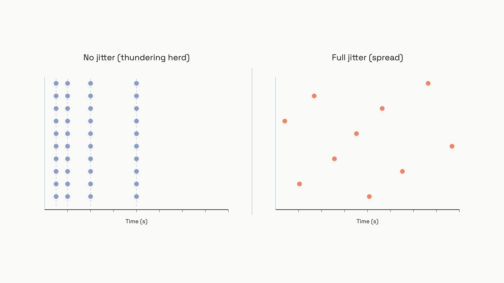

# Errors, retries, fallbacks

Your support bot crashes at 14:03 UTC because Anthropic returns a 529. Your code catches the exception, waits 0.5 seconds, retries, gets another 529, waits 1 second, retries, gets another 529. Ten minutes later the provider recovers, but your queue is now twelve thousand requests deep and every customer is staring at a spinner. Meanwhile the alert pager is going off because someone copy-pasted a 401 retry loop from a REST tutorial and your billing dashboard says you've burned $4,000 on an API key that was revoked an hour ago.

Every problem in that paragraph is solvable, and none of the fixes are clever. They're a small set of rules about which errors deserve a retry, how to wait between retries, when to fail over to a different model, and how to keep a timeout from charging you twice for the same answer.

## Read the status code before you do anything

Most retry bugs come from treating an LLM error as a generic exception. The HTTP status code is the entire decision, and the two big providers diverge in ways that matter:

| Code | OpenAI meaning | Anthropic meaning | Retry? |
|---|---|---|---|
| 400 | Bad request | Invalid request | **No.** Fix the payload. |
| 401 | Bad API key | Bad API key | **No.** Fix the credentials. |
| 403 | Key lacks permission | Key lacks permission | **No.** |
| 408 | Request timeout | (uses 504) | Yes |
| 413 | (rare) | Request over 32 MB | **No.** Shrink the payload. |
| 429 | Your quota hit (RPM/TPM) | Your account rate-limited | Yes, with `Retry-After` |
| 500 | Provider bug | Internal Anthropic error | Yes |
| 503 | "Engine overloaded" or "Slow Down" | (rare) | Yes |
| 504 | (rare) | Generation timed out | Yes, or stream |
| 529 | (not used) | **Infrastructure-wide overload** | Yes, but consider fallback |

Two rows on that table are the ones that bite. **A 401 is not retryable.** Your key is wrong; sleeping and trying again will burn quota until your monitoring catches it. The pattern `@retry(exceptions=Exception)` lifted from a generic REST tutorial is the single most common cause of "why did our bill spike overnight."

The other one is 529 vs 429 on Anthropic. A 429 means your account hit its per-minute limit; the right move is to wait the `retry-after` value and try again. A 529 means **Anthropic itself is overloaded for everyone**, and waiting longer at the same provider doesn't help.[^1] The two return similar-looking error envelopes and developers pattern-match on "4xx-ish, retry it" without reading the code. They are different problems with different fixes.

The retryable set you actually want, in code:

```python
RETRYABLE_STATUS_CODES = {408, 409, 429, 500, 502, 503, 504, 529}
FATAL_STATUS_CODES = {400, 401, 403, 404, 413, 422}

def should_retry(status_code: int) -> bool:
    return status_code in RETRYABLE_STATUS_CODES
```

If a code isn't in the retryable set, raise it now. The faster a fatal error surfaces, the cheaper it is.

## Don't just retry: spread the retries

Suppose a hundred of your servers all hit the same 429 at exactly noon. The naive fix is exponential backoff: sleep `0.5 * 2^attempt` seconds, then try again. So all hundred wake up at 12:00:00.5 and slam the provider in lockstep. The provider 429s them again. They all double their sleep and slam it again at 12:00:01.5. This is a thundering herd, and it's exactly how a five-second outage stretches into a five-minute one.

The fix is to add randomness. Marc Brooker's AWS simulation, the canonical reference for backoff, compared four schemes against a hundred contending clients and found that **full jitter** cut total client work by more than half versus naive exponential, with no loss in completion time.[^2] The formula is one line:

```python
import random
import time

def full_jitter_backoff(attempt: int, base: float = 0.5, cap: float = 60.0) -> float:
    """Sleep up to min(cap, base * 2^attempt) seconds, uniformly at random."""
    return random.uniform(0, min(cap, base * (2 ** attempt)))
```

The trick is that the upper bound still grows exponentially (so a long outage gets longer waits), but the actual sleep is a uniform draw from zero up to that bound. A hundred clients now wake up scattered across a six-second window instead of all at once.


*Same retry budget, two strategies. Naive exponential backoff (left) creates synchronized retry spikes; full jitter (right) spreads load across the window.*

Before you compute that backoff, though, check the response headers. Both providers tell you exactly how long to wait when the answer is knowable. OpenAI sends `retry-after-ms` (milliseconds, non-standard) or `Retry-After` (seconds); Anthropic sends `retry-after` on 429s.[^3][^4] Use the provider's hint when it's there, and only fall back to your jitter calculation when it isn't:

```python
def wait_before_retry(headers: dict, attempt: int) -> None:
    raw_ms = headers.get("retry-after-ms")
    raw_s = headers.get("Retry-After") or headers.get("retry-after")
    if raw_ms is not None:
        time.sleep(float(raw_ms) / 1000.0)
        return
    if raw_s is not None:
        try:
            time.sleep(min(float(raw_s), 60.0))
            return
        except ValueError:
            pass
    time.sleep(full_jitter_backoff(attempt))
```

Cap the header value at 60 seconds. A provider asking you to wait ten minutes is telling you to use a fallback, not to block your worker that long.

## The SDKs already do most of this

You probably don't need to write the loop above. The `openai` and `anthropic` Python SDKs both default to `max_retries=2` (three attempts including the original), use capped exponential backoff with jitter, respect `Retry-After`, and add an `X-Stainless-Idempotency-Key` header so the provider can deduplicate retries.[^3][^5] For interactive user-facing calls, the defaults are correct.

You only override them in two situations:

- **Non-interactive batch processing**, where latency tolerance is high and finishing the job matters more than failing fast. Bump `max_retries` to 5.
- **You're putting the SDK behind your own gateway** (LiteLLM Router, a custom retry layer). Set `max_retries=0` on the SDK client to avoid double-retrying. This is the one you'll forget. Two retry layers stacked over each other turn three attempts into nine, and a five-deep call chain with three retries each layer can fan out to 243 requests for what was meant to be one operation.[^6] **Retry at exactly one layer of the stack, and make it the outermost one.**

## Fallbacks: when retrying the same provider stops helping

Retries assume the provider will recover soon. Sometimes it won't. A 529 from Anthropic affects every Anthropic customer in the world; sleeping longer doesn't help. The escalation is to fail over to a different model entirely.

There are two kinds of fallback, and they are not the same:

- **Same model, different provider or region.** Run Claude Sonnet on AWS Bedrock when Anthropic Direct is overloaded. Output quality is identical because it's the same weights. This is the safe default and should be your first fallback.
- **Degraded model.** Fail over from a large model to a smaller, cheaper, faster one. Output quality drops. The trade is "a worse answer beats no answer."

The second kind is risky in ways the first isn't. A smaller model writes shorter, follows instructions less reliably, and may produce a JSON shape your downstream code rejects. **Cross-model fallback is only safe when the response is validated the same way as the primary**: a Pydantic schema, a structured-output spec, or an eval that catches malformed output. Without validation, you've quietly traded a 10-minute outage for a week of subtle bugs nobody can reproduce.

In practice you wire this through a router instead of writing it by hand. LiteLLM is the OSS standard:

```python
from litellm import Router

model_list = [
    {"model_name": "primary",
     "litellm_params": {"model": "anthropic/claude-sonnet-4-20250514"}},
    {"model_name": "primary-bedrock",
     "litellm_params": {"model": "bedrock/anthropic.claude-sonnet-4"}},
    {"model_name": "fallback-cheap",
     "litellm_params": {"model": "openai/gpt-4o-mini"}},
]

router = Router(
    model_list=model_list,
    fallbacks=[{"primary": ["primary-bedrock", "fallback-cheap"]}],
    num_retries=2,
    cooldown_time=5,
    allowed_fails=3,
)
```

A few defaults worth understanding. LiteLLM tries `num_retries` against the primary first, only then walks the fallback chain. A deployment that returns a 429 or fails three times in a minute gets cooled down for five seconds, and the router stops sending it traffic until the cooldown expires.[^7] The cooldown applies per-deployment, not per-model-name, so two Bedrock regions of the same model can independently fail without taking the whole group offline.

The chapter on [gateways and routing](06-gateways-and-routing.md) goes deeper on production router config; for now, the rule is: list a same-model fallback before any cross-model fallback, and validate every response the same way regardless of which deployment served it.

At architecture scale, [multi-provider AI system design](../../hld/part-8-case-studies/37-model-router-gateway.md) covers the whiteboard view of provider failover and SLAs.

## Idempotency: the LLM-specific trap

Here's the failure mode that doesn't exist in normal API work. Your client times out at 30 seconds. The provider, on its end, finished generating the response at second 31 and successfully charged your account. Your code retries. The provider runs the prompt again, samples different tokens this time, and returns a different answer. You've now paid for two completions, and if the LLM was deciding whether to send an email or charge a credit card, **both decisions just executed**.

This breaks the standard assumption behind retry-safe code. Normal REST APIs are deterministic: retrying a `GET /users/42` returns the same user. LLM completions don't have that property. A retry samples fresh, so a duplicate retry produces a duplicate-but-different output.[^8]

The OpenAI SDK handles part of this for you. It generates a UUID per request and sends it as `X-Stainless-Idempotency-Key` on every retry attempt of that request, so the OpenAI server can recognize "this is a retry, return the cached response" instead of running a second generation.[^3] If the SDK is doing the retrying, you're covered at the provider layer.

That's not enough when the LLM's output drives a real-world side effect. The SDK's idempotency key dies the moment the SDK call returns; if your code crashes after receiving the response but before persisting it, the next run kicks off a fresh request with a fresh key, and the side effect runs twice. The fix is the same idempotency pattern Stripe uses for payments, applied at your application layer:

```python
import uuid

def generate_with_side_effect(prompt: str, store) -> dict:
    op_id = uuid.uuid4().hex
    cached = store.get(op_id)
    if cached:
        return cached  # already ran; return the original answer

    response = client.chat.completions.create(
        model="gpt-5.4",
        messages=[{"role": "user", "content": prompt}],
        extra_headers={"Idempotency-Key": op_id},
    )
    payload = {"op_id": op_id, "content": response.choices[0].message.content}
    store.put(op_id, payload)   # persist BEFORE the side effect
    execute_side_effect(payload)
    return payload
```

Two non-obvious points. The `op_id` is generated for the **logical operation** ("send the welcome email for user 42"), not per HTTP call, so a process crash followed by a restart finds the same key. And you persist the LLM response **before** triggering the side effect, not after, so a crash between the call and the side effect leaves you with a recoverable record instead of a paid-for-but-lost answer.

Streaming responses are different. Once the stream starts, you can't deduplicate it at the application layer; partial output has already left the provider. For agent steps where idempotency matters more than time-to-first-token, use the non-streaming API or the Batch API. Reserve streaming for the user-facing rendering layer where duplicate generation is a cost annoyance, not a correctness bug.

## What to set, and where

The defaults that won't hurt you, by call type:

- **Interactive user calls.** Use SDK defaults. `max_retries=2`, jittered backoff, `Retry-After` respected. Don't add a second retry layer.
- **Batch or pipeline calls.** Bump SDK `max_retries=5`, but watch your quota: five retries per call against a quota-exhausted account is just a slower way to fail.
- **Agent steps with side effects.** Application-level idempotency keys, persist-before-act, and **never retry inside the loop that decides whether to act.** Retry the LLM call; let the agent step itself fail if the LLM call fails after retries.
- **Multi-provider routing.** Disable SDK retries (`max_retries=0`), let the router (LiteLLM or your own) handle retries and fallbacks centrally.

The error envelope you actually need to log on every failure is the HTTP status code, the provider's error type string, the `Retry-After` header if present, and the request's idempotency key. Without those four fields you can't tell a retry storm from a real outage at 3 a.m., and you'll be guessing for the rest of the post-mortem.

## References

[^1]: Anthropic, "Errors", Anthropic API Reference, accessed June 2026. https://docs.anthropic.com/en/api/errors

[^2]: Marc Brooker, "Exponential Backoff And Jitter", AWS Architecture Blog, March 2015 (updated May 2023). https://aws.amazon.com/blogs/architecture/exponential-backoff-and-jitter/

[^3]: OpenAI Python SDK, "Retries" documentation, generated from openai/openai-python (March 2026 commit). https://openai-openai-python-73.mintlify.app/concepts/retries

[^4]: Anthropic Support, "Our approach to rate limits for the Claude API", accessed June 2026. https://support.anthropic.com/en/articles/8243635-our-approach-to-api-rate-limits

[^5]: OpenAI, "Error Codes", OpenAI API Documentation, accessed June 2026. https://platform.openai.com/docs/guides/error-codes

[^6]: Marc Brooker, "Timeouts, Retries, and Backoff with Jitter", Amazon Builders' Library, AWS, accessed 2023. https://aws.amazon.com/builders-library/timeouts-retries-and-backoff-with-jitter/

[^7]: LiteLLM / BerriAI, "Router - Load Balancing", LiteLLM Documentation v1.86.0, accessed June 2026. https://docs.litellm.ai/docs/routing

[^8]: tianpan.co, "Idempotency Keys for Nondeterministic LLM Calls", May 2026. https://tianpan.co/blog/2026-05-16-retry-changed-answer-idempotency-keys-nondeterministic-llm
