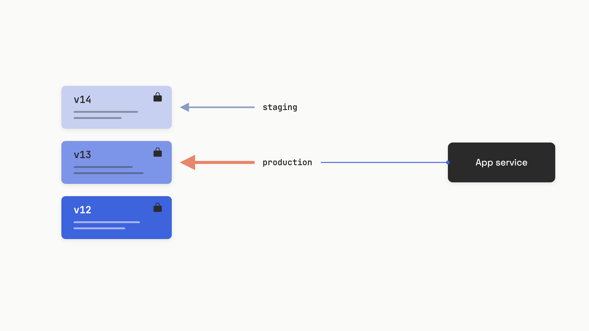

# Prompt versioning

At 11pm, someone edits the system prompt in a vendor dashboard. They add a few words about "conversational tone." It looks fine in the playground and they save. Ninety minutes later, structured-output errors spike. A revenue workflow stalls. During the postmortem, nobody can answer the only question that matters: who made the change, who reviewed it, and which team owns this prompt.[^1]

There was no PR. No reviewer. No rollback record. The string controlling production behavior had escaped change management entirely.

That's the failure prompt versioning prevents. A typical production LLM app runs on 20 to 50 prompts covering classification, summarization, extraction, and generation, and any one of them can swing structured-output error rates by an order of magnitude with a three-word edit.[^2] Yet the engineering practices we apply to regular code, version control, review, CI, rollback, are rarely applied to prompts, because prompts look like text, not code.

The fix isn't a platform purchase. It's four pieces you can wire up in a week: a single source of truth (the registry), a way to reference a frozen version (pinning), a fast undo (rollback), and a gate before anything reaches production (review). Everything else is optimization.

## Why prompts escape change management

Prompts have a higher behavior-per-character ratio than almost any other artifact you ship. A code change with comparable blast radius would be unmissable in review. A prompt change with comparable blast radius reads like a typo fix. The failures are non-local and delayed: the change ships clean, dashboards stay green, and the regression surfaces days later as a vague drop in a downstream metric. By then the edit is buried under a week of unrelated activity.

A reported case from April 2026 makes the timing concrete. A one-sentence change to the system prompt of a mortgage-document classifier sat in production for 21 days, silently misclassifying thousands of documents. Estimated impact: roughly $340,000 in operational inefficiency and SLA breaches. Nobody could identify who made the change, when, or why.[^3]

A 2025 review of more than 1,200 production LLM deployments found that operational discipline problems, drift, versioning, and change handling, drive most agent failures, ahead of raw model quality.[^4] The root cause is rarely the model. It's the absence of the boring infrastructure that surrounds it.

The natural progression is a slide. Prompts start as string constants in application code. They migrate to config files. Then to database rows. Then to vendor dashboards that market themselves on letting you edit prompts *without* a deploy or an engineer involved. Each step removes a checkpoint. The endpoint is a string that controls production behavior but has none of the governance you'd apply to a feature flag, let alone business logic.[^5]

## The registry: one source of truth, two kinds of identifier

The single mental model that fixes most of the pain: a prompt has an **immutable version** (a number or hash that never changes) and a **mutable label** (a pointer that does). Application code resolves the label at runtime. Promotion moves the label. Rollback moves the label back. The version itself is never edited.


*Code references the label; rollback is a pointer move, not a deploy.*

Three open or open-core registries implement this exact model as of mid-2026. **Langfuse** uses auto-incrementing integer versions and string labels like `production` and `latest`; any edit creates a new version, and labels can be marked "protected" so only project owners can move them.[^6] **LangSmith** uses commit hashes as version IDs and reserved tags for `staging` and `production`, with a per-environment rollback history and a built-in stale-while-revalidate cache (default TTL 300 seconds, 100 prompts, 60-second background refresh).[^7] **MLflow Prompt Registry** mirrors a Git model with named prompts, numbered versions, and aliases; it ships in `mlflow[databricks]>=3.1.0` and integrates with Unity Catalog for RBAC and audit.[^8] Pick whichever fits your stack; the mechanics are the same.

The label idea is what makes everything else fast. Promotion is a pointer move with no code change. Rollback is a pointer move with no code change. A canary cohort is a second label (`canary`) routed by a coin flip in your loader. The application is stable; the registry is where motion happens.

## When to pin a version

Labels are the right default for production serving. Pinning is the right default for everything that needs reproducibility. The split looks like this:

```python
# Production: resolves whichever version "production" currently points at.
# Moving the label is your rollback path. No code change required.
def get_production_prompt(client, name: str):
    return client.pull_prompt(f"{name}:production")

# Eval: pins an immutable hash. Label moves never change what the suite tests.
def get_pinned_prompt(client, name: str, commit_hash: str):
    return client.pull_prompt(f"{name}:{commit_hash}")
```

Pin a version when you need (1) a stable baseline for an eval suite, (2) reproducibility in an audit trail, or (3) a guaranteed cohort during a phased rollout. Don't pin the live production path. A pinned production deployment requires a code change to update, which means your fastest possible rollback is your CI pipeline's deploy time, typically 15 to 30 minutes. That's too slow for an active incident where every minute is wrong outputs to real users.[^5]

The practical pattern: production code uses a label, regression evals pin a hash, and every trace logs both the prompt name and the resolved version so you can answer "what was running at 11:47pm" in under a minute.[^2]

## Rollback: pointer move, then watch the cache

A registry rollback is one operation: reassign the `production` label to the prior known-good version. Sub-second on the registry side. The catch is the SDK cache.

Most registry SDKs cache fetched prompts in memory to avoid hitting the registry on every LLM call. LangSmith's default cache TTL is 300 seconds.[^7] If you flip the label at 11:47pm, instances that fetched the old version at 11:45pm will keep serving it until 11:50pm. On a high-traffic incident, those three minutes are not free.

> [!WARNING]
> **The rollback isn't done when the label moves; it's done when the cache turns over.** Before you reassign a label during an incident, drop the SDK TTL to something like 30 seconds (Langfuse: per-call config; LangSmith: `configure_global_prompt_cache(ttl_seconds=30)`). Then verify in your traces that the new `prompt_version` is actually being logged before you call the rollback complete.

A second invariant makes rollback work at all: **versions are immutable**. Once a version is promoted to any environment, its content never changes. A typo fix is a new version. This sounds pedantic until you discover that a database-backed registry someone wrote in a hurry allows `UPDATE` on the prompt content column. The team thinks they're rolling back to v12; v12's content was edited in place last Thursday. There is no stable point to roll back to. Every mature production team eventually adopts immutability as a foundational invariant; the ones that learn it through an incident learn it expensively.[^5]

If you're using Git-backed YAML instead of a registry, rollback is a revert commit plus a deploy. That's 15 to 30 minutes through a normal pipeline, and during a production prompt incident, that's the difference between a bad afternoon and a customer-facing outage. This is the single strongest argument for graduating to a registry once you're past a handful of prompts.

## Review: the gate that keeps the dashboard honest

A registry solves runtime serving. It does not, by itself, solve governance. If anyone with dashboard access can edit and promote a prompt with no review, you've moved the ungoverned string from a code file to a UI. That's lateral, not progress.

The fix is an explicit promotion path. Three patterns, in increasing rigor:

- **Git-native, engineers only.** Prompts live as YAML in the application repo. Changes go through PRs. CI runs evals on every PR touching `prompts/**`. A human reviewer approves; merge triggers a deploy. Right default when you have fewer than five prompts and only engineers author them.[^9]
- **Registry-based with protected labels.** Non-engineers can create new versions in the UI; the new version auto-gets the `latest` label. Promoting it to `staging` or `production` requires either a registered owner (LangSmith "Owners only" mode, Langfuse protected labels) or a CI webhook that runs evals before the label is allowed to move. This unblocks product managers without dropping the gate.[^7]
- **Hybrid with CI/CD.** Prompts are authored in the registry for speed. Promotion fires a webhook to GitHub Actions, which pulls the version, runs the eval suite, and only allows the label move if the suite passes. The canonical version is also synced back to Git for the audit trail. This is what teams managing 10 to 50 prompts converge on.[^9]

The eval gate is non-negotiable in all three patterns. The minimum viable suite is 20 to 30 examples drawn from production logs, covering the main happy path and the edge cases that matter; this catches the regressions a manual playground check would miss.[^2] How to design the suite belongs to [Why you can't ship without evals](../part-4-eval-fundamentals/00-why-you-cant-ship-without-evals.md) and [Your first eval set](../part-4-eval-fundamentals/02-your-first-eval-set.md). The rule that matters here is structural: no version reaches production without the gate firing.

## The minimum viable setup, without a platform

You can build the whole thing in a week with no vendor contract. The pieces:

- **Storage.** A `prompts/` directory in the application repo. One YAML file per prompt, with `name`, integer `version`, `model`, `temperature`, `messages` (array of `role`/`content`), and a list of `variables`.
- **Loader.** A small Python class that reads the YAML at startup, renders `{{variable}}` substitutions at call time, and stamps the prompt name and version into the call's metadata so traces carry it.
- **Eval gate.** A GitHub Actions workflow that triggers on PRs touching `prompts/**`, runs a Python script against a JSONL test set, and posts pass/fail. PRs can't merge if evals fail.
- **Rollback.** Revert the YAML change and deploy. Slower than a label flip, but free.

The loader is the only non-trivial code:

```python
import os
import yaml
from typing import Optional

class LocalPromptRegistry:
    def __init__(self, prompts_dir: str = "prompts"):
        self._prompts_dir = prompts_dir
        self._cache: dict = {}

    def get(self, name: str, version: Optional[int] = None, **variables) -> dict:
        cache_key = f"{name}:{version}"
        if cache_key not in self._cache:
            with open(os.path.join(self._prompts_dir, f"{name}.yaml")) as f:
                self._cache[cache_key] = yaml.safe_load(f)

        spec = self._cache[cache_key]
        messages = []
        for msg in spec["messages"]:
            content = msg["content"]
            for k, v in variables.items():
                content = content.replace("{{" + k + "}}", str(v))
            messages.append({"role": msg["role"], "content": content})

        return {
            "model": spec["model"],
            "messages": messages,
            "temperature": spec.get("temperature", 0),
            "_meta": {"prompt_name": name, "prompt_version": spec["version"]},
        }
```

A companion YAML file looks like this:

```yaml
name: ticket-classifier
version: 7
model: gpt-4o-mini
temperature: 0
messages:
  - role: system
    content: |
      You classify support tickets. Categories: {{categories}}.
      Return JSON: {"category": "...", "confidence": 0.0-1.0}
  - role: user
    content: "{{ticket_text}}"
variables:
  - categories
  - ticket_text
```

This is enough for a small team with engineer-only authors and fewer than five prompts. You get review (PRs), audit (Git history), rollback (revert), and version pinning (commit SHA) for free. The CI gate is a fifty-line Python script that loads a JSONL test set, calls the prompt, and exits non-zero if accuracy drops below a threshold. Langfuse is open-source and self-hostable when you outgrow this; the migration is a one-day project, not a quarter.

Graduate to a hosted or self-hosted registry when one of these is true: you have more than five prompts, non-engineers need to iterate, prompts change more than once a week, or you've had one incident where 15-minute rollback was too slow.[^9] Below that threshold, YAML in Git is the right shape and adding a registry is premature optimization.

## Log the version in every trace

Every LLM call in production should write the prompt name and resolved version into its observability metadata. Without it, the question "which prompt was running during this incident?" takes hours to answer instead of seconds, and per-version quality dashboards are impossible. With it, you can see a regression align to a deploy on a timeline and know within one glance whether v14 or some upstream change is responsible.[^1]

The slip everyone eventually makes is conflating cost with correctness. A prompt gets cut from 800 tokens to 300 to save 60% on API spend, accuracy drops from 0.94 to 0.81, and the cost dashboard celebrates while the support queue fills up. Token optimization is a prompt change like any other, and any prompt change runs through the same gate as a logic change. The registry, the label, the pin, the rollback, and the eval all exist for the same reason: a prompt change is a code change, and the highest-leverage artifact in a production AI system deserves the discipline you'd give to anything else that decides what your users see.

## References

[^1]: Tian Pan, "The Postmortem Where the Root Cause Was a Prompt Nobody Owned," TianPan.co, May 18, 2026. https://tianpan.co/blog/2026-05-18-prompt-nobody-owned-postmortem
[^2]: Roman Belov, "Prompt Engineering at Scale: Managing 50+ LLM Prompts in Production," Medium, May 2026. https://medium.com/@belovroman/prompt-engineering-at-scale-managing-50-llm-prompts-in-production-b43b054aea32
[^3]: Tian Pan, "What Happens When Every Team Treats Prompts as Configuration," TianPan.co, April 10, 2026. https://tianpan.co/blog/2026-04-10-prompt-ownership-problem-governance-failures
[^4]: Alex Strick van Linschoten, "What 1,200 Production Deployments Reveal About LLMOps in 2025," ZenML Blog, December 19, 2025. https://www.zenml.io/blog/what-1200-production-deployments-reveal-about-llmops-in-2025
[^5]: Tian Pan, "Treating LLM Instructions as Production Software," TianPan.co, April 20, 2026. https://tianpan.co/blog/2026-04-20-prompt-versioning-llm-production
[^6]: Langfuse, "Core Concepts: Prompt Management," Langfuse Documentation, accessed June 2026. https://langfuse.com/docs/prompt-management/data-model
[^7]: LangChain, "Manage Prompts Programmatically," LangSmith Documentation, accessed June 2026. https://docs.langchain.com/langsmith/manage-prompts-programmatically
[^8]: Databricks / MLflow, "Prompt Registry," MLflow 3 / Databricks Documentation, June 2026. https://docs.databricks.com/aws/en/mlflow3/genai/prompt-version-mgmt/prompt-registry/
[^9]: Mahmoud Mabrouk, "Git vs. Prompt Management Tools: Which Should You Use?," Agenta Engineering Blog, February 11, 2026. https://agenta.ai/blog/git-vs-prompt-management-tools
