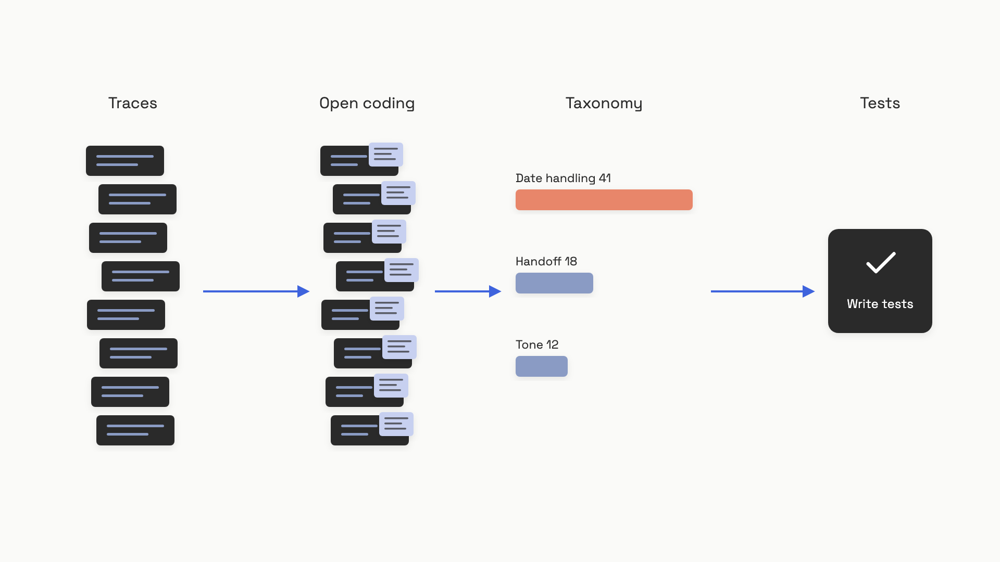

# Look at your data

A consultant walks into a team's office and asks one question: "Can you show me how you measure if this thing works?" The team pulls up a dashboard. Coherence: 4.1. Fluency: 4.3. Helpfulness: 3.9. The numbers go up most weeks. The support queue keeps filling.

That's the failure this chapter is about. The team isn't lazy. They installed the eval platform on day one. They wired the gauges. What they skipped is the unglamorous part that comes before any gauge means anything: sitting down with a hundred real traces and reading them.

Across 30+ production AI engagements as of March 2025, Hamel Husain reports the same pattern almost every time.[^1] Teams reach for generic metrics ("hallucination", "toxicity", "coherence") because those are the ones the platform ships. Generic metrics are uncorrelated with the specific failures of any specific product. Your accuracy goes from 3.72 to 4.20 and you genuinely don't know whether the system got better.[^2]

The fix is older than LLMs. It's the qualitative-research loop: read the data, write notes, group the notes into categories, count the categories, fix the most common one. Done well on a real product, this is the single highest-leverage thing an AI engineer does. NurtureBoss, an apartment-leasing assistant, found through this exact process that relative-date parsing ("schedule a tour two weeks from now") was failing two-thirds of the time. After targeted fixes, that one category went from 33% to 95% success.[^1] No off-the-shelf metric would have surfaced it.

## A trace is the unit of work

A trace is the full record of one interaction with your system: the system prompt, the user's input, any retrieved context, any tool calls, and the model's output. In a multi-turn conversation, a trace is the whole conversation. Whatever a domain expert needs to read to judge "did this go well?", that's the unit.

Don't confuse it with a distributed-systems trace. Those exist to find crashes and timeouts. LLM failures don't crash. The model returns 200 OK and fluent prose that's quietly wrong, off-tone, or politely refusing the thing the user actually asked for. The signal lives in the content, not the status code.[^3]

You don't need observability infrastructure to start. The right starting shape is a spreadsheet or a flat file with a row per trace and a few columns:

```python
import datetime, uuid
from dataclasses import dataclass, field
from typing import Optional

@dataclass
class Trace:
    trace_id: str = field(default_factory=lambda: str(uuid.uuid4()))
    timestamp: str = field(default_factory=lambda: datetime.datetime.utcnow().isoformat())
    session_id: Optional[str] = None
    system_prompt: str = ""
    user_input: str = ""
    assistant_output: str = ""
    model: str = ""
    # Filled in during manual review:
    label: Optional[str] = None         # "pass" | "fail"
    note: Optional[str] = None          # free-text, what went wrong
    category: Optional[str] = None      # filled after axial coding
```

The first six fields map cleanly onto OpenTelemetry's GenAI semantic conventions (`gen_ai.request.model`, `gen_ai.conversation.id`, etc., semconv 1.41.1 as of June 2026), so this schema graduates without a rewrite when you adopt a tracing library later.[^4] The last three fields are the ones that matter today. They're empty until a human fills them in.

That's the part nobody automates around. A human reads the trace and writes the note.

## Open coding: read, then journal

Open coding is the first pass through the data. You open one trace at a time, read it end to end, and write a free-text note about anything that's wrong. No taxonomy yet. No categories. Just notes. Husain calls this "journaling" and borrows the term verbatim from grounded-theory qualitative research.[^5]

A few rules that save you from the most common mistakes.

- **The reader is a domain expert, not the engineer.** A customer-service trace where the user complains about "billing" right after a known outage isn't a model failure; it's the right answer to an unusual user state. An engineer reading cold misclassifies it. The best annotator is the person who knows the product and the user.[^3] The engineer's job here is tooling, not judgment.
- **Note the *first* failure, not all of them.** In multi-turn or agentic traces, an early mistake cascades. A wrong tool call at turn 2 produces wrong context at turn 3, which produces a wrong final answer at turn 4. If you note all three, your taxonomy double- and triple-counts the same root cause and your "wrong final answer" bucket explodes while the upstream problem hides.[^5]
- **Write in your own words.** Don't try to pre-classify. "Forgot the user said vegetarian three turns ago" is a better note than "memory failure". The categories will come out of the notes; the notes don't come out of the categories.
- **Binary label, plus the note.** Pass or fail. Skip 1-to-5 scales. Husain and Shankar both argue binary forces the reviewer to make a real call, and the nuance lives in the free-text note rather than in a fake-precise number.[^1][^6]

Use one annotator at this stage, not a committee. After teaching evals to thousands of engineers and PMs, Husain's default is what he calls a "benevolent dictator": a single domain expert whose judgment defines the bar.[^7] Inter-annotator agreement matters later, when you're calibrating an automated judge against human labels. At the open-coding stage, two reviewers with no shared rubric just produce noise about a rubric that doesn't exist yet.

## Axial coding: turn notes into a taxonomy

Once you have a stack of notes, the second pass groups similar notes into named categories. This is axial coding. The output is a small taxonomy, typically five to ten labels, plus a count of how many traces fall into each one. That count is the thing that drives every decision after.


*Open coding produces notes; axial coding groups them; the counts tell you which failure to fix first.*

Build the taxonomy bottom-up from the notes you actually wrote. Don't start from a generic list ("hallucination, toxicity, coherence") and force-fit your data into it; that's how teams end up measuring something other than their product.[^1] An LLM can help with the grouping pass, since the input is a stack of short text notes that cluster cleanly. The cheap version is a prompt like "here are 80 open-code notes; propose 5 to 10 named categories and assign each note to one." A human still reviews the proposed taxonomy before it's accepted, and that's the order that matters: the human reviews the categorization, not the raw labels.[^5]

Then count. A pivot table in a spreadsheet is enough. NurtureBoss did exactly this; three categories accounted for over 60% of all failures (conversation flow, handoff, and date handling), and date handling was the dominant one.[^1] Counting is what turns a vague feeling of "the bot is bad" into a specific, fixable number. It also tells you what *not* to fix: a category with three traces in a hundred is not where this week's work goes.

The categories are the thing that drives the next chapter. Each one becomes a target for an automated check. "Date handling" turns into a test set of relative-date inputs with known correct outputs. "Handoff failures" turns into an assertion that the right tool was called. The taxonomy is the bridge between reading prose and writing code.

## When to stop reading

The natural question after the third trace is "how many of these do I have to read?" The temptation is to stop early. Twenty traces feels like a lot when each one takes five minutes.

The rule, borrowed from grounded-theory's *theoretical saturation*, is this: keep reading until 20 consecutive traces add no new category, with a hard floor of 100 traces total.[^5] Below 100, you've seen the obvious failures and missed the long tail. Stopping at 30 is how a failure mode you've never seen ships to production with no test coverage and surfaces six weeks later as a customer complaint with no eval to catch it.

You can encode the rule directly:

```python
from typing import List, Set

def reached_saturation(
    category_history: List[Set[str]],
    window: int = 20,
    min_reviewed: int = 100,
) -> bool:
    """Stop when the last `window` traces introduced no new categories,
    after at least `min_reviewed` total traces."""
    total = len(category_history)
    if total < min_reviewed or total < window:
        return False
    earlier = set().union(*category_history[:-window])
    recent = set().union(*category_history[-window:])
    return len(recent - earlier) == 0
```

This isn't a one-time effort. After every significant prompt change, model upgrade, or new user cohort, the failure space shifts and the taxonomy needs a fresh pass. A reasonable cadence in production is reviewing 20 to 30 new traces a week from live traffic, watching for categories that don't fit any existing bucket. Shankar frames this as a "data flywheel": evaluation, monitoring, and continual improvement feeding each other.[^6] The metric set you define today isn't the metric set you'll have in six months, and that's the point.

## Criteria drift is a feature, not a bug

Something uncomfortable happens around trace number 40. You realize you'd grade the first ten traces differently now. The reviewer who's been at it all afternoon can no longer fully explain why session-1 annotations differ from session-3 ones. The instinct is to call this inconsistency and worry that the data is contaminated.

It isn't. Shankar and colleagues named this phenomenon *criteria drift* in a 2024 CHI paper: some evaluation criteria are "dependent on the specific LLM outputs observed", not knowable in advance.[^8] Grading is what teaches you what to grade for. The act of reading a hundred outputs surfaces edge cases your specification never anticipated, and your standards sharpen as the corpus reveals itself. This isn't a defect in the methodology; it's the methodology working.

There's a real production observation of this. When Husain worked with Honeycomb's Phillip Carter on the Query Assistant feature, Carter noticed mid-process: "Seeing how the LLM breaks down its reasoning made me realize I wasn't being consistent about how I judged certain edge cases."[^1] He wasn't being sloppy. He was learning what his rubric should be, by using it.

The practical response is simple. Treat the rubric as a living document. Version it the way you version code. When the criteria sharpen, backfill labels on a random sample of earlier traces so old and new annotations stay comparable. And expect the rubric to keep moving for the first few weeks; if it's stable on day three, you probably haven't read enough data yet.

## A spreadsheet first, a viewer when it hurts

The temptation at this point is to shop for a platform. Resist it for a week. The single most impactful piece of infrastructure here isn't a vendor; it's the interface that lets a domain expert label a trace in two seconds without switching tabs. Husain's claim, after building these tools across dozens of engagements, is that teams with thoughtful data viewers iterate roughly 10x faster than teams without them, and that the viewer can be built in hours of AI-assisted development.[^1]

A workable starting point is genuinely a spreadsheet. Columns: `trace_id`, `input`, `output`, `note`, `category`. The caregiving SMS app Husain reviewed in his December 2024 office hours started exactly this way, with Azure OpenAI and Helicone behind it for logging.[^2] Spreadsheets fail when the trace involves things a cell can't hold: long retrieved documents, tool-call arguments and returns, CRM context that the reviewer needs alongside the conversation. That's when you build something custom.

A custom viewer doesn't need to be impressive. It needs four things:

- **Everything on one screen.** The trace, the retrieved context, the tool calls, and any business data the reviewer needs to judge correctness. Tab-switching is what kills annotation rate.
- **One-click binary label.** Pass or fail, not a dropdown menu of seven options.
- **A free-text note field.** Always present, always saved.
- **Keyboard navigation.** Next trace, previous trace, label, and save without touching the mouse.

Hosted tools (LangSmith, Braintrust, Arize Phoenix, Langfuse) all provide trace viewers and annotation workflows. They differ mostly in how cleanly they render domain-specific context and whether a non-engineer can use them without training.[^9] Pick one when you're past the spreadsheet stage and before you're sinking weeks into building your own. The build-vs-buy decision is genuinely close; the decision you can't get wrong is to *have a viewer at all*.

What you have at the end of this loop is a small, ranked list of named failure categories with counts, and a roughly 100-trace dataset where each row carries a binary label, a note, and a category. That dataset is the starting point of [your first eval set](./02-your-first-eval-set.md): the failure categories tell you what to test, and the labeled traces give you the first examples to test against. The ungrateful work of reading prose for an afternoon is what makes every metric you write afterward mean something.

## References

[^1]: Hamel Husain, "A Field Guide to Rapidly Improving AI Products," hamel.dev, March 24, 2025. https://hamel.dev/blog/posts/field-guide/
[^2]: Hamel Husain, "Evals: Doing Error Analysis Before Writing Tests," hamel.dev (Open Office Hours notes), December 21, 2024. https://hamel.dev/notes/llm/officehours/erroranalysis.html
[^3]: Hamel Husain, "Your AI Product Needs Evals," hamel.dev, March 29, 2024. https://hamel.dev/blog/posts/evals/
[^4]: OpenTelemetry Authors, "Semantic conventions for generative client AI spans," Semantic Conventions v1.41.1, opentelemetry.io, June 2026. https://opentelemetry.io/docs/specs/semconv/gen-ai/gen-ai-spans
[^5]: Hamel Husain, "Q: Why is 'error analysis' so important in LLM evals, and how is it performed?" AI Evals FAQ, hamel.dev, May 5, 2026. https://hamel.dev/blog/posts/evals-faq/why-is-error-analysis-so-important-in-llm-evals-and-how-is-it-performed.html
[^6]: Shreya Shankar, "Data Flywheels for LLM Applications," sh-reya.com, July 1, 2024. https://sh-reya.com/blog/ai-engineering-flywheel/
[^7]: Hamel Husain and Shreya Shankar, "LLM Evals: Everything You Need to Know," hamel.dev, May 2026. https://hamel.dev/blog/posts/evals-faq/
[^8]: Shreya Shankar, J.D. Zamfirescu-Pereira, Bjorn Hartmann, Aditya G. Parameswaran, Ian Arawjo, "Who Validates the Validators? Aligning LLM-Assisted Evaluation of LLM Outputs with Human Preferences," arXiv:2404.12272, April 18, 2024 (ACM UIST 2024). https://arxiv.org/abs/2404.12272
[^9]: Hamel Husain, "Selecting The Right AI Evals Tool," hamel.dev, July 2025. https://hamel.dev/blog/posts/eval-tools
