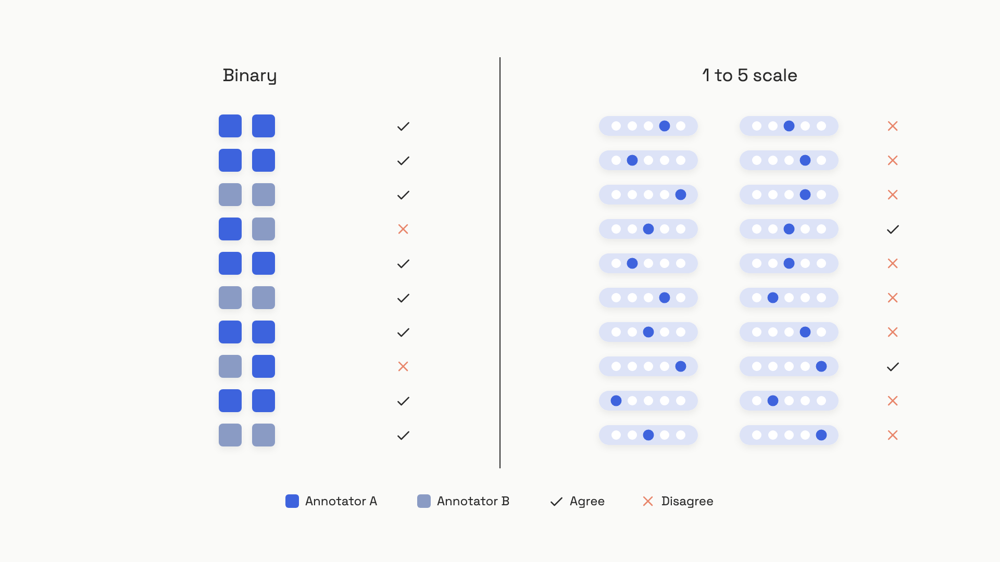

# Your first eval set

The product manager asks if the new prompt is better. The answer is some mixture of "I tried fifteen examples in the playground and it looked sharper" and a shrug. A week later the model API ships a minor update, the same fifteen examples still look fine, and a customer escalation lands on Slack from an input nobody had thought to try. The team learns about the regression from the user, not from a number.

That's what shipping without an eval set feels like. The fix isn't a platform, a vendor, or a quarterly initiative. It's a JSONL file with roughly 50 rows, checked into git, that answers one question in under a minute: did this change make the system better or worse?

The bootstrap is small on purpose. Fifty rows is enough to surface diverse failure modes and small enough that one engineer plus one domain expert can label it in a couple of afternoons.[^1] Past that, the set grows the way a test suite grows, by absorbing the bugs production keeps finding.

## What an eval row actually looks like

Lead with the artifact. One row, JSONL, six fields:

```json
{"id": "ex001",
 "input": "show me the slowest traces yesterday",
 "expected_label": "fail",
 "critique": "Query returns MAX(duration_ms) over time but doesn't group by trace.trace_id, so the user sees an aggregate line, not the actual slow traces.",
 "source": "production",
 "tags": ["feature:nlq", "scenario:aggregation"]}
```

Five of the six fields are obvious. The one that does the work is `critique`. It's the labeler's one-sentence reason for the pass or fail decision, written in plain language. That sentence is what later turns into few-shot context for an LLM judge, and what lets a second labeler check whether they'd have made the same call. A label without a critique is a vote you can't audit.[^2]

The Honeycomb team's natural-language query feature was bootstrapped exactly this way. Phillip Carter, a domain expert who knew the query language, wrote a one-line critique on every fail. After three iterations of feeding those critiques back into an LLM judge, judge-versus-Carter agreement passed 90 percent.[^2] The critiques weren't documentation; they were the training signal.

The other fields earn their place too. `source` distinguishes synthetic seeds from real production traces, so you can watch the set mature. `tags` lets you check coverage across features, scenarios, and personas. `id` makes a row referenceable from a regression report. `expected_label` is binary, which is the next thing worth arguing about.

## Binary beats 1 to 5

The first instinct is to label on a scale. The output is sort of right, give it a 3. The output is great, give it a 5. The thinking goes: a number captures more information than a yes-or-no. In practice, a number captures less.

Two annotators looking at the same output disagree on a five-point scale roughly half the time. Eugene Yan reports inter-rater Cohen's Kappa of 0.2 to 0.3 on LLM annotation tasks, which is the low end of the "fair" band, and notes that fatigued human annotators miss as many as 50 percent of defects across a long batch.[^3] Hamel Husain puts it more bluntly after working with domain experts across thirty-plus deployments: "Tracking a bunch of scores on a 1-5 scale is often a sign of a bad eval process."[^2] The two reasons he gives are mechanical. People don't know what to do with a 3 versus a 4. And the threshold question, "is a 4 a pass," is unanswered, so every stakeholder negotiates a different one.


*The disagreement pattern is the argument: binary forces one decision boundary, Likert leaves five.*

The deeper reason binary wins is that it forces a decision boundary, and a decision boundary is what an eval set is for. A pass/fail label answers the only question the deployment cares about: did this output achieve the desired outcome? A 3 doesn't ship or not ship; only a threshold ships or not ships, and you'll end up picking that threshold anyway. The Llama2 team reported similar economics: pairwise comparisons cost about $3.50 per labeled unit, written-rating supervised data cost about $25 per unit. Binary collapses cognitive load and unit cost in the same move.[^4]

The honest exception is when two prompt variants both pass and you need to pick the better one. That's where pairwise wins help: show two outputs, ask which is better, allow ties.[^3] Pairwise preserves ordinal information exactly where you need it, between two close candidates, without forcing labelers to calibrate a five-point scale across hundreds of examples.

> [!WARNING]
> **Don't compromise on a 3-point bad/ok/good scale.** It looks like a moderate position. It isn't. You inherit the same calibration problem (what makes something "ok" versus "good"?) without the ordinal resolution, and the threshold question still stalks you. Husain explicitly warns against it for early-stage work.[^2] If a true binary feels too coarse for your task, the next step up is pairwise comparison, not a shorter Likert.

## How to get to fifty

The number 50 isn't a sample-size calculation. It's the practical band where most teams stop seeing new failure modes.[^1] The actual stopping condition is "we've labeled ten examples in a row without surfacing anything new," and that usually lands somewhere between 30 and 50 rows. If your task has many sub-features, expect to need closer to 100 or 200; at 200 examples a 5 percent defect rate gives you a 95 percent confidence interval of roughly +/- 3 percent, which is enough to make ship/don't-ship calls.[^3]

The seed comes from one of three sources, in priority order:

- **Real production traces.** If you have any traffic at all, this is the only source that matters. Pull the last week of inputs, sample across user types, run them through your current system, and label the outputs.
- **Synthetic inputs you run through the real system.** When traffic doesn't exist yet, generate inputs with a smaller and weaker model. The "weak generator" rule matters: a frontier model produces inputs that are too clean. A weaker model produces the messy, organic edge cases that resemble what real users actually type.[^3] Run those synthetic inputs through your actual system, then label the outputs.
- **Hand-crafted edge cases.** Useful for covering scenarios you know exist but haven't seen yet (refusals, adversarial inputs, the kind of typo your designer's QA pass missed). Add these last; they fill gaps, they don't anchor the set.

What you're chasing is coverage across three axes: features (what the system does), scenarios (normal, edge, adversarial), and personas (who's using it).[^1] A coverage check is one Counter dictionary:

```python
import json
from collections import Counter

REQUIRED_FEATURES = {"summarization", "qa", "refusal"}
REQUIRED_SCENARIOS = {"edge_case", "normal", "adversarial"}

def coverage_report(eval_path: str) -> dict:
    features: Counter = Counter()
    scenarios: Counter = Counter()
    with open(eval_path) as f:
        for line in f:
            row = json.loads(line)
            for tag in row.get("tags", []):
                if tag.startswith("feature:"):
                    features[tag[len("feature:"):]] += 1
                elif tag.startswith("scenario:"):
                    scenarios[tag[len("scenario:"):]] += 1
    return {
        "missing_features": list(REQUIRED_FEATURES - set(features)),
        "missing_scenarios": list(REQUIRED_SCENARIOS - set(scenarios)),
        "coverage_ok": (
            not (REQUIRED_FEATURES - set(features))
            and not (REQUIRED_SCENARIOS - set(scenarios))
        ),
    }
```

Run it as a pre-commit hook on the JSONL file. A failing `coverage_ok` is the signal that your set is clustered around easy cases. The other check worth running: count the rows where `expected_label == "fail"`. If fewer than 20 percent are fails, your set is too easy. The fails are where the signal lives, and a judge trained on a set of nearly-all-passes will learn to wave outputs through.[^3]

## Version it like code

The eval set lives in git. One JSONL file, one row per example, committed atomically with the code it grades. That's the whole versioning story for sets up to about 10,000 rows. Past that, or when binary assets like images or audio are part of the eval, switch to DVC, which keeps a small `.dvc` pointer file in git and stores the actual data in S3 or GCS, content-addressed by hash.[^5]

The reason versioning matters becomes obvious the first time you debug a regression. A pull request changes a prompt, an eval run reports the score moved from 0.82 to 0.79, and you need to know whether the prompt got worse or whether someone added three hard examples to the set last Thursday. Without an immutable dataset version pinned to the run, the question is unanswerable. With it, you check out the previous commit, re-run, and read the number off the same dataset you ran a month ago.[^6]

The discipline is small but non-negotiable: dataset changes and code/prompt changes go in separate commits. A PR can touch both, but the commits are split so a bisect on either dimension keeps working. Tag the commit when you run evals for a deployment decision, the same way you'd tag a release.

The schema below is enough; resist the urge to add fields you might use someday. Critique-first, source tracked, tags free-form:

```python
from dataclasses import dataclass, asdict
from typing import Literal
import json

@dataclass
class EvalRow:
    id: str
    input: str
    expected_label: Literal["pass", "fail"]
    critique: str
    source: Literal["synthetic", "production"]
    created: str
    tags: list

def append_row(path: str, row: EvalRow) -> None:
    with open(path, "a") as f:
        f.write(json.dumps(asdict(row)) + "\n")
```

Tools like Braintrust, LangSmith, and Langfuse offer hosted dataset versioning with a UI for promoting traces to eval rows.[^6] They're worth adopting once the set is large or the reviewers are non-engineers. For a one-engineer-plus-one-domain-expert bootstrap, JSONL in git is faster, free, and reviewable in any code review tool you already have.

> [!WARNING]
> **Eval rows are records, not scratch space.** Treating the JSONL file as something you edit in place ("just bumped the expected label on row 12, looked wrong") destroys reproducibility. Once a row is in, its content is frozen. Relabels happen as a new commit with a clear "relabel batch from criteria audit" message, and the old labels stay readable in git history. Schema changes happen with a migration, not a sed command.[^7]

## Grow it from production failures

A bootstrap set built on day one represents the failure distribution as you imagined it. Three months later, your users have evolved the system in ways you didn't anticipate, and a set frozen at week one is grading the wrong test. The set has to grow, and the only growth source that matters is real production failures.[^6]

The loop has four steps:

1. **Log every request and response in production.** Trace ID, input, output, model version, prompt version, timestamp.
2. **Score every trace online with the same judge you use offline.** A binary pass/fail signal, written back into the trace.
3. **Triage the low scorers.** A human spends 30 minutes a week reading the failures, confirming the judge wasn't wrong about being wrong, and picking the ones worth adding to the set.
4. **Commit the confirmed failures as new rows** with `source: "production"` and a fresh critique.

The triage step is where the loop dies in most teams. Without an owner on rotation, week one runs the loop, weeks two through twelve don't, and by the time someone notices, the set hasn't seen a new row in two months. The fix is unceremonious: assign weekly triage to a person, track examples-added-per-sprint as a metric, and set a target like "five new production failures per sprint."

There's one selection bias worth naming directly. A set built only from users who stayed around to interact with you a second time will miss the failure modes that drove other users to leave. Pass rates climb on the eval; retention slips in the dashboard. The mitigation is to trace exit interactions explicitly. If a user hits the AI feature once and never returns, that interaction is a candidate for the set, even if no one complained.[^8]

A practical iteration pattern from Hamel Husain's deployments: random sampling for the first two label passes, then shift to targeted failure search.[^2] Find one confirmed error type, search the logs for more examples of the same shape, batch them in. Run a thin layer of random sampling underneath so you keep catching new failure modes you don't yet know to search for.

After 60 days of production traffic, look at the `source` distribution in the set. If the production share is below 20 percent, the loop isn't running. That number is the maturity gauge: a healthy bootstrap starts mostly synthetic, and a healthy mature set is mostly production.

## Criteria drift is real, and critiques are the defense

The hardest thing about an eval set is that the labelers' criteria change as they label. Shankar et al. (2024) showed this is near universal: even participants who graded outputs first refined their criteria upon further grading, going back to change earlier grades.[^9] Your week-one "pass" doesn't mean what your week-eight "pass" means. Aggregate trends become slippery.

The defense is the critique field. A label is just a token; a critique is the reasoning that produced it. When criteria stabilize, you re-read the early critiques and re-apply current criteria to the labels. Periodically re-label a 20-row subset from early in the set against today's criteria; if the flip rate is above 15 percent, schedule a relabel pass. The critiques make this cheap, because the labeler isn't re-deciding from scratch, just checking whether their old reasoning still meets the bar.

This is also where the link forward to the LLM judge matters. The critiques you write here are what an LLM judge later uses as few-shot context, and the binary labels are what that judge is trained against. A judge can't be more consistent than the human labels it learns from. The earlier the critiques are crisp, the cheaper everything downstream gets.[^2]

For the architecture-scale view of how an observability platform makes the production logging step actually work, [Observability platform](../../hld/part-8-case-studies/52-observability-platform.md) in HLD Part 9 covers the whiteboard view.

## References

[^1]: Hamel Husain, "Using LLM-as-a-Judge For Evaluation: A Complete Guide," hamel.dev, October 29, 2024. https://hamel.dev/blog/posts/llm-judge/
[^2]: Hamel Husain, "Using LLM-as-a-Judge For Evaluation: A Complete Guide," hamel.dev, October 29, 2024 (Honeycomb case study, critique-shadowing process, binary advocacy). https://hamel.dev/blog/posts/llm-judge/
[^3]: Eugene Yan, "Product Evals in Three Simple Steps," eugeneyan.kit.com, December 2024. https://eugeneyan.kit.com/posts/product-evals-in-three-simple-steps
[^4]: Eugene Yan, Bryan Bischof, Charles Frye, Hamel Husain, Jason Liu, and Shreya Shankar, "What We've Learned From A Year of Building with LLMs," applied-llms.org, June 8, 2024 (Section 1.4.5; Llama2 cost data from Thomas Scialom). https://applied-llms.org/
[^5]: DVC (iterative.ai), "Versioning Data and Models," dvc.org, accessed June 2026. https://dvc.org/doc/use-cases/versioning-data-and-models
[^6]: Ankur Goyal, "Eval feedback loops," Braintrust blog, April 17, 2024. https://www.braintrust.dev/blog/eval-feedback-loops
[^7]: Tian Pan, "Why a Prompt Schema Change Wrecks 800 Test Cases," TianPan.co, May 2, 2026. https://tianpan.co/blog/2026-05-02-eval-migration-tax-prompt-schema-changes
[^8]: Tian Pan, "Why Your Test Set Goes Blind to the Failures That Drove Users Away," TianPan.co, May 10, 2026. https://tianpan.co/blog/2026-05-10-eval-selection-bias-test-set-blind-to-churn-failures
[^9]: Shreya Shankar, J.D. Zamfirescu-Pereira, Bjorn Hartmann, Aditya G. Parameswaran, and Ian Arawjo, "Who Validates the Validators? Aligning LLM-Assisted Evaluation of LLM Outputs with Human Preferences," arXiv:2404.12272, April 18, 2024 (ACM UIST 2024). https://arxiv.org/abs/2404.12272
