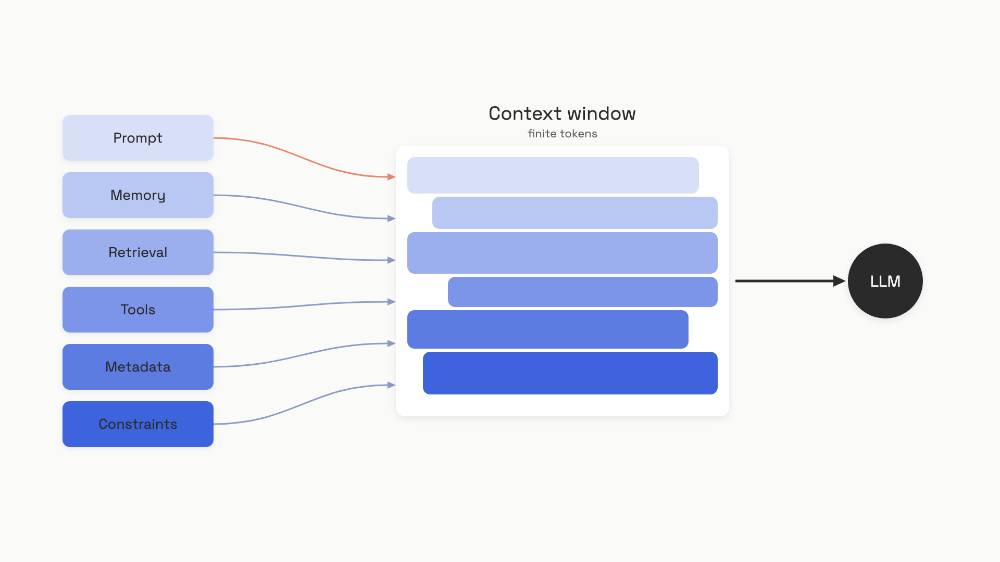

# Context is more than the prompt

The support agent's system prompt hasn't changed in a month. The eval suite is green. And yet this week it quoted a refund policy that was retired last quarter, called the wrong tool because eleven tools were defined and only three applied to the query, and greeted a customer of eight months with "what can I help you with today?" as if she'd never used the product. The team's first instinct is to rewrite the prompt. None of those bugs live in the prompt.

They live in the *context*: the assembled stack of tokens the model actually sees on a given turn. The prompt is one floor of that stack. Everything else, the retrieved policy doc, the tool schemas, the conversation history, the user's stored preferences, the timestamp, all rides in the same finite window and competes for the same attention budget. When Andrej Karpathy and Tobi Lutke pushed the term "context engineering" into the discourse in June 2025, what they were really saying is: the job most LLM products call "prompt engineering" is mostly not about prompts.[^1][^2]

## The anchor equation

Six components enter the model's context window on every turn. Part 5 is built around them, and you'll see this equation again in every chapter that follows:

> **Context = Prompt + Memory + Retrieved Knowledge + Tools + Metadata + Constraints**

Each component is a different source of tokens, owned by a different part of your code, with different rules for what should and shouldn't enter:

- **Prompt** is the system instructions and the user's current message. This is what classic prompt engineering optimizes.
- **Memory** is conversation state and any persistent facts about the user pulled from a store. It changes turn by turn.
- **Retrieved Knowledge** is the chunks a RAG pipeline pulls in for this specific query. It's empty for some queries and dense for others.
- **Tools** are the JSON schemas the model can call. Each schema costs tokens whether the model uses it or not.
- **Metadata** is environmental state the model can't infer: the current timestamp, the user's role, locale, session ID, feature flags.
- **Constraints** are the explicit guardrails: safety rules, refusal policies, format requirements that must hold regardless of what the user asks.


*All six component streams compete for space in the same finite window before a single token reaches the model.*

The equation is an accounting identity, not a recipe. It tells you what enters the window. It does not tell you how much of each, in what order, or what to do when they don't fit. Those choices are the discipline.

## Why "prompt engineering" undersells the job

The term "prompt engineering" formed in 2022 and 2023 around a workflow that mostly involved one developer, one static string, and one model output. You wrote a clever prompt; you graded the result; you iterated on the wording. That's still a real skill, and [Anatomy of a production prompt](../part-3-prompt-engineering/00-anatomy-of-a-production-prompt.md) is the chapter that owns it. But it's a narrow skill.

In a production agent, the wording of one section isn't the load-bearing decision. The decisions that matter happen at assembly time, on every turn, in code:

```python
def build_context(user_msg: str, session: Session) -> list[dict]:
    # Memory: which past turns to keep, summarize, or drop?
    history = session.history.last_n_or_summarized(budget_tokens=2_000)

    # Retrieved knowledge: which chunks for this specific query?
    chunks = vector_store.search(user_msg, k=5, filter=session.tenant_id)

    # Tools: which of 23 available tools apply to this user role?
    tools = registry.tools_for(role=session.user.role, query=user_msg)

    # Metadata: what does the model need that it can't infer?
    meta = {
        "now": datetime.now(UTC).isoformat(),
        "user_locale": session.user.locale,
        "user_tier": session.user.tier,
    }

    return assemble(SYSTEM_PROMPT, history, chunks, tools, meta, user_msg)
```

Every line in `build_context` is a decision the prompt itself can't make. Pick the wrong five chunks and the prompt is irrelevant. Forget to inject the timestamp and the model can't reason about "renewals due this week". Pass all 23 tools and the model picks the wrong one because the relevant signal is drowning. Harrison Chase's framing from the LangChain post is the cleanest: prompt engineering is "architecting your prompt to work well with a single set of input data"; context engineering is taking "a set of dynamic data and format[ting] it properly" so the prompt has anything sensible to work on.[^3]

This is why every serious provider has converged on the term. Anthropic's September 2025 engineering post defined context engineering as "the set of strategies for curating and maintaining the optimal set of tokens (information) during LLM inference, including all the other information that may land there outside of the prompts," and stated explicitly: "most agent failures are now context failures, not model failures."[^4] The July 2025 academic survey reviewed over 1,400 papers and formalized the same distinction: prompt engineering optimizes a static string, context engineering composes a dynamic structured assembly.[^5] Prompt engineering didn't die. It's a subset.

## More context isn't more capability

The first instinct when context windows grew past a million tokens was to put everything in. That instinct is wrong, and it's wrong for a reason that's baked into how transformers work.

Self-attention is quadratic: every token attends to every other token, so pairwise relationships scale as O(n²) with sequence length. As you stretch the input, the model's attention spreads thinner across more pairs. Two well-documented effects follow.

First, **lost in the middle**. The 2024 TACL paper by Liu et al. showed that performance peaks when relevant information sits at the start or end of the input and degrades sharply in the middle, even for models explicitly trained on long contexts.[^6] The shape mirrors human primacy and recency bias. The practical consequence: where you place a fact inside the prompt matters as much as whether it's there.

Second, **context rot**. Chroma's July 2025 study evaluated 18 frontier LLMs (GPT-4.1, Claude 4, Gemini 2.5, Qwen3) on tasks where the difficulty was held constant and only the input length varied. Every model degraded as input length grew, even on trivial tasks. A single distractor reduced accuracy versus a clean baseline; four distractors compounded the loss.[^7] Databricks ran a parallel study in 2024 with similar shape: Llama 3.1 405B started losing accuracy past 32k tokens; GPT-4-0125-preview past 64k, both well below the nominal window limit.[^8]

The Karpathy phrasing is exact: "filling the context window with just the right information for the next step."[^1] Not all the information. The right information. Anthropic's guiding principle in the same vein: "find the smallest possible set of high-signal tokens that maximize the likelihood of some desired outcome."[^4] Treat the context window as a finite resource you're spending, not a bucket you're filling.

## The four ways context goes wrong

Every Part 5 chapter that follows is, underneath, a defense against one of four failure modes. Drew Breunig named them in June 2025 and the names stuck because each describes a distinct, reproducible bug:[^9]

- **Context poisoning.** A hallucination from an earlier turn gets written back into the context (as a tool result, a summary, a memory note) and treated as fact on later turns. Google DeepMind's Gemini 2.5 technical report documented this in their Pokémon-playing agent: "many parts of the context (goals, summary) are 'poisoned' with misinformation about the game state, which can often take a very long time to undo."[^9]
- **Context distraction.** As the conversation grows long, the model over-attends to the accumulated history and stops drawing on its parametric knowledge. The same Gemini report: past 100k tokens, the agent "showed a tendency toward favoring repeating actions from its vast history rather than synthesizing novel plans."[^9]
- **Context confusion.** Irrelevant content (the wrong tool schemas, the wrong retrieved chunks) makes it into the window, and the model uses it because it's there. The Berkeley Function-Calling Leaderboard shows accuracy declining as tool count grows for every model tested; one experiment found a quantized Llama 3.1 8B fail with all 46 tools available and succeed when given only the 19 relevant ones.[^9]
- **Context clash.** Information arrives in stages and later turns contradict earlier ones; the model commits to a partial answer and won't revise. A Microsoft and Salesforce study sharded benchmark prompts across multiple turns and saw an average 39% accuracy drop across models. OpenAI's o3 fell from 98.1% to 64.1%.[^9]

These aren't model bugs. They're assembly bugs. Each one is fixed by a Part 5 chapter: assembly and routing for confusion, compression and budgets for distraction, memory design for poisoning, evaluating context for clash.

## The default rule

Apply context engineering discipline the moment your application has more than one turn or pulls in any external data. Single-turn, no-retrieval use cases are fair game for pure prompt engineering. Once you add conversation history, retrieval, or tools, you're assembling a context every turn, and the assembly is the part that fails first.

Three habits cover most of the win. Place stable, high-priority content (system instructions, hard constraints) at the start and end of the window, where attention is strongest; put variable material in the middle. Prune tools per request, not per design: every tool schema you ship to the model that doesn't apply is a token tax and a confusion vector. And track what you spent: every assembled context should be loggable as six labeled byte counts, because if you can't see your own budget, you can't manage it.

This is the floor of [Context assembly and routing](./01-context-assembly-and-routing.md), the chapter that turns these habits into code. At architecture scale, [AI system design](../../hld/part-9-ai-ml-system-design/) in HLD Part 9 covers the whiteboard view: vector stores, memory stores, observability for what enters the context.

## References

[^1]: Andrej Karpathy, X post, June 25, 2025, https://x.com/karpathy/status/1937902205765607626
[^2]: Tobi Lutke, X post, June 19, 2025, https://x.com/tobi/status/1935533422589399127 (2.05M views, 881 reposts as of June 2025)
[^3]: Harrison Chase, "The rise of 'context engineering'", LangChain Blog, June 23, 2025, https://www.langchain.com/blog/the-rise-of-context-engineering
[^4]: Anthropic Applied AI team, "Effective context engineering for AI agents", Anthropic Engineering, September 29, 2025, https://www.anthropic.com/engineering/effective-context-engineering-for-ai-agents
[^5]: Lingrui Mei, Jiayu Yao, Yuyao Ge et al., "A Survey of Context Engineering for Large Language Models", arXiv:2507.13334, July 17, 2025, https://arxiv.org/abs/2507.13334
[^6]: Nelson F. Liu, Kevin Lin, John Hewitt et al., "Lost in the Middle: How Language Models Use Long Contexts", TACL 2024, https://arxiv.org/abs/2307.03172
[^7]: Kelly Hong, Anton Troynikov, Jeff Huber, "Context Rot: How Increasing Input Tokens Impacts LLM Performance", Chroma Technical Report, July 14, 2025, https://research.trychroma.com/context-rot
[^8]: Databricks Research, "Long Context RAG Performance of LLMs", Databricks Blog, August 2024, https://www.databricks.com/blog/long-context-rag-performance-llms
[^9]: Drew Breunig, "How Long Contexts Fail", dbreunig.com, June 22, 2025, https://www.dbreunig.com/2025/06/22/how-contexts-fail-and-how-to-fix-them.html (citing Gemini 2.5 technical report, Berkeley Function-Calling Leaderboard, and the Microsoft and Salesforce sharding study, arXiv:2505.06120)

