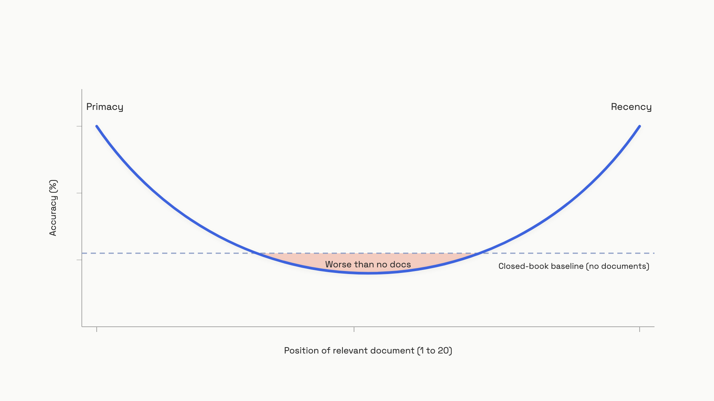

# Compression and context budgets

A model with a million-token window can answer worse with 100,000 tokens than with 10,000.

That isn't a quirk of one model. In July 2025, Chroma tested 18 frontier models, including GPT-4.1, Claude Opus 4, Gemini 2.5 Pro, and Qwen3-235B. Every one of them got worse as input length grew, even on a task as simple as repeating back a word sequence.[^1] On LongMemEval, every Claude model scored higher on a 300-token focused prompt than on the same conversation packed into 113,000 tokens.[^1]

Bigger window is not "more memory." It's more rope to hang yourself with. The job of context engineering, once your prompt and retrieval are working, is to keep the window small on purpose, and to know which compression move to use when.

## Two ways long context fails

The first failure mode is positional. Liu et al. (TACL 2024) ran multi-document QA across GPT-3.5-Turbo, Claude, MPT, and LongChat with the answer-bearing document placed at every position in a 20-document context.[^2] Accuracy traced a U-shape: high when the answer sat at position 1 or 20, low in the middle. At the worst position, GPT-3.5-Turbo dropped to **52.9%, below its 56.1% closed-book score.** The model was better off with no documents than with the right document buried in the middle.[^2]


*With 20 retrieved documents, the model attends best to the first and last; an answer in the middle does worse than no documents at all.*

The second failure mode is length itself. Chroma named this **context rot**: continuous, measurable degradation that scales with input length, separate from the binary "you ran out of room" failure.[^1] Three things compound. Attention dilution: with softmax, each relevant token's weight is proportional to 1/N, so doubling the input halves the signal strength of every fact in it. Distractor interference: even one topically-related-but-wrong passage drags accuracy down, and four distractors compound non-linearly. And the lost-in-the-middle bias on top.

One Chroma finding is genuinely strange. Models scored *higher* on shuffled haystacks than on logically coherent essays of the same content.[^1] Coherent prose makes better-looking distractors; the model's attention spreads more evenly, diluting the needle. Coherence, the thing your retrieval pipeline is trying to produce, can hurt you.

## Two cheap mitigations before you compress anything

If you do nothing else from this chapter, do these two things to your retrieval pipeline today.

**Cap retrieved documents at around 20.** Liu et al. measured retriever recall continuing to climb past 20 documents while reader accuracy plateaus: docs 21 through N add roughly **1.5% accuracy on GPT-3.5-Turbo, 1% on Claude**, at full latency and full token cost.[^2] Your reranker isn't the bottleneck above 20; the model's attention is. Going from top-50 to top-10 with a good reranker beats going from top-10 to top-50 with a great one.

**Put rank-1 first and rank-2 last.** The U-curve is a free decision rule. Highest-scoring document at position 0, second-highest at the end of the context, the rest in the middle where the model's attention is thinnest anyway:

```python
def order_for_u_curve(docs: list[dict]) -> list[dict]:
    """Place top-ranked at start, second at end, rest in middle.
    Mitigates lost-in-the-middle (Liu et al., TACL 2024)."""
    ranked = sorted(docs, key=lambda d: d["score"], reverse=True)
    if len(ranked) <= 2:
        return ranked
    head, tail, middle = ranked[0], ranked[1], ranked[2:]
    return [head, *middle, tail]
```

One caveat. Chroma's NIAH variants didn't reproduce a sharp U-curve across 11 needle positions.[^1] Their haystacks had no relevance-ranked structure, which probably damped the primacy advantage. The disagreement is unresolved as of mid-2026, but the cost of acting on Liu's recommendation is zero, so do it.

## Trim, summarize, re-retrieve: pick one per situation

Once your context is big enough to need cutting, you have three moves, and they're not interchangeable. Pick by asking what the missing information looks like and whether you can get it back.

- **Trim** drops the oldest N tokens or turns. It's free, instant, and indiscriminate. Use it when the context is genuinely time-ordered (a chat where only the recent turns matter) and the dropped material is dead weight, not state.
- **Summarize** replaces a long history with an LLM-generated abstract of decisions, constraints, and open tasks. It costs an extra model call and is lossy by design. Use it for stateful long-running work, coding agents, research agents, multi-turn problem solving, where earlier *decisions* still bind later turns even though the verbatim text doesn't.
- **Re-retrieve** discards the current context for stale data and runs a fresh retrieval query. Use it whenever the missing information is queryable from an index. For factual lookups against a stable corpus, re-retrieval beats summarization because it's lossless: you're paying retrieval cost to get verbatim source back.

The decision tree is short:

```text
Is the info still in an indexed store?  -> re-retrieve
Is earlier state load-bearing now?      -> summarize
Otherwise                                -> trim
```

A coding agent halfway through a refactor needs summary memory: "we decided to use Postgres, the schema lives in `db/schema.py`, three tests still failing." A customer support bot answering "what's our refund policy" needs re-retrieval against the current policy doc. A long casual chat where the user just asked a follow-up question needs a trim of everything before the last few turns.

Mixing them up burns money and quality. Trimming a coding agent loses the schema decision; the agent re-derives it wrong. Summarizing a factual lookup turns a verbatim quote into a paraphrase, then a hallucination. Re-retrieving a multi-turn negotiation drops the constraints the user established three turns ago.

Ma et al.'s SELF-ROUTE work (2024) frames this as a per-query routing problem, not a fixed pipeline.[^3] You don't have to pick one strategy for the whole product. A single agent can trim chit-chat, summarize at session boundaries, and re-retrieve when a tool call returns "results may have changed." That's the production pattern, not "we are a RAG company" or "we are a long-context company."

## How summarization actually works in production

The minimal pattern is a rolling buffer with a summary memory. Keep the last few turns verbatim. When the buffer crosses a threshold, summarize everything older into one block, append it to a running summary, and drop the raw turns:

```python
from dataclasses import dataclass, field

@dataclass
class CompactionState:
    summary: str = ""
    recent: list[dict] = field(default_factory=list)
    tokens: int = 0

def maybe_compact(state, new_turn, summarize_fn,
                  budget=8000, keep_turns=4):
    state.recent.append(new_turn)
    state.tokens += len(new_turn["content"]) // 4  # rough estimate

    if state.tokens <= budget:
        return state

    older = state.recent[:-keep_turns]
    state.recent = state.recent[-keep_turns:]
    new_summary = summarize_fn(state.summary, older)
    state.summary = new_summary
    state.tokens = (len(new_summary) // 4
                    + sum(len(t["content"]) // 4 for t in state.recent))
    return state
```

The `summarize_fn` is the load-bearing part, and "summarize this conversation" is the wrong prompt. Generic summaries optimize for fluency and silently drop the things you actually need: active constraints ("never store PII"), specific values ("user's account ID is 88421"), open tool results, and decisions already made. Write your summary instructions as a structured extraction, not a recap. Enumerate categories: *decisions made, active constraints, open tasks, key values.* Test it by running a probing question after compaction that requires a fact established before the compaction fired. If the answer changes, the summary lost it.

Anthropic shipped server-side compaction as a beta feature in early 2026 (header: `compact-2026-01-12`). It triggers automatically when input exceeds a threshold (default 150,000 tokens, minimum 50,000), runs an internal summarization call using the same model, and returns a `compaction` block in place of the dropped messages.[^4] Two billing traps come with it. The summarization call is billed at full input/output rates, on the same model you requested, with no option for a cheaper summarizer. And the top-level `usage.input_tokens` field excludes the compaction iteration; you have to sum across `usage.iterations` to get the real cost. Cost trackers that ignore that field will silently underreport by tens of thousands of tokens per compaction event.[^4]

> [!WARNING]
> Tool-call results are the silent killer of compaction. A long-running agent accumulates large `tool_result` blocks; the summarizer rolls them into "I called the search tool five times and got results about X." On the next turn the agent can't see the actual data, so it re-calls the tools to recover what it just paid to compute. Anthropic's docs recommend `tool_result_clearing` to drop already-processed tool outputs, or `pause_after_compaction` so you can preserve the most recent tool results verbatim before the conversation continues.[^4] Without one of these, compaction roughly doubles tool-call costs instead of reducing them.

## Context isolation: the move that beats compression

Sometimes the right answer isn't to compress a long context. It's to never assemble one in the first place.

Anthropic's multi-agent research system uses an Opus 4 lead agent that delegates subtasks to Sonnet 4 subagents. Each subagent runs in its own isolated context window, does its work, and returns a condensed result of roughly 50 to 200 tokens. The lead never sees the search traces, dead ends, or tool exchanges. Anthropic reports this architecture beat a single Opus 4 agent by 90.2% on research tasks, while consuming around 15x more total tokens distributed across isolated windows.[^5]

This is the architectural answer to context rot. Subagents replace summarization with delegation: instead of reading 100,000 tokens of search history and summarizing them, the lead reads a 200-token result. The cost is more total tokens; the win is that no single window ever gets long enough to rot. When you find yourself building elaborate compaction logic for an agent loop, ask whether the loop should be a subagent call instead. The architecture-scale view of this pattern, where it lives in the system diagram alongside queues and stateful services, is in the High-Level Design Handbook's [agentic systems chapter](../../hld/part-9-ai-ml-system-design/03-ai-agent-architectures.md).

## Spend the budget on purpose

The unifying habit is to give every context layer an explicit token quota and enforce it before every model call. System prompt, conversation history, retrieved docs, tool definitions, output reserve. If the inputs exceed the budget, you compress *before* the API rejects the call, not after:

```python
def allocate_budget(system_t, history_t, retrieved_t,
                    max_context=128_000, output_reserve=4_096):
    available = max_context - output_reserve
    system = min(system_t, available)
    rest = available - system
    history = min(history_t, int(rest * 0.40))
    retrieved = min(retrieved_t, rest - history)
    overflow = (system_t > system or history_t > history
                or retrieved_t > retrieved)
    return {"system": system, "history": history,
            "retrieved": retrieved, "overflow": overflow}
```

The percentages are a starting point, not a law. Tune them with the eval set you built in [Your first eval set](../part-4-eval-fundamentals/02-your-first-eval-set.md): vary the history-vs-retrieval split, measure answer quality, find the inflection point. Most teams discover they were spending 60% of the window on conversation history that contributed nothing, and 10% on retrieved docs doing all the work. Reallocate, and the same model with the same prompt starts giving better answers.

The point of this chapter, the thing to carry forward into [Memory and state](./03-memory-and-state.md) and [Tool context and metadata](./04-tool-context-and-metadata.md): the context window is a budget you spend, not a bag you fill. Models punish you for filling it.

## References

[^1]: Hong, Kelly; Troynikov, Anton; Huber, Jeff. "Context Rot: How Increasing Input Tokens Impacts LLM Performance." Chroma Technical Report, July 14, 2025. https://research.trychroma.com/context-rot
[^2]: Liu, Nelson F.; Lin, Kevin; Hewitt, John; Paranjape, Ashwin; Bevilacqua, Michele; Petroni, Fabio; Liang, Percy. "Lost in the Middle: How Language Models Use Long Contexts." TACL, Vol. 12, pp. 157-173, 2024. arXiv:2307.03172. https://arxiv.org/abs/2307.03172
[^3]: Ma, Shuai; et al. "Retrieval Augmented Generation or Long-Context LLMs? A Comprehensive Study and Hybrid Approach." arXiv:2407.16833, 2024. https://arxiv.org/abs/2407.16833
[^4]: Anthropic. "Compaction." Claude API Documentation (beta, `compact-2026-01-12`). Accessed June 2026. https://docs.anthropic.com/en/docs/build-with-claude/compaction
[^5]: Anthropic. "How we built our multi-agent research system." Anthropic Engineering Blog, 2025. https://www.anthropic.com/engineering/multi-agent-research-system
