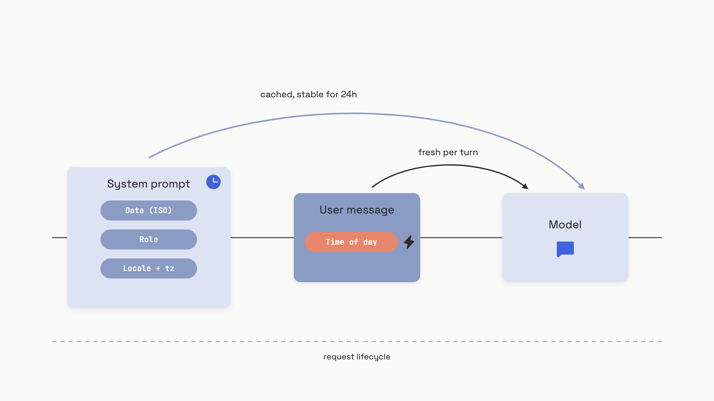

# Tool context and metadata

A user asks your assistant: "Show me the receipts from last week." The model returns receipts from October 2023. Your code is fine. Your retrieval is fine. The model just doesn't know what week it is.

That's the chapter in one bug. The model has no clock, no idea who's asking, no sense of locale, and only a fuzzy idea of what each tool actually does. Whatever you don't put in front of it, it has to guess from training-data priors that may be twenty-nine months stale.[^1] Most "wrong but confident" answers in production trace back to one of those gaps, not to the model being bad at reasoning.

[Function and tool calling](../part-2-working-with-model-apis/03-function-and-tool-calling.md) covered the mechanics of the loop: schemas in, JSON arguments out, results back. This chapter is the other half. What does the model need to know about its tools, the user, and the environment so it picks the right tool, calls it correctly, and gives an answer that matches reality?

## The description is the routing signal, not the schema

Most engineers treat a tool definition the way they treat a TypeScript type: the JSON Schema is the real contract; the description is documentation. The model treats it the opposite way. The schema constrains the arguments *after* the model has decided to call the tool. The decision itself is made almost entirely from the natural-language description.

Anthropic's own guidance is blunt: the description is "by far the most important factor in tool performance."[^2] OpenAI says the same thing in different words.[^3] When Anthropic published the tool design behind their SWE-bench Verified result in January 2025, the headline number was Claude 3.5 Sonnet at 49% with just two tools, beating the previous state of the art (45%) which used larger custom scaffolds.[^4] What did the work? Long, opinionated descriptions on `bash` and a string-replace editor that preempted every misuse pattern the team observed in eval traces. Schema design was secondary.

A real example from that same body of work: when Claude's web search tool first launched, evaluation transcripts showed it kept appending `2025` to the user's query, biasing every result. The fix was one paragraph added to the description telling the model not to do that.[^5] No code change. No retraining. One paragraph.

So: write the description the way you'd brief a new hire who can't see your code. Cover what the tool does, when to use it, when *not* to use it, and the format of every parameter, including any niche terms. The OpenAI docs phrase the bar concretely: "Can an intern correctly use the function given nothing but what you gave the model?"[^3] If they'd ask a clarifying question, the answer to that question belongs in the description.

Three rules fall out of this:

- **Disambiguate parameter names.** `start_date_iso8601` beats `start_date`. `customer_id` beats `customer`. The model leans on the name when the description is silent.
- **Don't ask the model to fill arguments you already know.** If the application has the `tenant_id` from the session, pass it in code. Every parameter the model has to invent is a parameter it can hallucinate.
- **Consolidate related operations behind an `action` enum.** Three tools called `create_pr`, `review_pr`, `merge_pr` look tidy in code but force the model to disambiguate three near-identical descriptions. One `pr_action` tool with `action: "create" | "review" | "merge"` selects more reliably.[^5]

## What the model doesn't know about the world

The receipts bug at the top of the chapter is the easiest of a family. The model has no internal clock. It reasons about "today" using whatever date-shaped tokens dominated near the end of training, which for GPT-4o is October 2023.[^1] In early 2026 that's a twenty-nine-month gap. ChatGPT and Claude.ai paper over this by injecting the current date into the system prompt for every chat. The API does not. If you don't inject it yourself, you ship the gap.

The fix is one line, and the line you write matters:

```python
import datetime

# Right: date precision, ISO 8601, UTC. Stable for 24 hours.
today = datetime.datetime.now(datetime.UTC).date().isoformat()
system = f"Today's date is {today} UTC.\n\n" + base_instructions

# Wrong: full datetime. Unique on every request. Busts your prompt cache.
# now = datetime.datetime.now(datetime.UTC).isoformat()
```

That comment is doing real work. One engineering team found their LLM latency had jumped from a few seconds to over fifty seconds, and traced it to a single line of the form `Current date and time: ${dateTime}` formatted to second precision.[^1] Every request produced a unique system prompt prefix, so the provider's prompt cache hit-rate collapsed to zero, and every call paid full input-token rates and full prefill latency. Date precision keeps the prefix stable for twenty-four hours; the cache stays hot; the bill stays sane. The chapter on [prompt caching](../part-2-working-with-model-apis/07-prompt-caching.md) covers why a stable prefix matters; this is one of the highest-payoff places to keep one stable.

Two other points about *where* the date goes. Put it at the start of the system prompt, before instructions, so the model anchors temporal reasoning before it reads anything that might be date-sensitive.[^1] And put the *date* in the system prompt; if you genuinely need time-of-day or the user's local timezone, put those in the first user message, where the per-turn volatility doesn't pollute the cached prefix.

Long-running agents need a third option. A session that opens at 11:45 PM with `Today is April 19, 2026` cached, and serves a request at 12:15 AM, will compute "tomorrow" wrong. The bug only fires in a two-hour window around midnight in whatever timezone the cache TTL straddles, and you can't reproduce it during business-hours testing.[^1] For agents that may run hours, expose a tiny tool the model can call when it cares:

```python
def get_current_time(timezone: str) -> str:
    """Return the current time in the requested IANA timezone, e.g. 'America/New_York'.
    Use this whenever the user asks about today, tomorrow, or anything time-relative,
    if the session has been running for more than an hour."""
    import datetime
    from zoneinfo import ZoneInfo
    return datetime.datetime.now(ZoneInfo(timezone)).isoformat()
```

The model will read that description and call the tool when it needs fresh time. The injected date in the system prompt covers the common case; the tool covers the long tail.

## Who's asking, and where they live

The same logic applies to the user. The model can't tell whether it's talking to an admin or a viewer, a doctor or a child, a German user expecting `19.04.2026` or an American expecting `04/19/2026`. Whatever you don't tell it, it picks based on whatever majority pattern dominated training. The fix is a small, structured block of metadata at the top of the system prompt:

```python
from dataclasses import dataclass

@dataclass
class RequestContext:
    user_role: str    # "admin" | "editor" | "viewer"
    locale: str       # BCP-47, e.g. "en-US", "de-DE"
    timezone: str     # IANA, e.g. "America/New_York"

def build_system_prompt(base: str, ctx: RequestContext) -> str:
    today = datetime.datetime.now(datetime.UTC).date().isoformat()
    lines = [
        f"Today's date is {today} UTC.",
        f"User locale: {ctx.locale}. Timezone: {ctx.timezone}.",
        f"User role: {ctx.user_role}.",
    ]
    if ctx.user_role == "viewer":
        lines.append("You have read-only access. Do not suggest write, edit, or delete actions.")
    elif ctx.user_role == "admin":
        lines.append("You have full administrative access including deletion and config changes.")
    lines.append("")
    lines.append(base)
    return "\n".join(lines)
```

The discipline is to inject the minimum set of facts that would change the model's answer if absent. Date always qualifies. Role qualifies for any system with permissions. Locale and timezone qualify whenever the model formats numbers, currency, or dates, or makes time-relative statements. Anything else is padding, and padding is just tokens you pay for on every request.


*Stable metadata goes in the system prompt prefix. Per-turn volatile metadata goes in the user message. Get this wrong and your cache hit rate collapses.*

One caveat that gets people in trouble. Injecting `user_role: viewer` guides the model. It does not enforce anything. A model told it's talking to a viewer can still call `delete_order` if the tool is in its array and a sufficiently persuasive prompt injection convinces it to. Treating the LLM as your authorization layer is the kind of mistake that ends up in a postmortem.[^6]

The fix is defense in depth: inject the role to guide the model, *and* filter the tools array before the request, so a viewer literally never sees a destructive tool:

```python
ROLE_ALLOWED_TOOLS = {
    "viewer":  {"read_orders"},
    "editor":  {"read_orders", "cancel_order"},
    "admin":   {"read_orders", "cancel_order", "issue_refund"},
}

def filter_tools_by_role(tools, role):
    allowed = ROLE_ALLOWED_TOOLS.get(role, set())
    return [t for t in tools if t["function"]["name"] in allowed]
```

Metadata injection guides reasoning. Tool filtering enforces the constraint structurally. Real authorization still lives in your API and your database, but those two layers, working together, kill the most embarrassing class of role-confusion bug before it reaches the model.

## The tool count tax

Every tool definition you register lives in the system prompt of every request, whether the model uses it or not. A simple single-parameter tool burns roughly 96 to 150 tokens; a complex one with 28 parameters chews through about 1,633.[^7] Connect the official GitHub MCP server with its 93 tools and you've spent 55,000 tokens before the user has typed anything, around 21% of a 200K context window.[^8][^9] Wire up ten MCP servers with fifteen tools each and you're at roughly 75,000 tokens of standing tax.[^10]

That cost is real but tractable. The accuracy cost is worse. Independent benchmarks as of 2026 show that around 50 tools, frontier models still pick correctly 84 to 95% of the time. At 200 tools the range fragments to 41 to 83%, depending on the model. At 740 tools, accuracy collapses to between 0 and 20%.[^11] More tools is not more capability. Past a point, more tools is just more confusion.

OpenAI's soft ceiling is "fewer than 20 tools available at the start of a turn."[^3] That's the right anchor. When you cross it, you have four options that compose:

- **Tool filtering by role or task,** as above. The cleanest win when different users genuinely need different tools.
- **Tool search.** Expose one `tool_search` tool the model can call to discover and load schemas on demand. Spring AI's implementation cut tool tokens by 34 to 64% across OpenAI, Anthropic, and Gemini.[^12] You pay one extra turn of latency to load a tool; you save the tax on every other turn.
- **Prompt caching on the tool block.** Tool definitions are stable across requests and are exactly the kind of long, repeated prefix prompt caches were built for. Cache writes cost about 25% more than base input pricing, but pay back on the second hit.[^13] Just don't put a per-request timestamp above your tool block, or none of this works.
- **Context editing.** On long agent runs, drop stale `tool_result` blocks from history once the model is done with them. The same idea covered in [Compression and context budgets](02-compression-and-context-budgets.md), applied to tool output specifically.

The starting recommendation: keep your initial set under 20, turn on prompt caching for the tool block from day one, and reach for tool search when you genuinely need more.

## What MCP annotations do, and what they don't

If your tools come from the [Model Context Protocol](../part-7-agent-engineering/04-mcp-model-context-protocol.md), you'll see a fifth field on the tool object: `annotations`. As of the 2025-03-26 spec revision, an MCP tool can declare four behavioral hints:[^14]

```python
# From the MCP spec. Defaults are deliberately pessimistic.
annotations = {
    "readOnlyHint":    False,  # default: assume the tool modifies state
    "destructiveHint": True,   # default: assume the modification is destructive
    "idempotentHint":  False,  # default: assume retries are unsafe
    "openWorldHint":   True,   # default: assume the tool talks to external systems
}
```

Clients can use these to drive UX. Show a confirmation dialog before any non-`readOnly` tool. Ask once and remember for `idempotent` tools. Flag `openWorldHint` tools when a session has acquired all three legs of [the lethal trifecta](../part-9-security-and-governance/01-agent-security-and-the-lethal-trifecta.md): private data access, untrusted content ingestion, and external communication.[^15]

The MCP spec is explicit that annotations are hints, not contracts. An untrusted server can claim `readOnlyHint: true` and delete your files anyway.[^14] Adoption reflects this; only about 17% of GitHub MCP users enable read-only mode as of March 2026.[^14] Use annotations to drive client confirmation flows. Do not use them as a security boundary. Real isolation lives in transport auth, sandboxing, and egress controls, the territory of [Agent security and the lethal trifecta](../part-9-security-and-governance/01-agent-security-and-the-lethal-trifecta.md).

## Tool responses are context too

The output of a tool call goes straight into the model's working memory. A bloated, UUID-laden response wastes tokens on every turn that follows it and gives the model more surface area to hallucinate against. Anthropic's evaluation work on internal Slack and Asana MCP servers found that resolving opaque internal IDs to human-readable names cut hallucination rates measurably on retrieval tasks,[^5] and that a `response_format` enum letting the model choose between `concise` and `detailed` cut a Slack thread response from 206 tokens to 72, about 35% of the original, with no accuracy loss on the held-out test set.[^5]

Three rules for tool output:

- **Return what the model needs to reason, not what your database happens to store.** Names beat UUIDs. Status enums beat raw integer codes. Strip MIME types and internal refs.
- **Paginate long responses with a sensible default.** Claude Code caps tool output at 25,000 tokens.[^5] When you truncate, say so in the response, and tell the model how to fetch more: "showing 50 of 200 results; pass `page=2` for the next batch."
- **Make errors actionable.** "ERROR: 404" tells the model nothing it can do. "ERROR: user 'alice' not found. Valid IDs are integers between 1000 and 9999. Try `get_user(id=1234)`." gets the model to retry with a real argument or escalate to the user. The chapter on [Tool design](../part-7-agent-engineering/03-tool-design.md) goes deeper on the error taxonomy.

Every one of these rules is the same idea you've seen four times in this chapter, applied to a different surface. The model only knows what's in front of it. Whatever you don't put there it will guess at, and it will guess with full confidence. Tool descriptions, environmental metadata, the tool list itself, and the responses your tools return are four channels of the same context. Each one prevents a different family of confidently wrong answer.

## References

[^1]: Tian Pan, "Temporal Context Injection: Making LLMs Actually Know What Day It Is," TianPan.co, April 20 2026, https://tianpan.co/blog/2026-04-20-temporal-context-injection-llm
[^2]: Anthropic, "Define tools," Anthropic API Docs, https://docs.anthropic.com/en/docs/agents-and-tools/tool-use/define-tools
[^3]: OpenAI, "Function calling," OpenAI API Docs, https://platform.openai.com/docs/guides/function-calling
[^4]: Erik Schluntz, "Raising the bar on SWE-bench Verified with Claude 3.5 Sonnet," Anthropic Engineering Blog, January 6 2025, https://www.anthropic.com/engineering/swe-bench-sonnet
[^5]: Ken Aizawa et al., "Writing effective tools for agents, with agents," Anthropic Engineering Blog, September 11 2025, https://www.anthropic.com/engineering/writing-tools-for-agents
[^6]: Oracle Developers Blog, "How to Enforce Role-Based Data Access in AI Applications with Oracle Deep Data Security," 2026, https://blogs.oracle.com/developers/how-to-enforce-role-based-data-access-in-ai-applications-with-oracle-deep-data-security
[^7]: Tianpan.co, "Why Your Agent Breaks at 30 Tools," April 2026, https://tianpan.co/blog/2026-04-13-tool-explosion-problem-agent-tool-selection-at-scale
[^8]: Piotr Hajdas, "MCP Tools Token Allocation Report" (GitHub gist), August 2025, https://gist.github.com/ghuntley/1fe34212c515a59ea2a9963b5f2386bf
[^9]: Simon Willison, "too many model context protocol servers and LLM allocations on the dance floor," August 22 2025, https://simonwillison.net/2025/Aug/22/too-many-mcps/
[^10]: getunblocked.com, "A Measured Guide to Context-Window Bloat," 2025-2026, https://getunblocked.com/blog/mcp-tool-overload/
[^11]: Tianpan.co, "Your Tool Catalog Is a Power Law and You're Optimizing the Long Tail," April 2026, https://tianpan.co/blog/2026-04-27-tool-catalog-power-law-hot-cold-partition
[^12]: Mario Tzolov, "Achieving 34-64% Token Savings with Spring AI's Dynamic Tool Discovery," Spring Blog, December 11 2025, https://spring.io/blog/2025/12/11/spring-ai-tool-search-tools-tzolov/
[^13]: Anthropic, "Manage tool context," Anthropic API Docs, https://docs.anthropic.com/en/docs/agents-and-tools/tool-use/manage-tool-context
[^14]: Ola Hungerford, Sam Morrow, Luca Chang, "Tool Annotations as Risk Vocabulary: What Hints Can and Can't Do," MCP Blog, March 16 2026, https://blog.modelcontextprotocol.io/posts/2026-03-16-tool-annotations/
[^15]: Simon Willison, "The lethal trifecta for AI agents," June 16 2025, https://simonwillison.net/2025/jun/16/the-lethal-trifecta/
