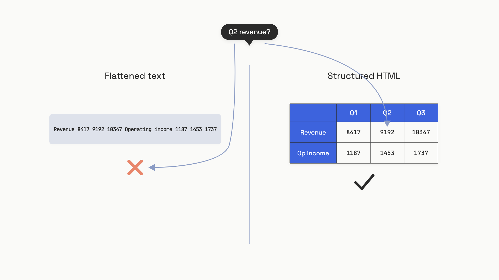
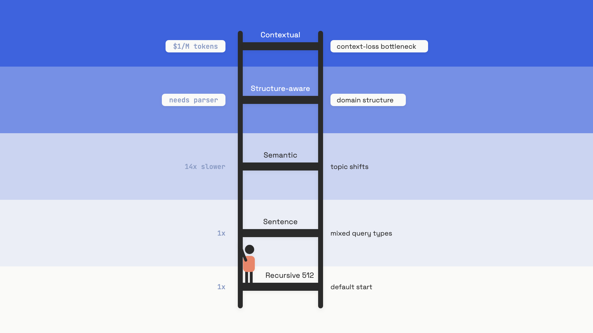

# Document processing and chunking

A team ships a finance assistant on top of last quarter's earnings PDFs. The retriever is fine. The embedding model is fine. The reranker is fine. But every time someone asks "what was Google Cloud's Q2 revenue?", the answer is wrong. The right table is in the corpus. The retriever even pulls the right page. The numbers in the answer are still hallucinated.

Open the indexed chunk. The three-column revenue table that read cleanly in the PDF is now a flat string: `Revenue 8417 9192 10347 Operating income 1187 1453 1737`. Numbers without headers. Quarters without labels. The embedding represents that soup, the LLM gets handed that soup, and no amount of prompt engineering recovers what the parser already destroyed.

The retrieval ceiling is set at indexing time, before any query exists. A chunk is the smallest unit your system can ever return. If a fact is split across two chunks, or a table is flattened into unparseable text, no embedding model and no reranker fully compensates. This chapter is the two decisions that pin that ceiling: how you parse, and how you chunk.

## Parsing: PDF is a display format, not a data format

The reason the table broke is structural. PDF stores text as positioned glyphs, not as logical runs. A naive parser reads glyphs in roughly the order they appear on the page, which is fine for a single column of prose and disastrous for anything else. A two-column academic paper interleaves columns. A page header bleeds into body text. A table loses its row-column mapping the moment cells are read left-to-right, top-to-bottom.


*The same table, parsed two ways: flatten it and the relationships are gone before retrieval ever starts.*

The production tool landscape splits along two axes: rule-based parsers that read the PDF object model and apply heuristics, and vision-language parsers that render the page and detect layout. As of mid-2026, four tools cover almost every real pipeline:

- **PyMuPDF / PyMuPDF4LLM** is the speed default: plain-text extraction runs at about 0.006 seconds per page on one CPU core (well over 100 pages per second), while PyMuPDF4LLM's layout-aware Markdown output is far slower at about 0.5 seconds per page[^1]. The March 2026 release of PyMuPDF-Layout hit F1 0.864 on the DocLayNet benchmark[^2]. Use it for prose-heavy programmatic PDFs and high-throughput batch indexing. It still struggles with merged cells, multi-page tables, and anything scanned.
- **Docling** (IBM Research, MIT licensed) runs DocLayNet for layout and the TableFormer transformer for table structure. On an Apple M3 Max with four CPU threads, it processes 1.27 to 1.34 pages per second using about 6.2 GB of memory[^3]. Reach for it when tables are load-bearing, the document has multi-column layouts, or data can't leave your network.
- **Unstructured** (open-source plus commercial API) uses a `hi_res` strategy that with `infer_table_structure=True` extracts tables as HTML with full row and column structure preserved, plus element types (Title, NarrativeText, Table) attached as metadata[^4]. The recommended pattern for tables: embed an LLM-generated natural-language summary, store the raw HTML for display.
- **LlamaParse** is the commercial escalation: its Agentic tier costs 10 credits per page (about $0.0125 at list price) and scored 84.9% overall on ParseBench, a benchmark LlamaIndex published itself, as of April 2026[^5]. Use it when accuracy matters more than data residency.

Scanned PDFs are their own category. No text layer exists, so the parser has to invoke OCR. Docling's default EasyOCR runs at upwards of 30 seconds per page on CPU[^3], so a 500-page scanned document is a four-hour job on a single core. Route those to Azure Document Intelligence or AWS Textract, or accept the GPU cost of running OCR yourself.

For HTML, parse with BeautifulSoup or lxml and keep the heading structure attached as metadata. LangChain's `HTMLHeaderTextSplitter` walks the document and tags every chunk with the parent `h1` through `h6` path, which becomes filterable retrieval metadata downstream.

The decision is simpler than the tool list suggests: **default to PyMuPDF4LLM; escalate to Docling the moment tables matter; escalate to LlamaParse only when an internal benchmark shows you need to**. Do not pick the parser by reading vendor accuracy claims. Pick it by parsing 50 representative documents with two candidates and eyeballing the output.

## Chunking: a ladder of strategies, not a single answer

Once you have clean text, you have to split it. Every chunking strategy sits somewhere on a cost-versus-quality curve, and the conventional wisdom keeps getting overturned. Two papers from the last year set the ground:

- Bennani and Moslonka (arXiv:2601.14123, January 2026) ran a controlled study with sentence-aware chunking, SPLADE retrieval, and Mistral-8B on Natural Questions. Adding 10 to 20% overlap produced no measurable improvement (BERTScore changes within 0.004; Exact Match within 0.001), while inflating index size by a factor of 1/(1-r). That's a 25% storage and ingestion-cost penalty for nothing[^6].
- Qu et al. (NAACL 2025 Findings, Vectara) found that semantic chunking does not consistently beat fixed-size chunking on real-world documents and may not justify roughly 14x slower indexing[^7]. The advantage shows up on synthetically diverse corpora; on production text it often disappears.

The lesson isn't "semantic is bad" or "overlap is dead". It's that chunking defaults that propagated from tutorials between 2023 and 2024 were untested on most corpora. The right posture is a ladder you climb only when an eval forces you up it.


*Climb the ladder only when your eval data shows the rung below isn't enough.*

**Recursive fixed-size, in tokens.** This is the floor. LangChain's `RecursiveCharacterTextSplitter` tries separators in order: `["\n\n", "\n", " ", ""]`, falling back from paragraph to line to word to character. There's one trap that almost everyone hits the first time:

```python
from langchain_text_splitters import RecursiveCharacterTextSplitter

# WRONG: chunk_size=512 here means 512 characters, ~128 tokens
bad = RecursiveCharacterTextSplitter(chunk_size=512, chunk_overlap=0)

# RIGHT: measure in BPE tokens via tiktoken
splitter = RecursiveCharacterTextSplitter.from_tiktoken_encoder(
    model_name="cl100k_base",   # GPT-4 / text-embedding-3 tokenizer
    chunk_size=512,
    chunk_overlap=0,
    separators=["\n\n", "\n", " ", ""],
)
chunks = splitter.split_text(document_text)
```

The default `chunk_size` parameter counts characters, not tokens. A `chunk_size=512` setting on the default constructor produces roughly 128 tokens per chunk, a quarter of the intended size[^8]. You'll see it as four times the chunk count you expected, retrieval precision that looks artificially good, and a model that can't reason because every chunk is too short. Always use `from_tiktoken_encoder` (or your embedding model's actual tokenizer) when you care about chunk size.

**Sentence-based** splits on sentence boundaries instead of fixed counts. Bennani and Moslonka found it statistically tied with semantic chunking up to about 5,000 tokens of context, at a fraction of the compute[^6]. Their practical recommendation: default to sentence chunking; only escalate to semantic for very large context budgets or genuinely discursive documents.

**Semantic chunking** measures embedding cosine similarity between consecutive sentences and inserts a break wherever similarity drops below a threshold. The intuition is right: split at topic shifts. The empirics are mixed. Indexing slows by roughly 14x[^9], and on real corpora the quality gain often disappears under noise[^7]. Reach for it when your documents have strong topic shifts (news aggregations, multi-topic wikis) *and* your eval shows sentence chunking underperforming.

**Structure-aware** uses the document's own logical units: `h1`-`h6` for HTML, AST function boundaries for code, clause numbers for legal contracts. A November 2025 clinical-domain study found adaptive chunking aligned to logical boundaries reached 87% accuracy versus 13% for fixed-size on clinical decision-support queries[^9]. That's a domain-specific result, but the direction is robust. Use this when your documents have native structure that maps to how users query them.

**Contextual Retrieval** is Anthropic's September 2024 technique. Before embedding, you call a small LLM (Claude 3 Haiku) to generate a 50-100 token description of where each chunk sits in its document, then prepend that description to the chunk. The numbers are striking: contextual embeddings alone cut top-20 retrieval failure rates from 5.7% to 3.7%; combined with BM25, to 2.9%; with reranking on top, to 1.9%, a 67% reduction[^10]. With prompt caching, the one-time preprocessing cost is about $1.02 per million document tokens. It's a real escalation, not a free win, but if your diagnosed bottleneck is context loss at chunk boundaries, it pays.

## Overlap is a tunable, not a default

The 10-20% overlap rule is everywhere. Pinecone's guide still recommends 50-100 token overlap on 512-token chunks as a starting baseline. The Bennani and Moslonka study punctures it: on Natural Questions with sentence-aware chunking and SPLADE retrieval, adding 10-20% overlap moved BERTScore by less than 0.004 and Exact Match by less than 0.001, while inflating the index by 1.25x at 20% overlap[^6]. The mechanism is intuitive once you see it: with sentence-aware chunking, boundary spillover rarely changes which top-N chunks come back, so overlap mostly buys you near-duplicates that consume retrieval budget without adding information.

The caveat matters. That study uses one retriever on one general-domain QA corpus. The authors call out boundary-sensitive domains, things like legal clauses, numbered specification steps, and tightly-formatted reference material where one fact routinely straddles two chunks, as places where overlap may still earn its keep. The right posture: **start with overlap=0, add overlap only when an A/B on your eval set shows it improves retrieval metrics enough to justify the index inflation**.

## Metadata is part of the chunk

A chunk in your vector index isn't just text. It's a data object with two sets of fields: the embedding text (what the model encodes) and the metadata (filterable provenance that never inflates the embedding). Skipping metadata is one of those decisions that costs you nothing on the day you ship and everything on day 30, when you need citations, multi-tenant isolation, or incremental re-indexing.

The minimum useful set per chunk:

- **`source`**: document identifier or URL, for citation
- **`section`**: nearest heading, both for filtered retrieval and for reranker context
- **`page_number`**: for the user to verify
- **`chunk_index`**: position within the parent document
- **`tenant_id`** or **`permission_level`**: for any multi-tenant deployment, enforced at query time
- **`content_hash`** and **`last_modified`**: for delete-and-reindex on document updates without rebuilding the whole corpus

A schema that makes metadata required at the boundary, rather than an optional enhancement:

```python
from dataclasses import dataclass, field

@dataclass
class Chunk:
    text: str
    context_prefix: str = ""           # for Contextual Retrieval
    metadata: dict = field(default_factory=dict)

    @property
    def embed_text(self) -> str:
        if self.context_prefix:
            return f"{self.context_prefix}\n\n{self.text}"
        return self.text

def attach_metadata(texts: list[str], source: str, section: str, page: int) -> list[Chunk]:
    return [
        Chunk(text=t, metadata={
            "source": source, "section": section,
            "page_number": page, "chunk_index": i,
        })
        for i, t in enumerate(texts)
    ]
```

For tables, follow the Unstructured pattern: embed an LLM-generated natural-language summary of the table; store the raw HTML in a `display_html` metadata field; at query time, return the HTML to your application for rendering[^4]. The vector index searches against meaning; the user sees structure.

## Chunk size is an eval question

There is no chunk size that wins everywhere, and there is no way to discover yours by intuition. The variable interacts with three things you can't predict without data: your query distribution, your embedding model's sensitivity to chunk length, and your document structure.

Bhat et al. (arXiv:2505.21700, May 2025) tested fixed-size chunks across multiple embedding models and datasets. The optimum splits cleanly by query type: 64-128 tokens for factoid queries with concise answers, 512-1024 tokens for queries needing broader context. Embedding models also have personalities. Stella benefits from larger chunks for long-range retrieval, while Snowflake performs better at smaller chunks for fine-grained entity matching[^11]. A LlamaIndex study on Uber's 2021 10-K filing benchmarked sizes from 128 to 2,048 tokens and found 1,024 produced peak faithfulness with only modest latency increases[^9]. Weaviate's September 2025 guide reports the gap between best and worst chunking strategy on the same corpus and retriever can be up to 9% in recall[^9].

Bennani and Moslonka surface one more constraint: a context cliff at roughly 2,500 tokens of total retrieved context for their setup. Below that, BERTScore is stable; push past it and accuracy degrades by 4-5% relatively at 10,000 tokens[^6]. The mechanism is the same "lost in the middle" effect that surfaces throughout [Compression and context budgets](../part-5-context-engineering/02-compression-and-context-budgets.md): more context isn't more capability. The exact cliff is model-dependent, but the shape is consistent.

The way out is a measurement loop, not a guess. The [RAGAS](https://docs.ragas.io/) framework gives you four LLM-as-judge metrics that need no labeled ground truth to start: `context_precision` (how much of what you retrieved was actually used), `context_recall` (whether you retrieved everything you needed), `faithfulness`, and `answer_relevancy`. Fix every variable except chunk size, sweep across 256, 512, 1024, and 2048 tokens, watch precision and recall move in opposite directions, and pick the size where they cross for *your* queries. Repeat the same sweep when you change embedding models. The deep RAG eval harness lives in [Evaluating retrieval](./07-evaluating-retrieval.md); the discipline of running it is in Part 4's [Why you can't ship without evals](../part-4-eval-fundamentals/00-why-you-cant-ship-without-evals.md).

A reasonable starting point while you build the eval set: 512 tokens, no overlap, sentence-based splitting with `from_tiktoken_encoder`, metadata attached at ingestion. Treat that as a hypothesis, not a configuration. Every team that ships a working RAG system has, somewhere in their commit history, the experiment that proved their chunk size on their corpus, and a different experiment six months later when the corpus changed.

At architecture scale, [Enterprise RAG system design](../../hld/part-9-ai-ml-system-design/01-rag-pipelines.md) in HLD Part 9 covers the indexing pipeline, storage topology, and multi-tenant isolation as a whiteboard view.

## References

[^1]: Artifex, "PyMuPDF benchmark" (ParseBench, AWS c7i.2xlarge, single CPU core, PyMuPDF 1.28.2), September 2026, https://pymupdf.io/benchmark
[^2]: Artifex, "PyMuPDF-Layout Performance on DocLayNet: A Comparative Evaluation," March 2026, https://artifex.com/blog/pymupdf-layout-performance-on-doclaynet-a-comparative-evaluation
[^3]: Christoph Auer et al. (IBM Research), "Docling Technical Report," arXiv:2408.09869, August 2024, https://arxiv.org/abs/2408.09869
[^4]: Unstructured, "Preserving Table Structure for Better Retrieval," August 2025, https://unstructured.io/blog/preserving-table-structure-for-better-retrieval
[^5]: LlamaIndex, "Introducing LlamaParse v2", December 18, 2025, https://www.llamaindex.ai/blog/introducing-llamaparse-v2-simpler-better-cheaper; LlamaIndex, "Pricing" (1,000 credits = $1.25), https://www.llamaindex.ai/pricing; LlamaIndex, "ParseBench", April 13, 2026, https://www.llamaindex.ai/blog/parsebench
[^6]: Hicham Bennani and Maxime Moslonka, "A Systematic Analysis of Chunking Strategies for Reliable Question Answering," arXiv:2601.14123, January 2026, https://arxiv.org/abs/2601.14123
[^7]: Renyi Qu, Ruixuan Bao, and Lyumanshan Tu (Vectara), "Is Semantic Chunking Worth the Computational Cost?", NAACL 2025 Findings, https://aclanthology.org/2025.findings-naacl.114/
[^8]: LangChain documentation, "How to split text by tokens," https://python.langchain.com/docs/how_to/split_by_token/
[^9]: Digital Applied, "RAG Chunking Strategies: A 2026 Retrieval Playbook," May 2026, https://www.digitalapplied.com/blog/rag-chunking-strategies-2026-retrieval-quality-playbook (synthesizing Chonkie benchmarks, LlamaIndex 10-K study, Weaviate September 2025 guide, and MDPI Bioengineering November 2025 clinical study)
[^10]: Anthropic, "Introducing Contextual Retrieval," September 19, 2024, https://www.anthropic.com/engineering/contextual-retrieval
[^11]: Ishaan Bhat et al., "Rethinking Chunk Size For Long-Document Retrieval," arXiv:2505.21700, May 2025, https://arxiv.org/abs/2505.21700
