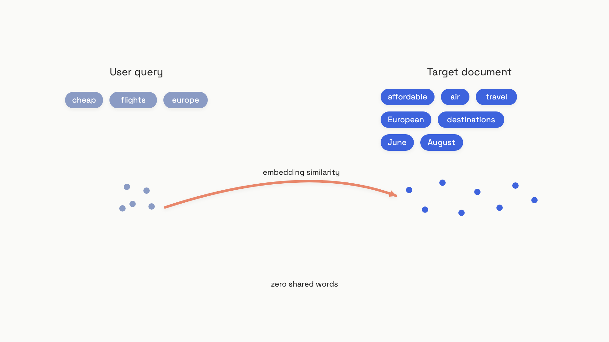

# Query understanding

A user types `cheap flights europe summer`. The document that answers them says `affordable air travel to European destinations between June and August`. Zero overlapping words. BM25 returns nothing. A dense retriever does better, but it's still being asked to bridge a gap the user didn't know was there: their query is three keywords, the document is a paragraph, and the embedding space treats them as different shapes.

That's the vocabulary mismatch problem, and it's where most "RAG just doesn't work for us" complaints actually originate. The retriever is fine. The chunks are fine. The user's phrasing is fine for a human. It's the bridge between them that's broken, and you can't fix it by upgrading the embedding model.

Query understanding is the family of techniques that rewrite, expand, decompose, or route the query *before* it hits the retriever, so the retriever sees something it can match. There are four worth knowing, in roughly increasing cost order: rewriting (one extra LLM call), multi-query (N parallel calls), decomposition (a chain of dependent calls), and routing (one classifier upstream of all of it). The job of this chapter is to tell you which to reach for, in what order, and what each one costs you.


*The retrieval gap: the document that answers the query may share none of its words.*

Frame each technique against a simple budget. Every rewrite, every variant, every sub-question is at least one extra LLM call before the user sees anything. At a small model's typical 200 to 500 ms per call, four sequential calls add a second of latency before retrieval even begins. The question for each technique is the same: does the recall improvement on your eval set justify the calls it's costing you?

## Rewriting: a single extra call

The cheapest move is to rephrase the query before retrieval. One LLM call, one prompt: *"Rewrite this question as a standalone declarative statement suitable for document retrieval."* The model expands abbreviations, resolves pronouns, drops conversational filler, and tends to produce text that's syntactically closer to your corpus. Microsoft's Azure AI Search ships this as a built-in feature and reported a four-point NDCG@3 gain on their own benchmarks as of November 2024, with the largest wins on short, ambiguous queries against term-based indexes.[^1]

You don't always want it. A 2025 study found that prompt-only rewriting can *decrease* dense retrieval quality on queries that are already well-formed: the rewrite paraphrases tangential terms into the query and shoves the embedding outside the retriever's learned cluster.[^2] The rule that follows is conditional: rewrite when queries are conversational, when they contain pronouns or coreference, or when retrieval precision is consistently low on your eval set. Skip when queries are already crisp declarative statements. A/B test before turning it on globally.

The more interesting variant is HyDE: Hypothetical Document Embeddings.[^3] Instead of embedding the user's question, you ask the LLM to write a short *answer* to it, then embed that answer and use *its* vector for retrieval. The hypothesis can be partly hallucinated. That doesn't matter, because the encoder maps it into roughly the same region of the embedding space where real answer documents live. Style transfers; content gets filtered when you actually run similarity search against the real corpus.

```python
def hyde_retrieve(query: str, llm_generate, embed, vectorstore, top_k: int = 5):
    """
    HyDE: generate a plausible answer passage, embed THAT, retrieve real docs.
    Gao et al., arXiv:2212.10496 (Dec 2022).
    """
    # The hypothesis can hallucinate facts; we never show it to the user.
    hypothesis = llm_generate(
        f"Write a concise passage that answers: {query}\n\nPassage:"
    )
    hyp_vec = embed(hypothesis)
    return vectorstore.similarity_search_by_vector(hyp_vec, k=top_k)
```

HyDE is the right reach for zero-shot dense retrieval over technical corpora, where the user's query is short and the documents are long and full of domain vocabulary. It's the wrong reach when the model generating the hypothesis doesn't know your domain. A medical query about a rare disease can produce a hypothesis describing a *different* disease with the same symptom name, and now the embedding points at a wrong cluster with high confidence. Detection: run HyDE and direct-query retrieval side by side on your eval set, compare recall@k. If HyDE wins, ship it. If it doesn't, your model isn't strong enough at this domain to fabricate well.

## Multi-query: N rewrites, fused

Rewriting picks one phrasing. Multi-query picks several at once, runs each through the retriever in parallel, and fuses the result lists. The bet is on recall: different phrasings surface documents that no single phrasing would have hit, because each phrasing pulls in a slightly different region of the embedding space.

The fusion step is Reciprocal Rank Fusion. For each document `d` that appears in any list `L`, the score is `sum over lists of 1 / (k + rank_L(d))` with `k=60` from the original RRF paper.[^4] Documents that show up high in multiple lists score highest; documents that appear once at rank 80 contribute almost nothing. RAG-Fusion is the canonical write-up of this pattern, and the RRF score is what makes the technique forgiving to noisy variants: a bad rephrasing's results sink to the bottom on their own.[^4]

```python
def reciprocal_rank_fusion(ranked_lists: list[list[str]], k: int = 60) -> list[str]:
    """RRF: score(d) = sum_L 1 / (k + rank_L(d)). k=60 is standard."""
    scores: dict[str, float] = {}
    for ranked in ranked_lists:
        for rank, doc_id in enumerate(ranked, start=1):
            scores[doc_id] = scores.get(doc_id, 0.0) + 1.0 / (k + rank)
    return sorted(scores, key=lambda d: scores[d], reverse=True)


def multi_query(question: str, llm_generate, retriever, n: int = 3):
    """Generate n phrasings, retrieve each, fuse with RRF."""
    raw = llm_generate(
        f"Generate {n} different phrasings of this question, one per line, "
        f"no numbering.\nQuestion: {question}"
    )
    variants = [q.strip() for q in raw.strip().split("\n") if q.strip()][:n]

    ranked, doc_map = [], {}
    for v in variants:
        results = retriever.get_relevant_documents(v)
        ids = [doc.metadata.get("id", doc.page_content[:40]) for doc in results]
        for doc, did in zip(results, ids):
            doc_map[did] = doc
        ranked.append(ids)

    return [doc_map[i] for i in reciprocal_rank_fusion(ranked) if i in doc_map]
```

Three to five variants is the practical range. Below three, you might as well rewrite once and pay one call. Above five, you're paying for diminishing recall gains and adding more noise than signal. The retriever calls should run concurrently; serial multi-query at five variants stacks five retrieval round-trips into the user's latency budget.

The failure mode worth watching is topic drift. The variant generator has no hard constraint on staying inside the user's intent and will sometimes interpret an ambiguous query in a direction that pulls in topically adjacent but irrelevant documents. Rackauckas reported this as the main breakage when evaluating RAG-Fusion at Infineon's product information system.[^4] The fix is a relevance gate: embed each generated variant, compute cosine similarity to the original query, and drop any variant scoring below ~0.7. It costs one extra embedding call per variant and stops the worst drift in its tracks.

## Decomposition: when one query can't carry the question

Multi-query helps when one phrasing misses the right documents. It can't help when the question genuinely requires two facts that live in two different documents. *"Who is the CEO of the company that makes the programming language ranked #1 on TIOBE in 2024?"* needs you to first find the language, then find that language's company, then find that company's CEO. No rewrite of the original question retrieves all three documents at once, because the second and third lookups depend on answers you don't have yet.

This is a bridge question, and it wants decomposition: break the original into ordered sub-questions, retrieve and answer each in sequence, feed each answer into the next sub-question's retrieval. IRCoT formalized this by interleaving chain-of-thought reasoning with retrieval; each reasoning sentence becomes the next retrieval query.[^5] On HotpotQA, 2WikiMultihopQA, MuSiQue, and IIRC, IRCoT improved retrieval by up to 21 points and downstream QA by up to 15 points over a single-shot RAG baseline, and it generalized from GPT-3 to Flan-T5-large without retraining.

```python
def sequential_decompose(question: str, llm, retriever, max_hops: int = 3):
    """
    Bridge questions: each sub-question's answer informs the next.
    Cap at 3 hops in production; latency scales linearly.
    """
    context, answer = [], None
    for hop in range(max_hops):
        prompt = (
            f"Question: {question}\n"
            f"Known so far: {context}\n"
            "If you can answer now, output FINAL: <answer>. "
            "Otherwise output NEXT: <one sub-question to retrieve>."
        )
        step = llm(prompt).strip()
        if step.startswith("FINAL:"):
            return step[6:].strip(), context
        sub_q = step[5:].strip() if step.startswith("NEXT:") else step
        docs = retriever.get_relevant_documents(sub_q)
        context.append({"sub_q": sub_q, "docs": [d.page_content for d in docs]})
    return llm(f"Question: {question}\nContext: {context}\nAnswer:"), context
```

Two important shapes here. First, `max_hops` is capped at three in production, full stop. Each hop is a retrieval round-trip plus a generation call; at four to eight hops on hard MuSiQue questions, the user has been waiting five seconds before the first token streams back. Three hops handles most real bridge questions and keeps your p99 latency tractable. Second, sequential decomposition can't be parallelized when sub-question 2 depends on sub-question 1's answer, and that dependency is the whole reason you're decomposing. If sub-questions are *independent* (an aggregation question, "compare X across these five products"), parallel decomposition fires them concurrently and merges the results, but that's a different problem.

The pitfall is decomposing things that don't need it. *"What is the capital of France?"* is grammatically simple and factually atomic. Throwing it through a decomposer either generates one degenerate sub-question (the original, repeated) or, worse, two redundant sub-questions whose results contradict each other and confuse the generator. Gate the decomposer on a complexity check: a lightweight binary classifier trained on multi-hop versus single-hop examples, or a regex on bridge-question markers (*"that... which... whose..."* with multiple entities). If it's not a bridge question, retrieve once and stop.

## Routing: don't apply one strategy to every query

The three techniques above are quality moves on a single retrieval pipeline. Routing is the upstream gate that picks *which* pipeline runs in the first place. The premise: different query types have different best retrievers. Lexical search ([Hybrid search and reranking](./03-hybrid-search-and-reranking.md) covers the mechanics) wins on exact product codes, person names, and rare technical terms. Dense vector search wins on paraphrase and semantic similarity. Hybrid wins on mixed intent. Sending every query through the same pipeline means each query type gets a worse-than-best result some of the time.

Rule-based routing is the right starting point. Classify the query into a handful of types and look up the pipeline:

```python
from enum import Enum

class QueryType(Enum):
    FACTOID  = "factoid"   # exact entity/date  -> lexical
    SEMANTIC = "semantic"  # concept similarity -> dense
    HYBRID   = "hybrid"    # mixed intent       -> lexical + dense + RRF
    MULTIHOP = "multihop"  # bridge question    -> decompose first

ROUTING_RULES = {
    QueryType.FACTOID:  "lexical",
    QueryType.SEMANTIC: "dense",
    QueryType.HYBRID:   "hybrid",
    QueryType.MULTIHOP: "decompose_then_retrieve",
}

def classify_query(query: str, llm_classify) -> QueryType:
    label = llm_classify(
        "Classify into one of: factoid, semantic, hybrid, multihop.\n"
        f"Query: {query}\nType:"
    ).strip().lower()
    try:
        return QueryType(label)
    except ValueError:
        return QueryType.HYBRID  # safe default for anything ambiguous
```

SelRoute, a 2025 evaluation of exactly this pattern on long-term conversational memory retrieval, hit Recall@5 of 0.800 on LongMemEval_M with bge-base-en-v1.5 and rule-driven routing.[^6] The lesson is that for query-to-retrieval-pipeline routing, simple rules work because query types map to retrievers by well-understood properties. A learned router doesn't beat rules until your query distribution gets large and weird enough that the rules start missing.

The fallback matters as much as the rules. A query like *"what does the K stand for in BERT-K?"* could be classified as factoid (it's an exact-term question), but the answer doesn't live in any lexical index; it requires semantic understanding of what BERT-K is in the first place. Default to hybrid on low-confidence classifications. Track the routing distribution; if your fallback rate climbs past ~20%, your rule set is missing a category.

A different routing problem shows up in multi-model RAG: given several available LLMs, pick the one best suited to the query *with the retrieved documents in hand*. The same query that one model answers correctly without retrieval might fail with retrieval (the noise distracts it), and another model shows the opposite shift. RAGRouter handles this with a contrastive cross-encoder around 136M parameters; it outperformed the best single RAG-enabled model by 3.61% on average across five knowledge-intensive tasks and ran in 0.011 seconds per query on a single RTX 4090D as of May 2025.[^7] You don't need this until you're routing across multiple model providers and the cost-quality differences are large enough to justify the extra latency.

At architecture scale, query routing stops being a quality optimization and becomes an infrastructure component: a semantic router service in front of a vector DB, a SQL warehouse, and a knowledge graph, with caching, circuit breakers, and per-tenant policies. The HLD Handbook's [Enterprise RAG architecture](../../hld/part-9-ai-ml-system-design/01-rag-pipelines.md) chapter covers the whiteboard view.

## Putting it together: the budget rule

The four techniques compose. A real production pipeline routes the query first, then conditionally rewrites or decomposes based on the route, then optionally fans out to multi-query within the chosen pipeline. The trap is enabling all of them by default and discovering at p99 that you've stacked four LLM calls in series before retrieval starts.

| Technique | When to default to it | Skip when | Cost |
|---|---|---|---|
| **Rewrite** | Queries are conversational or have pronouns | Queries are already crisp declarative statements | +1 LLM call |
| **HyDE** | Zero-shot dense retrieval, technical corpus | LLM doesn't know the domain (will fabricate wrong) | +1 LLM call, +1 embed |
| **Multi-query** | Single-query recall is low on your eval set | Latency is tight; queries are already specific | +N LLM calls (parallel) |
| **Decomposition** | Bridge questions: two-plus dependent facts | Single-hop factoid; cap hops at 3 | +N sequential calls |
| **Routing** | You have more than one retrieval pipeline | You only run one retriever anyway | +1 small classifier |

> [!WARNING]
> Latency accumulation is the failure mode that kills query understanding in production. A naive stack of rewrite + multi-query (5 variants) + decomposition (3 hops) + routing classifier puts ten LLM calls upstream of retrieval. Even at 300 ms each, that's 3 seconds before a single document is fetched. Parallelize independent calls, gate expensive techniques on cheap classifiers, use a small fine-tuned model for transformations, and cache transformations for repeated queries. If your end-to-end p99 budget is two seconds, you can afford one of these techniques, maybe two, not all four.

There's a counter-argument worth acknowledging. For small, static corpora that fit comfortably in a long-context window, dropping the whole document set into the prompt and letting the model do its own retrieval can outperform chunked RAG, and a 2025 evaluation found long-context generally beats RAG on Wikipedia-based QA at moderate corpus sizes.[^8] The catch is cost shape: long-context pays per query, indefinitely; RAG with query understanding pays once to index and a fraction per query forever after. As of mid-2026, the practitioner consensus holds: long context wins for small static corpora where latency and cost don't matter; retrieval with query understanding wins for everything else.

The discipline that makes all of this measurable is the eval set. Every technique above has a recall@k number you can compute on the same fixed query set, and "did this help" is a number, not a vibe. [Evaluating retrieval](./07-evaluating-retrieval.md) is the next step after wiring any of these in.

## References

[^1]: Microsoft Azure AI Foundry Blog, "Raising the Bar for RAG Excellence: Query Rewriting and New Semantic Ranker," November 2024. https://techcommunity.microsoft.com/blog/azure-ai-foundry-blog/raising-the-bar-for-rag-excellence-query-rewriting-and-new-semantic-ranker/4302729
[^2]: "When Prompt-Only LLM Refinement Helps and Hurts Dense Retrieval," arXiv:2603.13301, 2025. https://arxiv.org/abs/2603.13301
[^3]: Luyu Gao, Xueguang Ma, Jimmy Lin, Jamie Callan, "Precise Zero-Shot Dense Retrieval without Relevance Labels" (HyDE), arXiv:2212.10496, December 2022. https://arxiv.org/abs/2212.10496
[^4]: Zackary Rackauckas, "RAG-Fusion: a New Take on Retrieval-Augmented Generation," IJNLC Vol. 13 No. 1, February 2024, arXiv:2402.03367. https://arxiv.org/abs/2402.03367
[^5]: Harsh Trivedi, Niranjan Balasubramanian, Tushar Khot, Ashish Sabharwal, "Interleaving Retrieval with Chain-of-Thought Reasoning for Knowledge-Intensive Multi-Step Questions" (IRCoT), ACL 2023, arXiv:2212.10509. https://arxiv.org/abs/2212.10509
[^6]: "Query-Type-Aware Routing for Long-Term Conversational Memory Retrieval" (SelRoute), arXiv:2604.02431, April 2025. https://arxiv.org/abs/2604.02431
[^7]: Jiarui Zhang et al., "Query Routing for Retrieval-Augmented Language Models" (RAGRouter), arXiv:2505.23052, May 2025. https://arxiv.org/abs/2505.23052
[^8]: "Long Context vs. RAG for LLMs," arXiv:2501.01880, 2025. https://arxiv.org/abs/2501.01880
