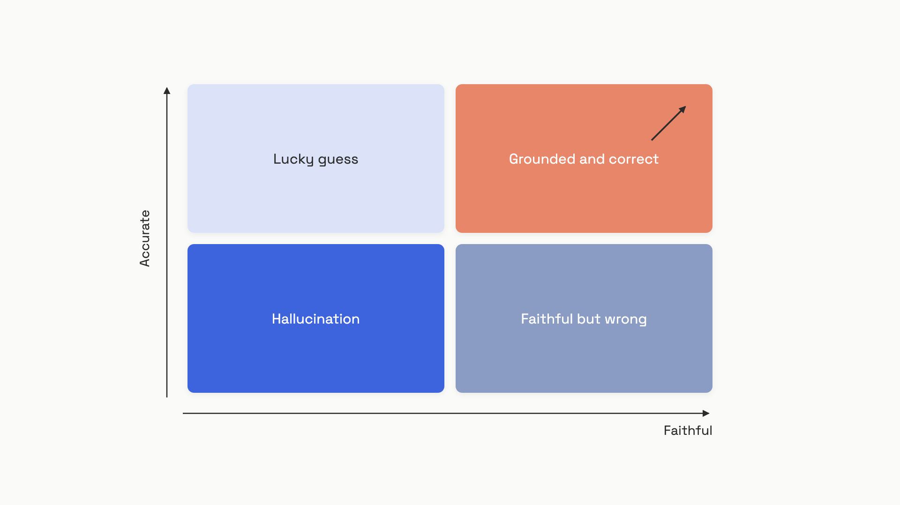

# Citations and grounding

A user asks your RAG assistant when the company's parental leave starts. The answer comes back fluent, confident, and specific: "Parental leave begins on the first day of employment for full-time employees, with up to 16 weeks of paid time off." It's also wrong. The retriever returned three policy docs, none of them about parental leave. The model answered from training data it absorbed two years ago, in a tone indistinguishable from a grounded answer.

That's the failure RAG was supposed to prevent, and it happens every day. Plugging in a vector store doesn't make a system grounded; it only makes grounding *possible*. The model still has to use the retrieved context faithfully, and your pipeline still has to verify it did. This chapter is about closing that gap.

There are two failure modes hiding inside one symptom. First, the model can cite a real document while the sentence next to the citation is invented. Second, the model can answer confidently when retrieval came back empty or off-topic, filling the void from parametric memory. Span-level citations attack the first. Refusal on empty retrieval attacks the second. Both rest on the same underlying tension: the more faithful the answer, the less fluent it tends to read, and users prefer fluent answers even when they're wrong.

## Span-level citations: pointers, not promises

A "cite your sources" instruction in the system prompt produces text that looks like citations. The model writes "[Doc 2]" after a claim, and you trust that the claim came from Doc 2. It often didn't. The model is optimizing for output that satisfies the instruction, not for output that's traceable. You can't run a string match to verify a prompt-based citation, because the cited text was never extracted, only described.

A span-level citation is different. It's a character range (or page range) that points back to an exact substring of a retrieved document. The API extracts that substring as metadata; you can string-match it against the original. Anthropic's Citations API, launched January 2025, makes this the wire-format default.[^1] Each text block in the response carries a `citations` array, and each citation gives you `cited_text`, a `document_index`, and start/end offsets. The cited span doesn't count as output tokens, and it doesn't count as input tokens when you pass it back in a follow-up turn.[^1]

```python
import anthropic

def answer_with_citations(question: str, document_text: str):
    client = anthropic.Anthropic()
    response = client.messages.create(
        model="claude-opus-4-8",
        max_tokens=1024,
        messages=[{
            "role": "user",
            "content": [
                {
                    "type": "document",
                    "source": {
                        "type": "text",
                        "media_type": "text/plain",
                        "data": document_text,
                    },
                    "title": "Source",
                    "citations": {"enabled": True},
                },
                {"type": "text", "text": question},
            ],
        }],
    )
    return response.content
```

That's the whole hookup. For a RAG pipeline, the small but important detail is that each retrieved chunk should be its own document block, not concatenated into one big string. The Anthropic docs are explicit: "if you want Claude to be able to cite specific sentences from your RAG chunks, you should put each RAG chunk into a plain text document."[^1] Plain-text documents get auto-chunked at sentence boundaries; custom-content documents preserve your own chunking, which matters for transcripts, bullet lists, or tables where sentence splitting goes sideways.

One gotcha as of mid-2026: citations and Structured Outputs are mutually exclusive. Enable both and the API returns a 400. If you need a JSON-shaped response with citations, you have two passes: one structured call to extract fields, one citations call to attach evidence. All active Claude models except Haiku 3 support the API.[^1]

A citation API doesn't make your answers true. It guarantees the *pointer* is valid, not that the cited span actually supports the claim. The model can still attach a citation to a sentence the cited span doesn't entail. Verifying that requires a faithfulness check, which we'll get to.

## Refuse before the model gets a chance to confabulate

When retrieval returns nothing, an instruction-tuned model still wants to be helpful. The "be helpful" prior was reinforced through hundreds of thousands of preference pairs in post-training, and it routinely overpowers a single line in your system prompt that says "refuse if you don't know." So the cheapest, most reliable fix is to never give the model the chance.

If your retriever returns zero chunks above the similarity threshold, return the refusal string before calling the model at all. It's deterministic, it costs nothing, and it removes the strongest source of confident fabrication in a RAG pipeline.

```python
import anthropic

REFUSAL = "I cannot answer this from the available documents."

REFUSAL_SYSTEM = (
    "Answer only from the provided documents. If none are relevant, "
    f'reply with exactly: "{REFUSAL}"'
)

def rag_with_refusal(question: str, retrieved_chunks: list[str]) -> str:
    if not retrieved_chunks:
        return REFUSAL

    content = [
        {
            "type": "document",
            "source": {"type": "text", "media_type": "text/plain", "data": chunk},
            "title": f"Document {i + 1}",
            "citations": {"enabled": True},
        }
        for i, chunk in enumerate(retrieved_chunks)
    ]
    content.append({"type": "text", "text": question})

    client = anthropic.Anthropic()
    response = client.messages.create(
        model="claude-opus-4-8",
        max_tokens=512,
        system=REFUSAL_SYSTEM,
        messages=[{"role": "user", "content": content}],
    )
    return "".join(b.text for b in response.content if b.type == "text")
```

The fast-path handles the empty case. The system prompt handles the harder case: retrieval came back, but none of the chunks actually answer the question. That second case is where models genuinely struggle. RefusalBench, a 2025 evaluation across 30+ frontier models on 176 perturbation strategies, found that no model achieves above 80% on both answering and refusal at the same time.[^2] The best single-document refusal accuracy was 73% (Claude-4-Sonnet). On multi-document tasks, where one chunk is on-topic and others are noisy decoys, that same model dropped to 36%, a 37-point cliff just from adding distractors.[^2]

Two findings from RefusalBench are worth keeping in mind. First, scaling the model and adding extended reasoning don't materially help; selective refusal is "a trainable, alignment-sensitive capability," not a capability that emerges with size.[^2] Second, GPT-4o on the same benchmark refused answerable questions 62.8% of the time while only failing to refuse 4.3% of the time. That's not a better outcome. A system that refuses two thirds of legitimate queries is useless. Over-refusal is the symmetric failure mode and it kills user trust just as fast as confident hallucination does.

The practical implication: track both directions. Log the rate at which your system refuses, and run a known-answerable eval set to catch over-refusal. If refusal rate drifts up after a prompt edit, your users will notice before your dashboards do.

For domains where refusal accuracy genuinely matters (medical, legal, financial), system-prompt instructions are not enough. Training-based approaches do measurably better. The Ground-GRPO paper from June 2025 reports that two-stage training (answerable-only first, then a mix with unanswerable examples) improves grounded refusal F1 by 15.8 points over single-stage training, on 8B-parameter open-weight models.[^3] That's the escalation path: prompt for prototyping, eval for diagnosis, fine-tuning when the prompt-only ceiling isn't high enough.

## Faithfulness is not accuracy

The two terms get used interchangeably in product reviews, and they shouldn't be. Faithfulness asks: does every claim in the answer trace to the retrieved context? Accuracy asks: is the answer actually true? A response can be faithful and wrong (the documents were outdated, so you grounded a stale fact). It can be accurate and unfaithful (the model recalled the right answer from training data and the citations are decorative). Confusing them is how teams ship a "grounded" assistant that confidently misinforms users.


*Faithfulness and accuracy are independent axes. The top-right quadrant is the target; the bottom-right is the failure mode citations create when retrieved sources are wrong.*

Faithfulness is the metric you can measure cheaply, because it doesn't need ground truth. Decompose the answer into atomic claims, check each claim against the retrieved context with an NLI model or an LLM judge, and divide the supported count by the total. That's the RAGAS faithfulness score, and it runs on every production response if you want it to.[^4]

```python
import anthropic, json

DECOMPOSE = """Extract atomic claims from this answer as a JSON list.
Answer: {answer}
Return only valid JSON like ["claim1", "claim2"]."""

CHECK = """Does the context support the claim?
Context: {context}
Claim: {claim}
Reply with exactly "yes" or "no"."""

def faithfulness_score(answer: str, context: str) -> float:
    client = anthropic.Anthropic()
    decomp = client.messages.create(
        model="claude-haiku-4-5",
        max_tokens=512,
        messages=[{"role": "user", "content": DECOMPOSE.format(answer=answer)}],
    )
    claims = json.loads(decomp.content[0].text)
    if not claims:
        return 0.0

    supported = 0
    for claim in claims:
        check = client.messages.create(
            model="claude-haiku-4-5",
            max_tokens=8,
            messages=[{
                "role": "user",
                "content": CHECK.format(context=context, claim=claim),
            }],
        )
        if "yes" in check.content[0].text.lower():
            supported += 1
    return supported / len(claims)
```

In production, swap the per-claim LLM call for a small NLI model (MiniCheck and similar are cheap and fast enough to run inline). The threshold you gate on is a domain decision: legal and medical systems often want above 0.9; general Q&A can tolerate 0.7. Below the threshold, fall back to the refusal message rather than ship an unsupported answer.

## The tug-of-war you can't prompt your way out of

Even a perfect citation pipeline runs into a deeper problem: when the retrieved document and the model's parametric memory disagree, the model has to pick one. And it picks systematically, not based on which is correct, but based on how confident it was *before* it saw the documents.

Wu, Wu, and Zou at Stanford ran the cleanest version of this experiment in 2024.[^5] They took 1,294 QA pairs across six domains (drug dosages, sports records, news facts, dates, names, locations), measured GPT-4's prior probability on each question without retrieval, then injected retrieved documents (some correct, some deliberately perturbed) and watched whether the model followed the document or its prior. The headline numbers, on `gpt-4-turbo-preview` accessed in March 2024:

- With correct retrieved content: 94% accuracy, up from 34.7% on the same questions without retrieval.
- Across all conditions: a slope of -0.23. Every 10% increase in the model's prior confidence corresponded to a 2.3% drop in how often the model followed the retrieved document.

That second number is the production risk in one line. The questions where your model "knows" the answer most confidently from training are exactly the questions where it's most willing to ignore your retrieved documents. A strict prompt ("Answer only from the provided documents, do not use any other knowledge") raises adherence uniformly but doesn't flatten the slope.[^5] A loose prompt makes the slope steeper. The mechanism survives prompt engineering.

The implication for fluency is direct. A model that synthesizes smoothly across documents and fills in stylistic glue from training data reads more naturally than one that copies fragments. Users score the fluent answer higher in short-term ratings even when it contains unsupported claims. So if you optimize for user satisfaction without measuring faithfulness, you optimize toward unfaithfulness. The faithfulness gate exists precisely because the obvious user-facing metric pulls the wrong direction.

## The pipeline that holds together

The three mechanisms in this chapter compose into one production path:

1. Before the model call, check the retrieval result. Zero chunks above threshold returns the refusal string immediately, no LLM spend.
2. On the model call, enable span-level citations and pass each chunk as its own document block. The response carries pointers you can string-match.
3. After the response, score faithfulness on the answer-and-context pair. Below your domain threshold, fall back to the refusal string. Log the score either way.

Each layer catches a different class of failure. The retrieval guard catches the empty case. The citation API catches "I cited Doc 2" claims with no Doc 2 to back them. The faithfulness check catches the hardest case: a confident answer that cites a real document the cited span doesn't actually support. Skip any layer and the failure mode it owns leaks straight to users.

What this chapter does not give you is a way to tell whether your retrieval surfaced the right documents in the first place. A 0.95 faithfulness score on the wrong source is a confidently incorrect answer with a tidy receipt. That's the bottom-right quadrant from the figure, and the only fix is upstream: better retrieval, better source vetting, and the retrieval-eval discipline covered in [Evaluating retrieval](./07-evaluating-retrieval.md). Grounding makes answers verifiable. Verifying answers against good sources is what makes them right.

At architecture scale, the [HLD chapter on RAG systems](../../hld/part-9-ai-ml-system-design/01-rag-pipelines.md) covers the whiteboard view: where the citation store lives, how faithfulness scores feed quality gates, and how refusal-rate dashboards plug into incident response.

## References

[^1]: Anthropic, "Citations," Claude API Docs, https://docs.anthropic.com/en/docs/build-with-claude/citations (accessed June 2026).

[^2]: Aashiq Muhamed, Leonardo F. R. Ribeiro, Markus Dreyer, Virginia Smith, Mona T. Diab, "RefusalBench: Generative Evaluation of Selective Refusal in Grounded Language Models," Carnegie Mellon University and Amazon AGI, arXiv:2510.10390, April 2025. https://arxiv.org/html/2510.10390v1

[^3]: Shang Hong Sim et al., "Lessons from Training Grounded LLMs with Verifiable Rewards," Singapore Management University and DSO National Laboratories, arXiv:2506.15522, June 2025. https://arxiv.org/html/2506.15522v1

[^4]: Shahul Es, Jithin James, Luis Espinosa-Anke, Steven Schockaert, "RAGAS: Automated Evaluation of Retrieval Augmented Generation," arXiv:2309.15217, 2023. https://arxiv.org/abs/2309.15217

[^5]: Kevin Wu, Eric Wu, James Zou, "How faithful are RAG models? Quantifying the tug-of-war between RAG and LLMs' internal prior," Stanford University, arXiv:2404.10198, April 2024 (updated February 2025). https://arxiv.org/abs/2404.10198
