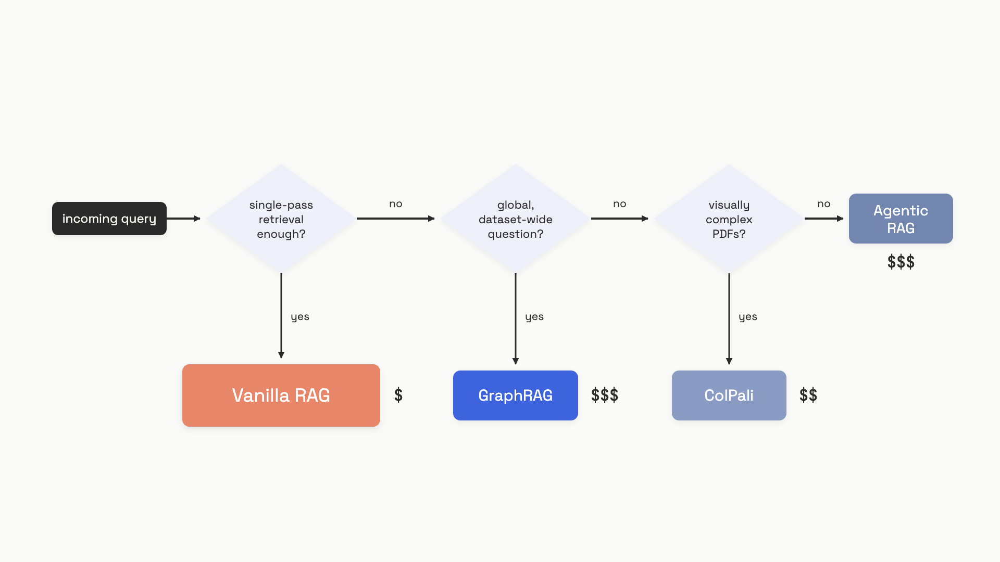

# Advanced retrieval

Three patterns get pitched as upgrades to vanilla RAG, and all three are genuinely useful for the right query shape. They're also expensive enough that defaulting to them costs you real money for no quality gain.

Here are the headline numbers, all from the same June 2025 benchmark over a 1M-token corpus. Vanilla RAG: ~880 tokens per query. GraphRAG global search: ~331,000 tokens per query. That's a 375x multiplier.[^1] On simple fact retrieval over the same corpus, GraphRAG's local search scores 49.3% accuracy versus 60.9% for plain RAG with a reranker.[^2] You can pay 40x more and get a worse answer if you pick the wrong tool for the question.

The honest framing for this chapter: each pattern earns its complexity for a specific query shape. A simpler stack wins everywhere else. The point isn't to learn three new toys; it's to know which fork you're standing at.


*The fork. Most queries take the leftmost branch and stop there.*

## Agentic RAG: retrieval as a tool the model calls

In standard RAG, the pipeline retrieves first and the model generates second. The order is fixed; the model doesn't get a vote on whether retrieval was useful or whether to try again.

Agentic RAG flips that. Retrieval becomes a function exposed to the model as a tool, called the way you'd expose any other tool from [Function and tool calling](../part-2-working-with-model-apis/03-function-and-tool-calling.md). The model decides when to call it, with what query, and whether to call it again based on what came back. The control loop follows the ReAct (Reason+Act) pattern: think, act, observe, repeat until answer or budget.[^3]

```python
MAX_STEPS = 8  # hard ceiling, not a soft warning

def run_agentic_rag(user_query: str) -> str:
    messages = [{"role": "user", "content": user_query}]
    for step in range(MAX_STEPS):
        response = llm_call(messages)
        if response["type"] == "answer":
            return response["content"]
        tool_result = retrieve(response["query"])
        messages.append({"role": "tool", "content": tool_result})
    raise RuntimeError(f"Agent exceeded {MAX_STEPS} steps")
```

The shape that earns the complexity is the multi-hop question. "Which of our customers in EMEA had a contract renewal in the last quarter and a support ticket marked critical in the last 30 days?" needs two retrievals where the second depends on the first, plus a join the model performs in its head. One-pass RAG can't do this. The model has to issue a query, read the result, then decide what to ask next.

The cost is real. Agentic RAG runs 3-10x the tokens and 2-5x the latency of one-pass RAG (single practitioner source, as of April 2026).[^4] That's not earned on FAQ bots or single-fact lookups, where the model's "decision" to retrieve is a foregone conclusion and the loop just adds round trips.

Two production rules are non-negotiable. The first is the step ceiling. A loop without a hard cap is a cost bomb: at 8,000 tokens of accumulated history, one tool failure burns 8,000 input tokens before the model writes a single output token. Ten retries on a flaky tool burns 80,000.[^5] LinkedIn engineering reported agents running 62-136x the cost of a single-turn call before governance was added.[^6] Set MAX_STEPS to 4-8 and raise on overflow; never return a silent partial answer.

The second is latency compounding. A 200ms tool call looks fine in isolation. Seven of them in a session means the user waits 4.5 seconds after the model stops thinking, because each invocation re-pays initialization overhead.[^7] Budget the loop in seconds, not in steps.

## GraphRAG: a knowledge graph for global questions

Vanilla RAG retrieves chunks similar to your query. That works when the answer lives in a chunk. It fails when the answer requires understanding the whole corpus.

"What are the main themes across our 10,000 customer interviews?" is the canonical example. No single chunk contains the answer. Top-k similarity returns ten interviews about whatever the query happened to embed near, and the synthesis is shallow.

GraphRAG, from Microsoft Research, addresses this with a two-stage index.[^8] An LLM reads every chunk and extracts named entities and the relationships between them, building a knowledge graph. The graph is then partitioned into communities of densely connected entities using the Leiden algorithm, and the LLM writes a natural-language summary for each community at multiple hierarchy levels. Querying happens in two modes:

- **Local search:** embed the query, find the top-k entities, pull their descriptions, relationships, and source chunks. About 39,000 tokens per query on a 1M-token corpus.[^1]
- **Global search:** map-reduce over every community summary, generate a partial answer from each batch, then reduce. About 331,000 tokens per query on the same corpus.[^1]

```python
def graphrag_query(query: str) -> str:
    if is_global_question(query):
        # map-reduce over all community summaries (~331K tokens)
        return global_search(query)
    # entity + relationship + chunk context (~39K tokens)
    return local_search(query)
```

On global sensemaking queries, GraphRAG genuinely wins. Edge et al. report 70-80% win rates over naive RAG on comprehensiveness and diversity, judged by an LLM, on podcast and news datasets.[^9] At that query type it also costs 2-3% of what hierarchical source-text summarization would cost. For "summarize the dataset", it's the right tool.

For everything else, the picture is uglier. The independent GraphRAG-Bench study (Xiang et al., June 2025) found GraphRAG local search hits 49.3% accuracy on fact retrieval versus 60.9% for RAG with a reranker. Global search context relevance on factoid queries collapses to 9.4% versus 77.8% for RAG with a reranker.[^2] Han et al. corroborate the same shape: 13.4% lower accuracy on Natural Questions, 16.6% lower on time-sensitive queries.[^10] If your users ask "who, what, when, where", GraphRAG adds cost with no accuracy gain and often loses ground.

Indexing cost is the second honest problem. Full GraphRAG reads every chunk twice with the LLM (once for extraction, once for community summarization). Microsoft's own follow-up acknowledges this: "avoiding the up-front indexing costs that may be prohibitive" is the explicit motivation for **LazyGraphRAG** (November 2024).[^11] LazyGraphRAG swaps LLM extraction for NLP noun-phrase extraction, drops indexing cost to 0.1% of full GraphRAG (the same cost as vector RAG), and at a query-time relevance budget of 500 tests it spends 4% of full GraphRAG global query cost while outperforming all other methods on both local and global queries.[^11]

The default rule: use vanilla RAG for fact lookup. Reach for GraphRAG when the dominant query is global ("compare perspectives", "what are the patterns", "what are the implications"), the corpus is stable enough that the index is amortized over thousands of queries, and you've measured that LLM-judged comprehensiveness is the metric you care about. Use LazyGraphRAG over the original unless you specifically need the knowledge graph as a shareable artifact. Fewer than 15% of enterprises had graph-based retrieval in production as of 2025, which roughly matches how many corpora actually have global-sensemaking traffic as the primary query shape.[^12]

## Vision-native retrieval: ColPali and the death of OCR pipelines

PDFs full of charts, infographics, multi-column tables, and scanned figures break text-based RAG. The standard pipeline (OCR -> layout detection -> chunking -> caption generation -> text embedding) destroys the visual structure that carried the meaning. A bar chart becomes "Q1 Q2 Q3 Q4 12 18 24 19" with no axis or legend, and the embedding has no idea what it just looked at.

ColPali (Faysse et al., June 2024, v5 February 2025) sidesteps the whole text-extraction stack.[^13] It renders each PDF page as an image, runs the image through a vision-language model (PaliGemma-3B in the original, ColQwen2.5-7b in the current state of the art), and stores one 128-dimensional vector per image patch. At 448px resolution that's 1,024 patches plus 6 instruction tokens, so 1,030 vectors per page.

Scoring uses **late interaction** with the MaxSim operator. The query is tokenized; each query token gets its own vector; for each query token you find its maximum dot product with any patch on the page, then sum across query tokens. The math is one line:

```python
import torch

def max_sim(query_vectors: torch.Tensor, page_vectors: torch.Tensor) -> float:
    """query_vectors: [n_query_tokens, 128]; page_vectors: [1030, 128]."""
    sim = torch.einsum("qd,pd->qp", query_vectors, page_vectors)
    return sim.max(dim=1).values.sum().item()
```

The payoff on visually complex documents is large. On the ViDoRe benchmark, ColPali averages 81.3 nDCG@5 across 10 tasks. On TAT-QA (financial reports with tables), ColPali scores 65.8 versus 44.0 for BM25 over OCR'd text. On infographic tasks, the text baseline can't even be evaluated because OCR returns nothing usable.[^13] Indexing latency runs 0.39 seconds per page on an NVIDIA L4, versus 7.22 seconds for the full Unstructured + captioning pipeline at peak quality. ColQwen2.5-7b-multilingual currently sits at rank #1 on the public ViDoRe leaderboard as of February 2025.[^14]

The cost is storage. At float16, a single page costs 257.5 KB of vector data, versus ~8.6 KB for a single-vector dense embedding.[^13] On a 1M-page corpus that's the difference between 244 GB and 8.2 GB. Deploy ColPali naively on 50M scanned documents and you'll run out of disk before you run out of users.

Two production fixes make this tractable. **Token pooling** at factor 3 cuts the vector count by 66.7% while retaining 97.8% of accuracy.[^13] **Binary quantization** packs each 128-dim vector into 128 bits with int8 storage, getting per-page cost down to ~16 KB (a 32x reduction), and switches MaxSim to hamming distance for a 3.5x compute speedup. Vespa demonstrated a phased pipeline (binary candidate retrieval, then float re-ranking on the top hits) that drops nDCG@5 from 52.4 to 51.6 on DocVQA, an 0.8-point trade for the storage win.[^15]

The other production trap is data transfer. A naive setup that pulls candidate page vectors out to an external ranker moves about 32 MB per query (20 query tokens x 2,000 candidate pages x 1,030 vectors x 16 bytes). At any meaningful throughput, the network saturates before the GPU does. Co-locate MaxSim with the index, the way Vespa does, or push the computation to the storage tier.[^15]

Use ColPali when your corpus is genuinely visual: charts, infographics, tables, multi-column layouts, scanned documents where OCR loses the structure. Skip it for plain-text corpora at scale, where the 30x storage tax buys you nothing. Skip it on CPU-only infrastructure with no GPU for encoding. The ColPali authors themselves note that text-centric documents "are also better retrieved by ColPali across all evaluated domains"[^13]; this is true and irrelevant if you're storing 50 million pages of legal contracts.

## How to actually decide

| Pattern | When it pays | Cost vs vanilla RAG | Skip when |
|---|---|---|---|
| **Agentic RAG** | Multi-hop questions; ambiguous queries; multiple retrieval backends to choose between | 3-10x tokens, 2-5x latency | Single-fact lookups, FAQ bots |
| **GraphRAG** | Global sensemaking ("themes", "patterns") on a stable corpus | ~375x tokens (global), full indexing burns the LLM twice over the corpus | Factoid queries; informal or sparse text; freshness-critical corpora |
| **ColPali** | PDFs heavy with charts, tables, infographics, scanned figures | ~30x storage per page (or ~2x with binary quantization) | Plain-text corpora; CPU-only infrastructure; corpora over 10M pages without quantization |

The question to ask before adopting any of these isn't "would this be more powerful?" It's "what fraction of my queries actually have the shape this pattern is designed for?" If it's under 20%, route those queries to the advanced pattern and let everything else stay on the cheap path. If it's under 5%, don't build it yet.

The chapter on [Evaluating retrieval](./07-evaluating-retrieval.md) covers how to measure whether the upgrade actually moved your numbers; the chapter on [Production RAG](./08-production-rag.md) covers the indexing-cost amortization and reindex tax that determine whether GraphRAG's index pays for itself in your traffic.

## References

[^1]: Xiang, Zhishang et al., Figures 8-9 token count tables, "When to use Graphs in RAG: A Comprehensive Analysis for Graph Retrieval-Augmented Generation," arXiv:2506.05690, June 2025. https://arxiv.org/abs/2506.05690
[^2]: Xiang, Zhishang et al., Tables 2-3, "When to use Graphs in RAG," arXiv:2506.05690, June 2025. https://arxiv.org/abs/2506.05690
[^3]: Yao, Shunyu et al., "ReAct: Synergizing Reasoning and Acting in Language Models," ICLR 2023. https://arxiv.org/abs/2210.03629
[^4]: MarsDevs, "Agentic RAG: The 2026 Production Guide," marsdevs.com, April 2026 (single source). https://www.marsdevs.com/guides/agentic-rag-2026-guide
[^5]: tianpan.co, "Why Every Failed Tool Call Burns Your Token Budget," April 2026. https://tianpan.co/blog/2026-04-10-retry-storm-problem-agentic-systems
[^6]: Bhalsod, "2026 ROI (Policy RAG, Autonomous w/ Approvals)," LinkedIn Pulse, 2025-2026 (single source). https://www.linkedin.com/pulse/2026-roi-policy-rag-autonomous-w-approvals-fix-runaway-bhalsod-pus1f
[^7]: tianpan.co, "How Tool-Server Overhead Compounds by Agent Step 7," May 2026. https://tianpan.co/blog/2026-05-10-mcp-tool-server-cold-start-tax-latency-compounds-step-7
[^8]: Edge, Darren et al., "From Local to Global: A Graph RAG Approach to Query-Focused Summarization," arXiv:2404.16130, April 2024. https://arxiv.org/abs/2404.16130
[^9]: Edge, Darren et al., "GraphRAG: New tool for complex data discovery now on GitHub," Microsoft Research Blog, July 2, 2024. https://www.microsoft.com/en-us/research/blog/graphrag-new-tool-for-complex-data-discovery-now-on-github/
[^10]: Han, Haoyu et al., "RAG vs. GraphRAG: A Systematic Evaluation and Key Insights," arXiv:2502.11371, February 2025. https://arxiv.org/abs/2502.11371
[^11]: Edge, Darren, Ha Trinh, Jonathan Larson, "LazyGraphRAG: Setting a new standard for quality and cost," Microsoft Research Blog, November 25, 2024. https://www.microsoft.com/en-us/research/blog/lazygraphrag-setting-a-new-standard-for-quality-and-cost/
[^12]: tianpan.co, "The Architecture Decision Teams Make Too Late," April 2026 (single source). https://tianpan.co/blog/2026-04-19-graphrag-vs-vector-rag-architecture-decision
[^13]: Faysse, Manuel et al., "ColPali: Efficient Document Retrieval with Vision Language Models," arXiv:2407.01449v5, February 2025. https://arxiv.org/abs/2407.01449
[^14]: ViDoRe Leaderboard, Hugging Face Spaces, accessed February 2025. https://huggingface.co/spaces/vidore/vidore-leaderboard
[^15]: Bergum, Jo Kristian, "Scaling ColPali to billions of PDFs with Vespa," Vespa Blog, September 20, 2024. https://blog.vespa.ai/scaling-colpali-to-billions/

