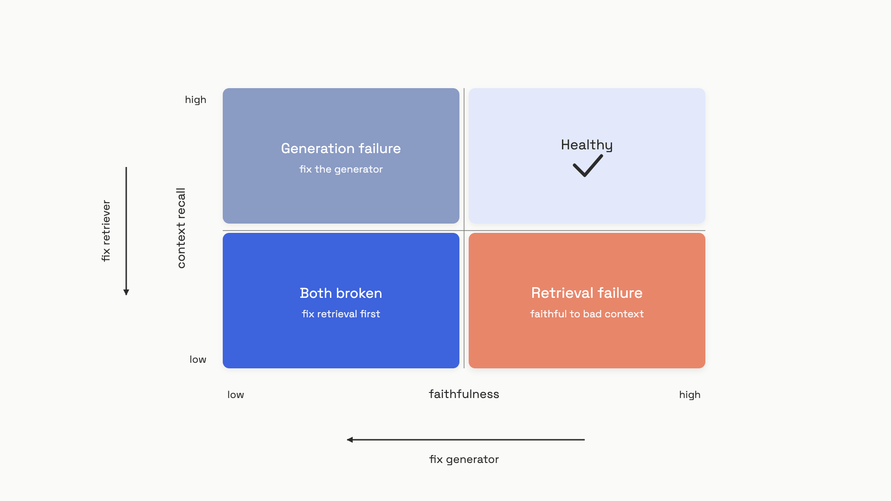

# Evaluating retrieval

Amazon AWS AI ran a controlled experiment in 2024 on 4,162 queries across ten domains. They held the generator constant and switched the retriever from BM25 to E5-Mistral; end-to-end F1 jumped 5 to 10 points across every generator they tested. Then they did the reverse: held retrieval fixed and swapped generators. The gains were smaller and inconsistent.[^1]

That's the shape of RAG quality, and it should change how you spend evaluation effort. The generator can only be faithful to what the retriever surfaces. If the right chunk isn't in the context window, no prompt engineering, no bigger model, and no chain-of-thought saves the response. So the practical claim is blunt: **most RAG eval is retrieval eval, and you should fix retrieval before you spend a dollar on generation grading**.

The good news is that retrieval eval is the cheap kind. Recall@k and MRR are deterministic, fast, and need no LLM judge. The expensive parts (faithfulness, context recall) come later, and they exist mostly to catch the generation-side failures that retrieval metrics can't see. The order matters.

## Recall@k tells you if the answer is in the room

Take a query that should be answered by two documents in your corpus: `doc1` and `doc2`. Your retriever returns five chunks: `[doc3, doc1, doc7, doc2, doc5]`. Recall@5 is the fraction of relevant documents that show up anywhere in the top five. Both gold docs are in there, so Recall@5 = 1.0. Cut the window to three and only `doc1` makes it; Recall@3 = 0.5.

That's the whole metric. Recall@k doesn't care about position; rank 1 and rank 5 score the same. What it cares about is *coverage*: whatever you pass to the generator, did the supporting evidence make the cut?

```python
def recall_at_k(retrieved_ids: list, relevant_ids: set, k: int) -> float:
    """Fraction of relevant docs found in top-k results."""
    top_k = retrieved_ids[:k]
    hits = sum(1 for doc_id in top_k if doc_id in relevant_ids)
    return hits / len(relevant_ids) if relevant_ids else 0.0


retrieved = ["doc3", "doc1", "doc7", "doc2", "doc5"]
relevant = {"doc1", "doc2"}
print(recall_at_k(retrieved, relevant, k=3))  # 0.5
print(recall_at_k(retrieved, relevant, k=5))  # 1.0
```

The right `k` is the same `k` your production system uses. If your pipeline passes five chunks to the LLM, Recall@5 is the metric that maps directly to a sizing decision. The StratRAG benchmark from March 2026 is explicit about this: their hybrid retriever (BM25 plus MiniLM) scored Recall@5 = 0.905, and the authors call that "a practical upper bound: a generator supplied with the top-5 retrieved documents would have access to the full supporting evidence for roughly 90% of questions."[^2] Above that ceiling, no generation work helps. Below it, you're testing whether your model can compensate for a retriever that's letting evidence slip through.

## MRR tells you how high it landed

Recall@k is order-blind. If you care about whether the most important chunk lands at position 1 instead of position 5, you want MRR (mean reciprocal rank). It's the average of `1/rank` for the first relevant document across all your queries. First hit at rank 1 scores 1.0, rank 2 scores 0.5, rank 5 scores 0.2, and a miss scores 0.

```python
def mrr(retrieved_ids: list, relevant_ids: set) -> float:
    """Reciprocal rank of the first relevant doc."""
    for rank, doc_id in enumerate(retrieved_ids, start=1):
        if doc_id in relevant_ids:
            return 1.0 / rank
    return 0.0
```

MRR exists because of "lost in the middle." LLMs attend most strongly to the first and last positions in long contexts and underweight the stuff in between.[^3] A gold document buried at rank 4 of 5 is technically retrieved, but the generator may not see it. When you add a reranker, MRR is the metric that moves; Recall@k may not budge.

Use the two together:

- **Recall@k high, MRR high:** retriever is finding the right docs and putting them on top. Healthy.
- **Recall@k high, MRR low:** docs are being found but ranked late. Add a reranker.
- **Recall@k low:** the docs aren't being found at all. MRR doesn't matter yet; fix recall first.

There's a third metric you'll see, nDCG@k, which generalizes both by supporting graded relevance (a doc can be partially relevant or fully relevant, not just yes/no). Use it when you have human-graded labels with real gradations. For binary synthetic eval sets, which is what most teams have, Recall@k and MRR contain the same information more cheaply.[^4]

## Build the eval set before you have labels

The metrics above need (query, gold-document) pairs. Most teams don't have any. Hand-labeling the corpus is the obvious wrong answer: it's slow, expensive, and produces a frozen snapshot that doesn't track production. The shortcut that actually works is reverse-generation.

Pick a chunk from your corpus. Ask an LLM to write a question whose answer lives in that chunk. The chunk becomes the gold document, the generated question becomes the query, and you have a labeled row without a human in the loop.[^5]

```python
def build_eval_row(chunk: str, llm_generate) -> dict:
    """Reverse-generate a query from a document chunk."""
    q_prompt = (
        "Read the passage and write a single factual question "
        "whose answer is entirely contained in it. "
        "Return only the question.\n\n"
        f"Passage: {chunk}"
    )
    question = llm_generate(q_prompt).strip()
    a_prompt = (
        f"Answer this question using only the passage.\n"
        f"Question: {question}\nPassage: {chunk}"
    )
    return {
        "user_input": question,
        "gold_chunk_id": chunk_id_for(chunk),
        "reference": llm_generate(a_prompt).strip(),
    }
```

A few hundred of these gets you off zero. The StratRAG benchmark uses 200 validation examples and reports stable rankings between retrieval systems at that scale.[^2] You don't need 4,000 rows to know whether hybrid beats BM25 on your corpus.

Synthetic queries have a known weakness: LLMs default to factoid questions ("What year was X founded?") because they're easy to generate. Real users ask vague, multi-hop, half-formed things. So as soon as you have any production traffic, mine it. The eval set Hamel Husain recommends starts synthetic, then drifts toward production logs the same way a regression suite drifts toward real bugs.[^5]

Three rules worth holding to:

- **Sample queries that got negative feedback** (thumbs-down, rephrasing, abandonment). Those are the rows where retrieval is most likely broken.
- **Include unanswerable queries.** If a question has no support in the corpus, the right behavior is "I don't know." A set with only answerable queries hides this failure mode entirely; Barnett et al. catalog it as failure point FP1.[^6]
- **Cluster before you label.** Group queries by topic and type, then sample within each cluster. This stops the set from over-representing whatever was popular last Tuesday.

For the broader discipline of growing an eval set from production, [Your first eval set](../part-4-eval-fundamentals/02-your-first-eval-set.md) covers the loop in detail. The retrieval-specific twist is that your "gold label" is a document ID rather than a pass/fail on the answer.

## Faithfulness checks the answer against the context, not the world

Once your retriever is sane, the next failure mode is the generator inventing things. Faithfulness measures whether every claim in the answer is entailed by the retrieved chunks. Critically, it does *not* check whether the answer is correct in reality. It checks whether the answer is grounded in what the retriever brought back.

The RAGAS implementation breaks the answer into atomic statements with an LLM, then asks (also with an LLM) whether each statement can be inferred from the context. The score is the fraction that pass. On the WikiEval dataset, this method hit 0.95 agreement with human judgments, well ahead of GPT-score baselines at 0.72.[^7]

Faithfulness is reference-free. You don't need a ground-truth answer; you only need the retrieved context and the generated response. That makes it cheap enough to run on every production trace, which is why most teams reach for it first.

Here's the trap. Faithfulness is a *conditional* metric. It asks "given this context, is the answer grounded?" It cannot ask "was this context any good?" If the retriever brings back the wrong document and the generator faithfully summarizes the wrong document, faithfulness scores 1.0 and your users get confidently wrong answers.

The mitigation is to track faithfulness alongside **context recall**, which decomposes the reference answer into statements and checks each against the retrieved context. Context recall needs a ground-truth answer (faithfulness doesn't), but the pair is what gives you a real diagnostic. One score in isolation lies.

## Retrieval failure or generation failure: the 2x2

Every wrong answer looks the same from the outside. The user asked something, the system replied, the reply was bad. The fix for "the right document was never retrieved" is completely different from the fix for "the document was retrieved but the model ignored it." If you can't tell those two apart, you'll spend weeks tuning the wrong component.

The diagnostic is a 2x2 on context recall and faithfulness:


*The four quadrants route a wrong answer to the component that produced it.*

Read it as a routing table:

- **High recall, high faithfulness.** Both components are working. Ship it.
- **High recall, low faithfulness.** The retriever found the evidence; the model ignored or distorted it. This is a generation failure: check for "lost in the middle" effects, tighten the prompt's instruction to stay within context, or reduce `k` so the relevant chunk isn't drowning in noise.
- **Low recall, high faithfulness.** This is the dangerous one. The retriever brought back the wrong material, the generator faithfully summarized the wrong material, and your faithfulness dashboard is green. Fix the retriever: chunking strategy, embedding model, or move from BM25 to hybrid. StratRAG showed hybrid retrieval lifting Recall@5 from 0.815 (BM25 alone) to 0.905 on multi-hop queries.[^2]
- **Low recall, low faithfulness.** Retrieval is so bad the generator has nothing to work with. Don't bother diagnosing generation; fix retrieval first and re-measure.

The code is small enough to paste into a notebook:

```python
def diagnose(context_recall: float, faithfulness: float) -> str:
    """Route a wrong answer to its dominant failure mode."""
    low_recall = context_recall < 0.5
    low_faith = faithfulness < 0.7
    if low_recall and low_faith:
        return "both broken: fix retrieval first"
    if low_recall:
        return "retrieval failure: faithful to bad context"
    if low_faith:
        return "generation failure: context present, model ignored it"
    return "healthy"
```

The thresholds (0.5, 0.7) are starting points; calibrate them against a small human-labeled subset of your own traces. RagChecker's meta-evaluation across 280 instances and 10 domains showed claim-level recall and faithfulness correlate with human judgments at 0.62 Pearson, well above any single end-to-end metric.[^1] The 2x2 isn't a perfect oracle, but it's the cheapest diagnostic that consistently routes you to the right component.

The escalation logic that falls out: when you sit down to improve a RAG system, run the eval set, look at the matrix, and spend your time where the failures live. Most teams discover their failures cluster in the bottom-right quadrant, which is why "RAG eval is mostly retrieval eval" keeps surviving contact with reality.

## References

[^1]: Ru, Dongyu et al., "RagChecker: A Fine-grained Framework for Diagnosing Retrieval-Augmented Generation," Amazon AWS AI, arXiv:2408.08067, August 2024. https://arxiv.org/abs/2408.08067
[^2]: Patodiya, Aryan, "StratRAG: A Multi-Hop Retrieval Evaluation Dataset for Retrieval-Augmented Generation Systems," California State University Fresno, arXiv:2604.22757, March 2026. https://arxiv.org/abs/2604.22757
[^3]: Liu, Nelson F. et al., "Lost in the Middle: How Language Models Use Long Contexts," arXiv:2307.03172, July 2023. https://arxiv.org/abs/2307.03172
[^4]: Yu, Hao et al., "Evaluation of Retrieval-Augmented Generation: A Survey," arXiv:2405.07437, May 2024. https://arxiv.org/abs/2405.07437
[^5]: Husain, Hamel, "Q: How should I approach evaluating my RAG system?", AI Evals FAQ, hamel.dev, July 2025. https://hamel.dev/blog/posts/evals-faq/how-should-i-approach-evaluating-my-rag-system.html
[^6]: Barnett, Scott et al., "Seven Failure Points When Engineering a Retrieval Augmented Generation System," Deakin University, arXiv:2401.05856, January 2024. https://arxiv.org/abs/2401.05856
[^7]: Es, Shahul et al., "Ragas: Automated Evaluation of Retrieval Augmented Generation," arXiv:2309.15217, September 2023. https://arxiv.org/abs/2309.15217
