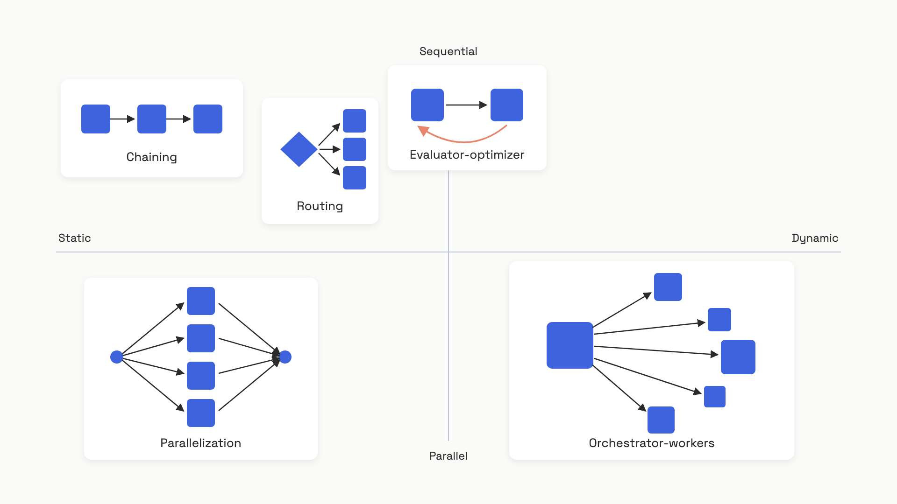

# The five workflow patterns

When Anthropic's applied team published "Building effective agents" in December 2024, the line that did the most damage to the agent-framework industry was this one: "the most successful implementations weren't using complex frameworks... they were building with simple, composable patterns."[^1] The post then named those patterns. Five of them. Every production "agent" you've heard of is some arrangement of these five primitives, plus tools.

This chapter is each pattern with the code that makes it concrete, the task it's actually for, and the specific way it fails. The patterns are listed in increasing order of complexity, and that order is doing real work: using a heavier pattern when a lighter one suffices is the most common, most expensive mistake in this space.[^1] The whole point of naming them is to make the next-cheapest option visible, so you can stop at it.


*Static decomposition on the left, dynamic on the right; sequential execution on top, parallel on the bottom. Evaluator-optimizer adds a loop. The patterns get more expensive as you move right and add iteration.*

## 1. Chaining

A chain is a fixed sequence of LLM calls where each step's output is the next step's input. You write the steps down in advance.

The classic shape is something like: outline a document, check the outline against criteria, then write the document from the approved outline.[^1] Each call is doing one thing, which is easier than doing four things at once.

```python
from typing import Callable

def chain(input_text: str, steps: list[Callable[[str], str]]) -> str:
    """Run steps sequentially, gating between each one."""
    result = input_text
    for step_fn in steps:
        result = step_fn(result)
        # Gate check goes here: parse, validate, halt on bad output.
    return result
```

The trade is honest: a four-step chain has at least 4x the latency of one call, and you're paying tokens at every step. You buy two things back. Each individual call is a simpler task the model handles better, and you can inspect what came out of step 2 when step 4 produced garbage.

The failure mode is **cascading error propagation**, and it's the single most common reason chains fail silently in production. AgentEval's analysis of 450 production agent traces (April 2026) found that 63% of step-level failures weren't locally caused, they were upstream errors that the next step accepted as ground truth.[^2] Context loss had the worst amplification, 3.2x downstream.[^2] The mechanism is brutal: LLMs don't throw exceptions on bad input. They produce confident, plausible output that incorporates whatever malformed thing came in. By step 4 the original mistake has been laundered through three rounds of fluent prose.

The fix is the gate check, the comment in the code above. Between each step, parse the previous step's output and assert it's well-formed before the next step ever sees it. End-to-end outcome checks (does the final answer look right?) catch only 41% of the failures that step-level checks catch.[^2] Log the intermediate outputs too. When something breaks in production at 2 a.m., the question you'll ask is "which step produced that?", and the only acceptable answer is a trace that shows you.

[Templates and chaining](../part-3-prompt-engineering/03-templates-and-chaining.md) covers the prompt-template side of the same primitive.

## 2. Routing

A router classifies the input and dispatches it to a specialized handler. The classifier is usually a small LLM call; the handlers are different prompts, different models, or different tool sets.

The most common production use is model-tier routing: easy questions go to a cheap model (Haiku 4.5), hard ones to a strong model (Sonnet 4.5).[^1] Same idea for support tickets: refunds get the refund prompt with the refund tools, billing questions get the billing prompt with read-only access to the invoice service.

```python
from typing import Callable

def route(
    user_input: str,
    classify_fn: Callable[[str, list[str]], str],
    handlers: dict[str, Callable[[str], str]],
    fallback: str = "default",
) -> str:
    """Classify, then dispatch to the matching handler."""
    chosen = classify_fn(user_input, list(handlers.keys())).strip().lower()
    handler = handlers.get(chosen) or handlers.get(fallback)
    if handler is None:
        raise ValueError(f"No handler for '{chosen}' and no fallback.")
    return handler(user_input)
```

Routing earns its keep when inputs split into categories with meaningfully different optimal handling, and when the classifier is reliable on your real traffic. Both halves matter. A 95%-accurate router that saves 60% on inference is a win; a 75%-accurate router that misroutes a quarter of customers into the wrong specialist is worse than no router at all.

The failure mode is **router miscalibration**, and it's worse than it sounds because it's invisible. Tian Pan documented a SaaS deployment that targeted 30% escalation to an expensive model; the classifier's decision boundary was off and it escalated 60% instead.[^3] The 40% of queries handled "locally" produced worse answers, users retried more, total request volume rose, and the inference bill went *up* 12% despite the router doing exactly what it was built to do, route. The telemetry showed routing working correctly. Quality cost and retry rate aren't on the router's dashboard.

Two specific things help. **Calibrate against real traffic**, not synthetic examples; the distribution of what users actually ask is the only distribution that matters. **Don't trust the classifier's confidence scores naively**: GPT-4o-mini's misclassifications cluster at the high-confidence end, with roughly two-thirds of errors happening when the model reports >80% confidence.[^4] A confidence-threshold fallback ("if unsure, escalate") will fail open in exactly the cases where it's most needed.

## 3. Parallelization

Run multiple LLM calls concurrently, then combine the results. There are two flavors, and conflating them is a small but persistent source of bad designs.

**Sectioning** splits a task into independent subtasks. Asked to analyze the impact of a policy change on customers, employees, investors, and suppliers? Send four separate calls, one per stakeholder, in parallel. Each call has the model's full attention on one frame. Anthropic's guardrail pattern is the same idea: one call answers the user, a second simultaneously screens the request for policy violations, and you don't proxy both jobs through one prompt that has to do them at once.[^1]

**Voting** runs the *same* task N times and aggregates. A code-security review where three independent prompts each look for vulnerabilities and a finding only survives if two agree. You're trading N times the cost for a lower false-positive rate.

```python
from concurrent.futures import ThreadPoolExecutor
from typing import Callable

def parallel(
    prompt_fn: Callable[[str], str],
    inputs: list[str],
    n_workers: int = 4,
) -> list[str]:
    """Run prompt_fn over independent inputs concurrently."""
    with ThreadPoolExecutor(max_workers=n_workers) as executor:
        futures = [executor.submit(prompt_fn, x) for x in inputs]
        return [f.result() for f in futures]
```

Use sectioning when subtasks are genuinely independent (output of A is never input to B) and you care about latency: parallel execution approaches the latency of the slowest single call instead of the sum. Use voting when one wrong answer is expensive enough that you'll pay N times to lower the false-positive rate.

The failure mode is **aggregation logic**. Parallel outputs have to be synthesized, and if the synthesis step is sloppy, contradictions across workers get smoothed into a confidently wrong combined answer. Worker A assumed the user is a free-tier customer; worker B assumed paid; the synthesis step splits the difference and recommends an upgrade flow that doesn't apply. The fix is to give the synthesis step an explicit contradiction-detection prompt: "if the inputs disagree on any factual premise, say so and stop."

Voting has its own variant of the same problem: vote-threshold design. Require unanimous agreement and you'll miss real findings (false negatives); accept any single vote and you've just paid 3x to run one call (false positives). The threshold is a calibration question on your eval set, not an intuition. The naive `ThreadPoolExecutor` above also has no per-worker error boundary, so one timeout poisons the batch; production code wraps each future and treats partial failures as data, not as exceptions.

## 4. Orchestrator-workers

A central orchestrator LLM looks at the input, decides what subtasks are needed, and dispatches each to a worker LLM. The workers return results, the orchestrator synthesizes.

The thing that makes this different from parallelization is the dynamic fan-out. Static parallelization always sends 4 stakeholder calls because you wrote "four stakeholders" in the code. Orchestrator-workers might decide *this* coding task touches three files, so it spawns three workers; the next one touches eleven files and spawns eleven; the one after that just needs a single targeted edit and spawns one.[^1] The decomposition is decided at runtime, by an LLM, on the specific input.

The canonical use cases are coding agents (the right files to change depend on the bug) and research agents (the right sources depend on the question).[^1] Anthropic's SWE-bench coding agent, which resolves real GitHub issues from PR descriptions, runs this pattern.[^1]

The failure mode is **orchestrator planning failure**, and it's the parent of every downstream worker problem. If the orchestrator misunderstands the task or generates poorly specified subtasks, every worker executes faithfully and the combined output is wrong or incomplete. AgentEval's failure taxonomy puts goal misinterpretation at 12% of agent failures, missing steps at 8%, and incorrect ordering at 5%, all of them upstream of any worker.[^2] One specific subspecies: the orchestrator emits XML or JSON the dispatcher can't parse, and the whole task fails before a single worker runs.

The discipline that helps is making the planning step inspectable. Prompt the orchestrator to state the coverage rationale ("what aspect of the task does each subtask address?") and treat that rationale as a gate check. Validate the structured output before dispatching. And remember the cost shape: orchestrator-workers is N+1 API calls minimum (1 plan + N workers), making it the most expensive pattern per task.[^5] Reach for it when the decomposition genuinely depends on the input. If you can write the decomposition down before seeing the input, use static parallelization, it's cheaper and easier to debug.

At architecture scale, this is the AI-system instantiation of the coordinator-worker distributed pattern, with the same single-point-of-failure properties; the [Agent Architectures](../../hld/part-9-ai-ml-system-design/03-ai-agent-architectures.md) chapter in HLD Part 9 covers the whiteboard view.

## 5. Evaluator-optimizer

One LLM generates a draft. A second LLM evaluates it and gives feedback. The first regenerates with the feedback. Loop until the evaluator signals PASS, then return.

The pattern works on tasks with clear, articulable success criteria where the gap between first draft and polished output is meaningful, literary translation, complex search, anything where critique-then-revise is how a human would do it.[^1] But you have to read the failure modes before you write the code, because this is the one pattern most likely to silently incinerate your token budget.

The dangerous failure mode is the **verifier-generator blind spot**. When the same model (or same model family) plays both roles, the evaluator inherits the generator's biases, including its mistakes. A 2025 benchmark across 14 models found that 64.5% of errors a model would have flagged in someone else's output were missed when evaluating its own.[^6] The mechanism is straightforward: both calls draw from the same underlying distribution, so a confidently wrong generation looks confidently right to a same-family evaluator.

What this looks like in production: Tian Pan documented a trace where the loop iterated 12 times, the evaluator score hovered between 0.78 and 0.84, never crossed the 0.90 PASS threshold, and the run timed out at 3 hours, having spent enough on tokens to pay for a quarter of a senior engineer's day.[^7] Each iteration added confidence without adding information. Calibration error rises with iteration count; the model becomes more sure, not more correct.

The cost shape compounds it. A 10-cycle Reflexion-style loop can consume roughly 50x the tokens of a single linear pass, because each iteration replays the full conversation history.[^7] And the marginal value drops fast: about 75% of the improvement self-correction can deliver lands in the first two rounds.[^7] Iteration 12 isn't fixing the answer; it's burning the budget.

The version that survives production has three properties baked in.

```python
from typing import Callable

MAX_ITERATIONS = 3  # ~75% of self-correction gains land in rounds 1-2.

def evaluator_optimizer_loop(
    task: str,
    generate_fn: Callable[[str, str], str],         # (task, feedback) -> draft
    evaluate_fn: Callable[[str, str], tuple[str, str]],  # -> (status, feedback)
) -> tuple[str, list[str], bool]:
    """Bounded loop with explicit escalation when the budget is exhausted."""
    feedback = ""
    history: list[str] = []

    for _ in range(MAX_ITERATIONS):
        draft = generate_fn(task, feedback)
        history.append(draft)
        status, feedback = evaluate_fn(task, draft)
        if status == "PASS":
            return draft, history, True

    return history[-1], history, False  # caller must handle the False
```

First, **a hard iteration cap, set by the orchestrator, not negotiable by the loop**. Three is a reasonable default for most tasks. Second, **a heterogeneous verifier**. The cheapest way to dodge the blind spot is a non-LLM check: a test runner for code, a JSON-schema validator for structured output, a SQL parser for queries. When that's not possible, use a different model family for the evaluator than the generator. Third, **an explicit escalation path** when the loop exits without passing, the `False` return above. The orchestrator decides what happens next: retry with a stronger model, hand off to a human, or surface the best attempt with a confidence flag. Silently returning the last draft as if it passed is how this pattern earns its bad reputation.

If you watch the evaluator score across iterations and see it oscillating in a narrow band below the threshold, the loop is stuck, not converging. Kill it.

## Picking between them

The default is a single LLM call. Optimized prompts with retrieval and good examples handle most tasks at one-fifth the cost and one-fifth the latency of the cheapest pattern here. Reach for these patterns only when a single call is demonstrably failing on your eval set.[^1] When you do reach, the order matters:

| If your task... | Use |
|---|---|
| Has serial sub-goals you can write down in advance | Chaining |
| Splits into known categories with different optimal handling | Routing |
| Has independent subtasks you know up front (or needs N-vote agreement on a high-stakes call) | Parallelization |
| Needs decomposition that depends on the specific input | Orchestrator-workers |
| Has a clear pass/fail criterion and benefits from critique-then-revise | Evaluator-optimizer (with a heterogeneous verifier and a hard cap) |

The patterns compose. A router can dispatch to either a chain or an orchestrator-workers subgraph depending on the query type. An evaluator-optimizer loop can sit inside an orchestrator's worker. Anthropic's own advice on composition is the same as on the patterns themselves: add complexity only when you've measured an improvement.[^1] The teams shipping the most reliable AI products in 2026 didn't get there by stacking patterns; they got there by stopping at the first one that worked.

## References

[^1]: Erik Schluntz and Barry Zhang, "Building effective agents," Anthropic, December 19, 2024. https://www.anthropic.com/research/building-effective-agents
[^2]: Dongxin Guo, Jikun Wu, Siu Ming Yiu, "AgentEval: DAG-Structured Step-Level Evaluation for Agentic Workflows with Error Propagation Tracking," arXiv:2604.23581v1, April 26, 2026. https://arxiv.org/html/2604.23581v1
[^3]: Tian Pan, "Model Routing in Production: When the Router Costs More Than It Saves," tianpan.co, April 18, 2026. https://tianpan.co/blog/2026-04-18-model-routing-production-when-router-costs-more
[^4]: Tian Pan, "Why Accuracy Is the Wrong Metric: LLM Classifiers in Production Beyond Accuracy," tianpan.co, May 4, 2026. https://tianpan.co/blog/2026-05-04-llm-classifier-production-beyond-accuracy
[^5]: Anthropic, "Orchestrator workers" (cookbook), December 2024. https://platform.claude.com/cookbook/patterns-agents-orchestrator-workers
[^6]: Cited in Tian Pan, "The Self-Correction Loop That Shared Its Verifier's Blind Spot," tianpan.co, June 2, 2026 (benchmark across 14 models, 2025). https://tianpan.co/blog/2026-06-02-the-self-correction-loop-that-shared-its-verifiers-blind-spot
[^7]: Tian Pan, "The Self-Correction Loop That Shared Its Verifier's Blind Spot," tianpan.co, June 2, 2026. https://tianpan.co/blog/2026-06-02-the-self-correction-loop-that-shared-its-verifiers-blind-spot
