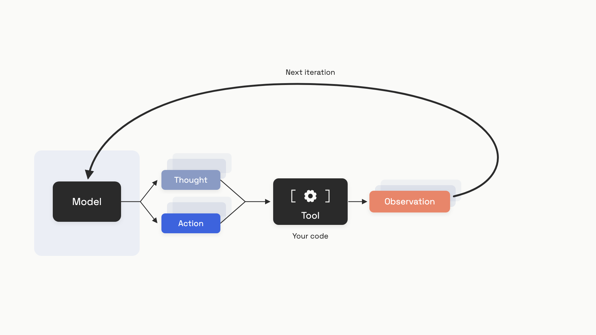
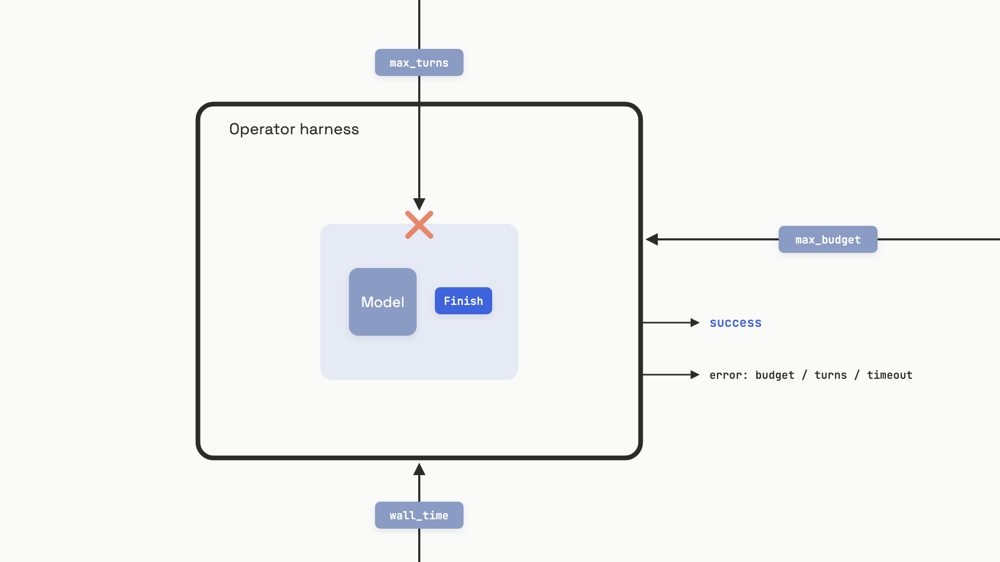

# The agent loop

A team I'll keep anonymous shipped an autonomous coding agent on a Friday. By Sunday morning it had spent $4,200 calling the same broken tool 8,100 times. The bug was tiny: the tool returned an error string the agent's parser silently treated as success, so the model "tried again," got the same error, retried, and the loop never closed. Nobody had set a step limit. Nobody had set a budget. The model had a `Finish` action it never reached because, from its point of view, the work wasn't done yet.

That story is the chapter. The think-act-observe pattern from the [ReAct paper](../part-3-prompt-engineering/02-chain-of-thought-react-self-consistency.md) is the part everyone learns first, and it's the easy part. The hard part, the part that decides whether your agent is a product or a money pit, is how the loop ends. Production agents are not more sophisticated than research demos. They're radically simpler, with one big difference: a thick layer of guardrails the model can't talk its way past.

## What the loop actually is

Take the function-calling round trip from [Function and tool calling](../part-2-working-with-model-apis/03-function-and-tool-calling.md) and run it more than once. That's the loop. The model proposes an action, your harness executes it, you append the result to the conversation, and you call the model again. The model reads its own prior thinking, the actions it took, and the observations that came back, then decides what to do next.

The canonical formulation comes from Yao et al.'s ReAct paper at ICLR 2023.[^1] Each iteration is three sequential pieces:

- **Thought:** free-text reasoning the model writes for itself, never sent to a tool.
- **Action:** a structured emission naming a tool and its input. The harness parses this and runs it.
- **Observation:** the tool's return value, appended to context for the next iteration.

The Thought and Action come out of the same model generation. The Observation is something your code injects after running the tool. By the time the model speaks again, it's reading its own past thoughts, its own past actions, and the world's response to them. That's what makes mid-trajectory correction possible: the model can see where it went wrong and pick a different path, the way you do when a `git status` reveals you staged the wrong file.


*One iteration of the loop: the model writes Thought and Action together; the harness runs the tool and injects the Observation; the next iteration reads everything that came before.*

A minimal Python skeleton, stripped to the essentials, fits in twenty lines:

```python
def react_loop(llm_call, tools: dict, max_steps: int = 10) -> str:
    """Run the agent loop until the model finishes or max_steps trips."""
    messages = []
    for _ in range(max_steps):
        response = llm_call(messages)
        action = response.get("action", "")

        if action == "Finish":
            return response.get("action_input", "")

        tool_fn = tools.get(action)
        if tool_fn is None:
            observation = f"Error: unknown tool '{action}'"
        else:
            observation = str(tool_fn(response.get("action_input", "")))

        messages.append({
            "thought": response.get("thought", ""),
            "action": action,
            "observation": observation,
        })

    raise RuntimeError(f"Agent did not finish within {max_steps} steps")
```

That's it. Twenty lines. Modern providers wrap this in their function-calling APIs so you rarely write the parser yourself, but the shape doesn't change. What changes between the demo and production is everything around it.

## Stop conditions are the hard problem

The misconception worth correcting before anything else: the model's `Finish` action is not your stop condition. It's one input to your stop condition. The model can hallucinate completion the same way it hallucinates a citation. There's a class of production failures cataloged under names like "When Your Agent Says Done and Means Nothing" where the agent emits a confident "Task complete" message and the file was never written, the webhook never fired, the database row is unchanged.[^2] The model has seen plenty of "Done!" sentences in training and will write one whether the work happened or not.

So the real architecture is two layers. The model has its own opinion about whether it's finished. The harness has an independent set of limits the model cannot override. When they disagree, the harness wins.

The Anthropic Claude Agent SDK exposes two operator-controlled hard limits, `max_turns` and `max_budget_usd`, and ships with no defaults for either; you must set both explicitly.[^3] The Claude Code production loop, dissected via source-map analysis of v2.1.88 in March 2026, returns one of five typed exit reasons: `success`, `error_max_turns`, `error_max_budget_usd`, `error_during_execution`, `error_max_structured_output_retries`. Four of those five are operator-side stops, not model-side ones.[^4]

Stop conditions fail in four distinct ways, and you should know each by name:

- **No hard limit at all.** The loop runs until context exhausts or someone notices the bill. One catalog of LLM-agent budget overruns documented 63 incidents where in-process budget tracking was missing.[^5]
- **Loop of death.** The model calls the same tool with the same arguments, gets the same error, retries. It's not infinite; it terminates when the budget cap fires. By then you've spent thousands.
- **Hallucinated completion.** The model emits `Finish` and the side effects didn't happen. Without an external verifier checking the database, the file, the HTTP response code, you ship silently wrong results.[^2]
- **Context saturation.** Each turn re-feeds the entire accumulated history. Past a few thousand tokens of tool output, signal-to-noise collapses; quality, latency, and cost degrade together.[^4]

The defense, ranked from most reliable to least:

1. **External verifier.** Run the test suite. Query the database. Check the HTTP status. The only stop condition that cannot be hallucinated, because the model didn't write it.
2. **Hard operator limits.** `max_turns`, `max_budget_usd`, and a wall-clock timeout. Three independent dimensions, all enforced by your code, none touchable by prompt injection.
3. **Cycle detection.** A rolling-window hash of (tool_name, input). Same pair twice in five steps, abort. This catches the loop of death before the budget does.
4. **The model's `Finish` action.** Useful as a hint. Never use it alone.


*Two layers of stopping. The model's "Finish" lives inside; the operator's hard limits sit outside it and always win the tie.*

The harness side, in code, is shorter than the failure modes it prevents:

```python
import time
from dataclasses import dataclass, field

@dataclass
class StopGuard:
    max_steps: int = 20
    max_wall_seconds: float = 300.0
    max_cost_usd: float = 5.0
    _steps: int = field(default=0, init=False)
    _start: float = field(default_factory=time.monotonic, init=False)
    _cost: float = field(default=0.0, init=False)

    def tick(self, step_cost_usd: float = 0.0) -> None:
        self._steps += 1
        self._cost += step_cost_usd
        elapsed = time.monotonic() - self._start
        if self._steps > self.max_steps:
            raise RuntimeError(f"exceeded max_steps={self.max_steps}")
        if elapsed > self.max_wall_seconds:
            raise RuntimeError(f"exceeded wall time {elapsed:.1f}s")
        if self._cost > self.max_cost_usd:
            raise RuntimeError(f"exceeded budget ${self._cost:.4f}")
```

Call `tick()` once per loop iteration, before deciding whether to continue. Three independent dimensions, all enforced outside the model's reach. The default of `max_turns=20` is a starting point; the rule worth memorizing is set it to roughly twice the steps you expect, and pair it with a dollar cap. A task you think will take five steps gets `max_steps=10`. The deeper budget chapter is [Long-running agents](../part-7-agent-engineering/08-long-running-agents.md), but every agent invocation needs at least these three lines.

## Reflection works only when something outside the model checks the work

"Have the model check its own work" sounds like a free upgrade. It's the first thing every team tries when accuracy disappoints. Huang et al. at ICLR 2024 ran the experiment carefully across multiple reasoning benchmarks and found the opposite: when an LLM is asked to re-read and revise its own answer with no external feedback, performance frequently *degrades*.[^6] The same distribution that produced the first answer produces the judgment that the answer was fine. The model rewrites without learning anything.

So when does reflection actually help? When you ground it in something the model didn't write. Reflexion, the canonical formalization (Shinn et al., NeurIPS 2023), wraps the inner agent loop with an outer trial loop that has three pieces beyond ReAct.[^7] An **Actor** runs a trajectory. An **Evaluator** grades it, and this is the load-bearing word: the Evaluator is an external signal, a test runner, an environment reward, an HTTP response code, not the model's confidence. If the trial fails, a **Self-Reflection** step writes a verbal post-mortem (e.g., "I should have looked for the desklamp first") and appends it to a small memory buffer. The next trial reads the accumulated reflections before starting.

The numbers are real when the grounding is real. Reflexion hit 91% pass@1 on HumanEval Python against a GPT-4 base of 80.1%, +22% absolute on ALFWorld, +20% on HotpotQA, all as of October 2023.[^7] What unlocked the HumanEval result was self-generated unit tests: the model wrote tests, ran them against its own code, and used the failures as its evaluator. The tests are imperfect, but they're written before the implementation, and Python's interpreter doesn't lie about whether they pass.

The minimum viable Reflexion shell:

```python
from dataclasses import dataclass, field

@dataclass
class ReflexionMemory:
    max_experiences: int = 3  # Shinn et al. cap memory at 1-3 to fit context
    _experiences: list = field(default_factory=list, init=False)

    def add(self, reflection: str) -> None:
        self._experiences.append(reflection)
        if len(self._experiences) > self.max_experiences:
            self._experiences.pop(0)

    def as_context(self) -> str:
        if not self._experiences:
            return ""
        return "Previous attempt reflections:\n" + "\n".join(
            f"- {r}" for r in self._experiences
        )

def reflexion_trial_loop(actor, evaluator, self_reflect, task, max_trials=5):
    """Outer trial loop. evaluator MUST be external, not the model itself."""
    memory = ReflexionMemory()
    for _ in range(max_trials):
        trajectory = actor(task, memory.as_context())
        if evaluator(trajectory):       # external signal: tests, API, env
            return trajectory
        memory.add(self_reflect(trajectory, reward=False))
    return None
```

Three rules for deciding whether to add a reflection loop:

- **The task has clean pass/fail semantics.** Tests pass or fail. The API returns 200 or 500. The query result matches or doesn't. If you can't write the evaluator in a few lines of deterministic code, you don't have grounding; you have another LLM call pretending to be one.
- **Multiple trials are acceptable.** Latency and cost multiply by trial count. A user waiting on a chat response won't tolerate five attempts; a nightly batch job will.
- **First-attempt accuracy is meaningfully below target.** If the model already gets it right 95% of the time, the reflection overhead won't pay back. Reflexion shines on tasks the model fails on more than it succeeds.

Reflexion's own paper documents the failure mode worth remembering. On WebShop, the agent showed no improvement after four trials and produced unhelpful reflections.[^7] When the task requires search-strategy diversity the model can't generate from its training distribution, reflecting on past attempts doesn't help. The production signal: if the evaluator score doesn't budge after three to five trials, stop. Get a human, change the tool, broaden the search. Don't keep paying for trials that aren't moving.

## Why production agents are simpler than the demos

Watch a research demo and the agent does ten things, navigates a website, plans a trip, books the hotel. Read the production code that survived a year of users and it does one thing with a tight scope and a short trajectory. This isn't a coincidence. It's the math.

A pipeline of independent steps composes multiplicatively. An agent that's right 95% of the time per step is right 0.95 to the power of N over N steps. At ten steps that's 59.9%. At twenty steps, 35.8%. At fifty steps, under 8%.[^8] To hit even 90% end-to-end success over twenty steps you need 99.5% per-step accuracy. No current model is reliably that accurate on open-ended tool use, and the gap doesn't close by scaling.

So the production move is to make N small. Anthropic's December 2024 production guide is explicit about this: "the most successful implementations weren't using complex frameworks or specialized libraries. Instead, they were building with simple, composable patterns." The recommendation is to start with a single optimized LLM call, add structure only when simpler solutions fall short, and treat the agent loop as the final escalation, not the default.[^9] The five workflow patterns in [the previous chapter](../part-7-agent-engineering/01-the-five-workflow-patterns.md) cover what to reach for first.

The other production move is to make every step recoverable. If step seven of ten fails and there's no checkpoint, you redo the whole thing. If step seven fails and the harness can retry just that step from the saved state, you've turned a multiplicative failure into an additive one. Claude Code's loop, as documented from v2.1.88 source-map analysis in March 2026, is over 1,400 lines of TypeScript. The naive version is eight lines.[^4] The 1,392-line difference is exponential backoff retry, four-stage compaction (tool result budget, snip, microcompaction, autocompact), session persistence to JSONL so `--resume` works, typed exit reasons, stop-hook overrides, and a two-model split where a smaller model handles bookkeeping while the reasoning model handles planning. None of those lines are about being smarter. All of them are about not failing.

That's the demo-to-production cliff in one sentence: a 90% success rate in development maps to near-zero usability in production if the task requires twenty steps and errors aren't independently recoverable. Teams that read "90%" as "90% of the way to shipping" regularly ship something users abandon in a week.

The shape that survives:

- A small number of well-designed tools, not twenty thin ones. Tool design is its own discipline; see [Tool design](../part-7-agent-engineering/03-tool-design.md).
- A scoped task with explicit success criteria. "Improve this codebase" is not a task; "fix the failing test in `billing_test.py`" is.
- An external verifier that decides whether the work is actually done. Tests, schema validation, an API health check. Not the model's word for it.
- Hard limits on every dimension that costs money: turns, wall time, dollars. No exceptions.
- Tracing on every iteration so when something does go wrong, you can read the trajectory back and see which step lied. The how-to lives in [Tracing](../part-8-evaluation-and-observability/06-tracing.md).

At architecture scale, [Agent architectures](../../hld/part-9-ai-ml-system-design/03-ai-agent-architectures.md) covers the whiteboard view: how these loops compose into systems that handle real traffic, fault domains, and the operational surface of long-running agents. From the editor's seat, that's still the same job done at a smaller scope. You design the boundaries around the model, you set the hard limits the model can't reach past, and you keep the trajectories short enough that the math works.

## References

[^1]: Yao, Shunyu et al., "ReAct: Synergizing Reasoning and Acting in Language Models," ICLR 2023. https://arxiv.org/abs/2210.03629

[^2]: tianpan.co, "When Your Agent Says Done and Means Nothing," April 23, 2026. https://tianpan.co/blog/2026-04-23-hallucinated-success-agent-false-completion

[^3]: Anthropic, "How the agent loop works," Claude Agent SDK Documentation, as of June 2026. https://code.claude.com/docs/en/agent-sdk/agent-loop

[^4]: Meiyappan, Lax, "Why Claude Code's Agent Loop Is Over 1,400 Lines," INTERNALS.md, June 3, 2026. https://internals.laxmena.com/p/why-claude-codes-agent-loop-is-over

[^5]: Khan, Sajjad, "Token Budgets: An Empirical Catalog of 63 LLM-Agent Budget-Overrun Incidents," 2026. https://huggingface.co/papers/2606.04056

[^6]: Huang, Jie et al., "Large Language Models Cannot Self-Correct Reasoning Yet," ICLR 2024. https://arxiv.org/abs/2310.01798

[^7]: Shinn, Noah et al., "Reflexion: Language Agents with Verbal Reinforcement Learning," NeurIPS 2023. https://arxiv.org/abs/2303.11366

[^8]: tianpan.co, "Why Your 95% Accurate Agent Fails 40% of the Time," April 2026. https://tianpan.co/blog/2026-04-20-compound-accuracy-multi-step-agent-pipelines

[^9]: Schluntz, Erik and Zhang, Barry (Anthropic), "Building Effective Agents," December 19, 2024. https://anthropic.com/research/building-effective-agents

