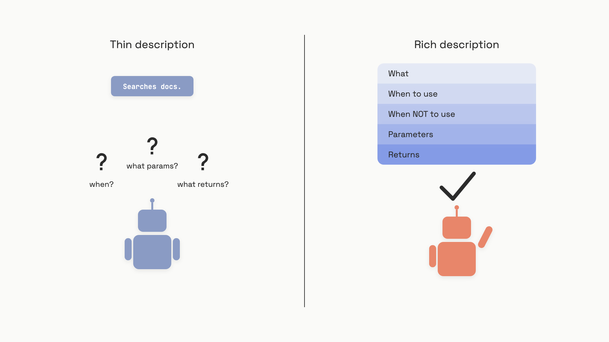

# Tool design

When Anthropic shipped its web search tool, post-launch evaluations turned up a strange pattern: Claude was silently appending `2025` to every query. Search results skewed recent, retrieval quality dropped, and nobody had asked the model to do this. The fix was a one-paragraph edit to the tool's description. No code changed.[^1]

That's the chapter. A tool's schema is not a type signature for a compiler; it's a prompt for an agent. The model meets your tool through three surfaces, in order: the description it reads before deciding to call, the schema that constrains what it can emit, and the error string it gets back when the call fails. Every one of those surfaces is load-bearing. Get them wrong, and the mistake compounds across every turn for every user, the way the `2025` bug did.

The [Function and tool calling](../part-2-working-with-model-apis/03-function-and-tool-calling.md) chapter taught you the wire format and the loop. This chapter is the design discipline on top of it. There are four things to get right, and they're ordered by how cheaply they pay you back: schema, description, error message, granularity.

## Make invalid calls impossible

The schema is the only mechanical guarantee you get. Everything else is prose the model can ignore. Use the guarantee.

Both Anthropic and OpenAI ship a strict mode that compiles your JSON Schema into a sampling grammar, so the model can't emit tokens that produce an invalid call. With `strict: true` set, `passengers: int` will never arrive as `"two"` or `"2"`; the API rejects those tokens at sampling time, not at validation time.[^2][^3] The cost is one-time: the schema gets compiled on first use and cached for 24 hours.[^2] The benefit is that an entire class of parse-and-retry failures disappears from your traces.

Strict mode comes with two requirements that catch every team migrating to it. Every object must declare `additionalProperties: false`, and every property must appear in `required`. Optional fields stay optional by typing them as a nullable union (`["string", "null"]`) and listing them in `required` anyway.[^2][^3] If you skip either rule, the API rejects the schema with a 400 on the first call.

Beyond strict mode, the schema is where you encode constraints that would otherwise live in description prose:

- **Name parameters unambiguously.** `user_id` beats `user`. `max_results` beats `n`. Anthropic's docs call this out by name: ambiguous parameters create silent misuse.[^4]
- **Use enums for closed sets.** A `section` field with `enum: ["policies", "products", "procedures"]` makes "marketing" unrepresentable. The model can't hallucinate a value the grammar won't sample.
- **Bound numerics.** `minimum: 1, maximum: 10` on `max_results` saves you a recoverable error the model would otherwise need to read.
- **Avoid contradictory shapes.** `toggle_light(on: bool, off: bool)` is OpenAI's canonical example of a schema that lets the model emit `{on: true, off: true}`. One enum field beats two booleans every time.[^3]

Here's the shape that does all four:

```python
tool_definition = {
    "name": "search_documents",
    "description": (
        "Full-text search across the internal knowledge base. "
        "Use this when the user asks about company policies, procedures, "
        "or product documentation. Do NOT use for real-time data or "
        "live prices. Returns up to 10 results ranked by relevance."
    ),
    "strict": True,
    "input_schema": {
        "type": "object",
        "properties": {
            "query": {
                "type": "string",
                "description": "Natural language question, e.g. 'What is the refund policy?'",
            },
            "max_results": {
                "type": "integer",
                "minimum": 1,
                "maximum": 10,
                "description": "Number of results to return. Default 5, max 10.",
            },
            "section": {
                "type": ["string", "null"],
                "enum": ["policies", "products", "procedures", None],
                "description": "Optional section filter. Pass null to search all sections.",
            },
        },
        "required": ["query", "max_results", "section"],
        "additionalProperties": False,
    },
}
```

That's the floor. Default to strict mode on every production tool; escalate out only when you genuinely need dynamic schemas you can't pre-specify. In two years of agent traces, we've never seen that escalation pay off.

## The description does the work

Strict mode tells the model what it can emit. The description tells it whether to call the tool at all, and that decision matters more than the arguments. Anthropic's engineering team, after rebuilding the Slack and Asana MCP tools with their own evaluation harness, named description quality as "by far the most important factor in tool performance," ahead of strictness or consolidation.[^1]

A good description covers five things, in this order:

- **What it does**, in one plain sentence.
- **When to use it**, including the situations the model might miss.
- **When NOT to use it**, naming the sibling tools that own adjacent jobs.
- **What each parameter means**, with format hints and a sample value where format is non-obvious.
- **What it returns**, and what it pointedly doesn't return.

Aim for at least three or four sentences per tool, eight to twelve for anything with non-obvious trigger conditions or known misuse patterns.[^4] Yes, this costs context tokens. Tool definitions are charged on every request: roughly 290 to 500 system-prompt tokens for the tool-use scaffolding alone, plus the body of every description.[^5] You're paying for these tokens whether they teach the model anything or not, so make them teach.


*The same tool, two descriptions. The model on the left has to guess; the model on the right doesn't.*

The SWE-bench result makes the cost of doing this well concrete. When Anthropic published its 49% SWE-bench Verified score in January 2025 (state-of-the-art at publication, up from 45%), the agent ran on exactly two tools: a Bash tool and a `str_replace_editor` tool. The schemas were minimal. The descriptions were not. The Bash tool's description spelled out non-obvious constraints in plain English: "the contents of the `command` parameter does NOT need to be XML-escaped. You don't have access to the internet via this tool. State is persistent across command calls. Please avoid commands that may produce a very large amount of output." The team wrote: "We put a lot of effort into the descriptions and specs for these tools. We tested them to uncover any ways that the model might misunderstand the spec."[^6]

That last sentence is the discipline. Tool descriptions deserve the same iteration loop you'd give a system prompt: write it, run your evals, read the failures, watch for the model doing something the description didn't forbid, and tighten the prose. The web search `2025` bug was caught this way. So was a smaller fix in the `path` parameter on the SWE-bench Edit tool, which originally accepted relative paths and was rewritten as `"Absolute path to file or directory, e.g. /repo/file.py"` after the team noticed agents getting confused after `cd`.[^6]

A description is doing its job when you can answer "why didn't the model call this tool?" or "why did it call it the wrong way?" by reading the description aloud and spotting the gap.

## Errors the model can act on

A failed tool call isn't an exception you raise. It's a string the model is about to read and reason over. Write it for that reader.

The default failure mode in tool dispatch code is to surface a raw exception: `TypeError: argument 'max_results' must be int, not str`. The model can't do much with this. It often retries with the same input, retries with a syntactically different but semantically identical input, or abandons the tool and hallucinates the result. We've seen agents stuck in five-call retry loops on a single bad parameter, burning tokens and breaking budgets, when one well-written error message would have unblocked them on turn two.

The recipe for a recoverable error has three parts: name the parameter, state the valid range or format, and show a corrected call.

```python
# Useless
return "ERROR: invalid argument"

# Useless and worse, because the model can't tell what to fix
return "TypeError: int() argument must be a string..."

# The model can act on this
return (
    "Error: max_results=15 exceeds limit of 10. "
    "Retry with max_results=10 or lower. "
    "Example: search_documents(query='refund policy', max_results=10, section=null)"
)
```

The dispatch shape that produces these errors looks like this:

```python
import json

def execute_tool(name: str, args: dict) -> dict:
    if name == "search_documents":
        query = args.get("query", "")
        max_results = args.get("max_results", 5)

        if not query.strip():
            return {
                "is_error": True,
                "content": (
                    "Error: 'query' is empty. Provide a non-empty natural "
                    "language question. Example: search_documents("
                    "query='What is the return policy?', max_results=5, section=null)"
                ),
            }
        if max_results > 10:
            return {
                "is_error": True,
                "content": (
                    f"Error: max_results={max_results} exceeds limit of 10. "
                    "Retry with max_results=10 or lower."
                ),
            }
        return {"is_error": False, "content": json.dumps(do_search(query, max_results))}

    return {"is_error": True, "content": f"Unknown tool: {name}."}
```

The structure mirrors the protocol both Anthropic and MCP define: errors travel inside the tool result, not as a thrown exception, with a flag (`is_error: true` on Anthropic, `isError: true` on MCP) that tells the model the result is a failure to recover from rather than data to consume.[^7][^8] OpenAI's protocol has no such flag, but the same pattern applies; the model reads error strings from context.

Two refinements that pay for themselves in long-running agents:

- **Truncate with an instruction, not a hard cut.** When a tool returns more than your token budget, truncate and append `"Truncated after N tokens. Use offset and limit parameters to retrieve subsequent pages."` This converts a wall into a ladder.[^1]
- **Treat side-effecting errors differently.** For an idempotent read, "retry with corrected input" is a fine default. For a tool that sends an email or charges a card, the error message should instruct the model to confirm with the user before retrying, not to retry directly. The error string is where you encode that policy.

Recoverable errors do cost extra turns, and therefore extra tokens. For cheap tools, the trade is overwhelmingly favorable. For expensive ones, the message itself is a control surface as much as a debug log.

## A few rich tools beat twenty thin ones

The last design axis is granularity: how many tools the model picks from per turn, and how much each one does. The pull toward thin tools is gravitational. Every backend endpoint becomes a tool; every microservice gets its own wrapper; six months in, your agent stares at thirty-two function definitions every turn. Accuracy on tool selection drops measurably past about twenty visible tools, which is why OpenAI's docs name that as a soft ceiling.[^3] Anthropic doesn't publish a hard cap but recommends "a few thoughtful tools" per workflow.[^1]

The reason thin tools fail isn't that the model can't read thirty-two descriptions. It's that thin tools force the model to do work the application should be doing. A three-call sequence like `get_customer_by_id` → `list_transactions` → `list_notes` puts the model in the middle of three round-trips, paying for all the intermediate context. Each call returns its own header noise; each result has to be summarized into the next call's arguments; each turn risks the model going off-script.

Replace those three with one `get_customer_context(customer_id, response_format)` and the agent makes one decision instead of three. Anthropic measured the response-shaping piece directly: their internal Slack tool went from 206 tokens per call (full IDs, all metadata) to 72 tokens (semantic names, ID stripped) by adding a `response_format: "concise"` mode. Same information, two-thirds fewer tokens.[^1]

The consolidation rule, stated concretely:

- **Consolidate when tools are always called in sequence on a single workflow.** `get_customer + list_transactions + list_notes` becomes `get_customer_context`. `list_users + list_events + create_event` becomes `schedule_event`.[^1]
- **Don't consolidate across conceptually distinct operations.** A `read` tool and a `write` tool stay separate; a tool that searches and a tool that mutates stay separate. The line is that read and write have different failure modes, different recovery semantics, and different audit requirements.
- **Namespace when you span services.** Prefix-based names (`crm_search_contacts`, `support_search_contacts`) disambiguate overlapping responsibilities better than identical descriptions ever can.[^1][^3]
- **Above twenty visible tools, defer.** OpenAI's `tool_search` and equivalent conditional-loading patterns let the model pull in a tool surface only when it needs it, instead of paying for all of it on every turn.[^3]

The dissent is real and worth naming. Over-consolidated tools can develop fat parameter surfaces (`schedule_event` quietly handling timezone resolution, conflict detection, and conference link creation) that are harder to describe unambiguously than three smaller tools would be. The resolution isn't a fixed count; it's that consolidation should follow natural human workflows, not synthetic groupings of unrelated actions. If you can't write a clean three-sentence description for the consolidated tool, you've consolidated too much.

This is also where the tool-design discipline closes the loop on context engineering. Every tool definition is a permanent tax on every request. Twenty tools with verbose descriptions can burn 2,000 to 5,000 input tokens before the user has typed a word.[^5] Concision in descriptions, consolidation in surface, and `response_format` modes in returns are the same lever pulled three ways: keep the model's working memory full of the user's problem, not your service catalog. [Context engineering](../part-5-context-engineering/04-tool-context-and-metadata.md) covers the budget side of this; tool design is where you spend it well.

For the architecture-scale view of how these tool surfaces compose into agent platforms with shared registries, sandboxing, and audit, [AI systems at architecture scale](../../hld/part-9-ai-ml-system-design/) covers the whiteboard view.

## References

[^1]: Ken Aizawa et al., "Writing effective tools for agents, with agents," Anthropic Engineering, Sep 11, 2025. https://www.anthropic.com/engineering/writing-tools-for-agents
[^2]: Anthropic, "Strict tool use," Anthropic Docs, accessed June 2026. https://docs.anthropic.com/en/docs/agents-and-tools/tool-use/strict-tool-use
[^3]: OpenAI, "Function calling," OpenAI Platform Docs, accessed June 2026. https://platform.openai.com/docs/guides/function-calling
[^4]: Anthropic, "Define tools," Anthropic Docs, accessed June 2026. https://docs.anthropic.com/en/docs/agents-and-tools/tool-use/define-tools
[^5]: Anthropic, "Tool use with Claude, Overview (Pricing)," Anthropic Docs, accessed June 2026. https://docs.anthropic.com/en/docs/agents-and-tools/tool-use/overview
[^6]: Erik Schluntz, "Raising the bar on SWE-bench Verified with Claude 3.5 Sonnet," Anthropic Engineering, Jan 6, 2025. https://www.anthropic.com/engineering/swe-bench-sonnet
[^7]: Anthropic, "Tool use with Claude, overview," Anthropic Docs, accessed June 2026. https://docs.anthropic.com/en/docs/build-with-claude/tool-use/overview
[^8]: Model Context Protocol, "Tools," MCP Specification 2025-06-18, accessed June 2026. https://modelcontextprotocol.io/specification/2025-06-18/server/tools
