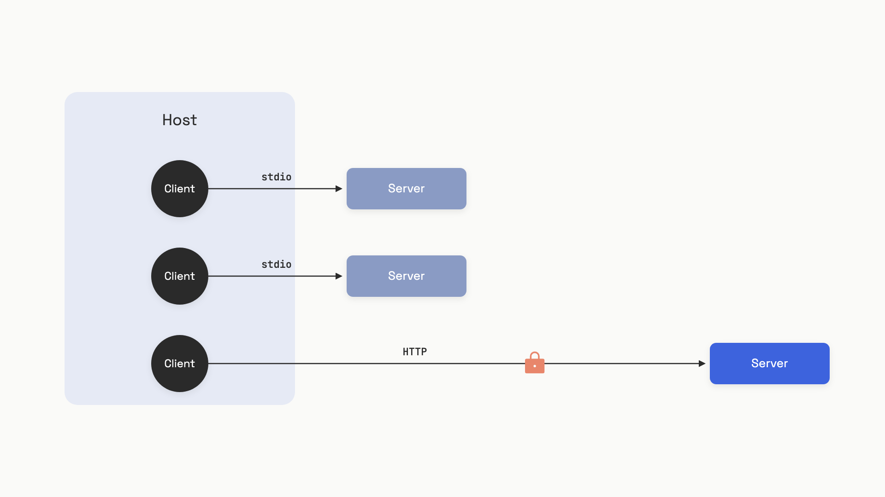

# MCP: Model Context Protocol

You've built a useful tool: a function that searches your company's wiki and returns the top three pages. Now your team uses Claude Code, Cursor, VS Code Copilot, and a custom Slackbot. That's four hosts. Tomorrow someone adds a fifth. Each one wants the search tool wired in differently: a different config format, a different SDK, a different way to declare arguments and stream results.

This is the M-times-N problem. M hosts, N tools, M*N glue layers, and every glue layer rots the moment a host changes its API. Editors hit the same wall a decade ago, when every IDE shipped its own bespoke integration with every language's analyzer. The fix was the Language Server Protocol: one wire format that decouples editors from analyzers, so a Python LSP server works in VS Code, Neovim, Emacs, and Zed without modification.

Model Context Protocol (MCP) is LSP for AI context.[^1] One JSON-RPC schema. Any host that speaks it can talk to any server that speaks it. Anthropic open-sourced MCP in November 2024 and donated it to the Linux Foundation in December 2025; by mid-2026 every major AI coding surface supports it natively and the public registry holds over 9,400 servers.[^2]

## Three roles, not two

Most engineers, on first contact, mentally collapse MCP into "client and server" and get it wrong within five minutes. There are three roles, and the middle one is the one that trips people up.

- **Host:** the AI application the user looks at: Claude Desktop, Cursor, your own agent. The host owns the model and the user's consent.
- **Server:** a separate program that exposes capabilities (tools, files, prompts). The server owns the integration with whatever back-end it wraps: a database, a SaaS API, the local filesystem.
- **Client:** an object *inside the host*, one per server, that does the wiring. If your host connects to three servers, it instantiates three clients.

The client is not the host. The client is not a separate process. It's a connector object the host creates to talk to one specific server, and it dies when that connection ends. This isolation is deliberate: a malicious server can corrupt its own client, but it can't reach across to a sibling server's client and read what you sent there.[^3]

Spec versions move fast. This chapter targets revision 2025-11-25, the latest stable release as of mid-2026.[^1]


*One host, three clients, three servers. Each client is an isolated connector inside the host; servers can run as local subprocesses or as remote HTTP services.*

## Build the server

The Python SDK ships a high-level wrapper called `FastMCP` that takes care of the JSON-RPC plumbing and generates the tool schema from your type hints. Here's a server that exposes one tool, one resource, and one prompt, enough to exercise three of the four primitives:

```python
# server.py (pip install mcp)
from mcp.server.fastmcp import FastMCP

mcp = FastMCP("notes-server")
NOTES: dict[str, str] = {}

@mcp.tool()
def add_note(name: str, content: str) -> str:
    """Add or overwrite a note.

    Args:
        name: Unique note identifier (alphanumeric, no spaces).
        content: Text content of the note.
    """
    NOTES[name] = content
    return f"Stored note '{name}'"

@mcp.resource("notes://all")
def list_notes() -> str:
    """All stored notes as newline-separated key=value pairs."""
    return "\n".join(f"{k}={v}" for k, v in NOTES.items()) or "(no notes)"

@mcp.prompt()
def summarize_notes() -> str:
    """Return a prompt asking the LLM to summarize all stored notes."""
    body = "\n".join(f"- {k}: {v}" for k, v in NOTES.items()) or "(none)"
    return f"Summarize these notes concisely:\n{body}"

if __name__ == "__main__":
    mcp.run(transport="stdio")
```

Three decorators do most of the work. `@mcp.tool()` reads the function signature and docstring to generate the JSON Schema the model sees; the model picks tools and fills arguments using that schema. `@mcp.resource("notes://all")` registers a read-only data source at a stable URI. `@mcp.prompt()` registers a user-selectable template, typically surfaced as a slash command in the host UI.

> [!WARNING]
> **Don't `print()` from a stdio server.** The transport uses stdout exclusively for newline-delimited JSON-RPC. A single stray `print("debug:", x)` corrupts the stream and the client fails with a parse error you'll spend an hour chasing. Send all logs to stderr: `print(..., file=sys.stderr)` or `logging.basicConfig(stream=sys.stderr)`. This is the single most common beginner mistake in the official MCP docs.[^4]

## Build the client

A client speaks the other end of that same protocol. In real life, the client lives inside Claude Desktop or your agent runtime; for development, you write one yourself to test the server in isolation.

```python
# client.py (pip install mcp)
import asyncio
from mcp import ClientSession, StdioServerParameters
from mcp.client.stdio import stdio_client

async def run():
    params = StdioServerParameters(command="python3", args=["server.py"])
    async with stdio_client(params) as (read, write):
        async with ClientSession(read, write) as session:
            await session.initialize()                       # 1. handshake

            tools = await session.list_tools()               # 2. discover
            print("Tools:", [t.name for t in tools.tools])

            result = await session.call_tool(                # 3. invoke
                "add_note", {"name": "hello", "content": "world"}
            )
            print("Tool result:", result.content[0].text)

            data = await session.read_resource("notes://all")  # 4. read
            print("Resource:", data.contents[0].text)

asyncio.run(run())
```

Run `python3 client.py` and you'll see the host launch the server as a subprocess, complete the protocol handshake, list one tool (`add_note`), call it, then read the `notes://all` resource and print `hello=world`. That's the full discovery-and-use loop a real host runs every time it connects.

The four lines marked above are the entire vocabulary you need. `initialize()` does the version and capability negotiation. `list_tools()`, `list_resources()`, and `list_prompts()` discover what the server offers. `call_tool()` and `read_resource()` exercise it. Pagination, change notifications, and progress reporting are all SDK-handled wrappers over the same JSON-RPC primitives.

## The four primitives

Three of the primitives live on the server. One inverts the trust direction and lives on the client. They are not interchangeable, and picking the wrong one is the most common design mistake in MCP servers.

**Tools** are functions the model invokes. Side effects allowed, parameters required, results streamed back as text, image, audio, or structured JSON. Tools are *model-controlled*: the LLM decides when to call them based on the task.[^5] If the operation does anything (writes a row, sends an email, runs a query with arguments), it's a tool.

**Resources** are read-only data sources identified by URI: `file:///etc/hosts`, `git://main/README.md`, `notes://all`. Resources are *application-driven*: the host or the user picks which ones to attach as context, not the model.[^6] If the data has a stable address and no parameters, it's a resource.

**Prompts** are templates the *user* selects, usually as slash commands. They return a list of pre-formatted messages: a few-shot pattern, a system prompt fragment, a multi-step workflow opener. Prompts are user-controlled.

The line is sharp: model-controlled means tool, application-controlled means resource, user-controlled means prompt. When in doubt, ask who decides whether the LLM sees this content.

**Sampling** is the inverted one. The server asks the *client* to run an LLM completion on its behalf, via `sampling/createMessage`.[^7] This sounds backwards until you see why: a server author who needs LLM calls inside their tool can either (a) hard-code an Anthropic API key into the server and pay for the inference themselves, or (b) borrow the host's model and let the user pay. Sampling is option (b). The host stays in control: it picks the actual model, it surfaces the request to the user for approval, and it can deny.

The spec is explicit on this last point: "There SHOULD always be a human in the loop with the ability to deny sampling requests."[^7] Treat sampling as a privilege you grant only to servers you trust, because the inversion lets a malicious server run arbitrary LLM interactions on your dime.

## Two transports

The transport is how bytes move between client and server. The data layer (JSON-RPC, primitives, lifecycle) is identical either way; pick the transport based on where the server lives.

**stdio** spawns the server as a subprocess of the host. Messages are newline-delimited JSON over stdin and stdout. Zero network setup, natural process sandbox, no auth needed because the host already trusts anything it launched. The spec explicitly recommends it: "Clients SHOULD support stdio whenever possible."[^8]

**Streamable HTTP** runs the server as an independent service. A single endpoint (e.g. `https://api.example.com/mcp`) handles both POSTs from the client and a GET that opens a Server-Sent Events stream for server-to-client messages. The server assigns a session ID via the `Mcp-Session-Id` header at initialization and the client echoes it on every subsequent request.[^8] This replaces the older HTTP+SSE transport from the 2024-11-05 spec, which used two separate endpoints; new servers should ship Streamable HTTP only.

Default to stdio for anything local: filesystem access, git, shell tools, a database running on your laptop. Escalate to Streamable HTTP when the server has to outlive the client (a SaaS integration like Sentry or GitHub), serve many clients at once, or live on different hardware than the host. There's no middle ground; the choice is structural.

| Picking a transport | stdio | Streamable HTTP |
|---|---|---|
| Server runs as | Subprocess of the host | Independent network service |
| Auth | Process trust (none in protocol) | OAuth 2.1 |
| Multi-tenant | One client per process | N clients per server instance |
| Latency floor | A few milliseconds (pipe IO) | Network round-trip |
| Use it for | Local files, git, shell, dev tools | SaaS APIs, shared infra, hosted servers |

## Auth: OAuth 2.1, with sharp edges

Auth is optional in MCP, and stdio servers should skip it (read credentials from the environment instead).[^9] But the moment you ship Streamable HTTP, the spec mandates OAuth 2.1 with PKCE required for every client.[^9] Two flows cover the cases that matter: Authorization Code when the agent acts on behalf of a user (most SaaS integrations), and Client Credentials for machine-to-machine.

The MCP-specific wrinkle is discovery. The MCP server is an OAuth *resource server*, and it advertises where its authorization lives through OAuth 2.0 Protected Resource Metadata (RFC 9728). When an unauthenticated client makes a request, the 401 response carries a `WWW-Authenticate` header pointing at the server's resource metadata document; since the 2025-11-25 revision, servers may also publish it directly at `/.well-known/oauth-protected-resource` for discovery without the initial 401. That document's `authorization_servers` field names the authorization server, and the authorization server's own metadata (RFC 8414) supplies the actual endpoints.[^9] Older clients still hardcode the pre-June-2025 behavior, deriving the auth base URL by stripping the MCP server URL's path and probing `/.well-known/oauth-authorization-server` on it; against a spec-current server, that's the classic cause of opaque "no auth server found" errors.

Two more rules worth memorizing: tokens go in the `Authorization: Bearer` header, never in a query string, and servers SHOULD support Dynamic Client Registration (RFC 7591) so clients can self-register without manual coordination. Skip DCR and you're stuck issuing client IDs by email.

At architecture scale, auth across multi-service systems gets its own depth treatment in the HLD handbook's [authentication and authorization chapter](../../hld/part-7-security-at-scale/00-authn-authz.md); MCP's OAuth 2.1 flow is one well-defined slice of that broader landscape.

## The handshake that hangs

Three messages start every session. Get them wrong and the connection silently locks up.

1. Client sends `initialize` with its supported `protocolVersion`, declared `capabilities`, and `clientInfo`.
2. Server responds with the `protocolVersion` it'll actually use, its own `capabilities`, and `serverInfo`.
3. Client sends `notifications/initialized` (a one-way notification, no `id` field, no response expected).

Step three is the one people skip. Without it, conformant servers refuse to serve any other request, because the spec says "the server SHOULD NOT send requests other than pings and logging before receiving the initialized notification."[^10] If your `tools/list` call hangs forever with no error, the missing initialized notification is the first thing to check. The Python SDK's `session.initialize()` handles both messages for you, which is one reason to use the SDK over raw JSON-RPC.

Capability negotiation is the other contract you can't violate. A client that didn't declare `sampling: {}` will not receive `sampling/createMessage` requests, even if the server tries; the spec says features not declared MUST NOT be used. Declaring capabilities you don't actually implement breaks just as badly. Match what your code can do, not what your roadmap promises.

## The unhappy path

The protocol's design has a sharp edge that the happy path obscures. A server can embed prompt-injection instructions in a tool's `description` field, and the moment the client calls `tools/list`, those instructions enter the model's context and get executed before any tool is ever invoked. Trail of Bits demonstrated this against Claude Desktop, Cursor, Cline, and Windsurf in April 2025 and named the class "line jumping."[^11] An academic study of 847 attack scenarios across five MCP implementations measured 23 to 41 percent higher attack success rates against MCP integrations than against equivalent direct integrations.[^12]

That whole class of attack, plus the mitigations that actually work, gets the next chapter to itself: [MCP security](./05-mcp-security.md) covers tool poisoning, rug pulls, tool shadowing across servers, and the gateway pattern that production deployments use to contain them.

## References

[^1]: Model Context Protocol, "Specification revision 2025-11-25," https://modelcontextprotocol.io/specification/2025-11-25 (latest stable as of June 2026).
[^2]: digitalapplied.com, "MCP Ecosystem H1 2026 Retrospective," https://www.digitalapplied.com/blog/mcp-ecosystem-h1-2026-retrospective-adoption-data-points
[^3]: Model Context Protocol, "Architecture Overview," https://modelcontextprotocol.io/docs/learn/architecture
[^4]: Model Context Protocol, "Build an MCP server," https://modelcontextprotocol.io/docs/develop/build-server
[^5]: Model Context Protocol, "Tools, spec 2025-11-25," https://modelcontextprotocol.io/specification/2025-11-25/server/tools
[^6]: Model Context Protocol, "Resources, spec 2025-11-25," https://modelcontextprotocol.io/specification/2025-11-25/server/resources
[^7]: Model Context Protocol, "Sampling, spec 2025-11-25," https://modelcontextprotocol.io/specification/2025-11-25/client/sampling
[^8]: Model Context Protocol, "Transports, spec 2025-11-25," https://modelcontextprotocol.io/specification/2025-11-25/basic/transports
[^9]: Model Context Protocol, "Authorization, spec 2025-11-25," https://modelcontextprotocol.io/specification/2025-11-25/basic/authorization
[^10]: Model Context Protocol, "Lifecycle, spec 2025-11-25," https://modelcontextprotocol.io/specification/2025-11-25/basic/lifecycle
[^11]: Trail of Bits, "Jumping the line: How MCP servers can attack you before you ever use them," April 21 2025, https://blog.trailofbits.com/2025/04/21/jumping-the-line-how-mcp-servers-can-attack-you-before-you-ever-use-them/
[^12]: arXiv, "Security Analysis of the Model Context Protocol Specification and Prompt Injection Vulnerabilities in Tool-Integrated LLM Agents," 2601.17549, https://arxiv.org/abs/2601.17549v1

