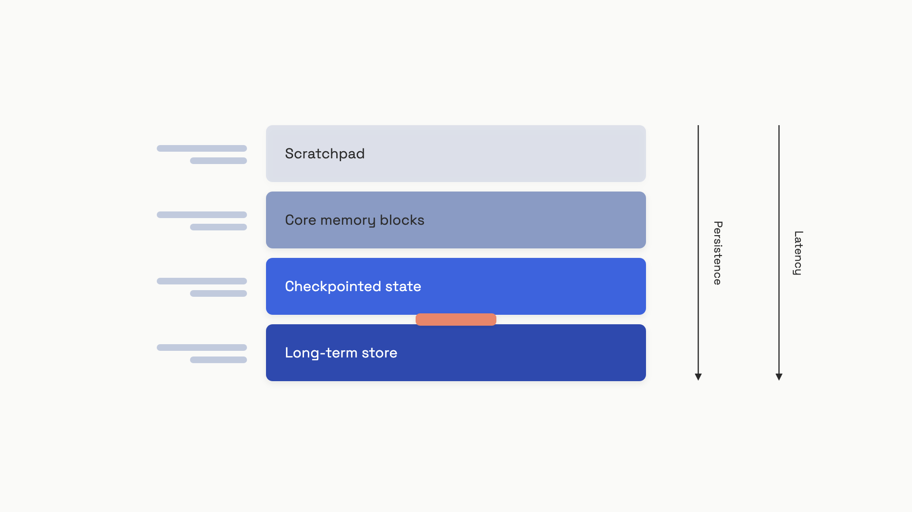

# Agent memory and task state

Your coding agent has been running for ninety minutes. It's read twelve files, run the test suite three times, and is halfway through refactoring the migration script. Then the pod gets OOM-killed. The orchestrator restarts the agent, which receives an empty state object and a fresh context window, and confidently begins step one again, this time clobbering the half-finished work it has no memory of doing.

This is the default behavior. LLMs are stateless by design: each inference call gets a context window and produces tokens, then forgets everything. An agent that runs for more than one step needs an explicit memory layer bolted on top, and that layer has to serve at least three different jobs at once. It needs working memory inside a single reasoning step, episodic state for the multi-step task, and durable storage of facts that outlive the task entirely. Conflate these into one mechanism and you build a system that's simultaneously too slow for real-time use and too shallow to survive a restart.

The job of this chapter is to draw the lines between those tiers, give you the rule for picking one per piece of data, and show what changes in your code when checkpointing stops being optional.

## Four places an agent can put information

The instinct is to think about agent memory as one thing. Production systems pull it apart into four distinct stores, each with its own latency profile, mutation rules, and failure modes.


*Fast and ephemeral at the top, slow and durable at the bottom. Most agent bugs come from putting data in the wrong tier.*

**Scratchpad** is the working memory inside one reasoning step. Chain-of-thought tokens, the model's planning notes for "what tool should I call next", the formatted observation from the last tool return. It lives in the context window, evaporates when the call returns, and costs you tokens proportional to its size.

**Core memory blocks** are small named sections always present in the system prompt: an agent persona, a user's known preferences, the current task goal. Letta (the production successor to MemGPT) defaults each block to a 5,000-character ceiling and exposes built-in tools so the agent can append or replace block contents during execution.[^1] Blocks are always visible, so retrieval costs zero, but they consume context-window budget on every call.

**Checkpointed state** is the structured task record: which steps have completed, what tool outputs they produced, what phase the agent is in. It's stored outside the context window in a database keyed by a `thread_id`, written automatically after every node executes, and re-read when the agent resumes from a crash. This is the tier that solves the OOM-killed-coding-agent problem at the top of the chapter.[^2]

**Long-term store** is the cross-session, cross-thread layer: facts about the user that should persist across unrelated tasks, organizational knowledge, episodic summaries of past work. Same backing technologies as RAG (vector DB, key-value store, sometimes a knowledge graph), but the unique angle here is the *write* path: the agent decides what gets committed.

The trap most teams fall into is treating the context window as the only tier and the long-term store as the only escape hatch. They miss the middle two. A 90-minute agent run with 20 tool calls and no checkpointing will dutifully serialize the full message history into every prompt, blow the budget, and lose everything on restart anyway.

## Checkpointer vs store: the line that gets blurred

If you take one engineering rule from this chapter, take this one. The checkpointer is for what's happening *in this task run*. The store is for what's true *about this user*. Confusing the two is the most common architectural mistake in agent systems, and the cost of getting it wrong shows up only when something fails.

The conceptual test is: if a brand-new task run started for the same user tomorrow, would I want this data? If yes, it's store data: user preferences, the org's coding conventions, past episodic summaries. If it's only relevant to the current run (current step number, partial tool outputs, retry counts), it's checkpointer data.

LangGraph makes this distinction explicit in its API. The checkpointer (`PostgresSaver`, `SqliteSaver`, `InMemorySaver`) writes a snapshot of the graph state after every node, keyed by `thread_id`.[^2] The store (`BaseStore` with `put`, `get`, `search`, `delete`) is a separate object, namespaced by user or organization, persisting across all threads. Same agent, two completely different scoping rules.

```python
from typing import TypedDict

class AgentState(TypedDict):
    messages: list[dict]
    # Checkpointed: thread-scoped, survives crashes within a task
    task_id: str
    current_phase: str          # "planning" | "executing" | "verifying"
    completed_steps: list[str]
    tool_outputs: dict[str, str]
    # Loaded from store at task start, NOT checkpointed per step
    user_preferences: dict[str, str]

def planning_node(state: AgentState) -> dict:
    """Returns a partial update; the framework merges it into the checkpoint."""
    return {
        "current_phase": "executing",
        "completed_steps": state["completed_steps"] + ["planning_done"],
    }
```

The subtle line is `user_preferences`. It's *in* the state schema because the agent reads it during reasoning, but it's not produced by the task. An upstream `load_memory_node` queries the store at task start and seeds it; the agent's tool calls during execution don't write back to it directly. Mixing these layers is how you end up with a user's preferences silently rolled back to a 30-day-old snapshot because the checkpoint didn't include them.

## What to write down versus hold in context

Per piece of data, you've got four choices. The decision rule is mechanical once you ask the right four questions about it.

| Tier | Keep here when | Example |
|---|---|---|
| Context window (always-in) | Small (<2,000 chars), rarely mutated, needed every step | Agent persona, current task goal |
| Scratchpad | Ephemeral reasoning for the current step only | Chain-of-thought, tool-call planning notes |
| Checkpointed state | Mutable progress within a task, must survive crashes, thread-scoped | Current phase, completed steps, tool outputs |
| Long-term store | Cross-session facts, large or growing, retrieved by query | User history, org knowledge, past episodes |

The rule from the Letta context-hierarchy docs is direct: keep small data in the context window with memory blocks; only escalate to an external store when the data is large or crosses session boundaries.[^1] The corollary from LangGraph's memory guide is the test from the previous section: thread-scoped data in the checkpointer, cross-thread data in the store.[^3]

Concretely:

```python
from enum import Enum, auto

class StorageTier(Enum):
    CONTEXT_WINDOW = auto()
    CHECKPOINTED_STATE = auto()
    LONG_TERM_STORE = auto()

def decide_storage_tier(
    data_size_chars: int,
    crosses_sessions: bool,
    mutation_rate: str,
    needed_every_step: bool,
) -> StorageTier:
    if data_size_chars > 4_000 or crosses_sessions:
        return StorageTier.LONG_TERM_STORE
    if needed_every_step and mutation_rate == "high":
        return StorageTier.CHECKPOINTED_STATE
    if needed_every_step and data_size_chars < 2_000:
        return StorageTier.CONTEXT_WINDOW
    return StorageTier.CHECKPOINTED_STATE
```

Run any candidate piece of data through those four questions. The cost of putting a 50KB document in the context window is one thing; the cost of putting a quickly-mutating step counter in the long-term store is worse, because you're writing through the wrong abstraction and your retrieval queries will be polluted with stale operational state forever.

The second-order rule is a budget one. The Mem0 paper showed that on the LOCOMO benchmark of 26,000-token conversations, full-context processing ran at a p95 of 17.1 seconds; an extractive memory pipeline that kept retrieved context under 7,000 tokens ran at 1.44 seconds, a 91% latency reduction at a small accuracy cost (LLM-as-a-Judge: 67 vs 73 overall).[^4] At long-running-agent scale, that ratio is the difference between an interactive product and a batch job.

## Checkpointing: the trick that survives a pod restart

Back to the OOM-killed coding agent. The fix is one line of configuration that most tutorials skip.

LangGraph's default is no checkpointer. If you call `graph.compile()` without passing one, the entire state lives in process memory and dies with the process. This is invisible in development because single-process tests never restart mid-task. It's catastrophic in production, where pods get evicted, OOM-killed, or rolled during a deploy. The community quote that captures it: "LangGraph makes the in-memory case so smooth that you forget there is a memory at all, and then production reminds you."[^5]

A durable checkpointer changes the failure mode. After every node in the graph executes, the framework serializes the full state dict, the channel versions, and a monotonic checkpoint ID into the configured backend.[^2] On crash, you call `graph.invoke(None, config={"configurable": {"thread_id": same_id}})` and execution resumes from the last completed step, not from scratch. Same code path; the framework reads the latest checkpoint for that `thread_id` and continues.

The production-grade pattern is `PostgresSaver` (or `SqliteSaver` if you're single-process), set up once in the application startup path:

```python
from langgraph.checkpoint.postgres import PostgresSaver
from psycopg_pool import ConnectionPool

pool = ConnectionPool(conninfo="postgresql://...", max_size=10)
checkpointer = PostgresSaver(pool)
checkpointer.setup()  # creates tables on first run; idempotent

graph = builder.compile(checkpointer=checkpointer)

# Every invocation now persists state per thread_id
config = {"configurable": {"thread_id": "task-001"}}
result = graph.invoke({"messages": [...], "task_id": "task-001", ...}, config)
```

The checkpoint API also opens up the human-in-the-loop pattern that gets its own treatment in [Human-in-the-loop](./07-human-in-the-loop.md): compile with `interrupt_before=["risky_node"]`, execution pauses there, the checkpoint is written, and a human reviewing the run can call `graph.update_state(...)` to correct intermediate values before resuming. No coordination code in the agent logic. The same machinery covers crash recovery, time-travel debugging, and approval gates.

Two pitfalls hit teams who turn checkpointing on naively. The first is checkpoint bloat: if your state schema includes large objects (full document text, base64 images, long tool outputs), every checkpoint write serializes those bytes to Postgres. A ten-step task with 200ms checkpoint writes adds two seconds of pure I/O. The fix is to keep references in state (S3 keys, document IDs) and fetch the artifact only inside the node that needs it. The second is checkpointer choice in production: `InMemorySaver` is for tests; in any deployment that can restart, you want a real backend.[^2]

## Flat list or task tree?

Most tasks are linear: planning, then a sequence of steps, then verification. A flat `completed_steps: list[str]` field in your checkpoint state covers it. The Mem0-style summary plus a step counter is enough.

It stops being enough when the task branches. A coding agent that runs tests, finds a failure, backtracks to revise an earlier step, and re-runs from there can't represent its history as a flat list without confusing itself about which version of which step is current. The Task Memory Engine paper formalizes this with a Task Memory Tree: each node stores `{action, input, output, status, parent_id, children, dependencies}`, and the prompt synthesizer traverses only the active root-to-leaf path when building context.[^6] On a six-round form-filling task with corrections, this saves around 19% of tokens versus naive full-history concatenation, because the model never re-sees the abandoned branches.

The escalation rule is simple. Use a flat list for tasks with predictable linear flow. Move to a tree when you have conditional branches, retry paths that invalidate earlier work, or human corrections that should override prior steps without erasing the audit trail. Don't reach for a DAG library on day one; ten lines of recursive Python over a `dict` of nodes works fine until it doesn't.

## The boundary with user memory

[Memory and state](../part-5-context-engineering/03-memory-and-state.md) covers user-facing memory in detail: sliding windows, summary buffers, fact extraction with ADD/UPDATE/DELETE/NOOP classification, GDPR erasure, and the eviction policies that keep a long-term store from drifting into noise. Don't reimplement that here. The line between the two chapters is sharp: Part 5 is *what the product remembers about the user across sessions*; this chapter is *what the agent remembers about the task it's working on right now*.

The handoff between them is the load and save points. At task start, you query the long-term store (covered in Part 5) for relevant user facts and seed them into the agent's state. At task end, anything the agent learned that's worth keeping (the user prefers Python over Ruby, this org's deploy script needs `--no-cache`) runs through the fact-extraction pipeline (also Part 5) before being written back. Inside the task, the only memory work is the four tiers above.

There are two failure modes specific to the agent side worth flagging.

**Memory contamination from tool returns.** When a tool returns attacker-controlled text, that text enters the context, gets processed by your reasoning step, and, if you've wired up automatic fact extraction, can end up written to the long-term store. Next session, it's retrieved as ground truth. The MEMTIER paper measured a 14-percentage-point drop in tool-execution success over 72 hours of operation in flat-file memory systems for related reasons.[^7] The fix lives in [Tool design](./03-tool-design.md): treat every tool output as untrusted input, sanitize before extraction, and store provenance (`source_tool`, `source_call_id`) on every memory record so contaminated entries can be purged later.

**Concurrent writes to shared blocks.** When multiple subagents write to the same Letta-style memory block, the last write wins and earlier writes vanish silently.[^1] The pattern that avoids this is one writer per block: give each subagent its own scratchpad block, then merge results at the supervisor level. For canonical shared facts, mark blocks read-only.

The most reliable check that you've got the architecture right is to kill the process mid-task on purpose. If the agent resumes from where it stopped, with the user's preferences intact and the work-in-progress correct, the four tiers are doing their jobs. If anything's missing, the data was in the wrong tier.

## References

[^1]: Letta, "Memory blocks (core memory)," Letta Docs, accessed June 2026. https://docs.letta.com/guides/core-concepts/memory/memory-blocks

[^2]: LangChain, "Checkpointing: state persistence, crash recovery, and time-travel debugging in LangGraph," LangGraph docs, March 2026. https://langchain-ai-langgraph-40.mintlify.app/concepts/checkpointing

[^3]: LangChain, "Memory: short-term and long-term memory in LangGraph agents," LangGraph docs, March 2026. https://langchain-ai-langgraph-40.mintlify.app/guides/memory

[^4]: Chhikara, Khant, Aryan, Singh, Yadav, "Mem0: Building Production-Ready AI Agents with Scalable Long-Term Memory," arXiv:2504.19413, April 2025. https://arxiv.org/abs/2504.19413

[^5]: learnwithparam.com, "LangGraph persistence and thread models in production," February 2025. https://www.learnwithparam.com/blog/langgraph-persistence-thread-models-production

[^6]: Ye, "Task Memory Engine: Enhancing State Awareness for Multi-Step LLM Agent Tasks," arXiv:2504.08525, April 2025. https://arxiv.org/abs/2504.08525

[^7]: Sidik and Rokach, "MEMTIER: Tiered Memory Architecture and Retrieval Bottleneck Analysis for Long-Running Autonomous AI Agents," arXiv:2605.03675, May 2026. https://arxiv.org/abs/2605.03675
