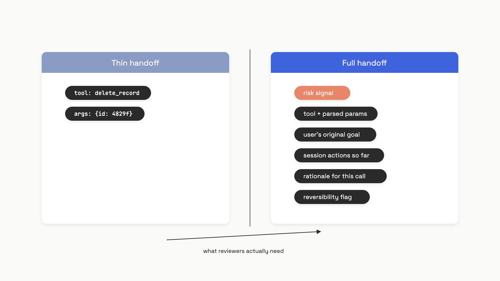

# Human-in-the-loop

Anthropic shipped Claude Code with a permission prompt before every consequential tool call. Users approved 93% of them.[^1] That's not oversight. That's a click reflex with a confirmation dialog wrapped around it.

The naive version of human-in-the-loop is "add an approve button." The production version is three separate engineering problems that fail independently. *Which* actions get gated decides whether the human ever sees what matters. *How* the gate threshold is set decides whether the agent escalates the right calls. *What* the human sees in the gate decides whether they make a real decision or rubber-stamp. Optimize one in isolation and you degrade the other two.

The empirical signal that everything in this chapter rests on came out of Anthropic's analysis of 500K Claude Code sessions in early 2026.[^2] New users (under ~10 sessions) auto-approve about 20% of the time and interrupt 5% of turns. Experienced users (750+ sessions) auto-approve over 40% of the time and interrupt 9% of turns. They aren't getting lazier; they're getting better at oversight. They've learned that watching the agent and stepping in when something looks wrong beats reflexively clicking approve on every shell command.

That shift, from per-action approval to monitor-and-interrupt, is the design target. The rest of this chapter is the three pieces that get you there.

## Approval gates are tool calls in disguise

Every major framework converged on the same trick: a gated tool isn't a special "pause" primitive. It's a regular tool call that the runtime intercepts, serializes, and surfaces to a human. The human's decision comes back as the tool's result. The agent loop never knew anything unusual happened.

That isomorphism is the design choice that makes HITL composable. Your agent already knows how to wait on a tool call, read the result, and adapt. Approval is just a tool whose implementation is a person.

Concretely, in the OpenAI Agents SDK:

```python
from agents import function_tool

@function_tool(needs_approval=True)
async def cancel_order(order_id: int) -> str:
    """Always requires human approval before cancelling."""
    return f"Cancelled order {order_id}"


async def requires_review(_ctx, params: dict, _call_id: str) -> bool:
    """Per-call: escalate only when the email looks like a refund."""
    return "refund" in params.get("subject", "").lower()


@function_tool(needs_approval=requires_review)
async def send_email(subject: str, body: str) -> str:
    return f"Sent '{subject}'"
```

When the runner hits a gated call, it doesn't execute the tool. It populates `RunResult.interruptions` with a `ToolApprovalItem` carrying the agent name, tool name, and exact arguments, then returns control to your application. You serialize the run state via `result.to_state()`, store it (DB, queue, file), and resume hours or days later with `state.approve(interruption)` or `state.reject(interruption, rejection_message="...")` followed by `Runner.run(agent, state)`.[^3] The run picks up at the exact paused point.

LangGraph implements the same pattern with imperative shape: an `interrupt()` call inside a node raises a special exception, the runtime saves graph state to the configured checkpointer, and the caller resumes via `Command(resume=<value>)`.[^4] Anthropic's Claude Agent SDK uses a `canUseTool` callback that returns `PermissionResultAllow(updated_input=...)` or `PermissionResultDeny(message=...)`.[^5]

Two design choices fall out of this once you see them.

**The rejection message is feedback the agent reads.** When the human types "no, this would delete production data, try the staging endpoint instead," that text becomes the tool result the model sees on its next turn. The agent reads why it was denied and adapts. A bare "rejected" signal trains the agent to either retry or give up; a real explanation lets it course-correct. Both the OpenAI and Anthropic SDKs let you customize the rejected text per call.[^3][^5]

**Approve-with-changes is one of the most underused features in the stack.** The Claude Agent SDK lets the approver mutate the tool's input before execution: `PermissionResultAllow(updated_input=modified_input)`.[^5] The model sees the result of the modified call, not the original. That single hook turns the human from a binary gatekeeper into an editor. Approve a database query, but scope it to one tenant. Approve a file write, but redirect it to a sandbox path. Approve the email, but strip the customer's full name from the subject line.

> [!WARNING]
> **LangGraph re-runs your node from the top on resume.** Code executed before the `interrupt()` call runs again every time the human approves. If you wrote `db.create_audit_log(...)` before the gate, you get a duplicate audit log per resume. Move side effects after the interrupt, or make every pre-interrupt operation idempotent (upserts keyed on a deterministic ID, not inserts).[^4]

There's one design pattern worth pulling forward from a sibling chapter: gated tools also work for tools loaded from external [MCP servers](04-mcp-model-context-protocol.md). Both SDKs let you flag entire MCP servers or specific MCP tools as `require_approval`, so HITL extends to third-party tools without modifying them.[^3][^5]

## Confidence-based escalation: the threshold isn't a vibe

Once you've decided the gate plumbing, the next question is which tool calls actually flow through it. Gating everything reproduces the 93% rubber-stamp problem. Gating nothing is what `--dangerously-skip-permissions` does. The middle path is escalating selectively based on the agent's confidence in its own action.

There's a clean formula behind this, from DosSantos DiSorbo and Ju's March 2026 paper on escalation behavior in language models.[^6] Treat the decision as a cost calculation. Let `c_l` be the cost of routing to a human reviewer and `c_w` the cost if the agent acts wrongly. The optimal threshold is:

```python
from dataclasses import dataclass

@dataclass
class EscalationPolicy:
    labor_cost: float   # cost of human review
    error_cost: float   # cost of an unsupervised wrong action

    @property
    def threshold(self) -> float:
        # tau* = 1 - c_l / c_w
        return 1.0 - self.labor_cost / self.error_cost

    def should_escalate(self, p_hat: float) -> bool:
        return p_hat < self.threshold

# Refund approval: a wrong auto-approval costs 10x a human review.
# tau* = 0.90 -- escalate unless the model is at least 90% confident.
refund_policy = EscalationPolicy(labor_cost=1.0, error_cost=10.0)
assert refund_policy.should_escalate(0.85)
assert not refund_policy.should_escalate(0.95)
```

Read this carefully: the threshold falls as the human review gets cheaper relative to errors, and rises as errors get cheap relative to reviews. A high-stakes action (financial transactions, deletions) wants a high threshold; a routine internal lookup wants a low one. The decision rule lives in your domain model, not the agent.

That's the easy part. The hard part is the agent's `p_hat`, the self-estimate of correctness. The same paper measured the implicit escalation thresholds of eight production models across five real decision domains (loan approvals, hotel cancellations, content moderation, and others). The results are uncomfortable.

Within the same model family, implicit thresholds differed by 38 percentage points. GPT-5-nano had an implicit `p*` of 91%; GPT-5-mini, the same family, had 53%. Qwen3.5-9B sat at 56% and overconfident on most domains, with self-estimated accuracy up to 41 points above its actual accuracy. GPT-5-mini was well-calibrated in aggregate (80% self-estimate vs. 78% actual) but carried offsetting biases of -38 to +27 points on individual domains.[^6] Two models from the same family, swapped without re-testing, can differ in their willingness to escalate by more than a third of the probability axis.

The practical implication: **a model swap without re-characterizing the escalation profile is a safety regression.** Before deployment, vary your task difficulty across known-accuracy bins, measure the model's escalation rate at each bin, and find the implicit `p*` where the model crosses 50% escalate. Compare it to your cost-optimal `tau*`. If they don't match, you have either an overconfident agent missing escalations or an underconfident one drowning your reviewers in false alarms.

What actually moves the threshold once you find a gap. Cost framing in the system prompt alone barely helps non-reasoning models (Qwen3.5-9B went from 62.0% to 63.9% decision accuracy at a 4:1 cost ratio). Extended thinking alone does nothing (61.9%). The combination of thinking and cost framing reaches 78.8%. For GPT-5-mini, cost framing alone hits 75.8% and the combination 87.1%. Supervised fine-tuning on chain-of-thought targets that explicitly compute `cost_ratio * error_rate` reaches near-100% accuracy across train, test, and held-out domains.[^6] Fine-tuning is overkill for most teams; thinking plus explicit cost framing is the default that gets most of the benefit.

Anthropic's Claude Code auto mode, shipped March 2026, is the largest production deployment of confidence-gated escalation that's published numbers. It uses three tiers.[^7]

| Tier | What's in it | Gate |
|---|---|---|
| 1 | Reads, grep, code navigation, user-configured allows | Always allow |
| 2 | In-project file writes (covered by version control) | Allow without classifier |
| 3 | Shell, web fetch, external tools, out-of-project filesystem | Two-stage classifier |

Tier 3 is where confidence-based escalation actually runs. Stage 1 is a fast single-token filter that errs toward blocking (8.5% false positive rate on benign actions). Stage 2 applies chain-of-thought reasoning only to actions Stage 1 flagged. The combined pipeline hits 0.4% FPR on real benign actions and 17% false negative rate on real overeager ones.[^7] After three consecutive denials or twenty in a session, the model is stopped and the human is paged unconditionally; in headless mode the process terminates.

The 17% FNR is the honest number. It's better than `--dangerously-skip-permissions` (which is 100% FNR) and worse than careful manual review. Anthropic publishes both bounds and tells you to pick where you sit.

## The handoff: what the human actually sees

A reviewer who gets `{"tool": "delete_record", "args": {"id": "4829f"}}` and nothing else has no way to make a real decision. They don't know what the user asked for, what the agent has already done, or whether deleting record `4829f` is reversible. They're going to approve it, because the alternative is blocking the agent and asking the user. The classic n8n implementation surfaces the bare floor: `"The AI wants to use {{ $tool.name }} with the following parameters: {{ JSON.stringify($tool.parameters, null, 2) }}"`.[^8] That's not enough.

A production handoff payload carries six things:

- **Tool name and parsed parameters.** The literal action requested.
- **The user's original goal.** The reviewer needs to know what was asked so they can judge whether this action serves it.
- **What the agent has already done in this session.** A one-line summary of prior tool calls, so the reviewer sees the trajectory.
- **A one-sentence rationale for this specific call.** The agent's planning trace, distilled. Why does it think this tool with these arguments?
- **Reversibility.** Is this idempotent, undoable, or permanent? A flag, not a paragraph.
- **The risk signal that triggered escalation.** "Confidence 0.62 on a refund-flagged email" is more useful than no signal at all.


*The thin handoff is what frameworks give you by default; the full handoff is what the reviewer actually needs to make a real decision.*

There's a counterintuitive design choice in Anthropic's auto mode classifier worth knowing. The classifier intentionally strips assistant prose and tool results before reading the transcript. It sees only user messages and the bare tool call commands.[^7] That's a deliberate injection-resistance move: the agent can't talk the classifier into a bad decision by writing persuasive justifications for its actions. The cost is that the classifier can't evaluate provenance. If the agent picked a target inferred from context rather than explicitly named by the user, the classifier can't detect the discrepancy.

That gap between "the user said something that looks like consent" and "the user actually authorized this specific blast radius" is where most classifier false negatives come from. "Clean up the PR" is consent for some actions but not for a force-push to main. The classifier sees approval-shaped evidence, doesn't verify it covers the action attempted, and lets it through. Anthropic flagged this as the primary source of their 17% FNR and reported no clean prompt-engineering fix as of March 2026.[^7] When automated classification can't bridge the gap, the answer is conservative trust boundaries (default to the current git repo, not the user's whole org), explicit authorization for high-blast-radius actions, and environment-layer containment as the backstop. The HITL gate sits on top of those, not as their replacement.

The opposite of human-initiated review is agent-initiated review, and it's the part of HITL that gets least attention. The same Anthropic measurement found that on the most complex Claude Code tasks, the agent stops to ask for clarification more than twice as often as humans interrupt it. The top reasons: 35% are presenting the user with a choice between proposed approaches, 21% are gathering diagnostic information, 13% are clarifying vague requests.[^2] An agent that recognizes its own uncertainty and surfaces a question is doing the reviewer's job preemptively.

The Claude Agent SDK exposes this through the `AskUserQuestion` tool: the model emits 1-4 questions with 2-4 structured options each, and your application renders them and returns the answers via the same `canUseTool` callback used for any other approval.[^5] Structurally identical to a regular gate, just initiated by the agent instead of triggered by a rule. Train your agent to use it. A model that knows when to stop and ask is worth more than a perfect external classifier, because it scales with task complexity instead of fighting it.

## References

[^1]: Max McGuinness et al., Anthropic Engineering, "How we contain Claude across products", May 25, 2026. https://www.anthropic.com/engineering/how-we-contain-claude

[^2]: Miles McCain et al., Anthropic, "Measuring AI agent autonomy in practice", February 18, 2026. https://www.anthropic.com/research/measuring-agent-autonomy

[^3]: OpenAI, "Human-in-the-loop -- OpenAI Agents Python SDK", June 2026. https://openai.github.io/openai-agents-python/human_in_the_loop/

[^4]: LangChain, "Interrupts -- LangGraph Python docs", June 2026. https://docs.langchain.com/oss/python/langgraph/human-in-the-loop

[^5]: Anthropic, "Handle approvals and user input -- Claude Agent SDK", June 2026. https://console.anthropic.com/docs/en/agent-sdk/user-input

[^6]: Matthew DosSantos DiSorbo and Harang Ju, "Act or Escalate? Evaluating Escalation Behavior in Automation with Language Models", arXiv:2604.08588, March 31, 2026. https://arxiv.org/abs/2604.08588

[^7]: John Hughes et al., Anthropic Engineering, "How we built Claude Code auto mode: a safer way to skip permissions", March 25, 2026. https://anthropic.com/engineering/claude-code-auto-mode

[^8]: n8n, "Human-in-the-loop for AI tool calls", n8n docs, 2026. https://docs.n8n.io/advanced-ai/human-in-the-loop-tools/
