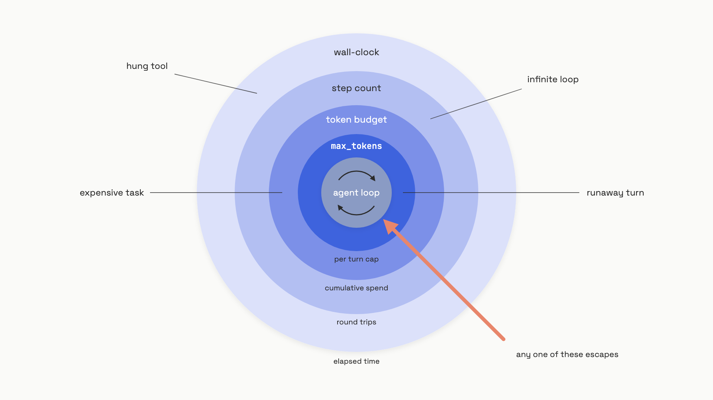
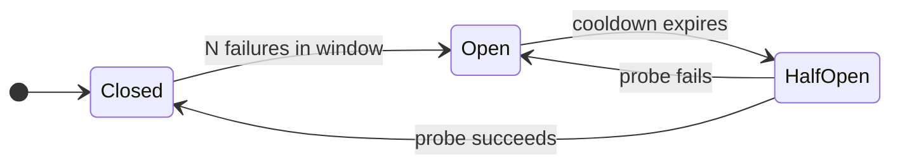

# Long-running agents

A coding agent gets a refactor task at 9:02 AM. It calls a search tool, gets a malformed response, and retries with the same arguments. The same error fires. The model retries again. Forty minutes later, an engineer notices the dashboard. The loop has spent $412 on identical failed tool calls and is still going.

The model didn't break. The harness around it did. Once an agent runs for more than a single request-response, the engineering problem stops being "can the model reason" and becomes "what stops it." This chapter is the runtime harness that keeps a multi-step agent under control: bounding cost and time, killing it from outside when it goes wrong, surviving a mid-task crash, replaying a trajectory to debug it, and choosing whether the client should hold the connection open or fire-and-forget. Each one is a separate engineering decision. Skip any of them and the failure mode finds you.

## Four budgets, not one

The most common production incident with agents is unbounded loops. A catalog of 63 confirmed budget-overrun incidents across 21 orchestration frameworks (2023 to 2026) found that almost all of them shared one feature: there was no hard limit, only the model's own judgment of when it was done.[^1]

You need four limits, not one, because they catch different failure classes:

- **Token budget (cumulative).** Caps total tokens spent across the whole run. Catches the case where the agent does a hundred cheap turns and silently spends $40.
- **`max_tokens` per turn.** The hard ceiling on a single API call. Catches the runaway turn that tries to write a 50,000-token report.
- **Step count.** Caps how many tool-call round trips the loop can run. Catches infinite loops of cheap, fast steps that don't trip the token budget.
- **Wall-clock timeout.** Kills the loop after a fixed duration regardless of tokens or steps. Catches the case where a non-LLM tool (subprocess, scraper, external API) hangs for an hour.


*Each budget catches a different failure class; you set all four, not one.*

There's a second decision under the token budget: who enforces it, the model or the harness? Anthropic's `task_budget` field (beta as of mid-2026, minimum 20,000 tokens, supported on Claude Opus 4.7+) is *advisory*. The platform injects a countdown into the conversation; Claude sees how much budget is left and self-regulates, finishing gracefully as the budget depletes.[^2] It's a soft cap. The model may overshoot a little if interrupting mid-action would be more disruptive than finishing.

That's not a hard cap. The hard cap is whatever your harness enforces between turns, before the next API call goes out:

```python
import time
from dataclasses import dataclass, field

@dataclass
class BudgetEnforcer:
    max_tokens: int
    max_steps: int
    max_wall_seconds: float
    _tokens: int = field(default=0, init=False)
    _steps: int = field(default=0, init=False)
    _start: float = field(default_factory=time.time, init=False)

    def record_turn(self, output_tokens: int) -> None:
        self._tokens += output_tokens
        self._steps += 1

    def check(self) -> str | None:
        if self._tokens >= self.max_tokens:
            return f"token_budget ({self._tokens}/{self.max_tokens})"
        if self._steps >= self.max_steps:
            return f"step_budget ({self._steps}/{self.max_steps})"
        if time.time() - self._start >= self.max_wall_seconds:
            return "wall_time"
        return None
```

You call `check()` after every turn, before the next API call. The harness owns the stop decision; the model is just one input to it. Use the advisory `task_budget` for graceful wind-down (the agent finishes its last action cleanly), and use the harness counter as the structural guarantee that nothing escapes.

## Kill switches and circuit breakers (orthogonal, both required)

Budgets handle the agent ending itself. Two other mechanisms handle stopping it from outside.

A **kill switch** is an external interrupt. An operator decides this run should stop, regardless of what the agent thinks. The cheapest implementation is a shared `asyncio.Event` checked between tool calls; the production version is a Redis key the harness polls each turn, or a container kill signal. The defining property is that the model can't override it. If the agent emits "I'd like to keep going," nothing happens; the harness checks the kill flag and aborts.

A **circuit breaker** is a state machine protecting a downstream call. It's not about one run; it's about the provider. When OpenAI is having an outage and 5 of the last 60 seconds of calls have failed, you don't want every active agent retrying three times each, holding worker threads for 14 seconds while the queue backs up.[^3] The breaker trips Open and fails fast for everyone until the provider recovers.



Defaults that work for LLM endpoints: 5 failures in a 60-second rolling window trips the breaker; 30 seconds of cooldown; one probe call to test recovery.[^3] When the breaker is open, retries don't fire at all. The point of the breaker is to *prevent* the retry storm, not survive it.

These two mechanisms aren't redundant. A kill switch fires for one run, by an operator, because that run is doing something wrong. A circuit breaker fires for all runs, automatically, because the provider is down. Build both. Then build a third kind of circuit breaker that watches the agent itself, not the provider: hash each tool call as `(name, args)` and abort if the same hash repeats within a sliding window of 3 to 5 turns. That's how you catch the retry-spiral pattern that opened this chapter, before the budget runs out the clock.

## Checkpointing isn't recovery

LangGraph, CrewAI, and Google ADK all advertise "fault tolerance" through checkpointers. The promise sounds like: if your process dies mid-task, just bring it back up and the agent picks up where it left off. The promise isn't quite what the code does.

What checkpointers actually guarantee is that *state is saved*. After every super-step (one tick of the graph, where one or more nodes execute), `PostgresSaver` writes the full graph state to a row keyed by `(thread_id, checkpoint_id)`. To resume, you call `graph.invoke(None, config={"configurable": {"thread_id": "..."}})` and LangGraph fetches the latest checkpoint and continues from the next scheduled node.[^4] The state is durable. The execution isn't.

Here's what that means in practice. Your worker process crashes at step 5 of 12. The checkpoint exists in Postgres. Nothing reads it. No watchdog notices the worker is gone. No supervisor calls `graph.invoke(None, config)` with the right `thread_id`. Until an operator (or a piece of glue code you wrote) does that explicitly, the task is dead with a perfectly preserved corpse.[^5]

This is the gap between *checkpointing* and *durable execution*. Durable execution engines (Temporal, Dapr Workflows) treat every `await` point as an automatic checkpoint AND register a durable reminder that re-fires the step if the worker dies. Recovery is automatic, not operator-driven. The trade is vendor lock-in and infrastructure complexity. The escalation rule:

- **`InMemorySaver`** for local development. Don't even think about it in production; it's gone the moment the process restarts.
- **`SqliteSaver`** for single-process staging.
- **`PostgresSaver` + manual recovery glue** for most production agents. Cheap, durable storage; you write the watchdog.
- **Durable execution engine** when the task is business-critical and a dropped worker is unacceptable, or when you need fan-out across many workers with distributed deduplication.

Then there's the durability mode itself. LangGraph exposes three:

| Mode | Persists | Use when |
|---|---|---|
| `"exit"` | On graph exit only | Pure read-only pipelines; throughput matters more than recovery |
| `"async"` | Asynchronously, mid-step | Long graphs where per-step cost matters more than last-step durability |
| `"sync"` | Synchronously before each step | Tools have non-idempotent side effects; correctness over throughput |

Default to `"sync"` if any of your tools write to external systems. The latency cost is real; the cost of running a non-idempotent tool twice is much worse.

That last sentence points at the trap that catches everyone exactly once: **resumption can duplicate side effects.** When you resume from a checkpoint at step 3, LangGraph re-runs the nodes after step 3, including tool-calling nodes. If your `send_email` tool isn't idempotent, the customer gets two emails. If your `create_invoice` tool isn't idempotent, you bill them twice. Either make every tool idempotent (a request ID the tool deduplicates on) or design the graph so each external call is a separate super-step that gets checkpointed individually. We covered the discipline in [tool design](./03-tool-design.md); checkpoint-and-resume is where that discipline gets tested under failure.

## Replay for debugging (not for retry)

The same checkpoint storage that powers resume also powers debugging. LangGraph calls it time travel. `graph.get_state_history(config)` returns every `StateSnapshot` for a thread, newest first; each snapshot has the full state, the next nodes to run, and a `step` counter. To rewind to step 3 and re-run forward, you grab that snapshot's config and call `graph.invoke(None, config=snapshot.config)`. To explore a counterfactual ("what if the agent had gotten correct tool output at step 3?"), you call `graph.update_state(snapshot.config, {"corrected_key": value})` first, then invoke. The trajectory forks at that checkpoint.[^4]

This is the right tool for "why did the agent take that path?" It is the wrong tool for production retry. Replaying past a checkpoint re-executes live LLM calls and live tool calls, with all the non-determinism (and side effects) those bring. True deterministic replay would require a recorded observation log where every LLM response and tool result is replayed from cache, not re-fetched. LangGraph doesn't do that by default; the steps before the chosen checkpoint are loaded from saved state, but every step *after* it runs against live APIs.

So the rule is: use time travel to inspect what happened. Use idempotent tools and `pending_writes` recovery (automatic in LangGraph when a node fails inside the same super-step as another) to handle production failures. Don't conflate the two.

One security note worth flagging. Checkpoint blobs are typically stored without integrity checks. A documented attack class injects a malicious tool result into a historical checkpoint; on resume, the agent treats the injection as ground truth and proceeds from a compromised state.[^6] The fix is straightforward: HMAC-sign checkpoint blobs with an operator-held secret, validate the signature on every load, and separate read and write access to the checkpoint store. Free if you do it on day one, painful to retrofit.

## Sync vs async: the 30-second rule

The last decision is whether the client holds the connection open until the agent finishes (synchronous), or submits the task and polls for completion later (asynchronous).

The default for short tasks is synchronous. It's what every framework demonstrates: `result = runner.run(agent, input)`, block, return. It's the right choice when the task takes under 30 seconds and the user is staring at a loading spinner.

That number isn't arbitrary. Almost every proxy and load balancer between your client and your agent process has an idle timeout in the 30 to 60 second range. AWS ALB's default is 60 seconds. Lambda's hard cap is 15 minutes. Mobile network connections drop on screen-off. A "5-minute coding task" served synchronously is a connection-drop in waiting at every hop in the chain.

The async pattern fixes that with a different shape:

```text
1. Client POSTs the task params.
2. Server enqueues, returns {task_id, status: "queued"}.
3. Worker dequeues and runs the agent loop.
4. Client polls GET /tasks/{id} until status is "completed" or "failed".
5. Client fetches the result.
```

OpenAI's Background mode implements this shape directly: pass `background=True` to `responses.create`, get back a response handle with `status: "in_progress"`, and poll via `responses.retrieve(resp_id)` or resume a dropped stream with `starting_after=cursor`. Result data is retained for about 10 minutes for polling.[^7] MCP's experimental Tasks primitive standardizes the same lifecycle (`working`, `input_required`, `completed`, `failed`, `cancelled`) across MCP servers.

Switch to async when:

- Task runtime exceeds proxy idle timeouts (over ~30 seconds).
- The client can't hold a connection (mobile background, serverless function with a 15-minute cap).
- You want parallel execution across many workers without blocking the submitter.
- A human review step happens mid-task.

The mistake to avoid is implementing async with a plain queue (Celery + Redis) and calling it done. A queue handles task submission and worker pickup; it does not handle worker death. If the worker crashes mid-task, the job is gone, even if you checkpointed. That's the same gap as section 4: queues give you fan-out, not durability. Reach for Temporal or Dapr Workflows when the task is critical-path enough that "it didn't finish, sorry" isn't an acceptable outcome.

Google Jules is the production proof point. It clones a GitHub repository into a fresh Cloud VM, runs the coding agent for minutes-to-tens-of-minutes, and returns a pull request when it's done. The client never holds the connection. The VM is the sandbox. The PR diff is the result. That architecture made multi-hour agentic coding viable, and it's why "spin up an isolated VM per task" is the dominant pattern for long-horizon coding agents in 2026.[^8]

## References

[^1]: Sajjad Khan, "Token Budgets: An Empirical Catalog of 63 LLM-Agent Budget-Overrun Incidents, with an Affine-Typed Rust Mitigation as a Case Study," arXiv:2606.04056, June 2026. https://arxiv.org/abs/2606.04056

[^2]: Anthropic, "Task budgets (beta)," Claude Developer Platform docs, accessed June 2026. https://platform.claude.com/docs/en/build-with-claude/task-budgets

[^3]: Ahmed Aleryani, "Circuit breakers for LLM calls: stop cascading failures," learnwithparam.com, March 2026. https://www.learnwithparam.com/blog/circuit-breakers-llm-calls-preventing-cascading-failures

[^4]: LangChain/LangGraph, "Checkpointers," LangGraph Python docs, accessed June 2026. https://docs.langchain.com/oss/python/langgraph/checkpointers

[^5]: Yaron Schneider, "Checkpoints Are Not Durable Execution: Why LangGraph, CrewAI, Google ADK and Others Fall Short for Production Agent Workflows," Diagrid blog, February 2026. https://www.diagrid.io/blog/checkpoints-are-not-durable-execution-why-langgraph-crewai-google-adk-and-others-fall-short-for-production-agent-workflows

[^6]: Shen et al., "Preventing Semantic Rollback Attacks in Agent Checkpoint-Restore," arXiv:2603.20625, March 2026. https://arxiv.org/abs/2603.20625

[^7]: OpenAI, "Background mode," OpenAI API docs, accessed June 2026. https://platform.openai.com/docs/guides/async-requests

[^8]: Google, "Jules: an autonomous AI coding agent," Google Blog, August 2025. https://blog.google/technology/google-labs/jules/
