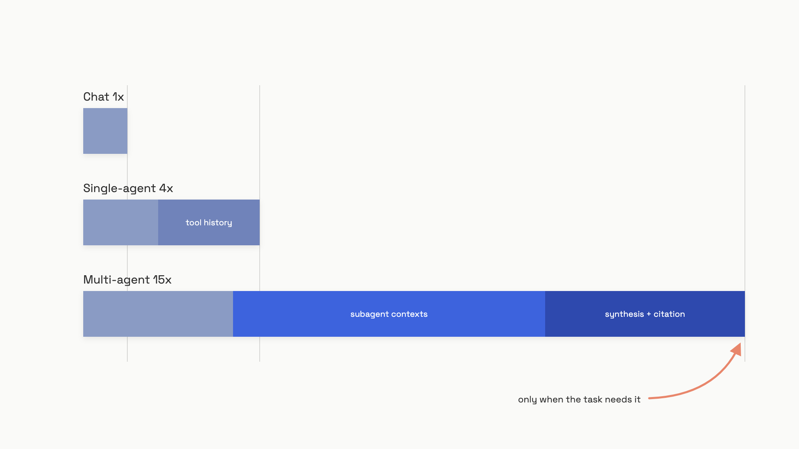

# Multi-agent systems

Anthropic's own production data, June 2025: a multi-agent system spends about 15x the tokens of a plain chat call. A single agent with tools spends about 4x.[^1] So the moment you spawn a second agent, you've made the same query roughly four times more expensive than running it through one agent, and roughly fifteen times more expensive than just asking the model. That multiplier is the entire reason this chapter exists. Most teams hear "multi-agent" and picture parallelism and emergent intelligence. The honest accounting is that you're paying for fifteen context windows where you used to pay for one, and you'd better have a reason.

There is a reason, sometimes. When the task genuinely needs more information than fits in one context window, and the subtasks are genuinely independent, multi-agent is the right call and nothing else works. When those conditions don't hold, you're buying complexity and bugs.

## The 15x stack

The multiplier is structural, not waste you can engineer away. Each subagent launch creates a fresh context window populated with the orchestrator's task description, any shared memory, and all tool results the subagent accumulates while running. When 3-5 subagents each pull in 40K-80K tokens of search results and return condensed summaries, then the orchestrator re-reads those summaries to synthesize a report, then a separate citation pass re-reads the source documents to verify claims, you've paid for roughly fifteen full context windows on one user query.


*The 15x isn't waste; it's what fifteen context windows cost.*

The compounding risk is worse than the baseline. A single misbehaving subagent that recursively spawns more subagents, or a tool that returns oversized results, can multiply that 15x by another 10x or more before any guardrail fires.[^1] Public bug reports document exactly this shape: a Claude Code defect let subagents recursively spawn children with no depth limit, burning 800,000+ tokens in one session with almost nothing to show for it.[^2] The takeaway is that the 15x is the floor, not the ceiling, and a multi-agent system without per-run cost limits is unbounded by design.

The flip side, which is also real: on Anthropic's internal research evaluation, a multi-agent setup using Claude Opus 4 as the lead and Claude Sonnet 4 as workers beat a single-agent Claude Opus 4 by 90.2%, and cut wall-clock time on complex queries by up to 90%.[^1] When the task is genuinely breadth-first, the math works. The question is which tasks are.

## When multi-agent earns its keep

Three conditions, all required:

1. **The information genuinely doesn't fit.** A single 200K-token context window can't hold "find every board member of every IT company in the S&P 500" (65+ companies, each with a separate filing trail). A single agent runs out of context before the task ends. This is the only condition that *forces* multi-agent; the others are about whether the cost is worth paying.
2. **Subtasks are provably independent.** Subtask B can't need subtask A's output as input within the same wave. If they're sequential, parallelism degrades to sequential execution with extra orchestration overhead. The test is brutal: write down each subtask's inputs without referring to the others' outputs. If you can't, the parallelism is a lie.
3. **The task value justifies 15x token cost.** If you're spending $0.03 on a chat call, multi-agent costs $0.45 per query. At a million queries that's $450K instead of $30K. Most product features can't carry that.

If any condition fails, single-agent is the right answer.[^3] Anthropic's own guidance, from "Building Effective Agents" (December 2024), is identical: "We recommend finding the simplest solution possible, and only increasing complexity when needed. This might mean not building agentic systems at all."[^3]

The clearest place all three conditions hold is breadth-first research. Many independent sources to consult, the union of which exceeds any single context window, against a query whose answer is worth real money. The clearest place they fail is most software engineering. Coding tasks involve fewer truly parallelizable subtasks, and the implicit decisions actions carry tend to conflict.[^1]

## Why parallel writes fail: the implicit-decisions problem

Cognition's June 2025 post "Don't Build Multi-Agents" articulates the failure mode with one example.[^4] Task: build a Flappy Bird clone. Two subagents work in parallel. Subagent 1 produces a Super Mario background; subagent 2 produces a bird that doesn't match the source game's aesthetic. Both subagents technically completed their assigned subtask. The combination is broken because neither agent saw the original framing fully enough to catch the implicit aesthetic constraint.

The mechanism is structural, not a prompt problem. When an orchestrator decomposes a task, it makes lossy decisions about what each subagent needs to know. It can't forward all of its accumulated context; that defeats the point of having separate context windows. Every piece omitted from a subagent's task description becomes a potential source of conflicting assumptions. Models haven't been trained in environments where cross-agent communication mattered, so they don't compensate for the gap; they just confidently make different choices that don't reconcile.[^4]

Anthropic hit the same failure in production. On a vague delegation like "research the semiconductor shortage", one of their subagents investigated the 2021 automotive chip crisis while two others duplicated work on 2025 supply chains.[^1] The fix was explicit task boundaries in the orchestrator's prompt: objectives, output format, list of tools, and explicit "don't research X, that's another subagent's job". Treat subagent task descriptions as API contracts, not natural-language requests.

The MAST taxonomy from NeurIPS 2025 quantifies the same picture across 1,600+ multi-agent execution traces from seven frameworks: 41.77% of failures are specification problems, 36.94% are coordination failures, 21.30% are verification gaps.[^6] Specification and coordination together are 79% of all failures, and both reduce to the same root: agents acting on assumptions that didn't survive decomposition.

The principle that drops out: **single-writer discipline**. One agent owns all writes for a given scope. Other agents contribute analysis, never changes. This is the rule everything else in the chapter is downstream of.

## Single-agent-with-subagents: the pattern that works today

Most production teams want multi-agent for the wrong reasons (parallelism, "intelligence") and the right pattern is narrower than they expect. Cognition's April 2026 update, ten months after their "don't build" post, documents three configurations that consistently work in production.[^5] All three share one property: writes stay single-threaded, and the additional agents contribute intelligence rather than actions.

**Generator-verifier loop.** A primary agent writes code; a separate review agent reads the diff from a clean context window and reports bugs. Cognition runs this on Devin PRs and reports an average of 2 bugs caught per PR, of which 58% are severe (logic errors, missing edge cases, security holes).[^5] The counterintuitive design choice is the clean context: the reviewer doesn't share history with the coder. Long contexts degrade attention quality (Cognition cites this as "context rot"), so a fresh-context reviewer reasons better about the diff than the coder could about its own work.[^5]

**Smart-friend escalation.** A cheaper primary model calls a more capable model as a tool when it hits something beyond its confidence. The smart friend only contributes analysis; the primary makes all changes. This works when both models are frontier-tier and breaks when the primary is significantly weaker, because a weak model can't reliably tell when to escalate.[^5]

**Manager-worker with scoped delegation.** A manager agent partitions a large task into non-overlapping scopes (different services, different modules with clear API boundaries) and spawns child agents per scope. Single-writer discipline holds because each child owns a different file set. This is the only pattern in the three where children do write; the constraint is that scopes don't overlap, so writes don't conflict.

The minimal version of the pattern looks like this:

```python
import anthropic

client = anthropic.Anthropic()

def query_codebase(question: str, codebase_path: str) -> str:
    """Read-only subagent. Answers questions, never writes."""
    response = client.messages.create(
        model="claude-sonnet-4-5",
        max_tokens=1024,
        system=(
            "You are a read-only code analysis agent. "
            "Answer questions about the codebase. Never propose changes."
        ),
        messages=[{"role": "user", "content": f"{codebase_path}\n\n{question}"}],
    )
    return response.content[0].text

def primary_agent(task: str, codebase_path: str) -> str:
    """Single writer. Calls the read-only subagent for context."""
    context = query_codebase(
        "What are the main interfaces and their contracts?", codebase_path
    )
    response = client.messages.create(
        model="claude-opus-4-5",
        max_tokens=4096,
        system="You are a senior engineer. Use the provided context to complete the task.",
        messages=[{"role": "user", "content": f"Task: {task}\nContext: {context}"}],
    )
    return response.content[0].text
```

The read-only subagent is structurally a tool call. It has no side effects, so it can't introduce conflicting decisions. The primary agent retains all write authority. You're paying maybe 2x chat tokens instead of 15x, and you've avoided the failure class that breaks parallel-writer swarms.

This is the default for coding agents. Reach for the orchestrator-worker pattern when, and only when, you've confirmed the three conditions for justified multi-agent and the task is breadth-first research, not software engineering.

## The orchestrator-worker pattern, when you do need it

Anthropic's Research feature is the canonical production example. A LeadResearcher (Claude Opus 4) decomposes the query into 3-5 parallel subtasks, dispatches them to Sonnet 4 subagents that each run searches in their own context window, then synthesizes the results.[^1] The skeleton:

```python
import anthropic
import asyncio

client = anthropic.AsyncAnthropic()

async def lead_plan(query: str) -> list[str]:
    response = await client.messages.create(
        model="claude-opus-4-5",
        max_tokens=1024,
        system=(
            "You are a lead researcher. Given a query, return a JSON list of "
            "independent subtasks. Each must be completable without knowledge "
            "of the others. Include explicit boundaries: what each subagent "
            "must NOT research because another subagent owns it."
        ),
        messages=[{"role": "user", "content": query}],
    )
    return parse_subtasks(response.content[0].text)

async def subagent(subtask: str) -> str:
    response = await client.messages.create(
        model="claude-sonnet-4-5",
        max_tokens=2048,
        system="Research subagent. Complete your assigned task. Do not exceed scope.",
        messages=[{"role": "user", "content": subtask}],
    )
    return response.content[0].text

async def run(query: str) -> str:
    subtasks = await lead_plan(query)
    findings = await asyncio.gather(*[subagent(s) for s in subtasks])
    synthesis = await client.messages.create(
        model="claude-opus-4-5",
        max_tokens=4096,
        system="Synthesize parallel findings into one cited report.",
        messages=[{"role": "user", "content": str(findings)}],
    )
    return synthesis.content[0].text
```

Three details matter more than they look. First, the lead is a more capable model than the workers; Opus orchestrates, Sonnet executes. Cost falls on the workers, judgment lives at the top. Second, the planning prompt explicitly demands boundaries between subtasks; vague delegation is the failure mode Anthropic burned through in early production. Third, the synthesis pass re-reads the subagent outputs, not the raw sources, which sets up the next problem.

The synthesis-from-summaries problem is what Anthropic calls game-of-telephone failure. By the time the report is drafted, source URLs have been condensed and re-summarized through several subagent returns, and the lead reconstructs citations from compressed memory.[^1] Their fix is a separate CitationAgent that reads both the original source documents and the final report to verify every claim. The general form of the fix: subagents write large outputs to external storage and pass lightweight references back to the orchestrator; the orchestrator reads primary artifacts during synthesis, not subagent summaries.

The other production trap is unbounded spend. Set `max_turns` and `max_budget_usd` on every agent invocation. Ban recursive subagent spawning unless you've explicitly designed for it; one early Anthropic agent spawned 50 subagents on a simple query before scaling rules were added.[^1] Anthropic's rule of thumb: 1 agent plus 3-10 tool calls for simple fact-finding, 10+ subagents only for genuinely complex research.[^1]

## A2A: awareness-level

Agent2Agent (A2A) is the open protocol for cross-organizational agent delegation. Google announced it April 2025, donated it to the Linux Foundation later that year, and by April 2026 it had 150+ supporting organizations and production deployments inside Microsoft Azure AI Foundry, Amazon Bedrock AgentCore Runtime, and Salesforce Agentforce 3.[^7] Current spec is v1.0, its first stable release, published March 2026.[^8]

Three things to know, and that's enough until you actually need it.

**A2A is not a competitor to MCP; it's the next layer up.** [Model Context Protocol (MCP)](04-mcp-model-context-protocol.md) standardizes how an agent talks to its tools (vertical, agent-to-tool). A2A standardizes how agents delegate work to each other (horizontal, agent-to-agent). The A2A documentation draws the line itself: MCP is the recommended protocol for connecting agents to tools and resources, A2A for connecting agents to other agents, and a full-featured agent is expected to speak both.[^8] Both protocols now sit under the Linux Foundation and are treated as paired standards.

**The mechanism is three primitives.** An Agent Card (JSON document at `/.well-known/agent-card.json`) advertises an agent's skills, endpoints, and auth schemes. A task envelope (JSON-RPC 2.0 over HTTPS) carries a unique task ID and skill invocation. A task lifecycle state machine (`submitted -> working -> input-required -> completed | failed | canceled | rejected`) controls multi-turn interaction.[^8] Calling agents never see the server agent's prompt, model, tools, or memory; both sides exchange tasks and results only.

**You need it when you cross organizational or framework boundaries.** A Salesforce agent calling a Microsoft Copilot agent. A specialist agent published for external consumption. Different teams owning different agents that must interoperate without tight coupling. Inside one codebase where every agent shares the same framework, A2A is overhead you don't need; direct function calls or MCP tool invocations are simpler and more controllable. The decision is not about the protocol's quality; it's about whether you have a wire-format problem.

The whole chapter compresses to one default and one exception. Default: a single agent, a single writer, with read-only subagents added freely because they're structurally just tool calls. Exception: orchestrator-worker with parallel subagents, taken only when the information genuinely exceeds one context window, the subtasks are provably independent, and the answer is worth fifteen context windows of tokens, with a budget cap on every spawn either way. [Agent archetypes](10-agent-archetypes.md) surveys how these patterns show up in the systems teams actually run; the orchestration infrastructure underneath them, queues, checkpointing, fan-out, lives at architecture scale in the HLD handbook's [multi-agent orchestration chapter](../../hld/part-9-ai-ml-system-design/04-multi-agent-orchestration.md).

## References

[^1]: Anthropic, "How we built our multi-agent research system," Anthropic Engineering, June 13, 2025. Source of the ~15x/~4x token multipliers, the 90.2% internal-eval result, the semiconductor-shortage delegation failure, the CitationAgent design, and the effort-scaling rules. https://www.anthropic.com/engineering/multi-agent-research-system
[^2]: "Uncontrolled Sub-Agent Recursive Loop Caused ~800k Token Consumption & Unexpected Charge," anthropics/claude-code, GitHub issue #69578, June 2026. https://github.com/anthropics/claude-code/issues/69578
[^3]: Anthropic, "Building Effective Agents," Anthropic Engineering, December 19, 2024. https://www.anthropic.com/engineering/building-effective-agents
[^4]: Walden Yan, "Don't Build Multi-Agents," Cognition blog, June 2025. https://cognition.ai/blog/dont-build-multi-agents
[^5]: Cognition, "Multi-Agent Systems in Production: Code Generation and Review at Scale," April 2026; production details (Devin Review's 2 bugs/PR average, 58% severity share, fresh-context reviewer design) as summarized in the ZenML LLMOps Database entry of the same name. https://www.zenml.io/llmops-database/multi-agent-systems-in-production-code-generation-and-review-at-scale
[^6]: Mert Cemri et al., "Why Do Multi-Agent LLM Systems Fail?", NeurIPS 2025; MAST taxonomy and the MAST-Data corpus of 1,600+ annotated traces across 7 frameworks. arXiv:2503.13657. https://arxiv.org/abs/2503.13657
[^7]: The Linux Foundation, "A2A Protocol Surpasses 150 Organizations, Lands in Major Cloud Platforms, and Sees Enterprise Production Use in First Year," press release, April 2026; Google, "Announcing the Agent2Agent Protocol (A2A)," Google for Developers blog, April 9, 2025. https://www.linuxfoundation.org/press/a2a-protocol-surpasses-150-organizations-lands-in-major-cloud-platforms-and-sees-enterprise-production-use-in-first-year
[^8]: A2A Project, "Agent2Agent (A2A) Protocol Specification," v1.0, and the "A2A and MCP" topic page, Linux Foundation, accessed August 2026. https://a2a-protocol.org/latest/specification/
