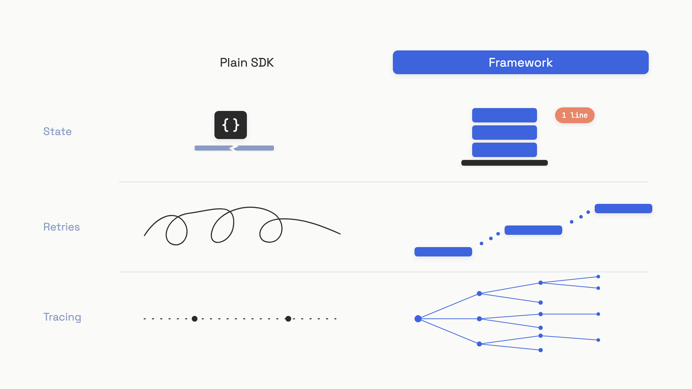
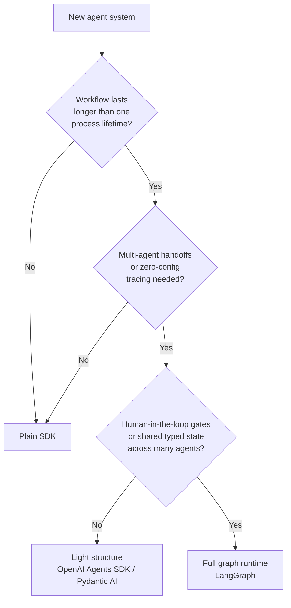

# Choosing a framework

Anthropic has worked with dozens of teams shipping agents in production. In December 2024 they wrote up what they found, and the headline sentence is the one most framework tutorials never quote: "the most successful implementations weren't using complex frameworks or specialized libraries. Instead, they were building with simple, composable patterns."[^1] That's the model provider that sells the API saying you probably don't need the wrapper around it.

The reason isn't that frameworks are bad. It's that the question almost everyone asks is the wrong one. "Should I use LangGraph or CrewAI" is the wrong question. The right one is: which of the three things a framework actually buys do I need, and would building them by hand be five lines or five hundred?

## What a framework actually buys

Strip the marketing away and a modern agent framework gives you three capabilities that recur in almost every product:

- **Durable state.** A typed schema for what the agent knows, plus a checkpointer that serializes that state to disk after every step so a process restart doesn't lose the run.
- **Retry and timeout policies per step.** Configurable backoff, jitter, exception filtering, and per-node deadlines that compose correctly with the rest of the runtime.
- **Tracing hooks.** Auto-collected spans for every model call, tool call, and handoff, exported to an observability backend with no instrumentation code in your business logic.

That's the list. Anything else most frameworks advertise (handoffs, guardrails, role-based agents) is sugar on top of those three or sugar on top of patterns you've already seen in [Workflow vs agent](00-workflow-vs-agent.md) and [The agent loop](02-the-agent-loop.md).

The trick is that each of these three is genuinely useful in some systems and pure overhead in others. Let's walk them.

### State that survives a restart

Without a framework, your agent's state is a Python dict you pass between functions. It's trivially debuggable and it dies the moment your pod restarts. For a single-shot tool-using assistant that finishes in twelve seconds, that's fine. For a multi-step research agent that runs for forty minutes and pauses on a human approval, it's catastrophic.

LangGraph's answer is a `TypedDict` schema plus a checkpointer. After every node executes, the runtime serializes the full state under a `(thread_id, checkpoint_id)` and stores it in SQLite, Postgres, or Redis. A restart re-enters at the next queued node with state intact.[^2] The OpenAI Agents SDK does the same job through Sessions backed by SQLAlchemy.[^3]

The failure mode here is so common it deserves a name. Teams ship on LangGraph's `InMemorySaver` (the dev default), watch a Kubernetes rolling restart kill twenty in-flight agent threads, and spend the next sprint reverse-engineering a Postgres schema under production pressure.[^4] The fix is one line at compile time. The damage is a week.

> [!WARNING]
> If you adopt a checkpointed framework, swap `InMemorySaver` for `PostgresSaver` or `SqliteSaver` before your first deploy, not after your first outage.

### Retries that don't bankrupt you

Hand-rolled retry logic is where most teams cut corners and most teams get burned. The standard mistakes: no jitter (so a hundred clients thunder back at the provider in lockstep), no exception filtering (so a `ValueError` from a bug gets retried three times), no budget cap, and no awareness of the difference between a 429 and a 500. We covered the basic shape in [Errors, retries, fallbacks](../part-2-working-with-model-apis/04-errors-retries-fallbacks.md).

LangGraph's `RetryPolicy` (langgraph >= 1.2, June 2026) bakes the right defaults into a per-node decorator: `max_attempts=3`, `initial_interval=0.5s`, `backoff_factor=2.0`, `max_interval=128s`, `jitter=True`, and a `default_retry_on` that excludes `ValueError`, `TypeError`, `OSError`, and other non-retryable exceptions.[^2] The composition with `TimeoutPolicy` works out of the box; the timeout clock resets on each new attempt.

What the framework can't save you from is the retry amplification problem. One team's bill went from $127/week to $47,000/week in eleven days because a framework's hidden retry layer had no budget circuit breaker.[^5] Three retries at each layer of a five-service chain produces 243 backend calls per original user request. The right framework gives you a clean retry surface; it does not absolve you of capping your spend.

### Tracing without instrumentation

The OpenAI Agents SDK turns on tracing by default. Every `Runner.run()` becomes a root trace; every model call, tool dispatch, and handoff becomes a typed span; everything ships to the OpenAI dashboard and to 25+ third-party processors (Langfuse, Arize, Datadog, MLflow) via a one-line `add_trace_processor()` call.[^3] LangGraph delegates the same job to LangSmith.

Doing this yourself with OpenTelemetry's GenAI semantic conventions is 30 to 100 lines of boilerplate per integration point.[^6] If you're already running an OTel pipeline and your team is comfortable with span instrumentation, that boilerplate is a one-time cost. If you're not, the framework's auto-tracing is the single biggest day-one win it offers. At architecture scale, the observability chapter in HLD Part 9 covers what to do with these traces once you have them.


*The three things a framework buys, and what you build by hand without one.*

## The three-tier decision

Three of the capabilities above might apply to your system. They might not. The decision tree that resolves this in practice has three tiers.

**Tier 1: Plain SDK.** A single LLM call, a linear prompt chain, simple branching, or a stateful conversation where in-memory state is sufficient. The whole workflow fits in one function. Tracebacks are Python tracebacks. Provider switches are a search-and-replace inside one file. Roughly the five workflow patterns from Anthropic's guide (prompt chaining, routing, parallelization, orchestrator-workers, evaluator-optimizer) land in 20 to 50 lines against the SDK directly.[^1]

**Tier 2: Light structure.** Multi-agent handoffs, type-safe structured outputs with validation retries, or zero-config tracing across multiple model providers. The OpenAI Agents SDK (released March 2025, MIT) and Pydantic AI (v1.0 released September 2025, MIT) sit here.[^3][^7] Neither asks you to define a state schema or compile a graph. You get the tracing and the structure without the topology overhead.

**Tier 3: Full graph runtime.** Durable state across process restarts, human-in-the-loop gates with indefinite latency, multiple agents sharing a typed state object, or conditional routing complex enough to want an explicit state machine. LangGraph lives here, with production deployments at Uber, JP Morgan, BlackRock, and others as of April 2026.[^8] The common thread across those deployments isn't that they're huge; it's that they're long-running and approval-gated. That's where the graph earns its weight.

The escalation conditions are the test, not vibes. Walk down the questions:



The default is the leftmost branch. Most teams should be one tier lower than they currently are.

## When no framework wins

There is a fourth case the decision tree doesn't capture: when the framework is the wrong shape for the problem at all, regardless of complexity. This is the case Anthropic's guide names explicitly and post-mortems keep confirming.

You want no framework when:

- The entire workflow has at most two branch points and would lose nothing by being plain Python.
- Model provider flexibility matters near-term. Framework-baked model objects (`langchain_openai.ChatOpenAI` inside a node body) make a provider switch a multi-day audit instead of a config change.
- Your debugging method is reading Python tracebacks. Frameworks route exceptions through internal Pregel/LCEL runtimes before reaching your code, and adding `print()` statements often means editing the framework's source.[^5]
- You need custom retry, timeout, or rate-limiting logic that fights the framework's model. Spelunking through five layers of abstraction to change a single backoff multiplier is a tax that compounds.

The numbers around this aren't kind to the "always reach for the framework" instinct. A 2026 engineering post-mortem aggregator reports that roughly 45% of developers who experiment with high-level orchestration frameworks never deploy them, and 23% remove them after shipping.[^5] One AI-powered browser testing team spent six months ripping out LangChain and described the result simply: "we no longer had to translate our requirements into LangChain-appropriate solutions. We could just code."[^5] MAFBench, a controlled study submitted to arXiv in February 2026, measured framework design choices alone increasing latency by over 100x and dropping coordination success from above 90% to below 30% in the worst configurations.[^9] The 100x is the worst case; the more typical tax is 2x to 5x. It's still a tax.

The cost is also structural. Framework-specific types (`StateGraph`, `MessagesState`, `CompiledGraph`) leak. Six months in, they appear in your API response schemas, your eval harness, and your business logic. Migration becomes a search-and-replace across every file that imports the framework, not a refactor of one orchestration module. ActiveWizards calls this "object leakage" and recommends an isolation audit before any migration: count the files outside the orchestration module that import framework types.[^4] More than two or three is a signal.

## What the plain SDK actually looks like

Before reaching for a framework, see what you're skipping. The full agent loop with operator limits, message accumulation, tool dispatch, and a hard budget cap fits in a single function:

```python
import json
from typing import Any

def run_agent(
    system_prompt: str,
    user_message: str,
    tools: list[dict],
    client: Any,
    max_turns: int = 10,
    max_budget_usd: float = 1.0,
) -> str:
    messages: list[dict] = [{"role": "user", "content": user_message}]
    cost = 0.0

    for turn in range(max_turns):
        if cost >= max_budget_usd:
            return f"Stopped: budget ${cost:.4f}"

        resp = client.messages.create(
            model="claude-opus-4-5",
            max_tokens=4096,
            system=system_prompt,
            tools=tools,
            messages=messages,
        )
        cost += resp.usage.input_tokens * 15e-6 + resp.usage.output_tokens * 75e-6

        if resp.stop_reason == "end_turn":
            return "\n".join(b.text for b in resp.content if hasattr(b, "text"))

        messages.append({"role": "assistant", "content": resp.content})
        results = [
            {"type": "tool_result", "tool_use_id": b.id,
             "content": json.dumps(dispatch(b.name, b.input))}
            for b in resp.content if b.type == "tool_use"
        ]
        messages.append({"role": "user", "content": results})

    return f"Stopped: max turns reached, cost ${cost:.4f}"
```

That's the whole agent. State is the messages list. Retries are whatever your HTTP client gives you (or the explicit policy from [Errors, retries, fallbacks](../part-2-working-with-model-apis/04-errors-retries-fallbacks.md)). Tracing is whatever your OTel setup already does. If your system needs more than this, you've earned the right to ask which tier to climb to.

The catalog of specific frameworks (LangGraph, OpenAI Agents SDK, Pydantic AI, CrewAI, and the rest), with their current versions, pricing, and feature matrices, lives on the handbook website's [frameworks reference page](https://ai-eng.handbook.academy/frameworks/) so it can change without invalidating this chapter. What lives here is the rule. Start at the bottom of the ladder. Climb one rung when a real production trigger forces you to. Most products never need the top rung, and the ones that do almost always knew it on day one.

## References

[^1]: Anthropic, "Building Effective Agents," December 19, 2024, https://anthropic.com/research/building-effective-agents
[^2]: LangChain, "Fault Tolerance" (LangGraph docs, langgraph >= 1.2), retrieved June 2026, https://docs.langchain.com/oss/python/langgraph/fault-tolerance
[^3]: OpenAI, "Tracing" (OpenAI Agents SDK docs), retrieved June 2026, https://openai.github.io/openai-agents-python/tracing/
[^4]: Igor Bobriakov (ActiveWizards), "LangGraph vs Direct API Orchestration: When the Framework Earns Its Weight," June 3, 2026, https://activewizards.com/blog/langgraph-vs-direct-api-orchestration-when-the-framework-earns-its-weight/
[^5]: Tian Pan, "When Your Agent Framework Becomes the Bug," April 17, 2026, https://tianpan.co/blog/2026-04-17-when-agent-framework-becomes-the-bug
[^6]: OpenTelemetry GenAI Semantic Conventions SIG, 2024, https://opentelemetry.io/docs/specs/semconv/gen-ai/
[^7]: Pydantic team, "A Predictable & Robust GenAI Framework" (Pydantic AI v1.0 announcement), September 2025, https://pydantic.dev/articles/pydantic-ai-v1
[^8]: Alphabold, "LangGraph Agents in Production," April 2026, https://www.alphabold.com/langgraph-agents-in-production/
[^9]: Orogat, Rostam, Mansour, "Understanding Multi-Agent LLM Frameworks: A Unified Benchmark and Experimental Analysis" (MAFBench), arXiv:2602.03128, submitted February 3, 2026, https://arxiv.org/abs/2602.03128
