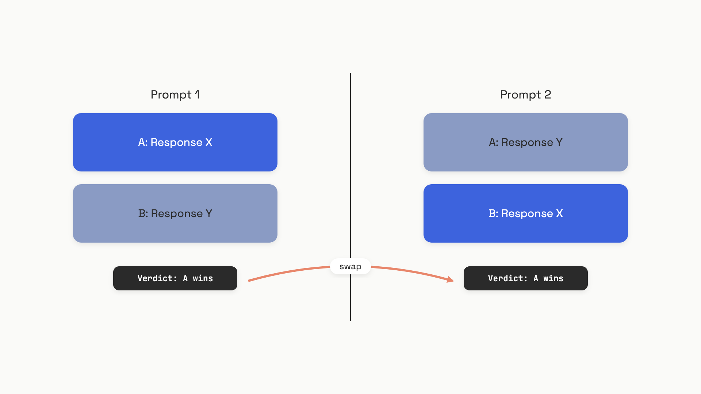

# Judge failure modes

In June 2023, the LMSYS team ran Claude-v1 as a pairwise judge on 80 same-quality answer pairs from MT-Bench. They asked the same question twice, swapping which answer was labeled "A" and which "B". Claude flipped its verdict 76% of the time. It picked whichever answer happened to be listed first.[^1]

That's the failure mode you're shipping if you wire up an [LLM-as-judge](./01-llm-as-judge.md) without thinking about it. The judge produces scores, the dashboard turns green, and the entire ranking is decided by prompt order. This chapter is the four documented biases that do this kind of damage, with the numbers, and the mitigations small enough to put in the prompt today.

## The four biases worth naming

Four classes of distortion have been measured carefully enough to act on:

- **Position bias.** The judge prefers the answer in a particular slot (usually first) regardless of content.
- **Length bias.** The judge rewards padding, repetition, or filler that adds zero new information.
- **Self-preference.** The judge favors outputs from its own model family.
- **Style bias.** The judge prefers markdown formatting (headers, bullets, bold) over identical content in plain prose.

These are not interchangeable. Length bias and style bias get conflated constantly, and the fixes are different: length you fight with an instruction or a regression; style you fight by normalizing formatting before the judge ever sees the responses. The magnitudes also disagree across model generations in ways you need to know about, so the right move is to measure each one against your own judge on your own data, not to copy a number from a 2023 paper.


*The same pair of responses, two prompts, opposite winners. The judge isn't reading content; it's anchoring on slot position.*

## Position bias

Zheng et al. measured this on a controlled test: 80 same-quality answer pairs from GPT-3.5, run through three judges twice with positions swapped. "Consistent" means the verdict agreed in both orderings.[^1]

| Judge (mid-2023) | Consistency | Biased toward first | Biased toward second |
|---|---|---|---|
| Claude-v1 | 23.8% | 75.0% | 0.0% |
| GPT-3.5 | 46.2% | 50.0% | 1.2% |
| GPT-4 | 65.0% | 30.0% | 5.0% |

Three things to notice. First, every judge had a preferred slot, and the preference was strong. Second, even GPT-4 disagreed with itself 35% of the time on the same pair when you flipped the order. Third, the bias is worst when the two answers are close in quality, which is exactly when you most need the judge to be right. On wider quality gaps (GPT-3.5 vs. LLaMA-13B), GPT-4 consistency rose to 98.8%; on subjective writing prompts at the same difficulty, it fell to 42%.[^1]

The 2026 update is real and matters. A systematic study of five frontier models from 2024-2025 (Gemini 2.5 Pro, Claude Sonnet 4, GPT-4o, Gemini 2.5 Flash, Llama 3.3-70B) on 400 MT-Bench instances measured a position-bias score of <=0.04 across all five, described as negligible.[^2] So position bias has shrunk dramatically in current frontier judges. It hasn't vanished in weaker or older models, and the 2026 study used natural pairs with quality variation, not the synthetic same-quality pairs where the bias hides hardest. The safe rule: assume non-trivial position bias on anything below GPT-4o or Claude Sonnet 4, and always measure before you trust.

### The fix: position-swap, then call ties

The conservative mitigation is two calls per comparison: judge in both orderings, only declare a winner if the verdicts agree.

```python
def judge_with_swap(judge_fn, question: str,
                    response_a: str, response_b: str) -> str:
    """Pairwise judge with position-swap debiasing.
    Calls the judge twice with A/B swapped; ties when verdicts disagree.
    """
    verdict_ab = judge_fn(question, response_a, response_b)
    verdict_ba = judge_fn(question, response_b, response_a)

    # In the swapped call, the model's "A" was actually our B, so flip it back.
    flip = {"A": "B", "B": "A", "tie": "tie"}
    verdict_ba_normalized = flip.get(verdict_ba, "tie")

    if verdict_ab == verdict_ba_normalized:
        return verdict_ab
    return "tie"
```

The cost is 2x API calls. The escalation is adding three few-shot judgment examples to the prompt, which lifted GPT-4 consistency from 65.0% to 77.5% in the original paper at roughly 4x prompt cost.[^1] You can skip swapping when you've measured your judge's bias on your own data and it's under ~5%, or when the quality gap between candidates is large enough that flipping won't change the answer. The cheapest production trick, used by Chatbot Arena, is to randomize A/B assignment per request: bias still exists per call, but it averages out across thousands of comparisons.[^1]

## Length bias

The simplest demonstration of length bias is the repetitive-list attack. Take a model answer that already contains a numbered list, paraphrase the items and append them to the bottom (zero new information added), and ask the judge to compare the padded version to the original. If the judge prefers the padded version, the attack succeeded.

In Zheng's 2023 test on 23 MT-Bench answers:

| Judge (mid-2023) | Failed the attack |
|---|---|
| Claude-v1 | 91.3% |
| GPT-3.5 | 91.3% |
| GPT-4 | 8.7% |

GPT-4 was already largely immune to this specific list attack in 2023.[^1] But length bias on general creative writing is broader than the list trick. Saito et al. ran a controlled study on 100 varied-length answers from the same generator and reported a verbosity-bias score of 0.328 for GPT-4 and 0.428 for GPT-3.5 (positive means the judge prefers verbose; range is -1 to +1).[^3] When humans preferred the shorter answer, GPT-4 disagreed with humans more often than when they preferred the longer one. The bias points in the direction that hurts your RLHF reward signal: padded answers train your generator to pad more.

Then it gets gameable at scale. Dubois et al. showed that prompting the same model to be maximally verbose moved its AlpacaEval win rate from 22.9% to 64.3%.[^4] Same model, same questions, more words; ranking transformed.

The 2025-era picture is more interesting. The same systematic study that flattened position bias found current frontier judges actively penalize filler: on expansion pairs (where padding was added to a complete answer), Claude Sonnet 4 scored -0.76 and GPT-4o scored -0.24, both preferring the shorter version.[^2] But on truncation pairs (where the longer answer was genuinely more complete), all five models correctly preferred the longer one with 0.92-1.00 accuracy. Modern judges seem to have learned the right rule: reward completeness, punish padding. They didn't have it three years ago.

### The fix: instruction first, regression second

For most production pipelines, the cheapest mitigation is one extra sentence in the judge prompt:

```python
LENGTH_NEUTRAL = (
    "Evaluate quality and accuracy only. "
    "Do NOT prefer a response simply because it is longer or shorter. "
    "If a longer response adds no information, treat it as equal or worse."
)
```

That last clause matters. "Don't prefer longer" is too easy for the judge to read as "prefer shorter", which flips you into a different bias. Naming the failure mode (padding without information) is what gets the right behavior on both expansion and truncation pairs.

When you control a benchmark scoring pipeline, the heavier-weight fix is length-controlled regression: fit a simple model with three terms (system, length, instruction difficulty) on a pool of comparisons and zero out the length term to recover counterfactual win rates. This is what AlpacaEval shipped as length-controlled AlpacaEval, and it raised Spearman correlation with Chatbot Arena from 0.94 to 0.98.[^4] It only works at benchmark scale (you need a pool of comparisons to fit), so don't reach for it in single-call pairwise pipelines.

## Self-preference

If you use GPT-4 as the judge for a system that itself runs on GPT-4, you have a problem. Zheng's 2023 paper saw GPT-4 give its own outputs about a 10% higher win rate than human judges did, and Claude-v1 give itself about 25% higher.[^1]

Panickssery et al. found the mechanism in 2024: the judge can literally recognize its own writing. Out of the box, GPT-4 distinguishes its own outputs from those of two other LLMs and humans with 73.5% pairwise accuracy. After fine-tuning on just 500 examples, GPT-3.5 and Llama-2 hit over 90% self-recognition. And there's a clean linear correlation across all those fine-tuning conditions: as self-recognition rises, self-preference rises with it. Control fine-tunes on length, vowel count, or readability didn't produce the same effect.[^5] Self-recognition is the cause, not a coincidence.

The summarization numbers from that paper:

| Evaluator | vs. own output | vs. other LLM | vs. human |
|---|---|---|---|
| GPT-4 (XSUM) | - | 0.638 | 0.710 |
| GPT-4 (CNN/DM) | - | 0.619 | 0.715 |
| GPT-3.5 (XSUM) | - | 0.514 | 0.581 |

A score above 0.5 means the evaluator prefers its own output. GPT-4 prefers itself over human-written summaries about 71% of the time on both datasets.[^5]

The implication for RLHF and reward modeling pipelines is the part that should worry you. If you generate training data with model M and score it with judge M, you're amplifying M's stylistic preferences over training steps. The loop converges on whatever M already likes about itself, and human preference drifts out of the picture. This connects directly to safety concerns covered in [Red-teaming](../part-9-security-and-governance/06-red-teaming.md): an adversary using the same model family as your judge can exploit the shared representation to game your scoring.

The 2026 study muddies the simple "models prefer themselves" rule. On model-origin pairs, Gemini Flash showed +0.56 self-preference but Gemini Pro showed -0.22 (preferring the other family's output), and GPT-4o strongly preferred Claude responses at -0.48.[^2] Self-preference in current models seems less about literal self-recognition and more about which training distribution the judge was last optimized against. Don't assume direction; measure.

### The fix: cross-family judging, or obfuscation

The default rule is straightforward: don't use a judge from the same model family as the system under evaluation. If you're evaluating a Claude-based product, use a GPT or Gemini judge. If you're evaluating a GPT-based product, use Claude. The cost difference is rarely the deciding factor; the validity of your scores is.

When you can't avoid it (your team standardizes on one provider, your eval rubric was written for one judge, your latency budget allows only one model), the second-best mitigation is authorship obfuscation: paraphrase or reformat candidate outputs to strip stylistic fingerprints before judging. This is harder than it sounds, because the paraphraser itself has style preferences, but it materially reduces the signal the judge uses for self-recognition.[^5]

## Style bias

This one didn't make the 2023 papers, and it's now the largest measurable bias in current frontier judges. Soumik (2026) tested five 2024-era models on controlled pairs where the same content was rendered once in markdown (headers, bullets, bold) and once in plain prose. Every model preferred the markdown version, with bias scores between 0.76 and 0.92 (1.0 means always picks markdown).[^2] Compare that to position bias under 0.04 in the same study. Style is now the dominant distortion, and almost no practitioner writing mentions it.

The production consequence is direct: on benchmarks like AlpacaEval or Chatbot Arena, models with markdown-heavy output styles can win on formatting alone. Worse, if you use a markdown-biased judge as a reward signal, you train your generator to emit headers and bullets where they don't belong. The user gets bullet-pointed answers to questions that wanted a sentence.

### The fix: normalize, then judge

Two options work, and the right one depends on whether your production system has a fixed format:

- **Normalize before judging.** Strip markdown from both candidates (or render both to markdown), then send to the judge. This removes the bias as a variable.
- **Instruct the judge.** Add a sentence: "Do not prefer responses based on formatting; evaluate content quality only." This helps but does not eliminate the bias on its own.

The combined fix from Soumik's S8 strategy (position-swap + chain-of-thought + explicit rubric) cut average style bias from 0.84 to 0.58 across the five tested models, a +11.2 percentage-point improvement on overall MT-Bench accuracy at p<0.0001.[^2] Chain-of-thought prompting (asking the judge to reason before verdicting) was the single intervention that helped or stayed neutral for every model on every benchmark in that study, at no extra API call. If you only do one thing, do that.

You can skip style normalization when your judge and your candidate system always emit the same format in production: markdown vs. markdown is fine, prose vs. prose is fine. The bias becomes a constant offset across both, not a distortion between them.

## Calibration: the operating loop

Every number above came from a paper. None of them came from your judge on your data, which is the only number that decides whether your eval pipeline is making good decisions. Calibration is the discipline of measuring that gap continuously, not once.

The cadence that holds up in production:

- **Weekly:** automated canary runs against a small fixed golden set with known human labels. Tracks judge drift caused by silent provider-side model updates.
- **Monthly:** human spot-checks on 50-100 stratified samples drawn from real production traffic, not the canary set. Stratify by judge verdict (equal A, B, and tie samples) so under-represented categories don't disappear.
- **Quarterly, or on red-flag drift:** full recalibration with subject-matter-expert annotation and Cohen's kappa between judge and human.[^6]

Cohen's kappa, not raw agreement, is the calibration metric. Raw agreement looks fine on imbalanced label distributions: if 90% of your real outputs are "A wins", a judge that always says "A" gets 90% raw agreement and a kappa near zero. The thresholds practitioners use: kappa below 0.60 with a stable rubric triggers recalibration; sustained kappa below 0.40 across multiple cycles means the judge or rubric needs a rebuild.[^6]

```python
from dataclasses import dataclass
from typing import Literal

Verdict = Literal["A", "B", "tie"]

@dataclass
class Sample:
    judge_verdict: Verdict
    human_verdict: Verdict | None = None

def cohen_kappa(samples: list[Sample]) -> float:
    """Cohen's kappa between judge and human verdicts.
    Returns 0.0 when no humans have reviewed yet.
    """
    labels = ["A", "B", "tie"]
    reviewed = [s for s in samples if s.human_verdict is not None]
    n = len(reviewed)
    if n == 0:
        return 0.0
    po = sum(s.judge_verdict == s.human_verdict for s in reviewed) / n
    pe = sum(
        (sum(s.judge_verdict == lbl for s in reviewed) / n)
        * (sum(s.human_verdict == lbl for s in reviewed) / n)
        for lbl in labels
    )
    return (po - pe) / (1 - pe) if pe < 1 else 0.0
```

Pin judge model versions where the provider allows it (OpenAI's dated snapshots, Anthropic's pinned versions). When pinning isn't available, the canary run is your only signal that a silent update has shifted the scoring distribution under you. A kappa decline across three cycles is the trigger to investigate; a single bad week is noise.

At architecture scale, [the eval and observability pipeline](../../hld/part-9-ai-ml-system-design/05-llm-evaluation-observability.md) covers how these calibration signals surface as production metrics, alert thresholds, and trace sampling.

## References

[^1]: Lianmin Zheng, Wei-Lin Chiang, Ying Sheng, et al., "Judging LLM-as-a-Judge with MT-Bench and Chatbot Arena", NeurIPS 2023 Datasets and Benchmarks Track, arXiv:2306.05685, June 2023, https://arxiv.org/abs/2306.05685
[^2]: Sadman Kabir Soumik, "Judging the Judges: A Systematic Evaluation of Bias Mitigation Strategies in LLM-as-a-Judge Pipelines", arXiv:2604.23178v1, experiments April-June 2025, https://arxiv.org/abs/2604.23178
[^3]: Keita Saito, Akifumi Wachi, Koki Wataoka, Youhei Akimoto, "Verbosity Bias in Preference Labeling by Large Language Models", arXiv:2310.10076, October 2023, https://arxiv.org/abs/2310.10076
[^4]: Yann Dubois, Balazs Galambosi, Percy Liang, Tatsunori B. Hashimoto, "Length-Controlled AlpacaEval: A Simple Way to Debias Automatic Evaluators", COLM 2024, arXiv:2404.04475, April 2024, https://arxiv.org/abs/2404.04475
[^5]: Arjun Panickssery, Samuel R. Bowman, Shi Feng, "LLM Evaluators Recognize and Favor Their Own Generations", ICML 2024, arXiv:2404.13076, April 2024, https://arxiv.org/abs/2404.13076
[^6]: Pratik Bhavsar, "How to Calibrate Your LLM Judge Using Human Annotations", Galileo Engineering Blog, May 15, 2026, https://galileo.ai/blog/calibrate-llm-judge-human-annotations
