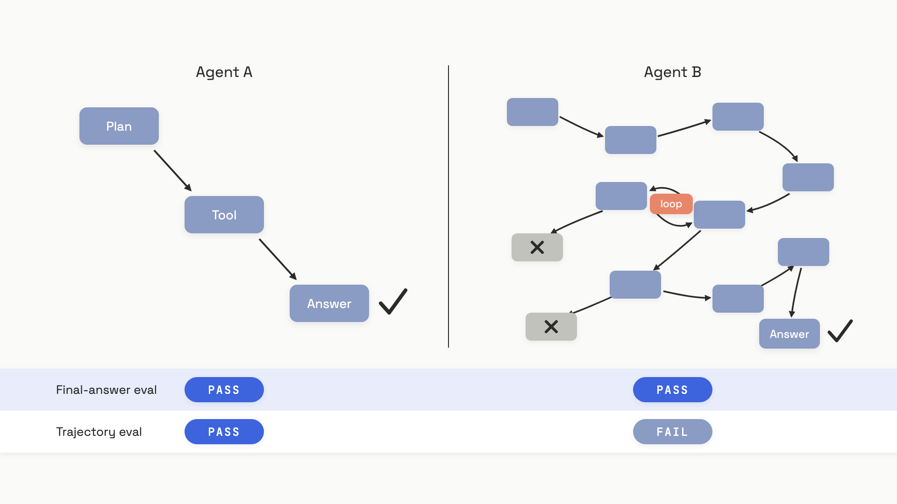

# Evaluating RAG and agents

In June 2024, Sierra Research published a number that made every agent team uncomfortable. Their tau-bench benchmark put GPT-4o through eight independent runs of the same retail customer-service task. On any single run, it succeeded about half the time. Across all eight runs, it succeeded a quarter of the time. That's a 60% drop in reliability from a model whose final-answer eval said it was passing.[^1]

The agent didn't get worse between runs. The eval was looking at the wrong thing.

End-to-end evaluation is what most teams ship with: send a query, grade the final answer, watch the dashboard. It's cheap, it covers the user's actual experience, and on a compound system it lies to you constantly. A retriever with 40% recall feeding a strong model can still produce 80% end-to-end answer quality, because the model fills the gap from parametric knowledge.[^2] An agent that takes a 12-step path through three dead ends to the right answer scores identically to one that takes 3 clean steps. Aggregate quality stays green; the bug stays invisible; you spend two weeks tuning the wrong component.

The fix is not a better end-to-end metric. It's evaluating the components separately and treating the system as a chain whose quality is bounded by its weakest link.

## The weakest-link debugging pattern

A RAG pipeline is a chain: retriever, reranker, generator. An agent is a longer chain: planner, tool selector, argument former, tool executor, response writer, sometimes a critic that loops back. End-to-end eval asks "did the last link produce the right output?" That's a useful smoke test, but when the answer is no, it tells you nothing about which link broke.

Component eval flips the order. You give each component its own metric, run it on its own labeled dataset, and read the scores top to bottom until you find the one that's red. Then you fix only that. The procedure is mechanical:

1. End-to-end eval flags a regression.
2. Run each component eval against a fixed labeled set.
3. Find the component whose score dropped or sits below threshold.
4. Fix that component, and only that component.
5. Re-run the component eval to confirm; re-run end-to-end to check for new regressions.

The order of step 2 matters. Run cheap deterministic metrics first, expensive LLM-judge metrics last. For a RAG system that means retrieval metrics (Recall@K, Precision@K, MRR) before generation metrics (faithfulness, answer relevance), because the retrieval ones are free and they catch the modal failure pattern. [Evaluating retrieval](../part-6-retrieval-augmented-generation/07-evaluating-retrieval.md) covers those metrics and the retrieval-vs-generation 2x2 in detail; this chapter assumes you've already wired them up and turns to the agent case, where the chain is longer and the failure modes multiply.

Barnett et al. studied three production RAG systems in 2024 and catalogued seven distinct failure points, from "document never indexed" to "LLM ignored the formatting instruction."[^2] Three of them live in retrieval (Recall@K spots them), three live in generation (faithfulness spots them), and one lives in the seam between (a chunk gets retrieved but lost during reranking or prompt assembly). Without component eval, all seven look identical from the outside: a wrong answer.

For agents, the chain is longer and the seams multiply. A tool-using agent can fail because it picked the wrong tool, called the right tool with the wrong arguments, called tools in the wrong order, looped, hit a context limit, or just gave up. Each one wants its own metric.

## Three metrics for the three things an agent can get wrong

Tool-using agents have three layers of correctness, and you need a metric at each layer to tell them apart.

**Tool-call accuracy** asks whether the agent invoked the right tools with the right arguments in the right order. Ragas's `ToolCallAccuracy` takes a reference list of expected tool calls and compares the agent's actual sequence. In strict mode (the default), the score is the argument-match rate multiplied by an order-match indicator: get the sequence wrong and the score collapses to zero, regardless of how many arguments matched. Flexible mode drops the order requirement, which is the right call for parallel-safe operations like fetching three independent records.[^3]

**Tool-call F1** is the same idea graded with partial credit. It treats the set of expected calls and the set of actual calls as labels and counts true positives (right tool, right args), false positives (extra calls), and false negatives (missing calls). Use F1 during early iteration when you want to see progress; use accuracy when the procedure has to be exact, like a database migration agent that must read before it writes.[^3]

**Agent goal accuracy** ignores the path entirely and asks one binary question: did the agent achieve what the user wanted? An LLM judge compares the final state of the conversation against a reference outcome and returns 0 or 1. Use it when the user doesn't care which APIs got called as long as the booking went through.[^3]

These three are complementary, not redundant. A booking agent can score 1.0 on goal accuracy ("the reservation exists") while scoring 0.5 on tool-call F1 because it tried two wrong APIs first. That's diagnostic gold: the procedure was inefficient, but the outcome held. The reverse is more dangerous and more common, which is what the next section is about.

Here's the minimal eval harness using Ragas:

```python
from ragas.metrics.collections import ToolCallAccuracy, AgentGoalAccuracyWithReference
from ragas.llms import llm_factory
from openai import AsyncOpenAI

async def eval_agent(conversation, reference_tool_calls, reference_goal):
    llm = llm_factory("gpt-4o-mini", client=AsyncOpenAI())
    tool_acc = ToolCallAccuracy()  # strict order by default
    goal_acc = AgentGoalAccuracyWithReference(llm=llm)

    tool_score = await tool_acc.ascore(
        user_input=conversation,
        reference_tool_calls=reference_tool_calls,
    )
    goal_score = await goal_acc.ascore(
        user_input=conversation,
        reference=reference_goal,
    )
    return {
        "tool_call_accuracy": tool_score.value,
        "agent_goal_accuracy": goal_score.value,
    }
```

`ToolCallAccuracy` is deterministic and costs nothing beyond labeling. `AgentGoalAccuracyWithReference` invokes an LLM judge and costs roughly half a cent per sample with `gpt-4o-mini`. Run the cheap one in CI on every PR; reserve the judge for nightly batches.

## Trajectory evaluation: the path matters, not just the destination

Two agents can produce identical final answers from radically different plans. One agent reads the query, picks the right tool, returns the answer. The other tries three wrong tools, gets confused, loops once, recovers, and stumbles into the same answer. Goal-accuracy gives them the same score. Tool-call accuracy catches the difference, but only if you have a reference trajectory to compare against.


*Final-answer eval can't distinguish a sound plan from a fragile one that succeeded by luck; trajectory eval can.*

This isn't an academic concern. The fragile path works on the run you're testing because the user's phrasing happened to nudge the agent toward recovery. Change one word in the prompt, change one tool's response time, run it again next Tuesday, and the same agent loops forever.

LangSmith frames trajectory evaluation along three axes that nest cleanly:[^4]

- **Final response.** Did the last message contain the right answer? This is the cheapest check and the one most teams already have.
- **Single step.** Take any step in the trajectory and grade it in isolation: was this LLM call's tool selection correct given what was known at that point? Useful for localizing where things went wrong.
- **Full trajectory.** Score the whole sequence against a reference. Exact match (same tools in same order) is the strict version; set match (same tools, any order) is the lenient version; an LLM judge over the whole trace is the flexible version when no rigid reference exists.

The cost ladder runs from free (final response, deterministic) to expensive (LLM-judge over the full trace, often two to five cents per sample). The reference-collection cost runs the same direction: writing down "the right answer was X" is cheap; writing down "the right plan was call_tool_A then call_tool_B with these arguments, and if that fails, fall back to..." is expensive. Most teams start with final response, add tool-call F1 when they need to debug, and add full trajectory eval only when reliability becomes the requirement.

## When pass@1 lies: pass^k and reliability

Most agent benchmarks report pass@1: run each task once, count successes. It's the optimistic metric, the one that makes demos look good. The pessimistic metric is pass^k: run each task k independent times, count cases where every single run succeeded. Reliability lives in the gap between them.

That gap is enormous. tau-bench measured GPT-4o on retail customer-service tasks: pass@1 around 50%, pass^8 around 25%.[^1] Across the twelve models Sierra tested in mid-2024, every single one degraded substantially as k grew. Anthropic's Claude 3.5 Sonnet, the strongest performer at pass@1, dropped to roughly the same neighborhood as the weakest models by pass^8.[^1] Reliability isn't free even when capability is high.

The mechanism is simple. An agent that succeeds 80% of the time on independent attempts succeeds on all eight attempts at 0.8^8, which is 17%. If your product gets eight different users asking the same kind of question every minute, that's the metric your support tickets are tracking. pass@1 is what your demo measures.

A practical pass^k loop in evaluation:

```python
async def pass_k_eval(agent, task, k=8):
    """Run the same task k independent times; report both metrics."""
    successes = 0
    for _ in range(k):
        result = await agent.run(task.input, fresh_state=True)
        if task.check(result):
            successes += 1
    return {
        "pass_at_k": 1 if successes >= 1 else 0,
        "pass_pow_k": 1 if successes == k else 0,
        "success_rate": successes / k,
    }
```

The "fresh_state=True" matters: every run must be independent (new conversation, no memory carried over) or the metric collapses back to pass@1 in disguise. Average pass^k across your eval set is the production-reliability number you actually want to track. AgentBench, evaluating 29 LLMs across eight environments at ICLR 2024, found that the dominant production failure mode wasn't "wrong answer" but "stuck in a loop": over 90% of timeout trajectories contained at least two responses with high lexical overlap in the last ten rounds.[^5] An agent that passes pass@1 by getting lucky on its first attempt will eventually get unlucky and loop, and pass^k is the metric that surfaces that risk before users do.

Component evals tell you which link is weakest. pass^k tells you whether the chain holds when you pull on it eight times in a row. Ship neither, and you're flying on the metric Sierra's data already showed will lie to you by a factor of two.

At architecture scale, [Eval and observability for AI systems](../../hld/part-9-ai-ml-system-design/05-llm-evaluation-observability.md) covers wiring these component metrics into live production traffic with traces, dashboards, and alerting.

## References

[^1]: Yao, Shinn, Razavi, Narasimhan, "tau-bench: A Benchmark for Tool-Agent-User Interaction in Real-World Domains," arXiv:2406.12045, June 2024. https://arxiv.org/abs/2406.12045
[^2]: Barnett, Kurniawan, Thudumu, Brannelly, Abdelrazek, "Seven Failure Points When Engineering a Retrieval Augmented Generation System," 3rd International Conference on AI Engineering, April 2024. https://arxiv.org/html/2401.05856v1
[^3]: Ragas documentation, "Agentic or Tool use metrics," docs.ragas.io, December 2025. https://docs.ragas.io/en/latest/concepts/metrics/available_metrics/agents/
[^4]: LangChain, "Application-specific evaluation approaches," LangSmith documentation, 2025. https://docs.langchain.com/langsmith/evaluation-approaches
[^5]: Liu et al., "AgentBench: Evaluating LLMs as Agents," ICLR 2024, Tsinghua University, arXiv:2308.03688. https://arxiv.org/html/2308.03688v3
