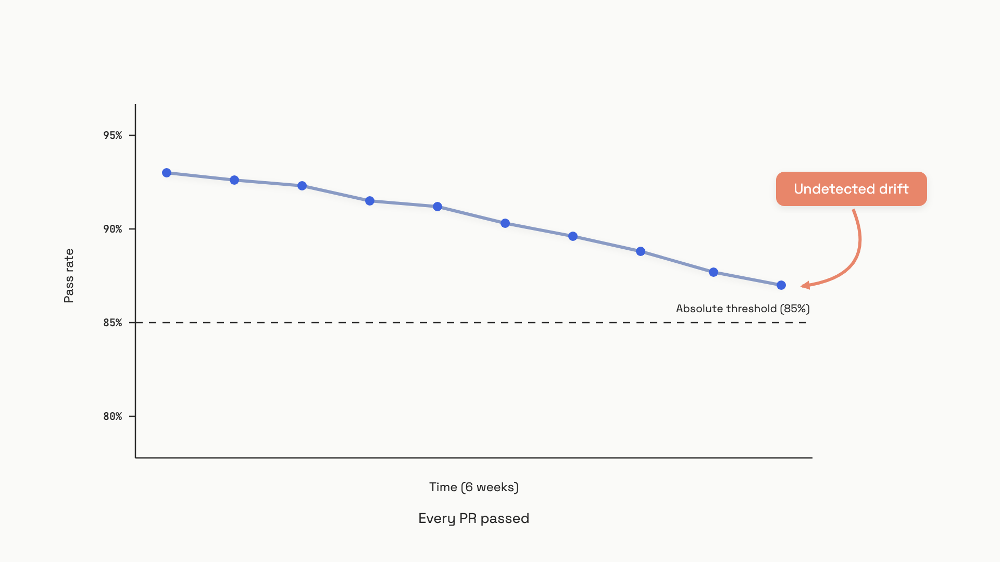

# Regression suites and CI gates

A team I'll keep anonymous shipped a prompt-CI gate they were proud of: pass rate had to clear 85% on a 200-case golden set, or the merge button stayed grey. Six weeks in, average quality had drifted from 0.93 to 0.87. Every PR cleared the bar. Every PR landed. No individual change owned the regression because none of them broke the rule.[^1]

That's the failure mode this chapter is about. A naive eval gate isn't quality control; it's quality theater. The fix is three parts that have to land together: a golden set sized to actually detect regressions, a gate that compares against your own baseline rather than a static floor, and enough statistical humility to handle outputs that are probabilistic by construction.

## Why the obvious threshold breaks

The 85% absolute threshold gate measures one thing: instantaneous position above a line. It doesn't measure direction. A PR that drops the score from 0.92 to 0.86 ships green. A PR that lifts the score from 0.80 to 0.84 fails the same gate. The team learns to ship if it clears the bar, which is a different rule than "maintain or improve quality."


*Six weeks of "passing" merges, six points of quality lost. Absolute threshold gates measure position, not direction; the change owner is everyone and no one.*

The honest gate is differential. You compare the PR branch's score on the golden set against the base branch's score on the same golden set, and you fail the build only when the delta is negative and large enough to be real signal rather than noise. That second clause matters more than it sounds, because the noise floor on a probabilistic test is much higher than engineers expect.

## Where determinism breaks (the BF16 surprise)

Most engineers assume `temperature=0` plus a fixed seed gets you a deterministic test. It doesn't, and the reason is hardware, not the model. BF16 floating-point arithmetic is non-associative: `(a+b)+c` and `a+(b+c)` can differ in the last bit. Change the GPU count, the batch size, or the GPU model, and the order of accumulations changes. When the top-1 and top-2 logits are close, that last bit flips token selection. The decoded text diverges. The eval flips.

Yuan et al. measured this directly across 12 hardware configurations on DeepSeek-R1-Distill-Qwen-7B at greedy decoding (temperature=0) on AIME'24. The standard deviation of accuracy across configs was 9.15% at BF16 precision; on MATH500, 99.6% of examples produced different outputs across configs. Switch the same model to FP32 inference and Std@Acc drops to 0%, with the divergence rate on MATH500 falling to 19.9%.[^2] The implication for CI is direct: if your provider runs BF16 inference, "I set temperature to zero" is not a flake-prevention strategy. It's a guess.

OpenAI's `seed` parameter, available since November 2023, is documented as best-effort, not guaranteed: the `system_fingerprint` field changes when the backend does, and reproducibility breaks with it.[^3] A separate study across five models reported accuracy variation up to 15% across runs at temperature=0.[^4] Treat seeds as one defense layer, not the answer.

That leaves two real tools. Run each case multiple times and aggregate. And widen the threshold to a confidence band that accepts the noise you can't kill.

## Multi-sample aggregation and confidence intervals

The minimum useful flake defense is running each golden case N times and aggregating. For CI, N=5 with a majority vote (binary pass/fail per sample) cuts spurious failures dramatically while costing roughly $0.15 to $0.50 extra per build at typical eval-model pricing. For nightly suites where cost matters less, N=16 or higher is reasonable. Song et al. recommend at least three samples for any safety-relevant evaluation; a single shot agrees with the multi-sample ground truth only 92.4 to 97.7% of the time depending on configuration.[^5]

The second tool is statistical: the gate has to know how big the noise actually is. The naive Central Limit Theorem confidence interval, `SE = sqrt(p*(1-p)/N)`, lies on small golden sets. Bowyer et al. (ICML 2025) demonstrate that for N below a few hundred, CLT intervals systematically underestimate uncertainty, producing error bars that are visually narrow and statistically wrong.[^6] At N=50 with an 80% pass rate, the actual Wilson 95% interval spans [0.67, 0.89], a 22-point window. If you compare a base score of 0.84 to a PR score of 0.80 on a 50-case set and call that a regression, you are reading noise as signal.

Use Wilson score intervals or Bayesian Beta-Bernoulli analysis instead. Both are one function call away in `scipy.stats.proportion_confint(..., method='wilson')`. The gate then becomes: fail only when the upper bound of the PR's confidence interval falls below your floor, or when a paired comparison against the base shows a statistically significant negative delta.

## A gate script that actually holds up

Here's the smallest script that does the job. It reads a results file (this shape matches `promptfoo`'s `results.json`, but any pass/fail counter works), computes a Wilson confidence interval, and fails the build only when the CI's upper bound drops below a tolerance-banded floor.

```python
import json
import sys
from scipy.stats import proportion_confint


def eval_gate(
    results_path: str,
    threshold: float = 0.80,
    tolerance: float = 0.05,
) -> int:
    """Wilson-CI gate: fail only when upper bound is below the noise floor."""
    with open(results_path) as f:
        data = json.load(f)

    stats = data["results"]["stats"]
    successes = stats["successes"]
    total = successes + stats["failures"]
    if total == 0:
        print("No results found", file=sys.stderr)
        return 1

    lo, hi = proportion_confint(successes, total, alpha=0.05, method="wilson")
    pass_rate = successes / total
    floor = threshold - tolerance

    print(f"Pass rate: {pass_rate:.2%}  Wilson 95% CI: [{lo:.2%}, {hi:.2%}]")
    print(f"Floor: {floor:.2%} (threshold {threshold:.2%}, tolerance {tolerance:.2%})")

    if hi < floor:
        print(f"GATE FAILED: upper CI {hi:.2%} below floor {floor:.2%}")
        return 1
    print("GATE PASSED")
    return 0


if __name__ == "__main__":
    sys.exit(eval_gate(sys.argv[1]))
```

The line that does the work is `if hi < floor`. A 50-case run that observes 79% pass rate has a Wilson upper bound around 88%; that's not strong enough evidence of regression to block a merge. A 200-case run that observes 70% has an upper bound around 76%; that's a real failure and the gate fires.

Wire it into GitHub Actions with a path filter, so the eval only runs when prompts or model config actually change:

```yaml
name: LLM Eval
on:
  pull_request:
    paths:
      - 'prompts/**'
      - 'promptfooconfig.yaml'
      - 'evals/**'
jobs:
  evaluate:
    runs-on: ubuntu-latest
    steps:
      - uses: actions/checkout@v4
      - uses: actions/setup-node@v4
        with: { node-version: '22' }
      - name: Run eval
        env:
          OPENAI_API_KEY: ${{ secrets.OPENAI_API_KEY }}
        run: npx promptfoo@latest eval -c promptfooconfig.yaml -o results.json
      - run: pip install scipy
      - run: python scripts/eval_gate.py results.json
```

That path filter is the difference between a CI bill of $20 a month and $20 a day. Running the eval on every CSS change is the easiest way to make the gate so expensive that someone disables it.

## Two tiers, not one

A single golden set can't be both fast enough for every PR and thorough enough to catch rare regressions. So you run two:

- **Fast tier (every PR that touches a prompt).** 50 to 200 cases, mostly deterministic [assertions](../part-4-eval-fundamentals/03-assertions-and-unit-tests.md) with a cheap judge model where assertions can't reach. Target: under three minutes, under $1 per build, blocks the merge button.
- **Nightly tier (full suite).** 500 to 2,000 cases including LLM-as-judge scoring, longer trajectories, harder edge cases. Posts to a dashboard, opens an issue on regressions, doesn't block the PR that triggered it.

Below 50 cases, the Wilson interval is so wide you can't reliably catch a five-point regression, so the fast tier loses its point. Above ~200, build time and cost push engineers toward "rerun until green" behavior, which is worse than no gate. The nightly tier exists for everything that doesn't fit those constraints.

There's a useful feedback loop between the two tiers. When a nightly run flags a real regression that the fast tier missed, that case gets promoted into the fast set. Production failures, surfaced through your tracing and feedback systems, do the same: each diagnosed bug becomes a labeled row in the golden set with a scorer that catches its specific pattern. Braintrust documents this explicitly as the regression-test pipeline; the same loop works against any platform or a flat JSON file in your repo.[^7]

## Golden set curation in one paragraph

The golden set is not a random sample of production traffic. It's a curated cross-section: cluster real traces into 5 to 15 behavior categories (refusals, structured extraction, multi-hop reasoning, near-boundary cases, business-critical paths), pick 5 to 20 representative cases per category, write deterministic assertions where possible, add LLM-as-judge scores only for properties that no assertion can measure. Keep the file in version control next to the application code, and bump the dataset version in the same PR that intentionally changes behavior. Hamel Husain and Shreya Shankar's evals course covers the curation craft in depth; the part-4 chapter on [your first eval set](../part-4-eval-fundamentals/02-your-first-eval-set.md) walks the minimal version.[^8]

One non-obvious risk: keep at least a private slice of the set out of public repos. Foundation models retrain on scraped GitHub. A golden set that lives in a public repo for two years has a non-trivial chance of leaking into the next model's pretraining data, and your scores will rise without your product getting better.

## Quarantine flaky tests, don't tolerate them

Even with multi-sample voting and Wilson gates, a few golden cases will flake unpredictably: ambiguous ground truth, an LLM-judge that disagrees with itself, an edge case where the model genuinely gives correct but differently-phrased answers each time. Track per-case flake rate. Any case that fails more than 10% of runs on unchanged code goes to the nightly suite while you diagnose the cause; promote it back to the PR gate only after two weeks below 5%.

The reason this matters is cultural, not statistical. Two flaky tests is enough to teach a team that the failed-check button means "click rerun" rather than "read the diff." Once that habit forms, the gate is theater again and you're back where the chapter started.

At architecture scale, [the eval and observability pipeline](../../hld/part-9-ai-ml-system-design/05-llm-evaluation-observability.md) covers how regression-suite signals feed into production alerting, sampling policies, and the long-running dashboards your nightly results land in.

## References

[^1]: tianpan.co, "Eval Differential as Branch Protection," engineering blog, April 28, 2026, https://tianpan.co/blog/2026-04-28-eval-differential-branch-protection-score-diff-not-floor
[^2]: Jiayi Yuan, Hao Li, et al., "Understanding and Mitigating Numerical Sources of Nondeterminism in LLM Inference," arXiv 2506.09501, May 2026, https://arxiv.org/abs/2506.09501
[^3]: OpenAI, "Reproducible outputs," OpenAI API Reference, accessed June 2026, https://platform.openai.com/docs/guides/text-generation#reproducible-outputs
[^4]: Label Studio, "How to handle non-determinism in agent evaluation," LabelStudio Learning Center, June 2026, https://labelstud.io/learningcenter/how-to-handle-non-determinism-in-agent-evaluation
[^5]: Yifan Song, Guoyin Wang, Sujian Li, Bill Yuchen Lin, "The Good, The Bad, and The Greedy: Evaluation of LLMs Should Not Ignore Non-Determinism," arXiv 2407.10457, July 2024, https://arxiv.org/abs/2407.10457
[^6]: Sam Bowyer, Laurence Aitchison, Desi R. Ivanova, "Position: Don't use the CLT in LLM evals with fewer than a few hundred datapoints," ICML 2025, arXiv 2503.01747, https://arxiv.org/abs/2503.01747
[^7]: Braintrust, "How to turn LLM production failures into regression tests," Braintrust engineering blog, May 2026, https://www.braintrust.dev/articles/turn-llm-production-failures-into-regression-tests
[^8]: Hamel Husain and Shreya Shankar, "AI Evals FAQ: What are LLM Evals?", AI Evals Course materials, 2025-2026, https://hamel.dev/blog/posts/evals-faq/what-are-llm-evals.html

