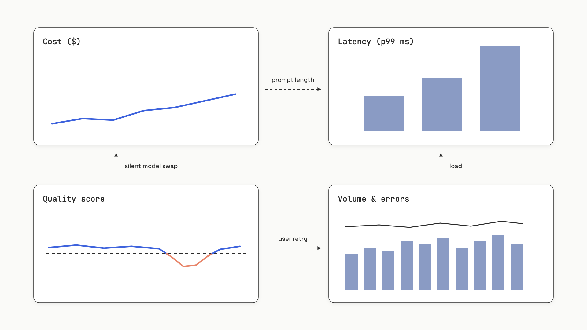

# Monitoring and dashboards

Your APM dashboard is green. CPU is flat. p99 latency hasn't moved. Error rate is zero. And your product is silently broken: faithfulness scores have drifted from 0.84 down to 0.71 over the last week, your daily OpenAI bill has tripled because someone's prompt template grew a 4,000-token system message, and three customers have churned without filing a ticket. None of those failures register as "an incident" on the dashboard a backend engineer would build by reflex.

That gap is the entire reason this chapter exists. LLM applications fail along axes that traditional infrastructure monitoring can't see, and the fix is a four-pane dashboard plus three classes of alert that most teams learn the hard way.

## The four panes that matter

A backend service has roughly two failure modes a dashboard needs to surface: it's slow, or it's throwing errors. An LLM application has four, and they need to live on the same screen, because diagnosis comes from how they move *together*.


*Cost, latency, quality, and volume on one screen. The diagnostic value is in the cross-pane patterns: cost up with latency stable usually means a longer prompt; quality down with cost stable usually means a silent provider model swap.*

**Cost** is total USD spend per time window, broken down by model, feature, prompt template, and (where it matters) per user or tenant. The math is `input_tokens * price_in + output_tokens * price_out`, summed at the trace level so that a RAG pipeline's embedding spend rolls up alongside the generation spend. Langfuse computes this automatically for major providers; LangSmith documents how to submit custom costs via metadata for unsupported ones.[^1][^2]

**Latency** is p50, p95, and p99 of full trace duration *and* time-to-first-token (TTFT) for streaming endpoints. p50 alone lies. LLM APIs have heavy tails because output length varies by an order of magnitude per request; p99 and p50 routinely sit a 5x apart at the same load. Use p99 as your SLO, p95 as your alert threshold, and capture TTFT in the OpenTelemetry attribute `gen_ai.response.time_to_first_chunk`.[^3]

**Quality** is the rolling mean of an automated judge score (faithfulness, relevance, or task pass-rate) applied to a sample of production traces. You can't run a judge on every call without doubling your bill, so 5-10% sampling is the working default. The aggregation window has to be wide enough to be meaningful: a 5-minute p99 needs at least 100 traces in the bucket, so low-volume products should widen to one hour.

**Volume and usage** is request count, active users, error breakdown by type (rate limit, timeout, content filter), and the distribution of `finish_reason`. That last one is underrated: if `finish_reason: length` starts spiking, your context window is exhausting and answers are getting truncated mid-sentence, and no other signal will tell you.

The single-screen rule isn't aesthetic. It's diagnostic. A latency spike that coincides with a quality drop and stable cost almost always means a model routing change. A cost spike with no latency change almost always means a prompt got longer. A quality drop with stable cost and stable latency means the provider quietly swapped your `gpt-4o` checkpoint underneath you. None of those incidents are visible from any single panel.

## The three alerts every LLM app needs

Dashboards are for humans browsing. Alerts are for humans being woken up. Three categories cover the failures worth paging on; everything else is a Slack notification at most.

**Cost-spike alerts** fire when total spend in a rolling window exceeds a baseline by some percentage. LangSmith's Cost alert sums `input_tokens * rate + output_tokens * rate` over a 5- or 15-minute window and routes to PagerDuty, Dynatrace, or any webhook.[^4] Langfuse offers the same shape via webhooks on its Core plan and above. The two failure modes you're catching: a runaway agent loop burning a daily budget in fifteen minutes, and a prompt template that quietly grew a 4,000-token preamble in someone's PR. Five-to-fifteen-minute windows catch the loop; an hourly rollup catches the slow drift.

**Quality-regression alerts** fire when a rolling judge score drops relative to a baseline. The design choice that matters is *absolute vs relative threshold*. An absolute alert ("faithfulness < 0.7") is easy to reason about at 3 a.m., but it fires forever when one query category that's normally at 0.68 takes a temporary traffic share, and the team learns to ignore it. A relative alert ("current score is more than two standard deviations below the 7-day rolling mean") survives traffic mix shifts, at the cost of needing more historical data and being harder to explain on-call. Default to relative; use absolute only for hard floors below which the product is unshippable.

**Drift alerts** are the hardest. Input drift means user queries have shifted distribution: a new topic cluster appears, a marketing campaign sends a different population, a competitor's outage routes their traffic to you. Output drift means responses changed without a deployment: longer answers, different vocabulary, a new tone. Neither maps cleanly onto a threshold. Production approaches embed queries with a fixed model and run PSI (Population Stability Index) or a KS test on the embedding distribution over rolling windows; cheaper proxies track output token-count distribution as a verbosity signal. Arize Phoenix has embedding-drift visualization built in, which is the one feature that genuinely separates it from the rest of the field.

Here's the platform-agnostic logic, the thing every observability vendor implements under different names:

```python
"""Cost-spike, latency-spike, and quality-regression alerts."""
from dataclasses import dataclass
import statistics

@dataclass
class TraceWindow:
    cost_usd: float
    latency_p99_ms: float
    quality_scores: list[float]

def check_alerts(
    current: TraceWindow,
    baseline: TraceWindow,
    cost_spike_pct: float = 0.25,
    quality_drop_abs: float = 0.05,
    latency_spike_pct: float = 0.50,
) -> list[str]:
    alerts = []
    if current.cost_usd > baseline.cost_usd * (1 + cost_spike_pct):
        alerts.append(f"COST_SPIKE: {current.cost_usd:.2f} vs {baseline.cost_usd:.2f}")
    if current.latency_p99_ms > baseline.latency_p99_ms * (1 + latency_spike_pct):
        alerts.append(f"LATENCY_P99_SPIKE: {current.latency_p99_ms} ms")
    if current.quality_scores:
        cur_q = statistics.mean(current.quality_scores)
        base_q = statistics.mean(baseline.quality_scores)
        if cur_q < base_q - quality_drop_abs:
            alerts.append(f"QUALITY_REGRESSION: {cur_q:.3f} vs {base_q:.3f}")
    return alerts
```

The thresholds (25% cost, 50% latency, 0.05 quality drop) are starting points, not industry standards. Every team tunes them against their own traffic over the first month, and LangSmith's own docs say so plainly: start broad, refine on observed patterns, treat alert fatigue as a real failure mode.[^4] At architecture scale, [Eval & observability for AI systems](../../hld/part-9-ai-ml-system-design/05-llm-evaluation-observability.md) covers how these thresholds connect to SLOs and error budgets; the math is the same burn-rate-over-rolling-window pattern you'd apply to any service.

> [!WARNING]
> **Pin your model versions, or add a "response model changed" alert.** OpenAI and Anthropic push silent updates to model aliases like `gpt-4o` and `claude-sonnet-4-5` without bumping the version string. Cost stays flat. Latency stays flat. Quality moves. Standard threshold alerts won't fire. Either pin to a dated checkpoint (`gpt-4o-2024-11-20`) or alert whenever the `gen_ai.response.model` attribute changes from the last N calls.

## The platform landscape, in one decision frame

Four vendors dominate LLM observability in 2026: LangSmith, Langfuse, Arize Phoenix, and Braintrust. Their feature lists are 80% overlapping. The differences that matter for a buy decision are licensing, OTel-friendliness, retention, and per-seat vs flat pricing. Here's the comparison that actually drives the choice:

| Platform | License / hosting | OTel ingest | Pricing (cloud) | Retention default | Strongest at |
|---|---|---|---|---|---|
| **Langfuse** | MIT, free self-host | First-class OTLP | Core $29/mo flat, unlimited users; Pro $199/mo | 90 days (Core) | OSS observability, eval workflows, no per-seat tax |
| **LangSmith** | Proprietary; self-host Enterprise-only | Accepts OTLP, native SDK is proprietary | $39/seat/mo (Plus) + trace overage | 14 days base | LangChain/LangGraph integration, autonomous diagnosis (Engine) |
| **Phoenix (Arize)** | ELv2, free self-host (no SaaS resale) | Native, OpenInference convention | Free OSS; Arize AX SaaS from $50/mo | 15-30 days (AX) | Embedding-drift visualization, air-gapped deploys |
| **Braintrust** | Proprietary, no self-host | Via OTLP exporter | Pro $249/mo | 14-30 days | Eval automation, "loop agent" prompt iteration |

All numbers are as of June 2026 and change monthly in this market; verify on vendor pricing pages before signing.[^1][^4][^5][^6]

The decision rule is unromantic.

**Default to Langfuse Cloud Core ($29/month) unless you already live in LangChain.** It's MIT-licensed, OTel-first, has no per-seat tax (a 10-person team pays the same $29 as a solo dev), gives you 90-day retention, and offers a free self-host migration path if compliance later forces it. As of January 2026 it's also part of ClickHouse, which gives the trace store a credible long-term roadmap.[^7] The Pro tier at $199/month is the compliance wrapper (SOC 2, 3-year retention, higher ingestion ceiling).

**Pick LangSmith if you're already using LangChain or LangGraph heavily**, or if you specifically want the Engine feature: an autonomous loop that runs every 6 hours, clusters production failures, proposes prompt fixes, and generates evaluators. That's worth real money for teams with high traffic; for a 10-person team paying $390/month before trace overages it's a meaningful jump from Langfuse's $29 flat. Self-hosting LangSmith requires an Enterprise contract; if data residency is a hard requirement and budget isn't, that's the path.[^5]

**Pick Phoenix self-hosted if data can't leave your VPC** or you specifically need embedding-drift dashboards. The Elastic License 2.0 lets you run it free with no feature gates; the catch is ELv2 is not OSI-approved and prohibits offering Phoenix as a hosted commercial service. Teams with strict OSI-only policies should stick with Langfuse's MIT license.[^8]

**Pick Braintrust as a complement, not a primary store.** Its strength is eval automation: closed-loop LLM-as-judge at scale, the "loop agent" that autonomously iterates on prompts. Its weakness for monitoring is retention: 14 days on Starter, 30 days on Pro. That's not enough for the regression analysis you'll want to do 45 days after an incident. Use it alongside something with longer retention.[^6]

A note on self-hosting more generally. The break-even point where running your own observability stack beats cloud overage fees is roughly 5 million traces per month, and even then the operations burden is real: you're now on call for ClickHouse upgrades on top of your application. Default to cloud unless compliance forces your hand or your trace volume is genuinely large.

## Sampling, the silent killer of monitoring

One implementation detail will undo all of the above if you get it wrong. At 100,000 requests per day, full trace data is several GB daily, and you can't afford to store it indefinitely. Most teams reach for sampling, and most teams reach for the wrong kind.

Head-based sampling makes the keep/drop decision when the trace starts, before the model has even responded. It's cheap and easy. It also systematically drops the rare, complex, slow traces, which are exactly the ones where quality regressions hide. Quality alerts fire late or not at all; manual inspection of your sampled traces looks healthy; meanwhile the long tail is broken.

Tail-based sampling buffers spans until the root span finishes, then decides. More expensive, but you can keep 100% of error traces and 10% of successful ones, which is closer to what you want. The right pattern, when your platform supports it, is *score-triggered* sampling: store all spans with metadata, but only persist the full prompt/completion content for traces where the eval score is below a threshold or `finish_reason` is unexpected. Langfuse's client-side masking and score-gated export does this; for other platforms you assemble it from sampling rules plus retention tags.

The corollary is retention strategy. LangSmith's 14-day default on base traces is a cliff: 45 days after an incident, the trace you need to diagnose it is gone. Tag important traces (customer-reported issues, A/B test samples, low-judge-score outliers) as extended-retention from creation, not retroactively, because retroactive promotion of a deleted trace doesn't work.

## What this looks like wired up

The instrumentation foundation sitting under all four platforms is OpenTelemetry's GenAI semantic conventions, at version 1.41.1 with "Development" stability status as of June 2026.[^3] If you emit standard `gen_ai.*` attributes from your code, you can swap backends by changing an OTLP endpoint, which is the lock-in escape every team should be planning for:

```python
"""Emit OTel GenAI spans to any OTLP backend."""
import os
from opentelemetry import trace
from opentelemetry.sdk.trace import TracerProvider
from opentelemetry.sdk.trace.export import BatchSpanProcessor
from opentelemetry.exporter.otlp.proto.http.trace_exporter import OTLPSpanExporter

provider = TracerProvider()
provider.add_span_processor(BatchSpanProcessor(OTLPSpanExporter(
    endpoint=os.environ["OTEL_EXPORTER_OTLP_ENDPOINT"],
    headers={"Authorization": f"Bearer {os.environ['PLATFORM_API_KEY']}"},
)))
trace.set_tracer_provider(provider)
tracer = trace.get_tracer("ai-app")

with tracer.start_as_current_span("chat gpt-4o") as span:
    span.set_attribute("gen_ai.operation.name", "chat")
    span.set_attribute("gen_ai.provider.name", "openai")
    span.set_attribute("gen_ai.request.model", "gpt-4o")
    span.set_attribute("gen_ai.usage.input_tokens", 120)
    span.set_attribute("gen_ai.usage.output_tokens", 85)
```

Swap the endpoint to retarget: `https://cloud.langfuse.com/api/public/otel` for Langfuse, `http://localhost:6006/v1/traces` for self-hosted Phoenix, `https://api.smith.langchain.com/otel/v1/traces` for LangSmith. The five attributes above feed every panel on the dashboard: token counts drive cost, span duration drives latency, model name drives the response-model-change alert, operation name drives the per-feature breakdown.

The semconv is at "Development" stability, which means attribute names can still change between versions. Pin your OTel SDK explicitly, and when you upgrade, use the `OTEL_SEMCONV_STABILITY_OPT_IN=gen_ai_latest_experimental` env var to migrate dashboard queries atomically rather than discovering a panel went blank a week later.[^3]

Build the dashboard before you ship to production, not after the first incident. The four panes, the three alerts, the response-model pin, and a sane retention policy on the traces you'll need 45 days from now: that's the working monitoring setup for an LLM application in 2026. Everything else is platform-specific surface area.

## References

[^1]: Langfuse, "Pricing," Langfuse Cloud pricing page, June 2026, https://langfuse.com/pricing
[^2]: LangChain, "Cost tracking," LangSmith documentation, https://docs.langchain.com/langsmith/cost-tracking
[^3]: OpenTelemetry Authors, "Semantic conventions for generative client AI spans," OpenTelemetry semconv 1.41.1, June 2026, https://opentelemetry.io/docs/specs/semconv/gen-ai/gen-ai-spans/
[^4]: LangChain, "Alerts in LangSmith," LangSmith documentation, June 2026, https://docs.langchain.com/langsmith/alerts-webhook
[^5]: LangChain, "Pricing," LangSmith pricing page, June 2026, https://www.langchain.com/pricing-langsmith
[^6]: Braintrust Data Inc., "Pricing," Braintrust pricing page, June 2026, https://www.braintrust.dev/pricing
[^7]: ClickHouse Inc., "ClickHouse raises $400M Series D and acquires Langfuse," ClickHouse press release, January 16, 2026, https://clickhouse.com/blog/clickhouse-raises-400-million-series-d-acquires-langfuse-launches-postgres
[^8]: Arize AI, "License," Phoenix self-hosting documentation, June 2026, https://arize.com/docs/phoenix/self-hosting/license

