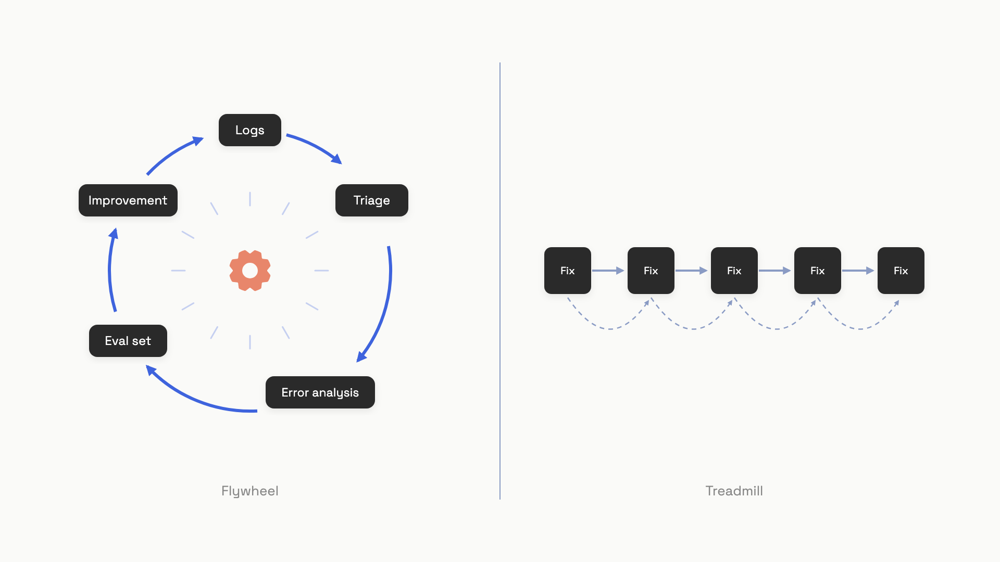

# Feedback & the data flywheel

Two AI teams ship the same product on the same day. Six months later, one team has shrunk their failure rate from 12% to 3% with the same headcount. The other team is still putting out fires every sprint, with quality oscillating between "slightly better" and "slightly worse" depending on which prompt change is in flight. They both worked equally hard. Only one of them was running a flywheel.

That's the chapter. Production traffic is the largest dataset your team will ever have. If every fixed bug also expands your eval set, calibrates your judge, and prevents the next regression, effort compounds. If every fixed bug is just a fixed bug, you're on a treadmill. The mechanism that turns one into the other is the data flywheel: logs into labeled examples into better evals into a better product into more traffic. Eugene Yan and co-authors gave the canonical four-line description in mid-2024: "Human evaluation to assess model performance and/or find defects; use the annotated data to finetune the model or update the prompt; repeat."[^1] The hard part isn't understanding it. The hard part is that most teams stall at step one because they assumed users would press the thumbs button.

## Why the thumbs button can't carry the load

The first instinct, when someone asks you to "collect user feedback," is to add thumbs-up and thumbs-down to every response. It's a one-day ticket. It looks like the right thing. The problem is what comes back.

Documented production LLM deployments report explicit feedback rates between 0.5% and 5% of all interactions, with some interaction types running 10x to 30x denser than others.[^2] At 1,000 daily active users and a 1% rate, you're getting roughly 10 to 30 ratings a day. Detecting a 5% quality change with statistical confidence wants something closer to 1,000 examples. So your "feedback signal" is a 30-day delayed, lossy view of what users actually felt.

It gets worse. The 1% who click are not a random sample. They sit in the tails of the satisfaction distribution: angry users punching thumbs-down, fan users punching thumbs-up, everyone in the middle going silent. A 2026 paper by Morandi and Viswanathan formalizes the size of this bias: naive averaging of explicit feedback can land 40 to 50 percentage points away from true system quality. They cite a documented production deployment where the naive thumbs-rate read 34% while the recovered true quality was 83%, a 49-point gap.[^3] Your dashboard says you're failing. You're not. You're misreading a self-selected sample.

## Capture that users don't have to opt into

Every user gives you signal whether they click anything or not. They retry. They regenerate. They copy text. They edit your output before sending it. They abandon the session and rephrase the same question three minutes later in a new one. The accept-or-modify-or-ignore pattern that coding assistants and Midjourney rely on covers 100% of users at zero UI cost.[^1] The regenerate button, in particular, is the loudest implicit thumbs-down available: the user looked at your answer and decided it wasn't even worth editing.

The decomposition of online signals (which retry counts, what coverage each one has, how to debounce them) is the subject of the [online evaluation chapter](./05-online-evaluation-and-ab-testing.md). What matters here is that those signals get logged side-by-side with the trace, so the labeling pipeline can query them later. The schema is unglamorous and worth getting right on day one:

```python
from dataclasses import dataclass
from datetime import datetime, timezone
from enum import Enum
from typing import Optional

class ImplicitSignal(str, Enum):
    COPY = "copy"
    RETRY = "retry"
    EDIT = "edit"
    ABANDON = "abandon"
    FOLLOW_UP = "follow_up"

@dataclass
class FeedbackRecord:
    trace_id: str
    session_id: str
    timestamp: str
    explicit_rating: Optional[int]      # 1 (pass), 0 (fail), None if absent
    explicit_comment: Optional[str]     # free text, only when offered
    implicit_signal: Optional[ImplicitSignal]
    latency_ms: int
    model_version: str
    prompt_hash: str                    # sha256[:8] of prompt template
```

The two fields that pay for themselves later are `model_version` and `prompt_hash`. Without them you can't tell whether a regression came from a model update, a prompt change, or a shift in user behavior, and the flywheel turns into archaeology.

For the explicit channel, ship binary plus an optional comment. Skip the five-star Likert. Shankar's recommendation and Husain's are aligned on this point: "What exactly distinguishes 'somewhat helpful' from 'helpful'?"[^4] Binary is easier for users to give consistently and easier for downstream judges to reproduce. Critiques in the optional free-text field are the fuel for the next stage of the loop; pairing binary verdicts with detailed critiques pushes human-LLM judge agreement up by 15 to 20 percentage points compared to verdicts alone, across Husain's client implementations as of March 2025.[^5]

## The loop that compounds

A logged trace plus a feedback signal is raw material, not improvement. Five steps connect raw material to a better product, and a flywheel is what you have when all five run on a cadence:

1. **Log everything.** Full trace with input, output, intermediate tool calls, latency, model version, and prompt hash. Without this, no later step is possible. The plumbing for it lives in [the tracing chapter](./06-tracing.md).
2. **Sample and triage.** You will never review every trace. Prioritize: low explicit ratings, retry-followed-by-abandon sessions, traces where an automated judge disagrees with itself across runs, and a small uniform random sample for unbiased coverage.
3. **Error-analyze the sample.** Open coding to free-text notes, axial coding into a small failure taxonomy, counts per category. The mechanics are covered in [look at your data](../part-4-eval-fundamentals/01-look-at-your-data.md) and aren't repeated here.
4. **Convert findings into eval assets.** This is the step teams skip and it's the difference between a flywheel and a treadmill. For every category with three or more instances, write a regression test. For the worst exemplars, add the corrected output as a few-shot example in the relevant judge prompt.
5. **Ship the change against the expanded eval.** New prompt or model goes out only if it doesn't regress on the now-larger suite. The improved system generates better traces, which feed step one.


*The flywheel turns each fix into a reusable test; the treadmill fixes the same shape of bug forever.*

Two production case studies make the compounding concrete. An EMNLP 2025 Industry Track paper from a US-based enterprise customer-support deployment embedded four annotation types directly into the operator workflow, so support agents labeled traces as a side effect of doing their jobs. The flywheel improved retrieval accuracy by 11.7% recall at 75 and 14.8% precision at 8, generation helpfulness by 8.4%, and adoption by 4.5%, while shortening the retraining cycle from months to weeks.[^6] DoorDash's June 2026 simulation-and-evaluation platform took a different angle: production support transcripts get converted into replayable test scenarios, and a customer-simulating LLM drives multi-turn conversations against the chatbot before any prompt change reaches live traffic. Their headline numbers are that 302 simulated conversations finished in 5 minutes versus 175 production conversations spread across 7 hours, with a 46% simulated escalation rate matching the 44% rate observed in production, and a 90% reduction in hallucinations during chatbot development.[^7]

The shape both teams have in common is step 4: a fixed bug doesn't stay a fixed bug. It becomes a test that runs on every change forever. That is the whole compounding mechanism.

## Re-annotating when the world moves under you

A growing eval set sounds like pure good news, until you notice that the labels you wrote in February don't quite match the criteria you'd apply in June. Three things keep moving:

- **Covariate shift.** New users, new query topics, new product features. The inputs change; what counts as a good answer doesn't.
- **Concept drift.** What "good" actually means changes. A finance assistant that was excellent in 2024 is wrong in 2026 because rates moved.
- **Criteria drift.** You yourself didn't know what you wanted until you saw a few hundred outputs. Shankar and colleagues named this in 2024: "users need criteria to grade outputs, but grading outputs helps users define criteria."[^8]

Only the last two require re-labeling old examples. Covariate shift just wants new examples from the new region of input space. Telling them apart in production is the first job of the re-annotation scheduler.

The cheapest signal worth wiring up is Jensen-Shannon divergence between the embedding distribution of recent inputs and a reference window. Shankar's recommended trigger threshold is 0.05.[^4] Combine that with a calendar floor (review some traces every week regardless) and you have a defensible scheduling rule:

```python
import math
from dataclasses import dataclass
from datetime import datetime, timezone
from typing import Optional

@dataclass
class DriftEvent:
    js_divergence: float
    triggered: bool
    reason: str

def js_divergence(p: list[float], q: list[float]) -> float:
    m = [(pi + qi) / 2 for pi, qi in zip(p, q)]
    def kl(a, b):
        return sum(ai * math.log(ai / bi) for ai, bi in zip(a, b) if ai > 0 and bi > 0)
    return 0.5 * kl(p, m) + 0.5 * kl(q, m)

def check_drift(
    reference: list[float],
    current: list[float],
    last_review: Optional[datetime],
    threshold: float = 0.05,
    cadence_days: int = 7,
) -> DriftEvent:
    jsd = js_divergence(reference, current)
    now = datetime.now(timezone.utc)
    cadence_due = last_review is None or (now - last_review).days >= cadence_days
    reasons = []
    if jsd >= threshold:
        reasons.append(f"JS divergence {jsd:.3f} >= {threshold}")
    if cadence_due:
        reasons.append(f"{cadence_days}-day cadence elapsed")
    return DriftEvent(jsd, bool(reasons), "; ".join(reasons) or "no trigger")
```

Run the divergence check daily on a rolling window of recent input embeddings. When it fires, sample disproportionately from the shifted region for that week's review. Voiceflow's experience is the cautionary case: a routine migration from `gpt-3.5-turbo-0301` to `gpt-3.5-turbo-1106` dropped intent classification accuracy by about 10% on their existing eval set.[^1] A scheduler tied only to the calendar would have missed that. A scheduler tied to model version changes catches it the day the new model goes live.

Two more habits keep the eval set from going stale. Treat labeled examples as versioned artifacts with a timestamp, the rubric version they were labeled under, and the annotator. When the rubric sharpens, you don't have to throw old labels away; you re-validate a random sample against the new rubric and backfill the disagreements. And weight recency in any few-shot retrieval that draws from the labeled pool; a corrected trace from last week is a better demonstration of "what good looks like" than one from a year ago, even if cosine similarity says otherwise.[^4]

The reason this matters more than it should is that an eval set silently going out of date is invisible. Coverage looks the same. The judge still scores. The dashboard is still green. Meanwhile the rubric the labels were written against is no longer the rubric anyone in the room would write today, and every prompt change is being graded by a ghost. Periodic re-annotation is what keeps the flywheel pulling on something real.

## References

[^1]: Eugene Yan, Bryan Bischof, Charles Frye, Hamel Husain, Jason Liu, and Shreya Shankar, "What We've Learned From A Year of Building with LLMs," applied-llms.org, June 8, 2024. https://applied-llms.org
[^2]: Andrea Morandi and Mahesh Viswanathan, "Correcting Selection Bias in Sparse User Feedback for Large Language Model Quality Estimation," arXiv:2605.12177, May 2026. https://arxiv.org/html/2605.12177v1
[^3]: Morandi and Viswanathan, ibid., Section V.A and Table 1.
[^4]: Shreya Shankar, "Data Flywheels for LLM Applications," sh-reya.com, July 1, 2024. https://sh-reya.com/blog/ai-engineering-flywheel/
[^5]: Hamel Husain, "A Field Guide to Rapidly Improving AI Products," hamel.dev, March 24, 2025. https://hamel.dev/blog/posts/field-guide/
[^6]: Cen Mia Zhao et al., "Agent-in-the-Loop: A Data Flywheel for Continuous Improvement in LLM-based Customer Support," arXiv:2510.06674, EMNLP 2025 Industry Track, October 2025. https://arxiv.org/abs/2510.06674
[^7]: DoorDash Engineering, "Inside DoorDash's one-click simulation and evaluation platform for support chatbots," careersatdoordash.com, June 1, 2026. https://careersatdoordash.com/blog/doordashs-one-click-simulation-and-evaluation-platform-for-support-chatbots/
[^8]: Shreya Shankar, J.D. Zamfirescu-Pereira, Bjorn Hartmann, Aditya G. Parameswaran, and Ian Arawjo, "Who Validates the Validators? Aligning LLM-Assisted Evaluation of LLM Outputs with Human Preferences," arXiv:2404.12272, ACM UIST 2024. https://arxiv.org/abs/2404.12272
