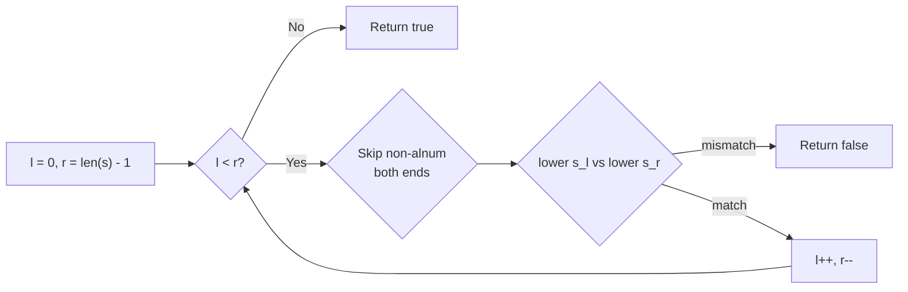
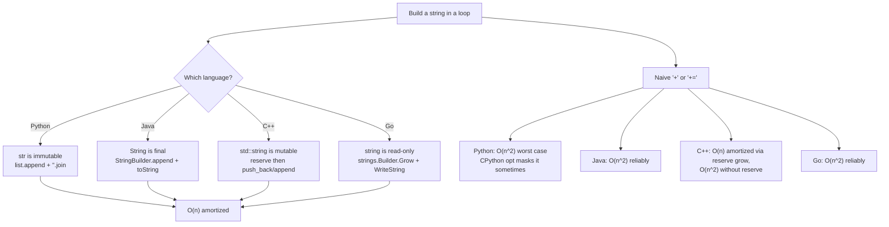

# Strings: encoding, immutability, builders

The same loop, written in four languages, has four different costs. `s += "x"` for a million iterations runs in a few hundred milliseconds in C++ if `std::string::reserve` is called first; tens of seconds in Java without `StringBuilder`; in Python it depends on whether the running string is aliased; and in Go it's reliably O(n²) without `strings.Builder`. The prose that explains why is more useful than any single algorithm.

This chapter is about the *shape* of strings in each of the four canonical languages. Three signature problems anchor the discussion: LC 14 Longest Common Prefix for vertical scanning, LC 344 Reverse String for in-place mutation idiom, LC 125 Valid Palindrome for two-pointer with character classification. Each is Easy. None is the lesson. The lesson is the cross-language contrast.

## What a string is in each language

| Language | Type | Mutable? | `s[i]` returns | Builder pattern |
|---|---|---|---|---|
| Python | `str` | No | length-1 `str` (Unicode code point) | `list.append` then `"".join(parts)` |
| Java | `String` | No (`final`) | `char` (UTF-16 code unit) | `StringBuilder.append` then `toString()` |
| C++ | `std::string` | Yes | `char` (byte) | `string::reserve(n)` then `push_back` |
| Go | `string` | No | `byte` (UTF-8 octet, NOT rune) | `strings.Builder.Grow(n)` then `WriteString` |

Three of the four are immutable. C++ is the only language where you can write `s[i] = 'x'` and have it stick. Every other "mutation" in the other three is producing a new string and rebinding the name.[^1][^2][^3][^4]

The consequence shows up most clearly in LC 344. The problem says "reverse a string in place with O(1) extra memory." If the input were a string, that would be impossible in three of the four languages. So the LC signature is `List[str]` (Python), `char[]` (Java), `vector<char>` (C++), `[]byte` (Go). The input is a character buffer, not a string.[^5] This is not a stylistic choice; it is the only way the problem can be expressed at all.

The indexing differences matter once you cross out of ASCII. Python `s[3]` for `s = "café"` returns `"é"` as a length-1 string. Go `s[0]` for `s = "日本語"` returns `0xe6`, the first byte of the UTF-8 encoding of "日". Iterating runes in Go requires `for i, r := range s` or `unicode/utf8.DecodeRuneInString(s[i:])`.[^4] For the three CORE problems below the input is ASCII and the distinction is silent. It will not stay silent forever. Pattern matching at scale, in [Part 12 — KMP and friends](../part-12-strings-pattern-matching/02-kmp.md), assumes the reader has internalized that `s[i]` means *byte* in Go and *code point* in Python.

## LC 14 — vertical scanning

Given an array of strings, return the longest common prefix. If there is no common prefix, return `""`.

The shape of the problem is "list of strings, output is shared structure." Three approaches all run in O(S) where S is the sum of character counts across all strings: horizontal scanning (reduce the running prefix against each new string), vertical scanning (compare column `i` across all rows before incrementing `i`), and divide-and-conquer (recursive merge). Vertical scanning stops fastest on inputs where the mismatch is in an early column.[^6]

```python
def longest_common_prefix(strs):
    if not strs:
        return ""
    shortest = min(strs, key=len)
    for i, ch in enumerate(shortest):
        for s in strs:
            if s[i] != ch:
                return shortest[:i]
    return shortest
```

**Solution** — Python ([Java](./02-strings/lc-14/sol.java) · [C++](./02-strings/lc-14/sol.cpp) · [Go](./02-strings/lc-14/sol.go))

```python
# LC 14. Longest Common Prefix
# Vertical scanning: walk columns of the shortest string; on first mismatch,
# return the prefix up to that column. Early-exit beats horizontal reduce on
# inputs that diverge near the front. O(S) where S = sum of lengths, O(1).
from typing import List


def longest_common_prefix(strs: List[str]) -> str:
    if not strs:
        return ""
    shortest = min(strs, key=len)
    for i, ch in enumerate(shortest):
        for s in strs:
            if s[i] != ch:
                return shortest[:i]
    return shortest
```

The early-exit pattern is the only thing distinguishing this from a textbook two-loop scan. On `["dog", "racecar", "car"]`, column 0 has three different characters and the function returns `""` after one comparison.

## LC 344 — the in-place reverse, four ways

Reverse a character buffer in place with O(1) extra memory. The two-pointer swap is mechanical; the interesting thing is what the function signature looks like across the four languages.

```python
def reverse_string(s):
    l, r = 0, len(s) - 1
    while l < r:
        s[l], s[r] = s[r], s[l]
        l += 1
        r -= 1
```

**Solution** — Python ([Java](./02-strings/lc-344/sol.java) · [C++](./02-strings/lc-344/sol.cpp) · [Go](./02-strings/lc-344/sol.go))

```python
# LC 344. Reverse String
# Two-pointer in-place swap on a mutable character buffer.
# Python str is immutable, so the LC signature uses List[str]. O(n), O(1).
from typing import List


def reverse_string(s: List[str]) -> None:
    l, r = 0, len(s) - 1
    while l < r:
        s[l], s[r] = s[r], s[l]
        l += 1
        r -= 1
```

Python takes `List[str]` because `str` is immutable. Java takes `char[]` because `String` is `final`. Go takes `[]byte` because `string` is read-only. C++ takes `vector<char>` to match the LC harness, even though `std::string` would also work since it is mutable. The two-pointer body is the same in all four. The parameter types are the chapter.[^5]

Python's tuple-swap idiom `s[l], s[r] = s[r], s[l]` deserves a callout. It compiles to a single bytecode that swaps without a temporary variable, and is faster than the three-line `tmp = s[l]; s[l] = s[r]; s[r] = tmp` you would write in Java. C++ `std::swap` is similarly specialized for `vector` element swaps; the call expands to a move-construct + two move-assigns at -O2.

## LC 125 — two pointers with classification

Determine whether a string is a palindrome, considering only alphanumeric characters and ignoring case. The empty string is a valid palindrome.[^7]

The classic example everyone has seen is `"A man, a plan, a canal: Panama"`. The example that catches most beginners is `"0P"`.

```text
"0P"  →  '0'.lower() == '0';  'P'.lower() == 'p';  '0' != 'p'  →  false
```

If you filter with `isalpha` (letters only) instead of `isalnum` (letters + digits), the digit `0` is skipped. What remains is `"P"`, a length-1 string, which is trivially a palindrome. Submission accepted by your local test, rejected by the grader. The LC 125 spec says "alphanumeric." Alphanumeric includes digits. Read the spec twice.[^7]

```python
def is_palindrome(s):
    l, r = 0, len(s) - 1
    while l < r:
        while l < r and not s[l].isalnum():
            l += 1
        while l < r and not s[r].isalnum():
            r -= 1
        if s[l].lower() != s[r].lower():
            return False
        l += 1
        r -= 1
    return True
```

**Solution** — Python ([Java](./02-strings/lc-125/sol.java) · [C++](./02-strings/lc-125/sol.cpp) · [Go](./02-strings/lc-125/sol.go))

```python
# LC 125. Valid Palindrome
# Two pointers converging from the ends, skipping non-alphanumerics, with
# case-folded comparison. The empty string and single-char strings count
# as palindromes. O(n), O(1).
def is_palindrome(s: str) -> bool:
    l, r = 0, len(s) - 1
    while l < r:
        while l < r and not s[l].isalnum():
            l += 1
        while l < r and not s[r].isalnum():
            r -= 1
        if s[l].lower() != s[r].lower():
            return False
        l += 1
        r -= 1
    return True
```

The two-pointer pattern is identical to LC 344's. The difference is the inner skip loops that advance past non-alphanumeric characters. Each character is visited at most twice (once when one of the pointers passes over it during the alnum skip, once during the equality check), so the algorithm runs in O(n).



*The two-pointer scan with alphanumeric filter and case-folded comparison. The pointers cross when the loop exits; total work is O(n) because each character is touched a constant number of times.*

## The O(n²) concatenation trap

This is the most consequential section of the chapter for downstream code.

Building a long string by repeatedly using `+=` (Python), `+` (Java), `+` (C++ without `reserve`), or `+` (Go) inside a loop is O(n²) in three of the four languages. Each `+` returns a brand-new string object that copies all the existing bytes plus the new ones. After n appends of one character each, total bytes copied is `1 + 2 + 3 + ... + n = O(n²)`.[^1][^2]

CPython hides this in some micro-benchmarks via a refcount-1 in-place optimization that has lived in the interpreter since 2.4. The optimization fails as soon as the running string is aliased by another reference, fails entirely on PyPy and Jython, and is documented as an implementation detail rather than a language guarantee.[^8] On a recent CPython 3.11 build, `s += "a"` for n=200,000 runs about 2.2x slower than `"".join(parts)`. That is well below the asymptotic difference but a clear constant-factor signal that the join idiom is faster even when the optimization is active.

The fix is the language's builder type. Pre-allocate when you can, use the builder API in the loop, materialize the result at the end:

| Language | Builder pattern |
|---|---|
| Python | `parts = []` ... `parts.append(piece)` ... `"".join(parts)` |
| Java | `StringBuilder sb = new StringBuilder(initialCapacity); sb.append(piece); ... sb.toString();` |
| C++ | `std::string out; out.reserve(expectedSize); out += piece;` |
| Go | `var b strings.Builder; b.Grow(expectedSize); b.WriteString(piece); ... b.String();` |

All four are amortized O(n) for total n bytes written. The pre-allocation call (`reserve`, `Grow`, the Java constructor argument) is a constant-factor win, not an asymptotic one. Without it, the builder still amortizes correctly via the same geometric resize argument from [Dynamic array internals](./01-dynamic-array-internals.md).[^1][^2][^3][^4]



*Three of the four languages have immutable strings; the fourth (C++) has a mutable string but still benefits from `reserve` for predictable allocation.*

## Where readers go wrong

> [!WARNING]
> **The `"0P"` case for LC 125.** Filtering with `isalpha` / `isLetter` strips the digit and leaves a single-character palindrome. LC 125 says "alphanumeric"; digits count. Use `isalnum` / `isLetterOrDigit`. This is the canonical first-attempt failure mode in the LC 125 community discussion.[^7]

> [!WARNING]
> **C++ `std::isalnum` undefined behavior.** On platforms where `char` is signed (the default on x86_64 Linux and macOS), bytes with the top bit set are negative `char` values. Passing them to `isalnum` is undefined behavior; the standard requires the input be representable as `unsigned char` or be `EOF` (-1). Always cast: `std::isalnum(static_cast<unsigned char>(s[i]))`. Make this an unconditional reflex.[^3]

> [!WARNING]
> **Go `s[i]` on multi-byte runes.** For ASCII problems, byte iteration is correct and faster. For Unicode-aware iteration, use `for i, r := range s` or `unicode/utf8.DecodeRuneInString(s[i:])`. Code that treats `s[i]` as a character on UTF-8 input gets wrong answers, not crashes.[^4]

> [!WARNING]
> **Java `==` vs `.equals()`.** `"abc" == "abc"` returns `true` because string literals are interned. `"abc" == new String("abc")` returns `false` because `new String(...)` constructs a fresh instance. For content equality always use `.equals()`. The pool optimization makes the bug invisible on literals but live on dynamically-built strings.[^2]

> [!WARNING]
> **Wrong signature for LC 344.** The Python one-liner `return s[::-1]` reverses a string, but it allocates a new string and returns it; LC 344 requires in-place mutation with O(1) extra memory. The right signature reads `def reverse_string(s: List[str]) -> None`: no return value, mutation through the parameter. Same trap in Java if the signature were `String s` instead of `char[] s`. LC's signatures are deliberately written to force the in-place version.[^5]

## Problem ladder

This chapter ships an all-Easy CORE. The natural Hard string problems (LC 3, 76, 424 for variable-window; LC 5 for longest-palindromic-substring DP) are owned by [Sliding window: variable size](../part-3-pointers-window-prefix/03-sliding-window-variable.md) and the Part 9 dynamic-programming chapters respectively. Here, breadth across four languages is the depth.

### CORE (solve all to claim chapter mastery)

- [LC 14 — Longest Common Prefix](https://leetcode.com/problems/longest-common-prefix/) [Easy] • vertical-prefix-scan
- [LC 344 — Reverse String](https://leetcode.com/problems/reverse-string/) [Easy] • in-place-string-reversal
- [LC 125 — Valid Palindrome](https://leetcode.com/problems/valid-palindrome/) [Easy] • two-pointer-palindrome-check ★

### STRETCH (optional)

- [LC 28 — Find the Index of the First Occurrence in a String](https://leetcode.com/problems/find-the-index-of-the-first-occurrence-in-a-string/) [Easy] • naive-substring-search
- [LC 9 — Palindrome Number](https://leetcode.com/problems/palindrome-number/) [Easy] • integer-palindrome

LC 28 is the brute-force naive substring search; the linear-time KMP algorithm is owned by [Part 12 — KMP and friends](../part-12-strings-pattern-matching/02-kmp.md). LC 9 is the same two-pointer palindrome shape applied to integer digits, and is owned primarily by [Math for interviews](../part-0-foundations/04-math-for-interviews.md); it earns a mention here because it's the cleanest test that the two-pointer pattern from LC 125 generalizes beyond strings.

## Where this leads

Variable-window string problems live in [Sliding window: variable size](../part-3-pointers-window-prefix/03-sliding-window-variable.md), which assumes you have internalized the two-pointer pattern from this chapter. Pattern matching at scale (KMP, Rabin-Karp, suffix arrays) is taught in [Part 12 — KMP and friends](../part-12-strings-pattern-matching/02-kmp.md), and every chapter there assumes you remember that `s += c` is O(n²) in three of the four languages and that `s[i]` returns a byte in Go. Edit-distance and longest-common-subsequence dynamic programs in Part 9 quote this chapter's complexity table whenever they discuss the cost of building intermediate strings.

## References

[^1]: Python Software Foundation, "Built-in Types — Sequence Types," Python 3 documentation. <https://docs.python.org/3/library/stdtypes.html#typesseq>

[^2]: Java Language Specification §4.3.3 "The Class String." Establishes that `String` instances "represent sequences of Unicode code points" and that "a `String` object has a constant (unchanging) value." String literals are references to interned instances in the constant pool. [docs.oracle.com/javase/specs/jls/se21/html/jls-4.html](https://docs.oracle.com/javase/specs/jls/se21/html/jls-4.html).

[^3]: cppreference.com, `std::basic_string` reference. [en.cppreference.com/w/cpp/string/basic_string](https://en.cppreference.com/w/cpp/string/basic_string).

[^4]: Rob Pike, "Strings, bytes, runes and characters in Go," The Go Blog, 23 October 2013. Establishes that Go strings are byte-indexed and that `for range` decodes runes. [go.dev/blog/strings](https://go.dev/blog/strings).

[^5]: LeetCode 344, "Reverse String": "Write a function that reverses a string. The input string is given as an array of characters `s`. You must do this by modifying the input array in-place with `O(1)` extra memory." [leetcode.com/problems/reverse-string](https://leetcode.com/problems/reverse-string/).

[^6]: LeetCode 14 official editorial, "Longest Common Prefix." Documents four approaches — horizontal scanning, vertical scanning, divide-and-conquer, binary search — with O(S) bounds for the first three. [leetcode.com/problems/longest-common-prefix/editorial](https://leetcode.com/problems/longest-common-prefix/editorial/)

[^7]: LeetCode 125, "Valid Palindrome": "A phrase is a palindrome if, after converting all uppercase letters into lowercase letters and removing all non-alphanumeric characters, it reads the same forward and backward. Alphanumeric characters include letters and numbers." [leetcode.com/problems/valid-palindrome](https://leetcode.com/problems/valid-palindrome/).

[^8]: PEP 393, "Flexible String Representation," Martin von Löwis, 2010. [peps.python.org/pep-0393](https://peps.python.org/pep-0393/).
