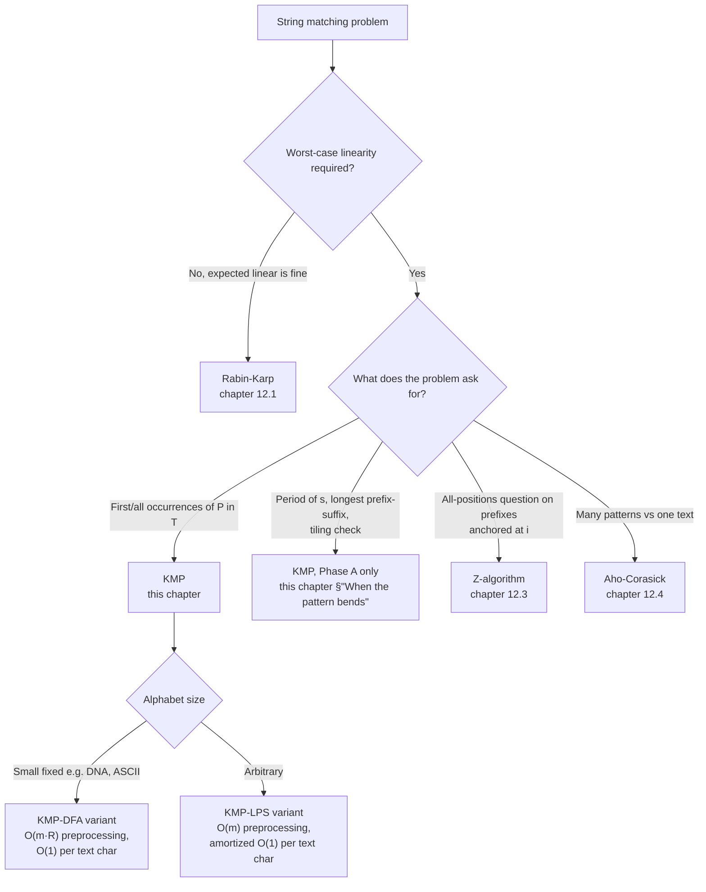

# KMP and the failure function

A pattern of length 1,000. A text of length 1,000,000, structured so that the pattern *almost* matches at every starting position before the last character betrays it: `aaaa...aab` against a million-character `aaaa...aaab`. Naive matching does roughly a billion character comparisons. KMP does about two million. Three orders of magnitude. That gap is the entire reason the algorithm exists.

> [!IMPORTANT]
> KMP is the chapter most readers bounce off of. The failure function is non-obvious; reading it as code without watching it run is roughly impossible. The animation in this chapter does most of the explanatory work, so work through it twice. If you skip the animation, you have skipped the chapter.

[Naive string matching](./00-naive-string-matching.md) showed why the simple loop blows up: every mismatch throws away every character we just confirmed and starts over one position to the right. [Rabin-Karp](./01-rabin-karp.md) bought linearity by hashing windows, with a verify step keeping correctness honest. KMP keeps linearity without the hash, without the randomness, and without the verify. The price is exactly one O(m) preprocessing pass that builds a small array, and that array is what this chapter is about.

## Why the obvious approach blows up

Walk what naive matching actually does on the adversarial input. Pattern is `aaaab`; text starts `aaaaaaaa...`. The matcher confirms five characters at positions 0..4, fails at position 4 because it found another `a` instead of `b`, and goes back to start at text position 1. Confirms five characters at 1..5, fails at 5, goes back to text position 2. Confirms five characters at 2..6, fails at 6.

Look at what's wasted. After the first failure, the matcher has just verified that text positions 0..3 are all `a`. Those four characters *are* a prefix of the pattern. The matcher knows that; it just learned it. Then it throws the knowledge away and re-examines those same characters when it restarts at position 1.

The fix writes itself once you stare at the redundancy. After a mismatch, the matcher already knows what some prefix of the text looks like. If the pattern has internal structure, meaning some prefix of it equals some suffix of what we just matched, we can resume the match in the middle of the pattern instead of restarting at the beginning. We never re-read a text character we already confirmed.

Doing that requires answering one question, once, before the search starts. *For each position `i` in the pattern, what is the longest proper prefix of `pattern[0..i]` that is also a suffix of `pattern[0..i]`?* Call the answer `lps[i]`. This array is the failure function. Build it in one O(m) pass over the pattern, then walk the text using it as a lookup. Total work is O(n + m), proven by the original 1977 paper.[^1]

The reduction is small but worth naming explicitly. **Because `lps[i]` is a property of the pattern alone, not of the text, the preprocessing depends only on `m`, not on `n`.** This is what lets KMP charge the failure-function build once and amortize the search.

## What the failure function actually says

Pick the pattern `ABABCABAB`. Index its characters 0..8. For each prefix `pattern[0..i]`, we want the longest proper prefix that's also a suffix. *Proper* matters: the whole prefix is a prefix and a suffix of itself, but that's useless, so we exclude it.

| `i` | `pattern[0..i]` | longest proper prefix-suffix | `lps[i]` |
|-----|------------------|------------------------------|----------|
| 0 | `A` | (none, single character) | 0 |
| 1 | `AB` | (`A` is a prefix but not a suffix) | 0 |
| 2 | `ABA` | `A` | 1 |
| 3 | `ABAB` | `AB` | 2 |
| 4 | `ABABC` | (the `C` breaks every alignment) | 0 |
| 5 | `ABABCA` | `A` | 1 |
| 6 | `ABABCAB` | `AB` | 2 |
| 7 | `ABABCABA` | `ABA` | 3 |
| 8 | `ABABCABAB` | `ABAB` | 4 |

Read row 8. The longest proper prefix of `ABABCABAB` that is also a suffix has length 4. The prefix is `ABAB`; the matching suffix is `ABAB`. They overlap in the middle of the string but that's fine. The question is whether the first four characters and the last four characters are the same string, which they are.

This array is what every searching decision will consult. When the matcher has confirmed `ABABCABAB` and then the next text character isn't `C` (which would extend to a full match), the matcher knows from `lps[8] = 4` that the last four characters it just saw are also the first four characters of the pattern. So it can resume matching from `pattern[4]` against the next text character, without rescanning anything.

## The pattern

KMP runs in two phases on a text `T` of length `n` and pattern `P` of length `m`. Both phases share the same fallback rule, which is the chapter's center of gravity.

```python
def compute_lps(pattern: str) -> list[int]:
    m = len(pattern)
    lps = [0] * m
    length = 0          # length of the previous longest prefix-suffix
    i = 1
    while i < m:
        if pattern[i] == pattern[length]:
            length += 1
            lps[i] = length
            i += 1
        else:
            if length != 0:
                length = lps[length - 1]   # fall back; do NOT advance i
            else:
                lps[i] = 0
                i += 1
    return lps


def str_str(haystack: str, needle: str) -> int:
    if needle == "":
        return 0
    n, m = len(haystack), len(needle)
    if m > n:
        return -1
    lps = compute_lps(needle)
    i = 0   # haystack pointer
    j = 0   # needle pointer
    while i < n:
        if haystack[i] == needle[j]:
            i += 1
            j += 1
            if j == m:
                return i - j
        else:
            if j != 0:
                j = lps[j - 1]
            else:
                i += 1
    return -1
```

**Solution** — Python ([Java](./02-kmp/lc-28/sol.java) · [C++](./02-kmp/lc-28/sol.cpp) · [Go](./02-kmp/lc-28/sol.go))

```python
# LC 28. Find the Index of the First Occurrence in a String
def compute_lps(pattern: str) -> list[int]:
    """Failure function: lps[i] = length of the longest proper prefix
    of pattern[:i+1] that is also a suffix of pattern[:i+1]."""
    m = len(pattern)
    lps = [0] * m
    length = 0  # length of the previous longest prefix-suffix
    i = 1
    while i < m:
        if pattern[i] == pattern[length]:
            length += 1
            lps[i] = length
            i += 1
        else:
            if length != 0:
                length = lps[length - 1]   # fall back; do NOT advance i
            else:
                lps[i] = 0
                i += 1
    return lps


def str_str(haystack: str, needle: str) -> int:
    """Return the index of the first occurrence of needle in haystack, or -1.
    Per LC 28, an empty needle returns 0. Time O(n+m), space O(m)."""
    if needle == "":
        return 0
    n, m = len(haystack), len(needle)
    if m > n:
        return -1
    lps = compute_lps(needle)
    i = 0  # haystack pointer
    j = 0  # needle pointer
    while i < n:
        if haystack[i] == needle[j]:
            i += 1
            j += 1
            if j == m:
                return i - j
        else:
            if j != 0:
                j = lps[j - 1]
            else:
                i += 1
    return -1
```

The two loops are the same shape. In `compute_lps`, the slow pointer is `length`; in `str_str`, the slow pointer is `j`. Both pointers advance on a match. Both fall back via `lps[<pointer> - 1]` on a mismatch when the pointer is non-zero. Both leave the fast pointer alone during fallback so the same character can be re-tested against the new pattern position. Phase A is structurally Phase B run on the pattern against itself, with `length` playing the role that `j` plays in Phase B.[^2]

The `j-1` index in `j = lps[j - 1]` is the most-typo'd line in any KMP implementation. It is correct because: after a mismatch at `pattern[j]`, what we know is that `pattern[0..j-1]` matched the corresponding stretch of text. The longest proper prefix of `pattern[0..j-1]` that is also a suffix of `pattern[0..j-1]` has length `lps[j - 1]`. That's the position in the pattern we should resume from. Off by one and you either loop forever or skip a viable alignment.

## Worked example: searching ABABCABAB inside ABABDABACDABABCABAB

Pattern `P = ABABCABAB`. Text `T = ABABDABACDABABCABAB`. The widget animates both phases, the failure-function build first, then the matching pass, on this exact input.

The build is the easy half. Walk the pattern left to right, comparing each character against the running `length`-th character. On a match, both `i` and `length` step forward and `lps[i]` records the new length. On a mismatch with `length > 0`, fall back to `lps[length - 1]` and try the comparison again *without moving `i`*. On a mismatch with `length = 0`, record `lps[i] = 0` and step `i`. Eleven steps, and the array `[0, 0, 1, 2, 0, 1, 2, 3, 4]` is built.

The matching pass starts on the left and moves to the right. The first four characters match: `ABAB` is a prefix of the pattern, and it's the first four characters of the text. At text index 4 the matcher reads `D` while the pattern expects `C`. Mismatch with `j = 4`. The fallback is `j = lps[3] = 2`. Read that line carefully: the matcher does not jump back to the start. It jumps to `pattern[2]`, because the failure function says the last two characters confirmed (`AB`, at text positions 2..3) are also the first two characters of the pattern. The text pointer `i` does not move.

> [!IMPORTANT]
> *Watch what does NOT happen.* The matcher does not re-examine `T[2]` or `T[3]`. It already knows those are `A` and `B`. The next thing the matcher does is compare `T[4]` (still `D`) against `P[2]` (which is `A`). Another mismatch, fallback again to `j = lps[1] = 0`, then to the `j = 0` skip path, and only now does `i` step forward to 5. **Across the entire run, every text character is read at most twice.** That's the O(n) bound made concrete.

The matcher meanders through positions 5..9 doing more falls and skips, picks up another partial match at position 10, and this time the partial match is the real one: positions 10..18 of the text are `ABABCABAB`, exactly the pattern. The match is reported at start index 10. The widget shows the full 36-step trace: 11 steps for the failure-function build, 25 steps for the matching pass.

> **Interactive widget:** [KMP failure-function build and matching pass](../widgets/w-38-kmp.yml) (panel `default`) — rendered on the website; the YAML spec describes the keyframes.

*Static fallback: the failure function is `[0, 0, 1, 2, 0, 1, 2, 3, 4]`. The matching pass falls back twice (at text indices 4 and 8), skips through `D` and `CD`, picks up the run starting at index 10, and reports the match at index 10. Total work: 36 algorithmic steps, 19 text characters scanned.*

## Locating this pattern



*Decision flowchart for the broader pattern-matching family. The algorithm-pair lookup is the discriminating signal: KMP for "find P in T" with a worst-case guarantee; KMP's Phase A alone for periodicity / prefix-suffix structural questions where the text is the pattern itself.*

## What it actually costs

| Variant | Time | Space | Notes |
|---|---|---|---|
| LPS construction (Phase A) | Θ(m) | Θ(m) | One pass over the pattern. CLRS 4e §32.4.[^3] |
| Matching pass (Phase B) | Θ(n) | Θ(1) aux | One pass over the text after LPS is built. |
| Total | Θ(n + m) | Θ(m) | The KMP 1977 abstract.[^1] |
| Comparisons (worst) | ≤ 2n | -- | Each text character is compared at most twice: once on a match attempt, once on a fallback. |
| DFA-form variant | Θ(n + m·R) time, Θ(m·R) space | -- | Alphabet size R; trades memory for true O(1) per text char. |

The 2n comparison bound is the cleanest way to state KMP's worst case. The proof is a potential argument: in any iteration of the matching loop, at least one of `i` or `i - j` strictly increases. `i` increases on a match or a `j == 0` skip. `i - j` increases on a fallback (`j` decreases, `i` stays). Both quantities are bounded above by `n`. Sum of increases is at most `2n`, which bounds the total iterations.[^4]

*The same potential argument bounds Phase A: the slow pointer `length` advances at most m times across the build, and falls back at most as many times as it has previously advanced. Total work in Phase A is O(m), and Phase B is O(n) given the lps array. The sum is O(n + m), with no hidden constants and no probabilistic caveat.*

## When the pattern bends

The failure function turns out to be useful for problems that are not searches. Phase A on its own answers a small family of questions about a string's structure, and these are the chapter's CORE problems.

### LC 459 (Repeated Substring Pattern): the failure function as a periodicity test

A string `s` is the concatenation of two or more copies of a smaller string iff the period `n - lps[n-1]` divides `n` cleanly *and* `lps[n-1]` is non-zero.[^5] The proof is a one-paragraph divisibility argument: if `s` tiles, then sliding the string by one period leaves it equal to itself, which forces the longest prefix-suffix length to satisfy that exact relationship. The full code lives in the sibling `sol.py`; the algorithm is one call to `compute_lps` and one modulo.

```python
def repeated_substring_pattern(s: str) -> bool:
    n = len(s)
    if n < 2:
        return False
    lps = compute_lps(s)
    period = n - lps[n - 1]
    return lps[n - 1] != 0 and n % period == 0
```

```python
# LC 459. Repeated Substring Pattern
# The compute_lps subroutine is the
# verified version; the closed-form check
# `n % (n - lps[n-1]) == 0` is the canonical KMP-trick proof from
def compute_lps(pattern: str) -> list[int]:
    m = len(pattern)
    lps = [0] * m
    length = 0
    i = 1
    while i < m:
        if pattern[i] == pattern[length]:
            length += 1
            lps[i] = length
            i += 1
        else:
            if length != 0:
                length = lps[length - 1]
            else:
                lps[i] = 0
                i += 1
    return lps


def repeated_substring_pattern(s: str) -> bool:
    """A string s is the concatenation of k>=2 copies of a smaller substring
    iff lps[n-1] != 0 AND n is divisible by (n - lps[n-1]).
    Time O(n), space O(n)."""
    n = len(s)
    if n < 2:
        return False
    lps = compute_lps(s)
    period = n - lps[n - 1]
    # period < n is guaranteed because lps records the longest PROPER
    # prefix-suffix; the divisibility test rules out partial matches.
    return lps[n - 1] != 0 and n % period == 0
```

This is the chapter's signature problem. It runs the LPS subroutine and never runs the matching loop. The whole answer is in one entry of the array.

### LC 1392 (Longest Happy Prefix): the answer is a slice

A "happy prefix" is the longest non-empty proper prefix of `s` that is also a suffix. Read that definition again. *That is what `lps[n-1]` measures.* The answer is `s[:lps[n - 1]]`. One call to compute_lps, one slice.

```python
def longest_prefix(s: str) -> str:
    n = len(s)
    if n < 2:
        return ""
    lps = compute_lps(s)
    return s[:lps[n - 1]]
```

```python
# LC 1392. Longest Happy Prefix
# The compute_lps subroutine is the
# verified version; a "happy prefix" is the longest proper
# prefix that is also a suffix, which is literally s[:lps[n-1]].
def compute_lps(pattern: str) -> list[int]:
    m = len(pattern)
    lps = [0] * m
    length = 0
    i = 1
    while i < m:
        if pattern[i] == pattern[length]:
            length += 1
            lps[i] = length
            i += 1
        else:
            if length != 0:
                length = lps[length - 1]
            else:
                lps[i] = 0
                i += 1
    return lps


def longest_prefix(s: str) -> str:
    """Return the longest non-empty proper prefix of s that is also a suffix.
    The entire problem is one application of the LPS construction.
    Time O(n), space O(n)."""
    n = len(s)
    if n < 2:
        return ""
    lps = compute_lps(s)
    return s[:lps[n - 1]]
```

LC labels this Hard, presumably because the wording obscures the connection to KMP and most submissions reach for some O(n²) prefix-vs-suffix comparison. The KMP solution is two lines because the entire problem definition is a paraphrase of the failure function's contract.

### KMP on a constructed concatenation

When the question is "find structural property X of `s` relative to `t`" and X is a prefix-suffix question, run Phase A on the concatenated string `s + "#" + t`. The separator (any character not in either string) prevents matches from spanning the boundary. The longest palindromic prefix of `s` is `lps[len(t) - 1]` for `t = reverse(s)`, which is the [Shortest Palindrome (LC 214)](https://leetcode.com/problems/shortest-palindrome/) reduction owned by [Z-algorithm](./03-z-algorithm.md) but solvable here too. The cp-algorithms page derives the offset formula and the boundary condition.[^6]

## Two pitfalls that bite

> [!WARNING]
> **Falling back with `j = lps[j]` instead of `j = lps[j - 1]`.** This is the canonical KMP off-by-one. The `lps` array's index convention is "lps[j] is the LPS length for the prefix ending at index j", so after a mismatch *at* `pattern[j]`, the structurally relevant entry is `lps[j - 1]`, because what matched is the prefix `pattern[0..j-1]`. Get this wrong and the matcher either loops forever (if `lps[j]` keeps the pointer in place) or silently skips a viable alignment (if it jumps too far). Memorize the line: **after a mismatch at index j, `j = lps[j - 1]`. After a full match, the next-occurrence shift is `j = lps[m - 1]`.** Both fallbacks index `j - 1` from the structural-position-of-last-confirmed-match perspective.

> [!WARNING]
> **Confusing the LPS array with the Z-array.** Both answer prefix-matching questions; they answer different sides. **`lps[i]` is the longest proper prefix of `s[0..i]` that is also a suffix of `s[0..i]`, anchored at the start of the substring.** **`z[i]` is the longest substring starting at `i` that matches a prefix of `s`, anchored at index i.** Same prefix-table information, different representation. Mixing them on a whiteboard produces nonsense like "lps[`ababaca`][3] = 0 because there's no `ab` starting at index 3", which is Z-array reasoning applied to an LPS-array index. The chapter mantra: *LPS reads from the start; Z reads forward from i.* The [Z-algorithm chapter](./03-z-algorithm.md) teaches Z explicitly.

A third pitfall worth flagging: writing `compute_lps` with the inner fallback as `length -= 1` or `length = lps[length] - 1`. Both look close enough to the canonical line `length = lps[length - 1]` to slip past code review, and both produce wrong-but-non-crashing output. Verify against the canonical pattern: `compute_lps("aaaa")` must return `[0, 1, 2, 3]`, with `lps[3] = 3` (not 4, since the proper-prefix constraint forbids the whole string). Any deviation means the fallback line is buggy.

## Problem ladder

### CORE (solve both to claim chapter mastery)

- [LC 459 — Repeated Substring Pattern](https://leetcode.com/problems/repeated-substring-pattern/) [Easy] • failure-function-trick ★ *(reference: Python only)*
- [LC 1392 — Longest Happy Prefix](https://leetcode.com/problems/longest-happy-prefix/) [Hard] • failure-function-direct *(reference: Python only)*

### STRETCH (optional)

- [LC 1668 — Maximum Repeating Substring](https://leetcode.com/problems/maximum-repeating-substring/) [Easy] • failure-function-trick (owned by [Z-algorithm](./03-z-algorithm.md); KMP-applicable variant)
- [LC 214 — Shortest Palindrome](https://leetcode.com/problems/shortest-palindrome/) [Hard] • kmp-on-concatenated (owned by [Z-algorithm](./03-z-algorithm.md); KMP-applicable variant)

LC 459 is the chapter's signature problem (★), the canonical "use the failure function for something other than matching" exercise. LC 1392 is the cleanest LPS-only Hard on the platform; the entire problem reduces to one application of `compute_lps`. The CORE pair spans Easy and Hard natively. The Medium band is structurally absent: KMP's natural Medium substring problems (LC 686, LC 187, LC 3034) are claimed by sister chapters under primary-ownership rules, and the chapter's `ladder_curation_flag` is `no-medium-canonical`. The canonical Easy where KMP's O(n + m) framing lands is [LC 28 (Find the Index of the First Occurrence)](https://leetcode.com/problems/find-the-index-of-the-first-occurrence-in-a-string/), owned by [Naive string matching](./00-naive-string-matching.md) and reused here as the chapter's worked-example vehicle.

## Where this leads

The sibling algorithm is the [Z-algorithm](./03-z-algorithm.md). Same O(n + m) bound, different representation of the prefix-match information, and the LPS-vs-Z distinction in the pitfall section is the bridge. The multi-pattern generalization is [Aho-Corasick](./04-aho-corasick.md): KMP's failure function lifted onto a trie, with the "fail link" doing what `lps[j - 1]` does for a single pattern. If alphabet size is small and you want true constant-time-per-text-character behavior without any inner fallback loop, the DFA variant builds an `m × R` transition table at the cost of `O(m · R)` preprocessing; Sedgewick's *Algorithms* §5.3 walks the construction.[^7]

## References

[^1]: Knuth, Donald E.; Morris, James H. The original paper introduces both the matching algorithm and the failure-function preprocessing in O(m + n) time. <https://epubs.siam.org/doi/epdf/10.1137/0206024>.

[^2]: cp-algorithms, "Prefix function. Knuth-Morris-Pratt algorithm." <https://cp-algorithms.com/string/prefix-function.html>.

[^3]: Cormen, Thomas H.; Leiserson, Charles E.; Rivest, Ronald L.; Stein, Clifford. *Introduction to Algorithms*, 4th ed., MIT Press, 2022.

[^4]: Wikipedia, "Knuth-Morris-Pratt algorithm." <https://en.wikipedia.org/wiki/Knuth%E2%80%93Morris%E2%80%93Pratt_algorithm>.

[^5]: Stack Overflow, "Leetcode 459 proof for KMP." <https://stackoverflow.com/questions/65468603/leetcode-459-proof-for-kmp>.

[^6]: WebCoderSpeed, "Shortest Palindrome — KMP on Reversed String." <https://www.webcoderspeed.com/blog/dsa-string-algorithms/13-shortest-palindrome>.

[^7]: Sedgewick, Robert; Wayne, Kevin. *Algorithms*, 4th ed., Addison-Wesley, 2011, Chapter 5 §5.3 "Substring Search." Companion site at <https://algs4.cs.princeton.edu/53substring/>.
