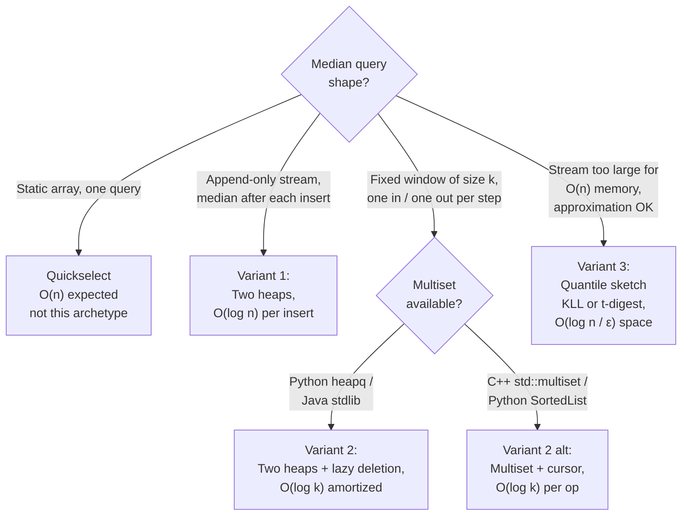

# Two-heap median archetypes: when one heap is not enough

A single heap exposes one extremum. The median is the middle. That gap is the entire pattern: split the data into two ordered halves, hold the lower half in a max-heap and the upper half in a min-heap, and the two roots flank the answer. Push, pop, peek, and a rebalance step that runs in `O(log n)` give you running-median queries on streams that would otherwise demand `O(n log n)` per insert.

The archetype shows up in three flavors that look the same on a whiteboard and differ sharply in their deletion model. **Streaming median** (LC 295) is the textbook case where the stream is append-only and lazy deletion never enters the picture. **Sliding-window median** (LC 480) is the same shape with a hostile twist: every step inserts one value and removes another, and standard binary heaps cannot delete arbitrary values in `O(log n)`. **Median-of-buckets** is the approximate variant for streams whose sizes blow past memory; you give up exactness for a sketch that fits in `O(log n)` space. Knowing which variant the problem demands is the recognition skill this page teaches.

## The decision

The question that routes you to the right variant is short:

1. **Can the stream grow without bound, or is the answer-window fixed at size `k`?**
2. **Do you need the *exact* median, or is an approximation within ε acceptable?**
3. **If the window is fixed, does your language ship a balanced multiset?**

Three answers, three variants. An append-only stream wanting the exact median is variant 1. A fixed-window stream wanting the exact median is variant 2 (lazy deletion in Python or Java without third-party libraries) or its multiset cousin (C++, or Python with `sortedcontainers`). A stream too large for `O(n)` memory pushes you out of the two-heap archetype entirely and into bucketed quantile sketches.

If the data is a static array of `n` values handed to you in one piece, none of the three variants wins. Quickselect finds a single median in `O(n)` expected time per [Heap vs sorted array vs balanced BST for top-K](./P-06-heap-vs-sorted-array-vs-bst.md), and CLRS §9.3 gives `O(n)` worst-case via median-of-medians.[^1] The two-heap pattern is for *online* queries where the alternative is re-sorting on every update.

## The flowchart

*Three branches: append-only goes to two-heap streaming, fixed-window splits on language support for ordered multisets, oversized streams bail to approximate sketches and leave the two-heap archetype behind.*

## Variants

### Streaming median (two-heap balance invariant)

The canonical case. A `MedianFinder` exposes `addNum(int)` and `findMedian()`; numbers arrive one at a time, queries fire after each insert. There is no deletion.

**Recognition signal:** "running median", "median after every insert", "median of values seen so far", with no window or expiry mentioned.

The structure is two heaps and two invariants. A max-heap `lower` holds the smaller half; a min-heap `upper` holds the larger half. **Size invariant:** `0 ≤ |lower| − |upper| ≤ 1`. **Ordering invariant:** `max(lower) ≤ min(upper)`. With odd total `n`, `lower` carries the extra element and the median is its root; with even `n`, the median is the average of the two roots.

The push-pop dance maintains both invariants in three steps per insert: push the new value into `lower` unconditionally, move `lower`'s top into `upper` (which forces the ordering invariant by sending the largest of the new lower half across the boundary), then if `upper` is now larger than `lower`, rotate one element back. Each step is `O(log n)`; `findMedian` reads heap roots in `O(1)`.[^2]

**When to pick this:** the data is append-only, the median must be exact, and `O(n)` total memory is acceptable. Munro and Paterson proved in 1980 that exact one-pass selection requires `Ω(n)` space, so this variant sits at the lower bound.[^3]

**Time:** `O(log n)` per insert, `O(1)` per query. **Space:** `O(n)` total. **Anchor chapter:** [Heaps and priority queues](../part-6-trees-heaps/04-heaps-priority-queues.md) walks the full LC 295 implementation across four languages.[^4]

### Sliding-window median (lazy deletion)

The window slides one step at a time, and every step removes the element falling off the left edge while inserting the one entering on the right. The two-heap structure still works, but only with help: standard binary heaps support `O(log n)` delete-at-known-index and *not* delete-by-value, because finding an arbitrary value requires scanning the array first.[^5]

**Recognition signal:** "median of every contiguous subarray of length `k`", "median of the last `k` elements", "sliding-window median".

The lazy-deletion idiom defers the actual remove. When the window's left edge slides past a value, mark it as stale in a hash-map counter (`removals[x] += 1`) and update a separate `balance` integer that tracks the *valid* size delta between the two heaps. Don't touch the heaps themselves yet. When `findMedian` runs, prune the heaps from the top: if a root has a positive stale count, pop it (real deletion) and decrement the counter, repeating until both roots are valid. The amortized cost is `O(log k)` per window step because each element pays for its own eventual removal once.[^6]

**When to pick this:** the language ships no balanced ordered multiset in its standard library. Python's `heapq` is stdlib but `sortedcontainers.SortedList` is third-party; Java has no `TreeMultiset` outside of Guava. In those languages, two heaps plus a stale-counter is the cleanest answer.

**Time:** `O(log k)` amortized per slide, `O((n − k) log k)` total. **Space:** `O(k)` valid plus up to `O(k)` stale survivors in the worst case.

The multiset alternative is worth flagging. C++'s `std::multiset` supports `O(log k)` insert, `O(log k)` erase by iterator, and an `O(1)` median-cursor advance after the first probe; CSES 1076 teaches this as the canonical competitive-programming solution.[^7] The trade-off is constant factors: balanced-BST nodes carry pointer overhead that array-backed heaps don't, so the multiset version reads cleaner but runs slower in practice. In Python, `SortedList` from `sortedcontainers` plays the same role with a different internal layout.

### Median-of-buckets (approximate, for large streams)

When the stream's size exceeds available memory, the two-heap pattern stops working. Munro and Paterson's `Ω(n)` lower bound on exact streaming selection means an exact median over a billion-row stream demands a billion-row data structure. Production telemetry pipelines (p99 latency over the last hour, p95 over the last week) cannot afford that, so they trade exactness for approximation.

**Recognition signal:** "approximate median", "p99 latency", "running quantile over a stream too large for memory", "ε-approximate quantiles". The data set is too big for `O(n)` storage, and the consumer is willing to accept an answer within ε of the true median.

The structure replaces the two heaps with a *quantile sketch*: a fixed-size summary that absorbs the stream incrementally and answers quantile queries with a guaranteed error bound. KLL (Karnin-Lang-Liberty) achieves multiplicative-error quantile estimates in `O((1/ε) · log log(1/εδ))` space.[^8] Apache DataSketches ships KLL as a standard production choice; t-digest, P², and Greenwald-Khanna are alternative sketches with different error-versus-space trade-offs.[^9]

**When to pick this:** the stream is large enough that `O(n)` memory is impractical, and the consumer accepts a small ε error. This is what Datadog, Prometheus, and most observability platforms use under the hood for percentile dashboards.

**Time:** `O(log(1/ε))` per insert in expectation. **Space:** `O((1/ε) log(εn))` for KLL.

This variant lives at the edge of the archetype. The data structure is no longer two heaps; the operational shape (one summary that answers a fixed-rank query in sublinear time) is the recognizable cousin. Treating it as the third variant is editorial: it's the answer that takes over when variants 1 and 2 hit the memory wall.

## Variants side-by-side

| Variant | Data shape | Balance invariant | Removal cost | Time per op | Canonical problem |
|---|---|---|---|---|---|
| Streaming median (1) | Append-only stream, exact answer | `0 ≤ \|lower\| − \|upper\| ≤ 1` on physical sizes | No removal | `O(log n)` insert, `O(1)` query | LC 295 |
| Sliding-window median (2) | Fixed window `k`, exact, one-in-one-out | `balance` counter on *valid* sizes; physical sizes drift | `O(log k)` amortized via lazy deletion + stale counter | `O(log k)` per slide | LC 480 |
| Median-of-buckets (3) | Unbounded stream, approximate within ε | Sketch state, no two-heap split | Old elements discarded by sketch policy | `O(log(1/ε))` per insert | LC 295 at scale; production telemetry |

The middle row is the one that bites. The temptation is to track size with `len(lower) − len(upper)` as in variant 1, but those are now *physical* sizes that include stale survivors waiting to be pruned. The valid-element count is what determines which heap holds the median, and it has to live in a separate integer that the lazy-deletion logic maintains explicitly.[^6]

## Three signature problems

- [LC 295 — Find Median from Data Stream](https://leetcode.com/problems/find-median-from-data-stream/) [Hard] • the canonical streaming-median problem; the two-heap implementation is the textbook answer and walks across four languages in chapter 6.4.
- [LC 480 — Sliding Window Median](https://leetcode.com/problems/sliding-window-median/) [Hard] • the lazy-deletion variant. Multiset solutions exist in C++ via `std::multiset`; Python and Java without third-party libraries reach for the two-heap-plus-stale-counter idiom.
- [LC 1825 — Finding MK Average](https://leetcode.com/problems/finding-mk-average/) [Hard] • the bucketed cousin: maintain three sorted multisets (or three balanced ordered structures) holding the smallest `k`, middle `m − 2k`, and largest `k` of the last `m` elements, and report the mean of the middle bucket. The data flows like a sliding window, the partition logic is two-heap-flavored, and the structure generalizes to median-of-buckets when you swap in approximate sketches.

## Common misconceptions

**Two-heap is the only median pattern.** It isn't. C++ candidates routinely solve LC 480 with a single `std::multiset` and an iterator parked at the median; CSES 1076's canonical solution is multiset-based.[^7] Python competitive programmers use `sortedcontainers.SortedList` for the same effect with `O(log k)` insert, delete, and indexed access. The two-heap pattern wins when the language stdlib gives you heaps but not balanced multisets, which is the situation in Python and Java without third-party imports. In C++, the multiset version is shorter, easier to debug, and roughly the same asymptotic cost. Pick the structure your language supports cleanly.

**Lazy deletion in sliding-window median is free.** The amortized analysis says each element pays for its own pruning once across the lifetime of the window, so amortized cost is `O(log k)` per slide. Two things to flag. First, that's *amortized*, not worst-case: a single `findMedian` call after a long run of stale-but-not-yet-surfaced removals can pop multiple roots in sequence, with each pop costing `O(log k)`. Second, the bookkeeping has real constant overhead: a `Counter` lookup, a balance update, and a prune check every step. A multiset-based solution avoids all of that and is often faster in practice despite the heavier per-node memory.[^6]

**The two heaps must be equal size.** They don't. The size invariant is `0 ≤ |lower| − |upper| ≤ 1`, not strict equality. With odd total count, one heap carries an extra element and the median is its root in `O(1)`. With even count, the heaps are equal and the median is the average of the two roots. Forcing strict equality breaks the read path: when the count is odd, neither heap's root is the median on its own, and `findMedian` has to do a comparison and an average that should have been a single read. The asymmetric invariant is what makes the read `O(1)` in the odd case and the implementation easier to write correctly.

**Physical heap size equals valid window size in lazy deletion.** This is the bug that surfaces in LC 480 submissions and ranks among the most common Discuss-thread failure modes. After several slides, the heaps contain stale survivors waiting at internal positions for their turn to surface; `len(lower)` is the count of *all* elements in `lower`, not the count of *valid* ones. The fix is a separate `balance` integer maintained alongside every insert and every lazy-mark step. Physical heap sizes are ground truth for the structural sift operations; valid sizes are ground truth for the median read.[^6]

**Median-of-medians is the same algorithm.** It isn't, and the name collision causes confusion in interviews. Median-of-medians is CLRS §9.3's deterministic `O(n)`-worst-case selection algorithm for *static* arrays, used as a quickselect pivot strategy.[^1] Median-of-buckets here is the *streaming* sketch family for unbounded data with approximate answers. The two algorithms solve different problems: median-of-medians answers one query on a finite array with exact precision; bucketed sketches answer many queries on an infinite stream with bounded error. Don't conflate them in an interview.

## References

[^1]: Cormen, Leiserson, Rivest, Stein, *Introduction to Algorithms*, 4th ed., MIT Press, 2022, Chs. 6 and 9.

[^2]: labuladong, "Implementing Median Algorithm with Two Binary Heaps." https://labuladong.online/algo/en/practice-in-action/find-median-from-data-stream/

[^3]: Munro and Paterson, "Selection and sorting with limited storage," *Theoretical Computer Science* 12 (1980): 315–323.

[^4]: LeetCode, "295. Find Median from Data Stream." https://leetcode.com/problems/find-median-from-data-stream/

[^5]: cstheory.stackexchange, "Nontrivial algorithm for computing a sliding window median." https://cstheory.stackexchange.com/questions/21730/nontrivial-algorithm-for-computing-a-sliding-window-median

[^6]: Paysan, "Sliding Window Median, Lazy Removal (n log k)," Medium, 2024-08-16. https://medium.com/@miguelpaysan/sliding-window-median-lazy-removal-nlogk-a4463c54bb72

[^7]: USACO Guide, "Sliding Median (CSES 1076)." https://usaco.guide/solutions/cses-1076

[^8]: Karnin, Lang, Liberty, "Optimal Quantile Approximation in Streams," FOCS 2016. https://arxiv.org/abs/1907.00236

[^9]: Engelhardt, "Calculating Percentiles on Streaming Data." https://www.stevenengelhardt.com/2018/03/06/calculating-percentiles-on-streaming-data-part-1-introduction/
