# Dijkstra vs Bellman-Ford vs 0-1 BFS vs A*, shortest-paths decision tree

## The decision

The question is *given a shortest-path problem on graph `G`, which algorithm do you reach for?* The answer routes off one input feature: **the set of edge weights**. All edges weight one means BFS. Weights drawn from `{0, 1}` means 0-1 BFS with a deque. Non-negative reals means Dijkstra. Negatives in the mix means Bellman-Ford. A goal-directed search with an admissible heuristic means A*. Get the route wrong and the price is at minimum a `log V` factor of redundant work; at maximum it is a wrong answer with no error message, because Dijkstra on a graph with even one negative edge silently returns garbage.

Every other discriminator (sparse vs dense, single goal vs all targets, all-pairs vs single-source) layers on top of the weight set. Read the weights first.

## The flowchart

```mermaid
flowchart TD
    Start[Shortest path<br/>on graph G] --> Q1{All edges<br/>weight 1?}
    Q1 -->|Yes| BFS[BFS<br/>O&#40;V plus E&#41;]
    Q1 -->|No| Q2{"Weights<br/>in {0, 1}?"}
    Q2 -->|Yes| ZBFS[0-1 BFS deque<br/>O&#40;V plus E&#41;]
    Q2 -->|No| Q3{Any edge<br/>weight negative?}
    Q3 -->|Yes| BF[Bellman-Ford<br/>O&#40;V times E&#41;<br/>detects neg cycles]
    Q3 -->|No| Q4{Single goal,<br/>admissible<br/>heuristic available?}
    Q4 -->|Yes| AStar[A star<br/>same worst case as Dijkstra,<br/>far fewer expansions in practice]
    Q4 -->|No| Dijk[Dijkstra binary heap<br/>O&#40;&#40;V plus E&#41; log V&#41;]
```

*Read the rubric top-down; the first yes terminates. The weight set picks the algorithm; the heuristic question only fires after the non-negative branch lands.*

## Algorithms compared

Five algorithms, each the right answer in a narrow regime. The H3s below name the regime as a precondition on the input, then quote the asymptotic, then point at the chapter that carries the canonical implementation.

### BFS, when every edge has weight 1

Trigger: every edge weight is `1`, or the graph is unweighted. On an unweighted graph, the first time BFS visits a vertex *is* the shortest-path visit; relaxation collapses to "first time we see `v`, record `dist[v]` and never revisit." No priority queue, no heap, no relax bookkeeping. Time `O(V + E)`, space `O(V)`. The losing condition is a single edge with weight greater than `1`: the FIFO no longer dequeues vertices in non-decreasing distance order, and the first-visit invariant breaks.[^1]

The canonical applications are word-ladder transformations, multi-source flood fills (rotting oranges, 01-matrix), and any "minimum number of moves" framing on a uniform grid. [BFS](../part-8-graphs/01-bfs.md) carries the canonical four-language implementation; [BFS vs DFS for graphs](./P-07-bfs-vs-dfs-graphs.md) covers when BFS is the right traversal in the first place.

### 0-1 BFS, when weights are drawn from `{0, 1}`

Trigger: every edge weight is exactly `0` or exactly `1`. Common shapes: free-vs-cost-1 transitions on a grid, "rotate sign vs accept direction" puzzles, layered graphs where a level transition is free. The data structure is a deque, not a heap. Push 0-cost relaxations to the *front* and 1-cost relaxations to the *back*; pop from the front each iteration. The deque holds vertices spanning at most two consecutive distance levels at any moment, which is the invariant that makes the front-pop legitimate.[^2]

Time `O(V + E)`, space `O(V)`. This beats Dijkstra by a `log V` factor and removes heap overhead entirely, which matters at competitive sizes. The trap is implementational: a naive deque-instead-of-queue BFS that pushes everything to the back, regardless of weight, is just BFS and is wrong on any input with a 0-weight edge. The front-vs-back rule *is* the algorithm.[^2]

[Dijkstra's shortest-path algorithm](../part-8-graphs/09-dijkstra.md) carries the canonical 0-1 BFS reference inside its "When the pattern bends" section.

### Dijkstra, when weights are non-negative reals

Trigger: single-source shortest paths with `w(u, v) >= 0` for every edge. The algorithm settles vertices in non-decreasing distance order using a min-priority queue keyed on tentative distance. The settled-once invariant is the load-bearing claim: when extract-min returns a vertex `u` with tentative distance `d`, that distance is final, because any undiscovered path to `u` must pass through some unsettled vertex `v` with `dist[v] >= d`, and adding non-negative remainder cannot improve `d`. CLRS Theorem 22.6 proves this formally.[^1]

Time `O((V + E) log V)` with a binary heap and lazy deletion. Space `O(V + E)`. The Fibonacci-heap variant tightens the bound to `O(E + V log V)`, but no production library uses it because the constants are large; binary heaps win at every realistic size.[^1]

The non-negativity precondition is non-negotiable. With even one negative edge, the settled-once invariant breaks: a later relaxation through the negative edge can decrease the distance of an already-settled vertex, but Dijkstra has already moved on. The algorithm returns wrong answers with no exception. Sedgewick's `DijkstraSP.java` reference throws on a negative edge precisely so programmers do not fall in;[^3] LeetCode's runtime gives no warning.

The default-of-defaults: when the problem says "weighted shortest path" with no qualifier and no heuristic, reach for Dijkstra. [Dijkstra's shortest-path algorithm](../part-8-graphs/09-dijkstra.md) carries the canonical four-language implementation, the lazy-deletion idiom, and the min-max-path specialization.

### Bellman-Ford, when negatives are possible (or detection is the question)

Three signals point at Bellman-Ford rather than Dijkstra. First, negative edge weights are possible (currency arbitrage, profit-and-loss flows). Second, the path is bounded by a number of edges, "stops", or "hops"; LC 787's "at most K stops" maps directly onto the Bellman-Ford lemma "after pass `i`, `dist[v]` is correct for any path of at most `i` edges." Run `K + 1` passes and stop. Third, negative-cycle detection is itself the question: run `V - 1` passes; if anything relaxes on the V-th pass, a negative cycle is reachable from the source.[^4][^5]

The `V - 1` outer-loop bound is the algorithm's central proof and the most cited claim in the comparison. CLRS Chapter 24 in the third edition (Chapter 22 in the fourth) establishes it as Theorem 24.4: any acyclic shortest path has at most `V - 1` edges, and the algorithm's `i`-th pass is correct for paths up to `i` edges, so `V - 1` passes cover every acyclic shortest path.[^1] The V-th pass adds `O(E)` and is the negative-cycle detector; the total is `O(V * E)`, conventionally rounded up rather than written as `(V - 1) * E + E`.[^4][^5]

Time `O(V * E)`. Space `O(V)`. The price relative to Dijkstra is roughly a factor of `V / log V`, which on `V = 10^4` is a 700x slowdown — the difference between accepted at 100ms and time-limit-exceeded at 70 seconds. Pay this price only when negatives are real or the K-edge bound matches the problem.[^4]

The K-edge variant has one load-bearing implementation detail: each pass must read from a `dist` snapshot taken at pass start, otherwise a single relaxation step can propagate two edges in one pass and the K-edge bound collapses. LC 787 will produce wrong answers without the snapshot.[^5]

[Bellman-Ford and negative cycles](../part-8-graphs/10-bellman-ford.md) carries the canonical four-language implementation and the snapshot trick.

### A*, when a single goal and an admissible heuristic are available

Trigger: single-source single-goal AND a heuristic `h(v)` that estimates the cost from `v` to the goal and never overestimates. The expand criterion is `f(n) = g(n) + h(n)`, where `g(n)` is the known cost from source to `n` and `h(n)` is the optimistic remaining cost. Nodes far from the goal by the heuristic are pushed deep into the open set and never expanded; informative heuristics shrink the explored region dramatically.[^6][^7]

A*reduces to Dijkstra when `h ≡ 0`. The two algorithms expand the same set of nodes, and the worst-case bound matches Dijkstra's. The win is in the constants. On a `1000 x 1000` grid, Dijkstra expands roughly half the cells before finding the goal; A* with Manhattan distance to the goal expands a narrow strip near the optimal diagonal, often 100x to 1000x fewer expansions on the same input.[^6]

Common admissible heuristics: zero (trivially admissible, reduces A*to Dijkstra), Manhattan distance on a 4-directional grid, Euclidean distance on a road network. The original 1968 paper proved optimality with an admissible heuristic; Pearl's 1984 analysis is the definitive efficiency proof.[^7] Losing conditions: no admissible heuristic, multi-target shortest paths, or negative weights. A* is rare in interview rotation because LC problems are mostly framed without natural geometric heuristics; the algorithm shines in production pathfinding (game engines, robotics) more than in coding interviews.

## Side-by-side

The cells are worst-case bounds on a connected `(V, E)` graph.

| Algorithm | Weight precondition | Time | Detects neg cycle? | Heuristic required? | When to pick |
|---|---|---|---|---|---|
| BFS | every edge `= 1` (unweighted) | `O(V + E)` | n/a | no | uniform-cost shortest path; "minimum moves" |
| 0-1 BFS | every weight in `{0, 1}` | `O(V + E)` | n/a | no | binary cost transitions, free-vs-paid moves on a grid |
| Dijkstra | non-negative reals | `O((V + E) log V)` | no (silently wrong on negatives) | no | the default for weighted graphs without negatives |
| Bellman-Ford | any reals | `O(V * E)` | yes (V-th pass) | no | negatives possible, K-edge constraint, or detection itself |
| A* | non-negative reals + admissible `h` | same worst case as Dijkstra | no | yes | single goal, geometric or domain heuristic available |

Three cells deserve a closer read. **The Dijkstra row's "silently wrong" is not hyperbole**: there is no runtime check, no exception, no out-of-bounds error. The algorithm finishes and returns a `dist[]` array that is wrong by an unbounded amount. The Bellman-Ford row's "detects neg cycle" specifically means *reachable from the source*, not "every negative cycle in the graph"; for the all-pairs version, run Floyd-Warshall and inspect the diagonal. The A* row's "same worst case" is the cell readers most often misread; an informative heuristic gives huge constant-factor wins, but the asymptotic bound does not improve.

## Three signature problems

The problems below sit at the three highest-frequency rows of the rubric. Each one is the canonical interview shape for its algorithm; recognizing the shape is the actual interview skill.

- [LC 743 — Network Delay Time](https://leetcode.com/problems/network-delay-time/) [Medium] • Dijkstra signature
- [LC 787 — Cheapest Flights Within K Stops](https://leetcode.com/problems/cheapest-flights-within-k-stops/) [Medium] • Bellman-Ford with K-edge bound
- [LC 2290 — Minimum Obstacle Removal to Reach Corner](https://leetcode.com/problems/minimum-obstacle-removal-to-reach-corner/) [Hard] • 0-1 BFS canonical

LC 743 is the textbook Dijkstra. Hand-built signal propagation across a directed weighted graph; answer is `max(dist[v])` over reachable `v`. Every standard library on the planet runs the lazy-deletion idiom on this input in well under 100ms. LC 787 looks like a Dijkstra problem and isn't: the K-stops constraint defeats Dijkstra's settled-once invariant because a vertex can be revisited along a longer-but-cheaper path that respects the K-bound. The Bellman-Ford "after pass i, correct for paths of at most i edges" lemma is exactly what the constraint asks for. LC 2290 is the cleanest 0-1 BFS shape on LC: every cell has four neighbors, an empty neighbor costs `0` to traverse, an obstacle costs `1`. Push 0-cost relaxations to the front of the deque, 1-cost to the back; total work `O(m * n)`.

## Common misconceptions

The misapplications below are frequent enough to surface on every shortest-paths interview thread. Each one has a real failure mode and a real fix.

**"Dijkstra works with negative weights if you reset distances when you find a shorter path."** It does not. The greedy invariant (settle-once, never revisit) is what gives Dijkstra its `O((V + E) log V)` bound and its correctness proof. Allowing revisits patches the wrong-answer symptom but breaks the bound: in the worst case the algorithm degenerates to exponential time on adversarial input.[^3] A second variant of this misconception, "add a constant to every edge weight to make all weights non-negative, then run Dijkstra," also fails: the constant-shift accumulates more on longer paths than shorter ones, so it does not preserve shortest-path identity.[^3] The correct reweighting is Johnson's algorithm, which runs Bellman-Ford from a virtual source to derive a per-vertex potential, then runs Dijkstra from each vertex on the reweighted graph.

**"Bellman-Ford detects all negative cycles in the graph."** It detects whether *any* negative cycle is reachable from the source vertex. Negative cycles disconnected from the source are invisible to the V-1-passes-then-V-th-pass-relaxation check. For the all-pairs version of the question, run Floyd-Warshall and inspect the diagonal: any negative entry on `dist[v][v]` is a negative cycle through `v`. The two algorithms answer different questions, and conflating them produces wrong answers on every multi-component test case.[^4]

**"A* is always faster than Dijkstra."**A* is *never asymptotically* faster than Dijkstra; the worst-case bound is identical. The wins come from constant factors, and only when the heuristic is both admissible and informative. With a bad heuristic (one that overestimates), A*can return a suboptimal path; the optimality proof is contingent on `h(v) <= dist(v, goal)` for every `v`.[^7] With a heuristic that is admissible but uninformative (`h ≡ 0`), A* is *exactly* Dijkstra, expansion-for-expansion. The "always faster" intuition comes from grid-pathfinding demos where Manhattan distance is informative; on a graph without natural geometry, A* offers nothing over Dijkstra.[^6]

**"0-1 BFS is just BFS with a deque."** The data structure is a deque, but the algorithm is not BFS. The discriminating rule is the front-vs-back push: 0-cost relaxations push to the *front* of the deque, 1-cost relaxations push to the *back*. A naive deque-BFS that pushes everything to the back is functionally a queue and produces wrong answers on any input with a 0-weight edge. The front-pushing rule is what preserves the BFS invariant ("the deque holds vertices spanning at most two consecutive distance levels") that makes pop-front a legitimate substitute for extract-min.[^2] Drop the rule and the `O(V + E)` bound disappears along with correctness.

**"Floyd-Warshall is the safe all-pairs default."** It is the *dense* all-pairs default. On a sparse graph with `E << V^2`, repeated Dijkstra (or Johnson's, if negatives are present) costs `O(V * (V + E) log V)`, which is asymptotically less than Floyd-Warshall's `O(V^3)`. For `V = 10^4` and `E = 10^5`, repeated Dijkstra is roughly `1.4 x 10^10` operations versus Floyd-Warshall's `10^12`, two orders of magnitude apart. Floyd-Warshall's tiny-constant ten-line loop is what makes it the right call when `E ≈ V^2`, not some general "safety" property.[^8]

The sibling decision page for minimum spanning trees, [Kruskal vs Prim, MST decision](./P-09-kruskal-vs-prim.md), uses a parallel rubric driven by the *density* of the input rather than the *weight set*. Once the shortest-path question is answered here, the natural follow-up is: same graph, what is the cheapest way to span every vertex? P-09 picks up there.

## References

[^1]: Cormen, Leiserson, Rivest, Stein, *Introduction to Algorithms*, 4th ed., MIT Press, 2022, Ch. 22.

[^2]: CP-Algorithms, "0-1 BFS." https://cp-algorithms.com/graph/01_bfs.html. Codeforces, "0-1 BFS [Tutorial]." https://codeforces.com/blog/entry/22276

[^3]: Sedgewick and Wayne, *Algorithms*, 4th ed., §4.4. https://algs4.cs.princeton.edu/44sp/

[^4]: Wikipedia, "Bellman-Ford algorithm." https://en.wikipedia.org/wiki/Bellman%E2%80%93Ford_algorithm

[^5]: Bellman, "On a routing problem," *Quarterly of Applied Mathematics* 16 (1958): 87–90. https://doi.org/10.1090/qam/102435.

[^6]: Wikipedia, "A* search algorithm." https://en.wikipedia.org/wiki/A*_search_algorithm

[^7]: Hart, Nilsson, Raphael, "A Formal Basis for the Heuristic Determination of Minimum Cost Paths," *IEEE TSSC* 4(2) (1968): 100–107. https://doi.org/10.1109/TSSC.1968.300136

[^8]: Wikipedia, "Floyd-Warshall algorithm." https://en.wikipedia.org/wiki/Floyd%E2%80%93Warshall_algorithm
