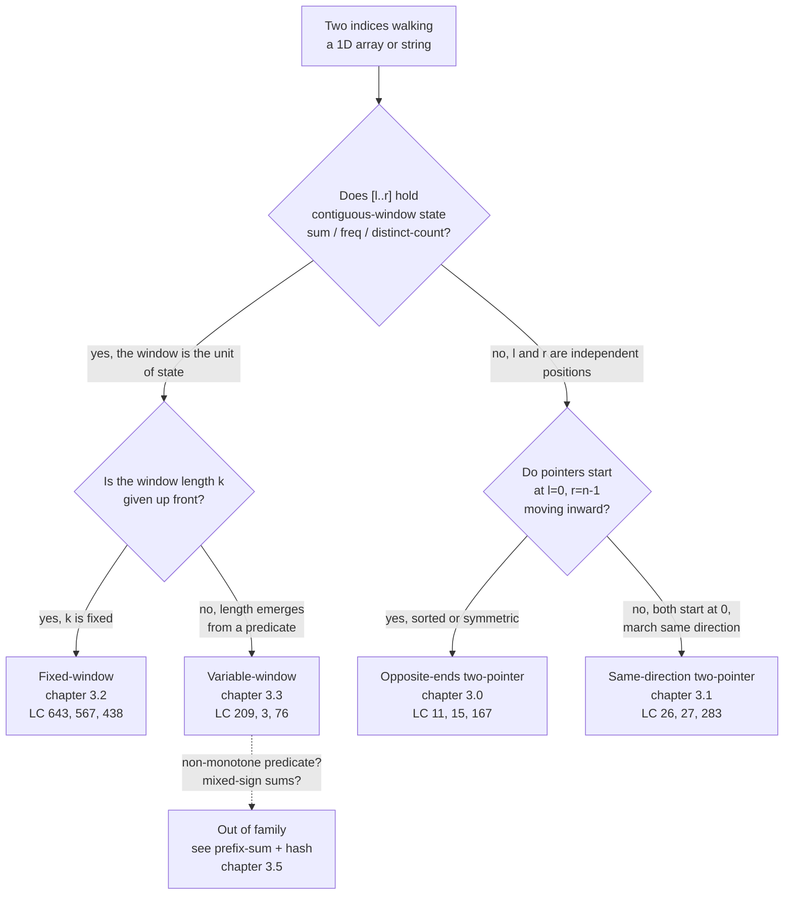

# Two pointers vs sliding window: the lookalikes

Four chapters back-to-back drill four loops that look almost identical from the outside. Each one walks an array with two indices, each one runs in linear time, each one does O(1) work per step. Pick wrong and the code compiles, runs, and passes the first test case. Then it fails the second on a sign change, an unsorted input, or a missing-by-one off the build phase, and you're staring at a `while l < r` loop wondering why the answer is `[1, 2]` instead of `[2, 3]`.

The conflation gets reinforced by every interview-prep site that writes "two pointers" as an umbrella term covering the entire family. Top-voted LC discuss guides do it. So does most of the YouTube canon. The handbook position is opinionated: **two-pointer and sliding window are distinct patterns with distinct invariants**, and learning to pick by invariant rather than by surface loop shape is the actual interview skill.

## The decision

The pivot is not "are there two indices?" Every algorithm on this page has two indices. The pivot is not "do they move together?" Most of these have at least one pointer that always advances. The pivot is a question about what `[l..r]` *means* between the pointers.

> **Does the algorithm maintain a contiguous-window invariant on `[l..r]`, or do `l` and `r` index two independent positions whose relationship is the answer?**

If `[l..r]` is a window the loop is incrementally summarizing (running sum, frequency map, distinct-character count, "no duplicate" boolean), the pattern is **sliding window**. The window is the unit of state.

If `l` and `r` are independent positions in the array whose pair value or relative order is the answer, the pattern is **two pointers**. The pointers don't define a window; they define two cursors whose meeting condition or pair-check produces the result.

Two secondary questions split each branch into two sub-archetypes. If you went sliding window, ask whether the window length `k` is given up front (fixed) or emerges from a predicate (variable). If you went two pointers, ask whether the pointers start at opposite ends and march inward (sorted-array territory), or both start at zero and march in the same direction (read/write or fast/slow territory).

That gives four sub-patterns, one per chapter in Part 3.

## The flowchart

*The pivot is Q1: window with maintained state versus two independent positions. Q2 and Q3 split each branch into the four sub-patterns owned by Part 3.*

## Algorithms compared

The four sub-patterns share surface mechanics but diverge on what `[l..r]` represents and what's allowed to break. Each H3 below covers one: when it wins, what it costs, which chapter owns it, and the precondition that, if violated, sends the problem to a different family.

### Opposite-ends two-pointer (chapter 3.0)

The input is sorted, or has a structural symmetry the algorithm can exploit (palindrome positions, container geometry between two walls). The answer is a property of a pair `(i, j)` with `i < j` whose predicate gets checked against a target. The pointers start at `l = 0, r = n - 1` and march toward each other; one advances per iteration based on a comparison.

The locked invariant: on a sorted array, if `nums[l] + nums[r] < target`, advancing `l` is the only useful move. Every alternative either shrinks the partner (decreasing the sum further) or replaces `nums[l]` with a smaller value, which is impossible because `l` was already the smallest unvisited entry on the left. The mirror argument holds for `> target`. The proof is by case analysis and is canon in the chapter[^1].

Time: O(n). Space: O(1). Each step decrements `r - l` by exactly 1, so the loop runs at most n - 1 times.

Wins on LC 11 Container With Most Water, LC 15 3Sum (with a sort + outer loop wrapper), LC 167 Two Sum II, LC 125 Valid Palindrome, LC 42 Trapping Rain Water. See [Two pointers: opposite ends](../part-3-pointers-window-prefix/00-two-pointers-opposite.md).

Loses the moment sortedness is removed. The case-analysis proof breaks; the algorithm starts producing wrong answers silently. Drop sortedness, reach for hash-map.

### Same-direction two-pointer (chapter 3.1)

Both pointers start at zero and march left to right. One is the *reader* (always advances), one is the *writer* or *slow pointer* (advances only when a kept-condition holds). The invariant is that `nums[0..write)` is the stable kept prefix and `nums[write..n)` is scratch the loop is still rewriting in place.

Two flavors share this shape. The **read/write** flavor handles in-place filtering, deduping, and partitioning where the rewrite preserves relative order: LC 26 Remove Duplicates, LC 27 Remove Element, LC 283 Move Zeroes, LC 75 Sort Colors (a three-pointer specialization, the Dutch national flag from Dijkstra 1976[^2]). The **fast/slow** flavor uses a 2x speed gap to detect cycles in linked lists; that lives separately in chapter 5.3 (Floyd's tortoise and hare) because the invariant differs.

Time: O(n). Space: O(1). The reader runs n times; the writer is bounded by the reader.

Wins when the problem says "modify `nums` in place" alongside an operation describable as "drop or overwrite elements while preserving relative order." See [Two pointers: same direction](../part-3-pointers-window-prefix/01-two-pointers-same-direction.md).

Loses when the rewrite needs three or more output classes (Dutch flag specialization), when the predicate depends on un-yet-visited elements (no read/write invariant possible), or when the operation isn't local to the read pointer.

### Sliding window, fixed size (chapter 3.2)

The problem asks for the best aggregate over every contiguous slice of an explicitly fixed length `k`. The slide costs O(1) per step regardless of `k`: subtract `nums[r - k]`, add `nums[r]`, observe. The brute approach re-sums the next `k` elements at every starting index and pays O(n × k); the slide replaces those `k - 1` redundant additions with a single subtract.

Time: O(n). Space: O(1) for numeric aggregates; O(σ) for frequency-map aggregates over a small alphabet.

Wins on LC 643 Maximum Average Subarray I, LC 567 Permutation in String, LC 438 Find All Anagrams, LC 30 Substring with Concatenation of All Words, LC 1456 Maximum Number of Vowels. The signal is the literal phrase "of length k", "of size k", or "exactly k" in the problem statement. See [Sliding window: fixed size](../part-3-pointers-window-prefix/02-sliding-window-fixed.md).

Negativity in the input doesn't break this pattern, because the slide is purely arithmetic. Loses the moment `k` stops being given and starts being the answer.

### Sliding window, variable size (chapter 3.3)

The window length is the unknown. The right pointer always advances; the left pointer advances only while a shrink condition holds. State is whatever the predicate needs: a running sum, a frequency map, a `have/required` integer counter for cover-all problems.

The amortization is the standard one. Each element enters via `r` at most once and leaves via `l` at most once, so total work across both pointers is O(n) regardless of how nested the inner shrink loop looks. CLRS Chapter 17 §17.1 carries this argument verbatim with the MULTIPOP-on-stack worked example[^3].

Time: O(n). Space: O(σ) for character-frequency state, O(1) for sum-threshold state.

Wins on three predicate classes. Sum-threshold on non-negative arrays: LC 209 Minimum Size Subarray Sum. No-duplicates predicates: LC 3 Longest Substring Without Repeating Characters. Cover-all predicates: LC 76 Minimum Window Substring with the `have/required` counter trick[^4]. See [Sliding window: variable size](../part-3-pointers-window-prefix/03-sliding-window-variable.md).

Loses the instant any element can be negative AND the predicate is sum-threshold. That case routes to chapter 3.5's prefix-sum + hash combo, where the correctness argument doesn't depend on monotonicity.

## Side-by-side

| Axis | Opposite-ends two-pointer | Same-direction two-pointer | Sliding window, fixed | Sliding window, variable |
|---|---|---|---|---|
| **Pointer movement** | One advances per step; pointers march inward | Reader always advances; writer/slow advances on a condition | Both advance by exactly 1 in lockstep | Right always advances; left advances on a shrink condition |
| **Contiguity required?** | No, the answer is a pair, not an interval | No, the answer is the new prefix length | Yes, `[l..r]` is the window | Yes, `[l..r]` is the window |
| **Monotone metric required?** | No, but sortedness is | No | No (slide is arithmetic) | Yes, in at least one direction of expansion |
| **Typical complexity** | O(n) time, O(1) space | O(n) time, O(1) space | O(n) time, O(1) or O(σ) space | O(n) time, O(σ) space |
| **Recognition signal** | "Sorted array" + "find pair / triple" + "sum / area / palindrome" | "Modify in place" + "drop / dedupe / partition" | "Of length k" / "of size k" / "exactly k" | "Smallest / longest / any window with X" + no `k` given |
| **Termination** | `l >= r` | `read == n` | `r == n` | `r == n` and inner shrink drained |
| **Canonical signature** | LC 11 Container With Most Water | LC 26 Remove Duplicates | LC 643 Maximum Average | LC 209 Minimum Size Subarray Sum |
| **Breaks when...** | Input is unsorted | Three+ output classes needed | `k` is unknown | Mixed-sign sum + sum-threshold predicate |

The two cells that matter most are *contiguity* and *monotone metric*. Sliding window requires both. Two-pointer requires neither. If the problem allows skipping (LC 1 Two Sum on an unsorted array, where the two indices can be arbitrary), sliding window is wrong by construction; reach for hash-map. If the metric isn't monotone in window expansion (LC 560 Subarray Sum Equals K with negative numbers), variable-window is wrong by construction; reach for prefix-sum + hash.

## Three signature problems

The three problems below pin down the difference between the pattern families. Each one is the canonical pick for its sub-archetype, and the contrast between them is what readers actually trip on.

**[LC 167 — Two Sum II (Input Array Is Sorted)](https://leetcode.com/problems/two-sum-ii-input-array-is-sorted/)** [Easy] is the canonical opposite-ends two-pointer. Given `numbers = [2, 7, 11, 15]` and `target = 9`, return `[1, 2]` because the values at those 1-indexed positions sum to 9. The algorithm keeps `l = 0, r = n - 1`; if `nums[l] + nums[r] < target`, advance `l`; if `>`, retreat `r`; if `==`, return. No element is ever aggregated; only pair-checks. Drop sortedness and the case-analysis proof breaks (misconception four below).

**[LC 3 — Longest Substring Without Repeating Characters](https://leetcode.com/problems/longest-substring-without-repeating-characters/)** [Medium] is the canonical variable-window. Given `s = "abcabcbb"`, return `3`. The window `[l..r]` carries a frequency map; `r` advances and updates the map; while any character's frequency exceeds 1, `l` advances and decrements the map. The amortization is total work bounded by 2n: each character enters once via `r` and leaves at most once via `l`. The contrast with LC 167 is the whole point of this page: both have two indices marching, but LC 167 never aggregates over `[l..r]` and LC 3 always does.

**[LC 643 — Maximum Average Subarray I](https://leetcode.com/problems/maximum-average-subarray-i/)** [Easy] is the canonical fixed-window. Given an array and a fixed `k`, return the maximum average across all length-`k` contiguous slices. The slide is one expression: `window_sum += nums[r] - nums[r - k]`. The reduction worth naming: maximum average and maximum sum rank windows identically when `k > 0`, so track the integer sum and divide once at the end. Naive brute force pays O(n × k); the slide pays O(n).

## Common misconceptions

Five recurring mistakes account for most of the bugs in this family. Two of them are the contrast at the heart of this page; the other three are the pivots that bend the pattern out of family.

**Sliding window is just two pointers with a different name.** This is the misconception this page exists to fix. Yes, both keep two indices that march left to right. No, they aren't the same algorithm. Hold up LC 3 next to LC 167. Both have `l` and `r`. LC 3 maintains a frequency map over `[l..r]` and asks for the longest `r - l + 1` satisfying a predicate; the algorithm is *summarizing* the window. LC 167 has `l` and `r` at opposite ends, never aggregates anything, and asks whether `nums[l] + nums[r]` matches a target. Sliding window is a *specialization* of two-pointer that adds the contiguous-window invariant. Every sliding window is technically a two-pointer scheme, but most two-pointer schemes are not sliding windows. The pivot question (Q1 in the flowchart) is what separates them: maintained window state versus independent positions. Treating the two as interchangeable is how you end up applying variable-window to LC 167 (correct on positive inputs, broken on negatives) or applying opposite-ends to LC 3 (broken everywhere).

**Variable-window on mixed-sign arrays.** The classic fail is LC 560 Subarray Sum Equals K with the LC 209 template: `for r in range(n): while sum >= K: l += 1`. LC 209's correctness depends on `nums[i] >= 0`, which makes the running sum monotone in window length. LC 560 allows negatives; the running sum can go down as the window grows; the shrink condition no longer captures the right l-positions; the answer is wrong. The Medium write-up that documents this trap names it directly as "Why does sliding window not work?"[^5]. The cue "mixed signs + sum target" routes out of the sliding-window family entirely and into chapter 3.5's prefix-sum + hash combo. Fixed-window stays unaffected because the slide there is pure arithmetic with no monotonicity assumption.

**Calling any nested loop with `l` and `r` "two-pointer".** A brute O(n²) double loop `for l in range(n): for r in range(l + 1, n): check(l, r)` labeled "two-pointer" because there are two index variables. The defining property of two-pointer and sliding window is amortized O(n) total work, not O(n²): each pointer advances monotonically, never resets, and the loop terminates by pointer-position rather than by index-pair. If the inner loop restarts from `l + 1` on every outer iteration, the algorithm is brute force with two indices, not two-pointer.

**Opposite-ends on an unsorted array.** LC 1 Two Sum (unsorted) approached with `l = 0, r = n - 1`. The opposite-ends correctness proof requires sortedness: the case-analysis "if `nums[l] + nums[r] < target`, advancing `l` is the only useful move" depends on `nums[l]` being the smallest unvisited entry on the left. Drop sortedness and the proof breaks. The cue is binary: sorted gets opposite-ends; unsorted gets a hash-map. The chapter widget for LC 11 includes an "unsorted trap" preset that lets readers watch the algorithm produce wrong answers on shuffled input.

**Same-direction read/write where three classes are needed.** LC 75 Sort Colors approached with a single read/write pair. The read/write template partitions into two regions, "kept" and "scratch". LC 75 needs three (`< 1`, `== 1`, `> 1`), which is the Dijkstra 1976 Dutch National Flag algorithm with a three-pointer invariant: `[0..low)` is reds, `[low..mid)` is whites, `[mid..high]` is unsorted, `(high..n)` is blues. Two output classes route to read/write; three classes route to Dutch flag.

## References

[^1]: scanny et al., "Proof for LeetCode 11," CS Stack Exchange, 2020. https://cs.stackexchange.com/questions/121472/proof-for-leetcode-11-container-with-most-water-problem

[^2]: Dijkstra, *A Discipline of Programming*, Prentice-Hall, 1976, Ch. 14.

[^3]: Cormen, Leiserson, Rivest, Stein, *Introduction to Algorithms*, 4th ed., MIT Press, 2022, Ch. 17.

[^4]: HelloInterview, "Leetcode 76. Minimum Window Substring." https://www.hellointerview.com/community/questions/minimum-window-substring/cm5eh7nrh04p4838owhtrqcnp

[^5]: Lee, "LeetCode 560: Subarray Sum Equals K," Medium, 2022. https://yuminlee2.medium.com/leetcode-560-subarray-sum-equals-k-9eb688e43534
