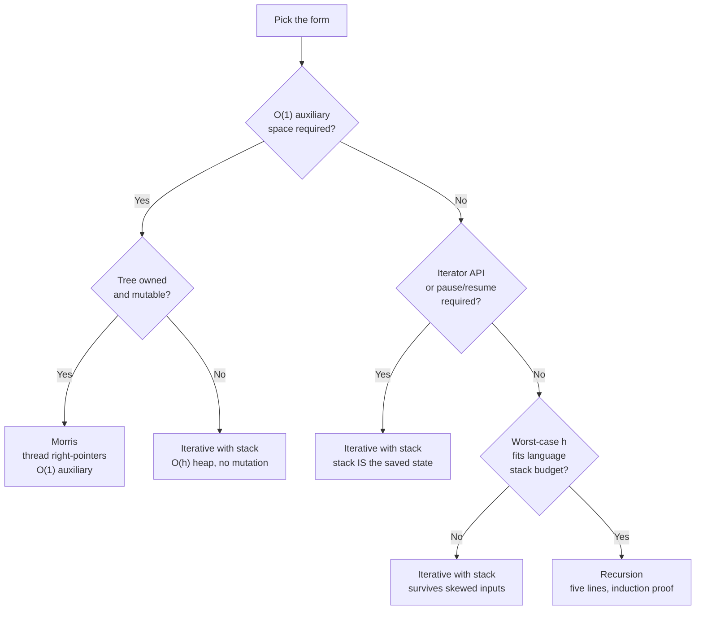

# Iterative vs Morris vs recursive tree traversal

Three forms walk every node of a binary tree in O(n) time. They differ in one thing only: where they keep the memory of "where do I go next?" Recursion hides it on the language's call stack. The iterative form moves it to a heap-allocated stack you push and pop yourself. Morris hides it inside the tree, by overwriting null right-pointers and tearing them down on the way back. The choice between the three is a budget question, not an aesthetic one.

## The decision

**Question:** for a depth-first walk over a binary tree, which form do I write?

**The one-line answer.** Recursive by default. Switch to iterative-with-stack when the call-stack depth is at risk or when the problem demands a `next()` / `hasNext()` iterator. Switch to Morris only when the interviewer says "O(1) extra space" out loud, the tree is yours alone for the duration of the call, and you can mutate right-pointers and restore them.

## The flowchart

*Three sequential questions. Space, then API, then depth. Morris exists only when all three favor it; the iterative form is the safe escape when any question fails; recursion is what's left when nothing pushes you off the default.*

## Algorithms compared

Three forms cover everything Part 6 asks for. The differences live in where each one stores the "what's next" state and what that storage costs.

### Recursive

The function calls itself on the left subtree, visits the node, calls itself on the right subtree. Five lines for inorder, three positions for the `visit()` call to choose between pre, in, and post. The implicit call stack carries the work; the program owns nothing except a base case on null.

Reach for recursion when:

- The interview is a generic tree question (LC 94, LC 104, LC 226, LC 543). The recursive form is what the interviewer expects to see first.
- The traversal threads state through the call (max depth, subtree sum, parent reference). The recursion's parameter list is the cleanest way to do this; the iterative form would push tuples onto its stack.
- The output ordering is one of the three canonical orderings. Pre, in, and post are the same five-line skeleton with the visit call moved between three positions.[^1]
- Worst-case depth fits the language's stack budget. Java HotSpot's default `-Xss` of 256KB to 1MB accommodates 5K to 25K frames in practice; C++ tops out in the millions for shallow frames.[^2] Python's default recursion limit is 1000, which is the place this assumption breaks first.[^3]

| | Time | Space |
|---|---|---|
| Recursive walk | Θ(n) | Θ(h) implicit call stack |

The Θ(n) bound is by induction over subtree size, with T(0) = Θ(1) and T(n) = T(L) + Θ(1) + T(R); the proof is one paragraph in CLRS §12.1, Exercise 12.1-4.[^1] The space cost is the maximum recursion depth, which is the height h. For a balanced tree, h is log n. For a left-skewed degenerate tree, h is n − 1 and the recursion's frames cost what an array of n nodes would cost, except they live on the C stack, which is a fixed-size OS resource and crashes hard when it overflows.

Reference: [Tree traversals: pre, in, post](../part-6-trees-heaps/01-tree-traversals.md).

### Iterative with explicit stack

Take the recursion away and you're left holding the stack yourself. A `list` in Python, an `ArrayDeque` in Java, a `std::stack` in C++, a slice in Go. The descent-and-pivot template walks the entire left chain from the current pointer, pushing each node, then pops, visits, and pivots to the popped node's right subtree. The program owns the stack; the JVM thread stack stays flat regardless of input shape.[^4]

Reach for the iterative form when:

- The interviewer literally says "iteratively" or "without recursion." LC 94's official editorial flags the iterative inorder follow-up as a real interview prompt, not a textbook footnote.[^4]
- The tree is genuinely deep enough to overflow the call stack. Python's default 1000-frame limit hits routinely on adversarial test inputs; left-skewed trees at LC scale (5×10⁴ nodes) reliably blow Python recursion without `sys.setrecursionlimit`.[^3]
- The problem requires a stateful iterator with `next()` and `hasNext()` semantics: BST Iterator (LC 173), bidirectional in-order, lazy in-order over a giant BST. The explicit stack *is* the iterator's saved state across calls; recursion has no equivalent without coroutine support.
- The traversal must be paused, resumed, or interleaved across multiple trees. The stack survives across function boundaries; an active recursion does not.

| | Time | Space |
|---|---|---|
| Iterative walk | Θ(n) | Θ(h) explicit stack on heap |

Same asymptotic bounds as recursion. The constant factors are similar; the stack lives in heap memory, which dwarfs any thread stack on every commodity machine. For a 10⁶-node skewed tree, the difference between a heap-allocated stack and a thread-stack overflow is the difference between "ran fine" and "crashed before printing anything."

Reference: [Tree traversals: pre, in, post](../part-6-trees-heaps/01-tree-traversals.md), [Stacks](../part-1-linear-data-structures/05-stacks.md).

### Morris (threaded)

J. M. Morris published this in 1979 in a two-page paper that did the impossible: walk every node in O(n) time, in inorder, with two pointer-sized scratch variables and no auxiliary memory.[^5] The trick is threading. For each node whose left subtree is non-empty, find the rightmost descendant of that subtree (the inorder predecessor). Its right pointer is null, because if it had a right child that child would itself be further right. Overwrite the null with a pointer back to the current node. Descend left. When the predecessor walk later finds that pointer is no longer null, the algorithm knows it has been here before, tears the thread down, visits the current node, and steps right.

Reach for Morris when:

- The interviewer asks "can you do this in O(1) extra space?" or "without recursion and without a stack." Those exact phrases are the trigger; nothing else in the standard binary-tree toolbox achieves both bounds simultaneously.[^5]
- The problem is **LC 99 Recover Binary Search Tree**, where the problem statement explicitly calls out the O(1)-space follow-up. It is the canonical Morris-only application.[^6]
- The tree is enormous (millions of nodes, embedded systems, memory-constrained streaming) and the auxiliary stack is the bottleneck. Every Θ(h) byte saved scales with input.
- The tree is **owned exclusively by the traversal** and not shared with concurrent readers, writers, GC traversers, or serializers. Morris is a single-writer single-reader algorithm.[^7]

| | Time | Space |
|---|---|---|
| Morris walk | Θ(n) amortised | Θ(1) auxiliary |

The space bound is by construction: two pointer variables, `curr` and the inner walker `pred`, plus the right-pointer fields the algorithm temporarily writes and restores. The time bound is amortised, not pointwise. The natural pointwise reading "n iterations × O(h) inner predecessor walk" suggests O(n h), which on a left-skewed tree would be O(n²). The actual O(n) bound charges each tree edge a bounded constant: at most three visits across the whole walk (once when the outer loop steps along it, once during thread installation, once during teardown). Total at most 3n edge visits.[^8]

Reference: [Morris traversal: O(1)-space inorder by threading](../part-6-trees-heaps/02-morris-traversal.md).

## Side-by-side

| Axis | Recursive | Iterative (explicit stack) | Morris |
|---|---|---|---|
| Auxiliary space | Θ(h) implicit call stack[^1] | Θ(h) explicit stack on heap[^4] | Θ(1) auxiliary[^5] |
| Worst case (skewed tree) | Θ(n) on the call stack | Θ(n) on the heap | Θ(1) |
| Mutates the tree? | No | No | Yes, transiently; right-pointers installed and removed[^5] |
| Tree state during walk | Identical to start | Identical to start | Threaded; right-pointers may point at ancestors |
| Tree state after walk | Identical to start | Identical to start | Identical to start (restored bit-by-bit) |
| Safe under concurrent readers? | Yes | Yes | No[^7] |
| Safe with read-only / `final` / `const` tree? | Yes | Yes | No |
| Stack-overflow risk | High in Python (default 1000)[^3]; bounded by JVM `-Xss`[^2] | None (heap) | None |
| Re-entry / pause-resume (iterator) | Hard (needs `yield` / coroutine) | Natural (stack IS the state) | Fragile (pausing leaves threads installed) |
| Code clarity | One sentence per case | Reads like a state machine | Two nested decisions per iteration |
| Lines of code (in-order, Python) | 5 to 7 | 12 to 14 | 18 to 22 |
| Pick when | Default; no special constraint | "Iteratively"; iterator API; deep skewed input | "O(1) extra space"; tree exclusively owned |

A reading of the table: the first three axes (space, mutation, tree state) put recursive and iterative in the same column and isolate Morris. The next three (concurrency, immutability, stack risk) split Morris from the other two on safety, in opposite directions: Morris is safer on the call stack, less safe everywhere else. The last three (iterator support, clarity, lines of code) are why Morris is rare in production code: it pays for the O(1) bound with a code shape that is famously hard to review under pressure.

## Three signature problems

### LC 94 — Binary Tree Inorder Traversal

[LC 94 — Binary Tree Inorder Traversal](https://leetcode.com/problems/binary-tree-inorder-traversal/) [Easy]

The chapter where all three forms live next to each other. Recursive inorder is five lines. Iterative inorder with the descent-and-pivot template is twelve. Morris inorder is twenty. The official editorial walks the recursive form, then the iterative form as the "could you do this without recursion?" follow-up, then references Morris as the constant-space variant. The decision tree on this page is calibrated against this problem: there is no constraint, so the default holds, and the recursive form ships first. Switch to iterative if the follow-up arrives. Mention Morris if the interviewer asks for O(1) and you are confident in the threading.

### LC 145 — Binary Tree Postorder Traversal

[LC 145 — Binary Tree Postorder Traversal](https://leetcode.com/problems/binary-tree-postorder-traversal/) [Easy]

The asymmetry between the three forms shows up most clearly here. Recursive postorder is the same five-line skeleton as inorder with the visit call moved to the bottom. Iterative postorder is structurally harder than iterative inorder because the parent must be visited *after* both children, and the descent-and-pivot template doesn't directly support that. The standard answers are the two-stack template or the single-stack template with a "last-visited" pointer. Morris postorder is materially harder than Morris inorder; the seductive analogy "Morris preorder moved the visit one way, postorder must move it the other way" produces a wrong algorithm that emits reverse-preorder instead. The genuine O(1) Morris postorder uses spine-reversal and is intricate enough that competitive-programming references treat it as a separate algorithm.[^9] If an interviewer pushes for O(1) postorder, the spine-reversal variant is the answer; most accept O(h) iterative postorder as a reasonable compromise.

### LC 173 — Binary Search Tree Iterator

[LC 173 — Binary Search Tree Iterator](https://leetcode.com/problems/binary-search-tree-iterator/) [Medium]

The problem where iterative wins by construction. The contract is "expose `next()` and `hasNext()` such that each `next()` returns the next inorder value." The iterative form *is* the canonical answer: the explicit stack survives between `next()` calls and acts as the iterator's resumable state.[^4] A recursive submission that materialises the entire inorder list up-front fails the problem's average O(1) `next()` requirement. Morris would technically work but pausing mid-walk leaves threads installed in the tree, which fails any reader that touches the BST between calls. This is the sharpest case where the three forms separate cleanly: recursive is wrong by API, Morris is wrong by ownership, iterative is the only fit.

## Common misconceptions

**"Morris is faster because it has no stack overhead."** It is not. Morris does Θ(n) time like the others, but the constant factor is worse. The instrumented step counts on a 7-node BST are Recursive 13 pointer reads and 0 writes, Iterative 13 reads and 0 writes, Morris 24 reads and 6 writes. The predecessor-find walks traverse internal nodes twice (once to install, once to tear down), so Morris does roughly 2× the pointer reads. The threading writes hit cache lines that were not yet warm. On a balanced tree of any reasonable size, recursive inorder is faster than Morris in wall-clock terms. Morris wins only when auxiliary memory is the bottleneck, not when speed is.[^5][^8]

**"Iterative is just recursion with an explicit stack."** Same mechanics, different capabilities. The explicit stack buys you the ability to *pause and resume*. Recursion cannot do that without coroutine support. LC 173's BST Iterator demands `next()` returns in average O(1) time and the iterator persists across calls. The explicit stack is the saved state; the recursive call cannot be paused mid-execution and resumed later. This is the fundamental reason iterative inorder is the canonical answer to LC 173 and a recursive submission that materialises the entire list fails the contract.[^4]

**"Morris mutates the tree, but it puts everything back, so callers can't tell."** They can, if they look mid-walk. Morris's own paper is explicit on this: any external observer that interrupts the algorithm sees a tree whose right-pointers are threaded, with some nominally-empty pointers leading to ancestors.[^5] A debugger frame, a logging callback, a panic handler, a concurrent reader on another thread, all of them see a tree that loops or contains apparent cycles. A naive recursive read on a partially-threaded tree visits its own ancestor and never terminates. Pfaff's libavl notes spell this out: Morris is for single-threaded use on trees the algorithm fully owns during the call.[^7] The "tree is restored" guarantee holds at function entry and exit, not at every instruction.

**"Recursion stack overflow only happens at insane depths."** It depends on per-frame size and the language. Python's default `sys.getrecursionlimit()` is 1000.[^3] A left-skewed binary tree of 1000+ nodes, well within LC's stated 5×10⁴ cap, crashes recursive inorder with `RecursionError: maximum recursion depth exceeded`. Java HotSpot's default `-Xss` of 256KB to 1MB accommodates roughly 5K to 25K frames before `StackOverflowError`, which is more headroom but not unbounded.[^2] Raising `sys.setrecursionlimit(10**6)` does not fix the problem; it just lets you recurse far enough to crash the underlying C stack instead, which segfaults silently. The fix on adversarial inputs is the iterative form, not a higher cap.

**"If you only need an inorder walk and the tree is mutable, always use Morris."** Default to recursive. Morris is the right answer when the interviewer specifies O(1) auxiliary space, when the tree is millions of nodes and the auxiliary stack is the bottleneck, or when the problem is LC 99 and the constraint is in the prompt. For a generic tree question on a 10⁴-node input, recursive inorder is shorter, easier to review, and runs faster wall-clock. Reaching for Morris by reflex on every tree problem signals "I memorised an algorithm" rather than "I read the constraints." Match the form to the budget.

## References

[^1]: Cormen, Leiserson, Rivest, Stein, *Introduction to Algorithms*, 4th ed., MIT Press, 2022, Ch. 12.

[^2]: Stack Overflow, "What is the default stack size, can it grow, how does it work with garbage collection?" https://stackoverflow.com/questions/20030120/what-is-the-default-stack-size-can-it-grow-how-does-it-work-with-garbage-colle

[^3]: Python 3 docs, `sys.setrecursionlimit`. https://docs.python.org/3/library/sys.html#sys.setrecursionlimit

[^4]: doocs/leetcode, "LC 94 Binary Tree Inorder Traversal." https://github.com/doocs/leetcode/blob/main/solution/0000-0099/0094.Binary%20Tree%20Inorder%20Traversal/README_EN.md

[^5]: Morris, "Traversing binary trees simply and cheaply," *Information Processing Letters* 9(5) (1979): 197–200. https://link.springer.com/article/10.1007/BF01933159

[^6]: walkccc, "LeetCode 99." https://walkccc.me/LeetCode/problems/99/

[^7]: Pfaff, *An Introduction to Binary Search Trees and Balanced Trees*, GNU libavl 2.0.3 manual.

[^8]: Stack Overflow, "How is the time complexity of Morris Traversal O(n)?" https://stackoverflow.com/questions/6478063/how-is-the-time-complexity-of-morris-traversal-on

[^9]: GeeksforGeeks, "Post Order Traversal of Binary Tree in O(N) using O(1) space." https://www.geeksforgeeks.org/post-order-traversal-of-binary-tree-in-on-using-o1-space/
